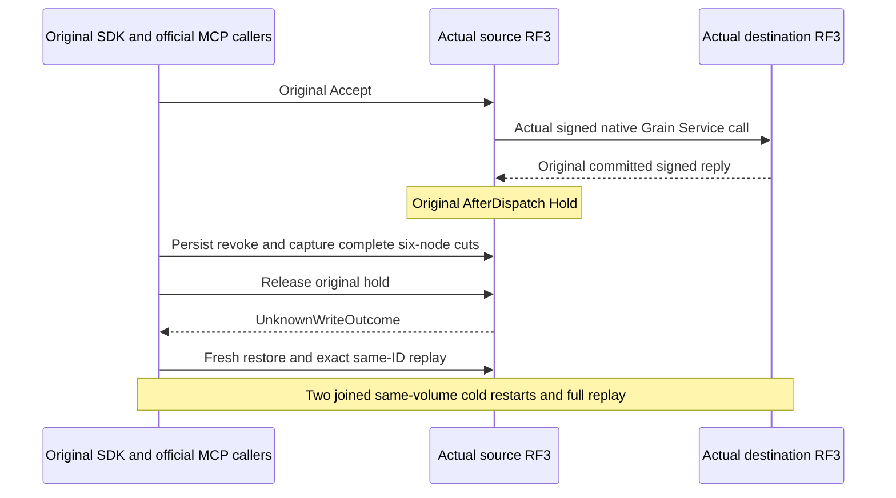

# Genuine native PostAwait transfer successor

REQ-NATIVE-XFER-POSTAWAIT-001 and AC-NATIVE-XFER-POSTAWAIT-001 preserve the original GenuineBCommitThenARevokeReturnsUnknownAndSameIdReconcilesTwoColdOwnersBeforeFreshSdkMcpQ1 case. Root-selected NativeCanonicalModelCutWaveStartup owns the genuine Aspire six-node two-RF3 topology and original technical subject. Messaging owns public administrator, original eight-byte blob/document/moved-parent seed, queue setup and original logical persisted c1-probe credential. No manual origins, storage owners or peer HTTP remain in this successor.

REQ-NATIVE-XFER-POSTAWAIT-002 maps to AC-NATIVE-XFER-POSTAWAIT-002: arm the original signed native client AfterDispatch Hold through authentic RequestStarted claim. Observe actual request and original reply, all six genuine signed discoveries and all six live canonical cuts. Check full target StoredOutcome/receipt/counter, original authority stamps, source absent logical Accept outcome and exact full intent/counter. Revoke QueuePublish using actual persisted administrator operation, require all six full canonical images unchanged, release original operation, observe UnknownWriteOutcome and joined original settlement, restore fresh policy and reconcile original receipt through SDK/official MCP/Q1. No fabricated callback completion or delay proof.

REQ-NATIVE-XFER-POSTAWAIT-003 maps to AC-NATIVE-XFER-POSTAWAIT-003: close real clients before each original Aspire StopForDirectoryReadAsync, prove all eighteen released locks, read all six stopped same-volume native stores and restart unchanged configuration. Fresh signed owners precede each cold; original SDK, official MCP and Q1 replay, literal receipt/token/image checks, actual Complete and healthy independent transfer run through two cold phases. SDK-only success is insufficient. Full selected records remain independent from raw rows and public outputs.

REQ-NATIVE-XFER-POSTAWAIT-004 maps to AC-NATIVE-XFER-POSTAWAIT-004: while the genuine signed original reply is held, send valid nonempty wrong arm/session/command/logical-principal diagnostic requests to each actual node. Require the canonical bounded Validation problem and no signature, then healthy original-scope full cuts and exact unchanged bytes after each category. After the final full cuts, verify genuine settled original owner/session/arm bytes, retire the original3 through their actual owner, require those three real server refusals and healthy signed discovery all6. No later six-cut request fabricates a retired arm. Extra3 retirement and mutated owner controls require their owning fixture seam and remain separately open. Root/Ann own the real route admission and parser; local reader refusal does not substitute for server refusal.

Ordered implementation: native public setup and callers; complete authenticated cut oracles; held operation; original policy restoration/replay; first cold and actual Complete; second cold and original complete outcomes plus healthy transfer; original parent/blob/document replay. All task/client/probe/Aspire cleanup uses original failure aggregation and cancellation/deadlines, retains failure evidence and joins owners before deleting volumes. No new quotas/timeouts/grain/context/role trust, no alternative fixture, no detached producer or skip.

REQ-NATIVE-XFER-POSTAWAIT-005 maps to AC-NATIVE-XFER-POSTAWAIT-005: failure of the actual owner-validated Release write is collected without preventing the original SDK task or callback settlement join. The original Commit owns a linked cancellation source; release cleanup failure cancels that same operation, then always directly awaits its original task and independently observes bounded settlement cleanup. No synthetic failure or completed-task flag substitutes for native owner joins.

REQ-NATIVE-XFER-POSTAWAIT-006 maps to AC-NATIVE-XFER-POSTAWAIT-006: ONLY after the last complete-cut no-effect comparison, an actual public SDK write adds an over8192 document to the existing destination collection. Same-ID SDK/official MCP receipt and exact document replay remain genuine. Destination3 diagnostic reads must return bounded ResourceExhausted/429 without signature, while all6 signed native discoveries remain healthy/current. Original document/blob/upload outputs are independently rechecked before final retirement. This legitimate new write is never compared to the prior image as a no-effect event; budgets are not increased or truncated.

Original UID remains source-mapped to the complete successor only after guarded trial replacement; original source/failures remain immutable history. Private code is uncompiled/unexecuted; Main owns compiler/analyzers/format/discovery and exact-source Linux public RF3 gates. Full live cut8192 capacity refusal remains an honest failure, never truncation or expanded budget. Existing unported nonce/wire variants retain their original open scope.
