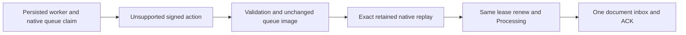

# Native queue delivery action validation

REQ-QUEUE-ACTION-001: Under REQ-MSG-001/002/004 and ADR026/028, only existing Ack, Nack and Renew values may enter the queue delivery transition. An authenticated signed unsupported numeric action with a genuine current lease must return Validation before counters, lease-index removal or any transition staging. No public/generated/persisted schema, authorization, time, retry choice or supported action behavior changes.

AC-QUEUE-ACTION-001: Actual TestDatabase native replica admission and genuine ZoneTree seed a persisted worker, queue, document collection, producer message and signed current lease. Cases -1 and99 under existing None and Full jitter require literal Validation/static safe detail, null JSON/native success, exact full queue-family bytes and no document/inbox effects. Original real retained native failure replays exactly without any whole-store/cut/journal change. Authorized outcome/clock persistence for first refusal remains permitted and distinguished from domain mutation.

REQ-QUEUE-ACTION-002: Unsupported action refusal does not invalidate, acknowledge, retry, dead-letter or release the original current lease. Preserve current persisted permissions and independent token/generation fence checks.

AC-QUEUE-ACTION-002: The same genuine lease subsequently renews and commits one actual document effect plus inbox/ACK atomically through native admission. Original Processing command and fresh command with the same handler fingerprint reuse the exact receipt without a second document revision or ACK. Terminal full queue bytes remain identical during supported replay. Existing Ack/Nack/Renew regressions remain selected; no test changes, skipped gate or fake RPC/result is introduced.

Owning source: Core Features/Messaging/Commands/QueueDeliveryTransition.cs. Regression: Unit Features/Messaging/Cases/QueueInvalidDeliveryActionTests.cs and Helpers/QueueInvalidDeliveryActionTrial.cs. Native unit admission uses actual DurableReplicaLog/ReplicaMaterializer/current generated bytes and ZoneTree; it is not Orleans RF3, network, power-loss or GitHub qualification. Compiler, TUnit unit, recovery and SDK/official MCP Aspire RF3 gates remain OPEN. Private source checks alone are not execution evidence.
