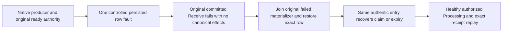

# Exact native ready-index authority

REQ-QUEUE-READY-001: Preserve REQ-MSG-001/002/004/005 and ADR026/028. Every selected ready index must bind the same original ID in decoded metadata/body, the actual Ready state and a positive ReadySequence with byte-exact canonical ready key. Check before counters, expiry, strict-head admission, quota, projection or transition staging. Unknown/stale state or key refuses existing RecoveryRequired/QueueRetryProtocol.StaleDecision; foreign metadata/body identity refuses existing Corruption/MissingReadyBody. No reconstruction, silent drop, new wire/schema or authority.

AC-QUEUE-READY-001: Genuine native replica admission with persisted worker, real producer/current ready message and ZoneTree applies exactly one controlled fault-owned row: Scheduled metadata state, changed ReadySequence, foreign metadata ID, or foreign body ID. Both unexpired and actually due-expired recorded times must fail the real committed original Receive materializer with RecoveryRequired, preserve whole canonical bytes/identity/position and absence of its canonical outcome; repeat the same retained native entry without append or canonical effect. Native owner failure wrapping is distinguished from underlying domain corruption/recovery classification; do not manufacture a persisted failed receipt.

REQ-QUEUE-READY-002: Retain and directly join the failed original materializer before restoring ONLY the exact original fault-owned row. Recover the same authentic committed index, native bytes, command ID and signed authority through existing TestDatabase.RecoverFaultOwnedRow. No second Receive identity to hide its failure.

AC-QUEUE-READY-002: Native recovery must restore original ready row and complete SAME Receive. Unexpired input yields literal original delivery, body and lease then atomic Processing document/inbox/ACK. Expired input yields no delivery and exact Expired metadata/null body/zero quota. Both variants then complete one fresh genuine healthy enqueue/claim/Processing and exact retained original receipt replay without changing full canonical image or native journal cut. Retain original native failure and joined failed-owner error observations as expected evidence, never a synthetic success. Existing queue transitions, failure/receipt semantics and original scopes remain unchanged.

Owned source: Core Messaging Commands/QueueReadyClaims.cs plus Validation/QueueReadyAuthority.cs. Unit Messaging Cases/QueueReadyAuthorityTests.cs and feature-local Helpers/Assertions/Contracts. Real native unit owner is DurableReplicaLog/ReplicaMaterializer/ZoneTree, not an RF3/network/Orleans or SDK qualification claim. Compiler, TUnit, process recovery, Linux and genuine Aspire RF3 SDK/official MCP gates remain OPEN.
