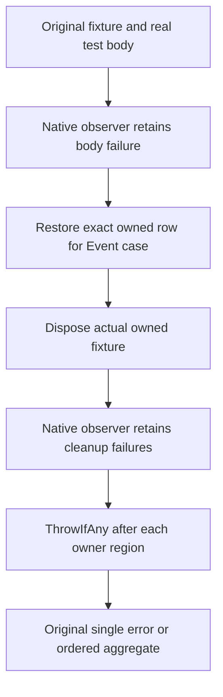

# Native Queue/Event regression owner failures

REQ-PEER-NATIVE-CLEANUP-001: preserve the original body failure and every actual fixture-disposal failure in original order for the genuine queue transition, failed-ready-entry recovery and Event append regressions. AC-PEER-NATIVE-CLEANUP-001: owning test scopes use original ServerFailureObserver aggregation while retaining every native operation, complete image/position assertion and healthy replay; no cleanup exception replaces the body exception.

REQ-PEER-NATIVE-CLEANUP-002: every introduced broad catch rethrows under the repository CA1031 contract. AC-PEER-NATIVE-CLEANUP-002: Event and Queue scopes use existing ObserveAsync/Observe without new catches; original restoration/disposal executes in finally, and ThrowIfAny after each region preserves ordered originals.

Source successor selects immutable queue-native Source4, queue-next Source9 and event-feed-next Source4 first. Tests still own real TestDatabase/native materializer or original Event kernel fixture. This is a narrow test cleanup correction; no product schema, guard, authority or operation result is changed. Compiler, analyzer, TUnit execution, Linux process/RF3 qualification remain OPEN. Source checks cannot inject a fake disposal or establish executed dual-fault proof.

# Event regression cleanup after owning scope

REQ-PEER-NATIVE-CLEANUP-003: actual Event test body, original-row restore and fixture Dispose failures retain every original identity while no exception is raised from finally. AC-PEER-NATIVE-CLEANUP-003: use genuine native ObserveAsync for body, Observe for restoration/disposal and ThrowIfAny after each owning region; existing whole image/position, two Corruption refusals, exact row restoration, same-command replay and healthy append remain unchanged. Compiler/analyzer/native tests remain OPEN; no fake disposal injection or Main edits.

## Canonical source map

The owning helpers are `tests/KeyLoad.UnitTests/Messaging/Helpers/QueueInvalidDeliveryActionTrial.cs`, `tests/KeyLoad.UnitTests/Messaging/Helpers/QueueReadyAuthorityTrial.cs`, and `tests/KeyLoad.UnitTests/EventStreams/Helpers/EventAppendCorruptHeadFlow.cs`. Each remains in its original feature slice and runs the original fixture and native operation assertions. This note owns failure preservation only, without a new runtime or storage authority.

