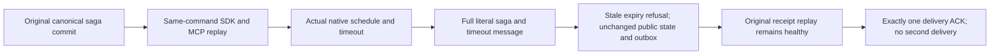

# Native job public publication regression

This is an additive regression for ADR-136 and the existing SagaDueRf3Tests
whole operation. It retains the existing Aspire-owned RF3, actual SDK and
official MCP clients, deadline, due time, native scheduling, ACK and no-second
delivery assertions. It introduces no job endpoint, provider, protocol or retry.

REQ-NATIVE-JOB-PUBLIC-001 / AC-NATIVE-JOB-PUBLIC-001: validate all public creation
receipt fields, literal mutation kind/resource/id/revision, actual RF3 token
identity/positive position and durability. Replay the same original command on
SDK and MCP before native timeout and after it, and after ACK. Public JSON omits
native CompositionReferences: decoded default arrays are not private-field proof.

REQ-NATIVE-JOB-PUBLIC-002 / AC-NATIVE-JOB-PUBLIC-002: independently compare every
public projected SagaInspection and timeout MessageInspection field. A stale
ExpireSaga command after the actual native timeout must be refused on both
interfaces. Complete public saga/message and administrator outbox status stay
unchanged across refusal and original-success replay. Rejected outcomes may be
persisted internally; this does not claim raw-store byte or commit-position
invariance. All comparisons of full private-bearing DTOs are Boolean-only.

Both criteria map to the unchanged method declaration
SagaDueRf3Tests.AcDue003WaitingSagaTimesOutAutonomouslyAndLeavesNoSecondDelivery.
Native ProcessDueAsync schedules through ILocalDurableJobManager and the native
IDurableJobHandler executes the timeout. Source routing alone is not evidence of
actual runtime delivery; the whole real case must run.

REQ-NATIVE-JOB-RECOVERY-001 / AC-NATIVE-JOB-RECOVERY-001 retains the separate
NativeSagaTimeoutRestartTests.NativeRuntimeRestartReclaimsRetainedJobAndCommitsOneStableTimeout
gate. It observes a genuine retained native job, same journal identity, changed
native owner/ETag and canonical owner generation before one stable timeout.
Its preopened fixture is not the [production constructor test](../ClusterRouting/NativeRuntimeConstructorCycle.md),
physical cold-publication proof or Docker RF3 qualification. Public terminal state
alone is not claimed to identify the original retained native scheduled job.

Compiler, native Unit/recovery, complete Aspire RF3 and exact-source Linux gates
remain OPEN. No performance, power-loss or production-ready claim follows.

