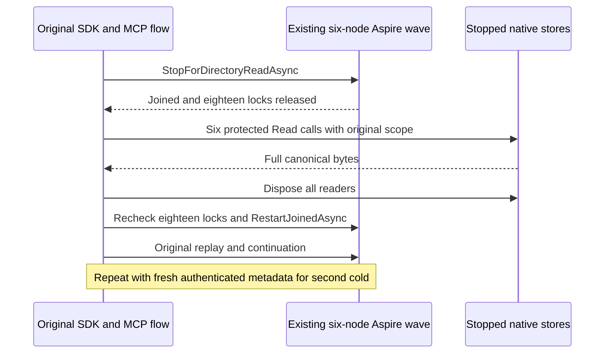

# Native transfer stopped-owner cuts

This Messaging supplement implements the existing two-cold transfer acceptance under REQ-MSG-001/004 and AC-MSG-001/004. It replaces the manual-owner cold reader in the native successor; original cases and their complete SDK/official MCP replay, receipt, effect and healthy-continuation assertions remain required. Root owns their integration and live held-cut transport.

REQ-NATIVE-XFER-COLD-001: read the original six same-volume canonical stores only after TwoRf3MembershipWave.StopForDirectoryReadAsync joins the Aspire application and proves all eighteen ownership locks released. Use NativeCanonicalModelCutReader inside each actual ZoneTreeStore.Read, retaining full source/destination family rows and full nullable outcome/receipt/intent/counter bytes. Use actual retained signed discovery supplied by the owning caller, not inferred addresses or synthetic generations.

REQ-NATIVE-XFER-COLD-002: close each actual reader, recheck all eighteen locks and restart through the existing RestartJoinedAsync, preserving original configuration, ports, volumes, cancellation and failure aggregation. Capture failures retain roots and cannot restart unjoined readers. The existing ZoneTreeStore constructor reopens/replays its verified journal; no filesystem-readonly opening API exists. This helper invokes only Read and Dispose, never Apply, Commit or identity mutation.

AC-NATIVE-XFER-COLD-001 maps to the existing complete PostAwait/original-nonce/wire-fault successor cases: invoke CaptureAndRestartAsync twice with independently captured authenticated pre-stop node metadata and run original SDK/official MCP receipt replay and healthy continuation between/after the real restarts. Every six-node witness includes complete raw rows plus six separate selected byte oracles. Oversized complete evidence refuses under the unchanged 8192-byte diagnostic envelope; truncation/digest substitution is forbidden. Deeper original images remain independent requirements.

AC-NATIVE-XFER-COLD-002 maps to error paths in those same cases: canceled reading, corrupt native opening, over-budget evidence, reader disposal failure or lock failure preserves initiating and cleanup exceptions, retains roots and prevents restart. Discovery authentication belongs to the existing native signed reader before stopping; this helper validates the closed six-node metadata inventory and its canonical addresses, but does not authenticate a caller-supplied replacement.

Private source-only scope. Compiler, format, native discovery, execution, public RF3 and Linux acceptance are pending the Main-owned lane. This helper does not close the independent live held-cut gate or prove power-loss durability. No prior failure or original case is removed.

## Strict original stopped-store authority

REQ-NATIVE-XFER-COLD-003 / AC-NATIVE-XFER-COLD-003: before each original Stop, capture six actual NodeStatus results through the existing persisted-admin .NET SDK caller and its original request/cleanup owner. NodeAdministration.StatusAsync issues NodeId from the live canonical Store.Identity.NodeId.ToString(), not configured voter/SiloName or directory metadata. Require exact canonical nonempty Guid store NodeIds, all six distinct, and exact status.Incarnation equality with that node's retained authenticated native discovery. Retain these original values privately per actual Aspire resource; no serialized field, caller role, new signing API or read-back identity oracle. Capture fresh original IDs independently before each of the existing two cold cuts.

After original Aspire application/18 locks join, use the SAME real ZoneTreeExistingStore.Open with expectedNodeId from the retained pre-stop result and options.Incarnation from authenticated retained discovery, under unchanged centrally validated native storage bounds. A narrowly scoped owning same-repo IntegrationTests friendship exposes only the existing internal test/native support; no public provider, fallback or new opener. Missing owner/identity/journal/tree/provider metadata cannot be created. Wrong original NodeId/incarnation refuses TokenInvalidated before journal/tree recovery, exact typed corruption/format failures remain, and original failures retain roots and prevent restart. PhysicalShardId, configured voter/SiloName and canonical store Guid NodeId remain separate.

Whole-flow mapping keeps unchanged RemoteTransferPostAwaitNativeTests, RemoteTransferOriginalNonceTests and RemoteTransferNativeWireTests (original methods/Args/UID declarations) and their complete source/target rows, receipt/outcome, replay/no-effects, two joined cold and healthy SDK/official MCP continuations. Native guard support reuses existing AcSg009001CapturedNodeOrIncarnationMismatchDoesNotChangeIdentity(bool), missing-original file/directory/tree/provider metadata cases, corrupt-original identity and original owner/repair/reopen process cases; these source mappings are not newly executed evidence and do not replace six-owner RF3. No new duplicate Unit cases or W27 StoredOutcome inspector. Compiler/runtime/discovery/public/Linux gates remain OPEN.
