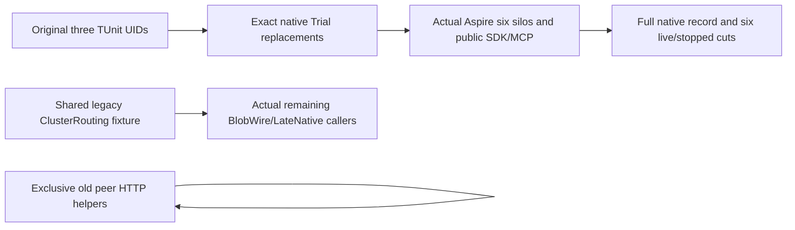
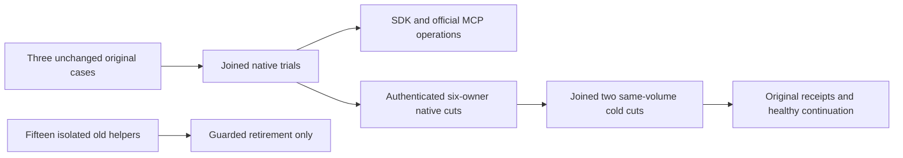

# Native Messaging peer-helper retirement

REQ-NATIVE-XFER-RETIRE-001 maps to AC-NATIVE-XFER-RETIRE-001: after selecting the three source-complete native OriginalNonce, WireFault and PostAwait Trial replacements, remove only the exact exclusive legacy peer-HTTP/manual-owner helper closure established by fresh untruncated Roslynk references. Every incoming reference must be inside that removed closure or an exact replaced original Trial declaration. Preserve all three original TUnit case declarations/UIDs and every substantive public SDK/official MCP/Q1, full-cut, nonce/MAC/error, persisted-authority, two-cold, healthy-continuation and joined-cleanup oracle in their genuine native successors.

REQ-NATIVE-XFER-RETIRE-002 maps to AC-NATIVE-XFER-RETIRE-002: retain the full RemoteTransferPostAwaitNativeCut outcome/receipt/counter/original receipt record and its exact RequireAsync oracle because selected native callers still use them. Remove only its now-exclusive manual active-owner Read/ReadSource and unused constant/imports; real full cuts come from the owning native six-node reader and stopped same-volume lifecycle, never live manual stores.

REQ-NATIVE-XFER-RETIRE-003 maps to AC-NATIVE-XFER-RETIRE-003: do not delete shared ClusterRouting or Controlled Unit fixtures with real external callers. Record current actual blockers separately from the conditional zero-incoming Messaging closure. This private source retirement is not runtime qualification or repository-wide manual-network retirement.

The selected native packets retain original failure and source receipts; this removal does not rewrite historical runtime evidence. Compiler, native RPC and RF3 gates remain OPEN until the actual Main-owned qualification lane runs.

## Current joined-source successor (2026-10-12)

The three original Cases now reference authentic native Trial implementations on Main. Snapshot cd5801f257184419b1c51944835cbd02 proves every reference to the fifteen retired helper types and two manual cut readers is inside the same removed closure. No surviving native/public caller needs a reference rewrite. Do not replay any selected producer/consumer ancestor.

REQ-NATIVE-XFER-RETIRE-004 maps to AC-NATIVE-XFER-RETIRE-004: preserve independently observed native outcomes, complete outcome/receipt/capacity bytes and original CommitReceipt in the retained record. RequireAsync remains byte-exact. Native cut lifecycle authenticates all six owners, joins original callers and owners before stopped same-volume capture/restart, requires exact cuts, unchanged incarnation/voter identities and changed actual SiloAddress after cold. Both original cold cuts, fresh persisted authority, SDK/official MCP/Q1 replay, healthy continuation and genuine arm retirement remain in unchanged native consumers.

Focused operation selections remain the three exact methods in the delivery map. No declaration, Args, native UID or substantive assertion is removed. Source/reference proof is not build, TUnit or Linux RF3 PASS. Integrated compiler and public fault/auth/no-effect/cleanup runtime gates remain open. Immutable historical reports and withdrawn attempts remain untouched.
