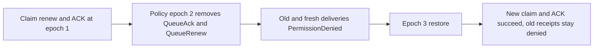

# queue delivery receipts and current persisted policy

This scope maps REQ-MSG-001/004/005 and AC-MSG-001/004/005, ADR-026 and the current CommandOutcomes policy fence. The existing renew/reclaim flow proves foreign and stale delivery fences; this separate genuine replicated-cluster flow proves current persisted authority for retained delivery receipts. It does not modify product transitions or classify lease expiry from permission refusal.

REQ-QUEUE-POLICY-001: persist the actual epoch-1 worker and credential, claim the literal message, renew and ACK through existing SDK, official MCP and shared SQL routes, retaining full original receipts. An actual epoch-2 policy update removes QueueAck and QueueRenew while preserving inspect/consume. Old successful Renew/ACK identities and fresh delivery identities must return PermissionDenied before lease-state access. Capture the complete stopped canonical and journal state of every replica copy after the real policy commit and denials. Cold repetition of those exact commands under epoch 2 preserves all rows except explicitly proven apply and exact retained delivery append identities; snapshot-covered proof cannot substitute for retained original journals.

AC-QUEUE-POLICY-001 maps to REQ-QUEUE-POLICY-001: the original public callers must return exact refusal without exposing success or reviving acknowledged messages. Compare full literal acknowledged-body absence, queue counters, future queued sibling, complete receipts and every replica copy image. Scope/principal/credential, authorized read cuts and exact command bodies remain genuine. No fake response, clock, role, retry, provider, allowlist or default change is allowed.

REQ-QUEUE-POLICY-002: restore the same persisted worker with the actual returned epoch-3 principal. Epoch-1 successful receipts remain PermissionDenied because their authority epoch differs; restoration does not turn old receipts into current success. New genuine epoch-3 claim/ACK work must succeed, and its exact successful receipts must survive a second cold phase under unchanged epoch-3 authority.

AC-QUEUE-POLICY-002 maps to REQ-QUEUE-POLICY-002: retain the original acknowledged state and queued future sibling across policy changes and cold phases, prove new literal healthy delivery and complete receipt replay, and preserve all canonical/journal cuts except explicit verified append/apply identities. Join every caller before stopping, check every owned file lock, retain the original ordered body/shutdown failure ledger. New feature-local Cases, Helpers and Assertions under IntegrationTests/Features/Messaging own the test; shared original renew/reclaim helpers and the independent changed-body Receive/ACK unit case remain unchanged.

