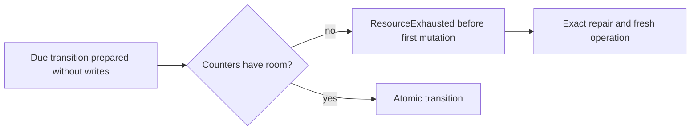

# Recorded queue deadline capacity

deadline advancement and receive sweeps validate their original message body, current due authority, counters, ordering and recorded retry decision before consuming a due reference. A due transition prepares all branch-specific effects without writes. State-version exhaustion and an actually required ready or parked sequence increment return ResourceExhausted before the first transition mutation. Native typed refusal persistence remains distinct from domain effects; the original failed identity keeps its exact result after fixture-only repair. Existing persisted formats, authorization, logged evaluation time and replica apply are unchanged.

Expiry retains priority over retry and dead-letter admission. A full dead-letter grant may move exhausted work to PendingDeadLetter without consuming a parked sequence; an expired exhausted lease releases storage without requesting dead-letter capacity. Those branches remain valid when NextParkedSequence is maximal. Free-capacity dead-letter admission must refuse the same exhausted sequence before consuming the original lease.

QueueDeadlineCapacityWholeFlowTests uses original native ZoneTree owners and real normalized/prepared operations. Source cases cover scheduled/lease/message expiry state ceilings, ready-sequence ceilings, original signed jitter decisions and direct/sweep due dead-letter capacity. Each seed has an independent full preapply receipt and, where leased, a complete original signed claim. Literal metadata, body, counters and every queue reference prefix are bounded and complete. The first typed refusal advances only its native outcome/exact scoped-locator/clock transaction, retaining all other bytes and identity; Apply and Resolve are each bracketed by immutable snapshots. Original roots reopen cold, repeat the refusal, repair only the exact injected row and preserve the old failed identity. A distinct fresh operation executes the original work once. Full receipts/claims and fresh healthy enqueue/receive/ACK are retained through a second same-root cold. Consumed nonempty receives refuse as StaleLease while their original full stored outcomes remain unchanged; empty receives retain their original exact result.

This is direct native Core/ZoneTree correctness and recovery evidence when executed. It does not claim actual scheduler-service catch execution, Docker cluster/public SDK interoperability, host clock synchronization or Linux performance/endurance qualification. The scheduler, physical clock, process recovery and cluster qualification gates remain independently required.

