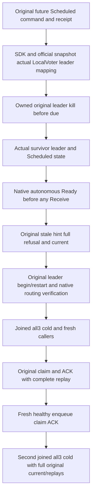

# Messaging — original queue deadline owner leader loss

REQ/AC-DUE-002/003/004 and REQ/AC-MSG-004/092 require queue-specific leader recovery; recurring/saga proof cannot substitute this operation. This source draft uses the existing selected subject ClusterFixture and exact native fault primitives. No new profile, scheduler, clock, timeout, provider, public/test hook or permission is introduced.

| Requirement | Acceptance |
|---|---|
| REQ-QUEUE-LEADER-001 | AC-QUEUE-LEADER-001: original independently authored future Scheduled row has exact body/headers/full metadata and full enqueue receipt. SDK statuses and official AdminNodeSnapshot.LocalVoter establish one actual current owned leader; map it to the resource from which that authenticated snapshot was read, never an assumed URI. Immediately before/after actual owned kill and after replacement leadership verification, original NotBefore must still be future; survivor full Scheduled inspection is required. A missed timing precondition fails, without increasing the original lead. |
| REQ-QUEUE-LEADER-002 | AC-QUEUE-LEADER-002: two actual survivors report the same different configured voter as leader. Native scheduler must autonomously reach complete literal Ready/version2/sequence1 before ANY Receive; exact original stale condition then refuses through SDK/MCP with immediate full public controls. Original seed full receipts cannot execute promotion again. No specific private attempt count/order is inferred. |
| REQ-QUEUE-LEADER-003 | AC-QUEUE-LEADER-003: original leader rejoins through owned begin/restart and authenticated routing reader. Then original all3 cold, fresh SDK/MCP callers, independently checked claim/ACK state and full original outcomes, healthy same-lane enqueue/ACK, and second joined all3 cold retain complete rows and original seed/ACK replays. Every individual SDK/MCP success/refusal/replay is followed full messages/resource summary/placement/outbox. |

Canonical map: new Messaging Cases/QueueDeadlineLeaderRf3Tests.OriginalSelectedQueueDeadlineSurvivesObservedLeaderLossRejoinAndTwoColdOwnersWithHealthyWork → Helpers Flow/Preparation/Ownership/Continuation/Actions/Delivery, Models State/Observation, Assertions Expected/Current, Contracts Protocol. One new no-Args declaration; original tests are untouched. Frontend/SQL/benchmark N/A for this existing SDK/official-MCP acceptance.

This code is authored SOURCE_N. Official snapshots use the native bodyless invocation and named AdminDashboardProtocol.SnapshotTool; stale conditions assert the exact native RevisionConflict detail. Fresh native type absence/check-only creation, compilation and runtime qualification remain pending; no admitted or executed whole flow is claimed. Actual public metadata/ready sequence and caller-owned enqueue/ACK receipts are checked fully; they do not expose raw queue counters or the automatic scheduler-generated GUID/receipt. Those strict private portions remain OPEN until an existing authenticated owner API proves them. No raw counter or automatic receipt is invented. Leadership timing, runtime/Linux RF3, power loss/endurance remain OPEN. Local prerequisite waits use the same original TimeProvider only; native logged evaluation time and state/deadline CAS authorize every effect.
