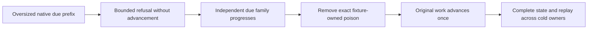

# KL-092 bounded queue deadline prefix refusal

REQ-MSG-092-DEADLINE / AC-MSG-092-DEADLINE and KL-092 require native QS/QL discovery to remain bounded and fair. An oversized readable native key refuses its selected prefix with the original Corruption/KeyExceedsBound failure. It cannot become an invented after-key or a retained oversized cursor.

QueueDeadlineCursor.DeferNext matches the current store incarnation/read generation and advances the family while preserving every valid fixed-upper and after-key bound. The silo-local cycle reports PrefixRejected and revisits the unchanged selected family on the next bounded sweep. Its other families may progress through the original separately authorized connection execution. The poison input is never deleted, acknowledged or advanced by this path. No persistent/public contract changes.

QueueDeadlinePoisonPrefixWholeFlowTests uses actual ZoneTree scheduled and leased inputs and business expiry. Both selected poisoned families refuse with unchanged full store image, position and identity; unrelated due work advances with an independently constructed complete receipt token. Poison remains readable and the original pending message unchanged through an actual cold owner. Only fixture-owned exact deletion repairs the injected key. The retained original work then advances once, with complete receipt replay/resolve and two cold images, literal body/metadata/counters/ready and empty deadline indexes followed by real healthy Receive/ACK with independently predicted complete claims/tokens/receipts and literal bytes after every mutation. A final third same-root cold replays seed, advancement and ACK outcomes, retains complete terminal images, and never replays a consumed Receive as successful. Named native fixture constants and Allman blocks preserve the required bounded code structure. Production time, page limits, service cadence, authorization and shutdown contracts remain unchanged.

Source review found no independently specified physical-drift readiness threshold beyond the existing committed-clock monotonic lower-bound refusal. This remains a contract review and RF3 physical-clock qualification gap; transport signature skew is a different boundary. Current native Aspire cold restart begins every killed resource before awaiting healthy quorum and joins original ownership receipts. Historical sequential restart evidence is retained as history.

This source packet does not qualify Linux RF3 identical follower decisions, physical drift/readiness, measured lateness, endurance or power-loss durability. Original autonomous/leader/renewal/process and joined lifecycle flows remain required against the coherent compiled source.

