# Queue dispatch control within Messaging

TASK-KL092-QUEUE-DISPATCH-CAS-001. Requirements-first owning repair for the confirmed inherited QueueDeadlineRf3Pause prerequisite incompatibility; source preparation only, no compilation or runtime acceptance inferred.

The current helper replaces the complete resource with a new default WorkQueue definition and Paused=true, without ExpectedSchemaVersion. Actual ExecuteConfigureResource first calls ResourcePolicyUpdates.Validate; changed existing metadata without CAS is UnsupportedCapability, and the policy-only CAS deliberately keeps Paused immutable. Adding CAS alone or dropping Paused from the policy comparer would violate the original contract. Original failed-source evidence stays retained and is not attributed to a historical runtime without its original outcome.

## Scope and contracts

Actual native inventory confirms existing SetDispatch is global, without resource/version, and ConfigureResource is policy-only. Add one explicit typed queue dispatch-state CAS through current metadata authority and ordered RF3 apply. The existing ConfigureResource policy-only path remains policy-only; no structural migration, policy bypass, second store, parallel dispatcher, client-owned role or storage-format fallback is permitted. Native API inventory and exact serialization/route ownership must be frozen before selecting that source join; a candidate is not integration or acceptance.

REQ-QUEUE-DISPATCH-001 / AC-QUEUE-DISPATCH-001: a currently authorized persisted cluster administrator reads the scoped resource metadata summary through the real public API and submits the explicit dispatch operation with original command identity and expected current SchemaVersion. Ordered canonical apply requires that exact version, changes only Paused plus the next SchemaVersion, and preserves Name, Kind, TransactionDomainId, every field/header policy, queue policy, quota, indexes, vector/relational schema and every other stored property. No caller default can replace the persisted definition. The original successful full typed result identifies the dispatch effect; genuine queue seed/ACK receipts retain their distinct effects. No speculative local counter is used.

REQ-QUEUE-DISPATCH-002 / AC-QUEUE-DISPATCH-002: real missing-resource, wrong-kind, stale-version, version-overflow, invalid-input, unauthorized-subject and changed-content-same-command operations must fail through their owning typed contracts, immediately followed by complete current metadata, message bodies/metadata, counters and original receipt observations. A selected failed operation cannot partially change Paused, version, data, policies, indexes, outbox or placement. No generic exception substitutes the actual refusal.

REQ-QUEUE-DISPATCH-003 / AC-QUEUE-DISPATCH-003: each accepted state-changing operation advances exactly one schema version. Exact original command replay returns its original full result with fresh persisted authorization and never restores a prior dispatch state over a later pause/resume. Independent stale original version cannot overwrite the successor. Request identity, metadata incarnation, command fingerprint and authority remain the common native contract; no special test deduplication log is introduced.

REQ-QUEUE-DISPATCH-004 / AC-QUEUE-DISPATCH-004: genuine public SDK and official MCP operations, including the current SQL operation envelope where supported, observe canonical persisted Paused after RF3 acknowledgment. The original direct AdvanceQueueDeadline not-due, stale and paused refusals remain complete; paused dispatch retains exact scheduled payload/header/state/version/deadline/index/counters. Current operation authorization and read cuts are reloaded after metadata commit; RAM and Orleans caches are disposable acceleration only.

REQ-QUEUE-DISPATCH-005 / AC-QUEUE-DISPATCH-005: resume retains the initial persisted definition and current authority, and the real selected native Orleans due coordinator autonomously promotes the original due message to Ready before any Receive. Persisted principal revocation still refuses, a strictly higher actual policy-epoch repair enables only the original intended grants, and fresh work proceeds. Original due instants, clock, deadlines, native Case/Args/UID, fault profile, resource caps and every original error/cleanup assertion remain unchanged.

REQ-QUEUE-DISPATCH-006 / AC-QUEUE-DISPATCH-006: full metadata, command receipts, original messages and state fences survive two genuine same-volume all-three cold cycles owned by the existing Aspire fixture. All original callers/tasks settle before resource stops, fresh real SDK/MCP sessions reconnect after actual readiness, and each initiating/cleanup failure remains retained. Native storage reopen/process recovery is distinct from power-loss durability. Only exact-source Linux original build, TUnit/RF3/recovery and source-bound coverage can qualify delivery.

## Canonical source and test ownership

Messaging owns dispatch-state request/effect contracts and domain validation/apply helpers; existing cross-feature OperationKind, authorization, metadata commit, SDK/MCP/schema inventories and registration have one Main integration owner. Authorization ResourcePolicyUpdates, its structural comparator and current policy-update rejection flows remain unchanged. Tests belong in Messaging Cases/Helpers/Assertions/Models and exercise real ZoneTree and the real public RF3 clients; the original QueueDeadlineRf3Pause helper uses the chosen API with a fresh metadata summary and current version instead of default replacement. Docs belong to Messaging; frontend is N/A because the existing SDK/MCP operation is the owned public boundary. SQL syntax is N/A: the coordinator owns the current shared parser/operation-envelope integration.

Required ADR is an additive native queue dispatch CAS decision if the actual API inventory is absent. Existing ADR-028/093/094/117/125 retain atomic queue state, policy-only replacement, due execution, native TUnit/Aspire lifecycle and connection-owned signed operation authority. No ADR is marked implemented while compilation and real public qualification remain open.

```mermaid
flowchart LR
    Read[Fresh scoped queue metadata version] --> Authority[Current server authenticated metadata authority]
    Authority --> CAS[Expected schema version]
    CAS --> Dispatch[Only pause state and next version]
    Dispatch --> Commit[Existing ordered RF3 metadata commit and receipt]
    Commit --> Paused[Original due attempt refuses and full state remains]
    Paused --> Resume[Explicit current version resume]
    Resume --> Ready[Native service Ready before Receive]
    Ready --> Cold[Joined callers and two owned cold cycles]
```

## Execution and evidence

First consume the exact current native API inventory and complete resource contracts. Freeze the actual existing API or typed additive route and serialization aliases/IDs, authority/version/result semantics and owning apply join. Author one coherent production/helper/regression batch, self-review the whole source and preserve all unrelated writers. Main alone executes existing-hunk native previews and new-path absence/creation boundary, integrates, runs current semantic diagnostics, canonical formatter, coherent solution build and mapped whole-operation native TUnit suites. Keep ordinary functional parallelism50 and genuine exclusive shared RF3 ownership. Then qualify real process recovery, SDK/MCP RF3, original failure-to-healthy flows and changed-source coverage. Record source preparation, native boundary, compiler, local focused, Linux, coverage and complete KL092 acceptance separately. All are OPEN here; no UID, count, percentage or speed claim is derived from a prepared source packet.

Frozen implementation: OperationKind.SetQueueDispatch=50 (append-only); QueueDispatchControlRequest generated alias keyload.messaging.queue-dispatch-control-request.v1, required JSON fields and Orleans IDs0..4 TenantId/DatabaseId/Queue/ExpectedSchemaVersion/Paused; positive expected version; /v1/admin/queues/dispatch; keyload_queue_dispatch_control; ResourceDefinition result. Common current cluster administrator and global metadata outcome scope match ConfigureResource. Official MCP effect hints readOnly=false, idempotent=true, destructive=true. Full stored-definition preservation is directly exercised by real ZoneTree unit bytes and independently constructed complete public command result; AdminResources exposes a summary and does not prove hidden policies by itself. Both policy-only pause rejection and global dispatch behavior stay distinct.

Automated mappings: AC001–003 QueueDispatchCasWholeFlowTests; AC002 required HTTP JSON-field presence and native overflow/refusal cases; AC004/006 QueueDispatchCasRf3Tests SDK/official HeaderCommand typed results, full existing4-route queue observations/counters/items, old accepted/failed replay before/after exactly2Aspire RF3cold cuts and healthyReceive/Ack. AC005 original QueueDeadlineAutonomousRf3Tests keeps its original due service flow and invokes the repaired QueueDeadlineRf3Pause. Real process recovery remains the required separately executed recovery gate, never inferred from unit store reopens or RF3 cold tests.

The dispatch command returns the complete ResourceDefinition using the existing metadata result contract; it does not introduce or promise a public dispatch CommitReceipt. Original queue seed/ACK CommitReceipt checks remain distinct from dispatch results. Internal ordered metadata outcomes and RF3 acknowledgement barriers require their actual common native/runtime evidence; no public dispatch cut or private counter is fabricated.
