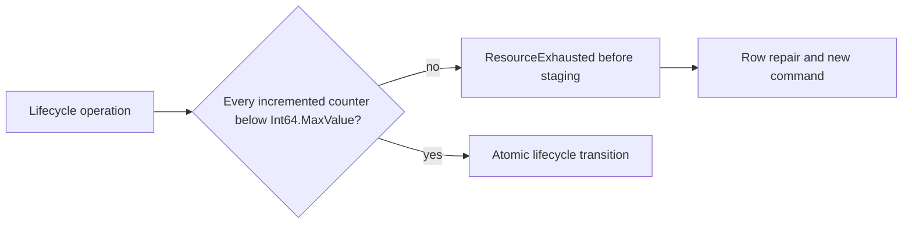

# Queue lifecycle finite increment capacity

## Requirements and acceptance

REQ-MSG-001/004/005 and AC-MSG-RETRY-ORDER/JITTER/PARK/REDRIVE/CANCEL require the versioned queue state machine, exact retained payloads, retry bounds, independent lane order and canonical terminal outcomes. This contract adds no public operation, persisted field, serializer alias, index family, migration or scheduling authority. Existing StrictPerKey null/empty-key refusal, Block head retention and Continue new-head redrive contracts remain unchanged.

A lifecycle operation that would increment a valid retained state version, delivery generation, lease version, ready sequence, order sequence or parked sequence beyond Int64.MaxValue refuses with ResourceExhausted before its first staged mutation. Existing permission, scope, stale lease, expected version, state, expiry, body/reference/order and quota checks retain their applicable precedence. The failure commits only its genuine immutable failed command outcome, its exact scoped outcome locator and accepted clock; no payload, metadata, usage, order or lifecycle index effect commits. Replay of that same command ID remains the original failure after fixture row repair. A separately authorized new command can then progress normally.

Only a counter actually incremented by that branch is capacity checked. Scheduled redrive does not consume ready sequence. Block redrive retains its active order position and next-order counter. Full-DLQ exhausted NACK retains the payload in PendingDeadLetter without consuming a parked sequence; its state version still advances. Existing bounded quota checks already prove admitted DLQ message/byte additions fit their configured limits.

## Implementation boundary

Feature-local ephemeral preparation records separate current reference/order/accounting validation from mutation within the same ordered transaction. They are not persistence or caller trust contracts. Redrive, cancel, explicit pending admission and exhausted NACK use the prepared context before deleting any existing reference. due/deadline owners consume the same private preparation roles through their separately reviewed exact caller joins; this document does not claim their runtime acceptance.

The ordered reference fixture observes the actual partition and next store position after existing NormalizeOperation/PrepareQueueRetryOperation and before unchanged DatabaseEngine.Apply. It cannot replace execution or supply a result. Receipt expectations use the original preapply cut on command replay.

## Whole-operation regression map

QueueLifecycleIncrementCapacityWholeFlowTests has ten genuine redrive/cancel/pending-admission ceiling variants. QueueExhaustedNackCapacityWholeFlowTests adds a real already-leased exhausted NACK with free DLQ capacity and maximum parked sequence. Each reuses original fixture operations, retains original successes/failures, verifies both absent failed payload channels, warm repeated refusal, exact raw-row repair, immutable original failure after repair, two same-root cold opens and healthy progression. Complete original receipts include independently captured CommitToken, command ID, literal mutations and ProcessDurable. Receive results include request ID, full delivery payload/header fields and signed claims.

QueueLifecycleNonIncrementWholeFlowTests contains three positive controls for the unused maximum counters above, including cold persistence of the unchanged maximum before exact fixture-scalar restoration. final message metadata, bodies, usage and all live/order indices are verified; replay is bracketed by full store bytes, cut and identity. No consumed receive claim is asserted successful.

Existing QueueOrderedRetryWholeTests, QueueRetryDeadLetterColdWholeFlowTests, QueueRetryLeaseRaceWholeTests and lifecycle authority fixtures retain their original successful/negative/reference scenarios. QueueOrderedRetryProcessRecoveryTests and QueueLifecycleProcessRecoveryTests retain actual child-process cuts. QueueOrderedRetryPublicClusterTests, QueueLifecyclePublicClusterTests and QueueParkedPolicyClusterTests retain actual SDK/official-MCP/SQL caller coverage. These existing cases must be discovered and executed against the final joined image; new unit fixture counter injection is not cluster or process-recovery evidence.

## Qualification boundary

No performance claim follows from this repair. Repeated strict-head reads remain a bounded profiling hypothesis under the actual ready examination cap; no cache, alternate read budget or optimization is introduced.

