# Current queue profile change through public callers

This acceptance flow extends REQ-MSG-001/004/005 and the existing strict-order delivery contract. It changes no product policy, schema, clock, quota or endpoint. queue profile CAS requires bounded complete body absence; retained terminal metadata is allowed. The public flow independently verifies complete exposed state, not raw storage or lane counters.

## Requirements and acceptance

- **REQ-MSG-PROFILE-PUBLIC-001 / AC-MSG-PROFILE-PUBLIC-001:** Original StrictPerKey/Block resource retains a future Scheduled keyed head and a same-key Ready sibling. A schema1→2 change to CompetingConsumers/Continue must return Conflict through SDK and official MCP; the complete metadata/body/headers, missing witness, resource summaries, original partition and outbox remain unchanged after EACH response. A fresh empty Receive cannot lease the sibling while the original strict head remains scheduled.
- **REQ-MSG-PROFILE-PUBLIC-002 / AC-MSG-PROFILE-PUBLIC-002:** Actual authorized Cancel(head) and ACK(sibling) settle both bodies with complete original receipts. The old failed CAS GUID must still return its original Conflict after absence; a NEW GUID with the identical valid CAS request succeeds. No failed effect is retried into success. Full current ResourceDefinition is verified by a fresh identical ConfigureResource command; that real write owns its GUID/result/replays and a subsequent declared baseline.
- **REQ-MSG-PROFILE-PUBLIC-003 / AC-MSG-PROFILE-PUBLIC-003:** Fresh Scheduled head retains its original caller-selected NotBefore and complete body under CompetingConsumers/Continue; fresh same-key ready sibling is eligible. Original Cancel and ACK settle them. Each SDK/MCP receipt replay is immediately bracketed by complete current public predicates. All callers join/dispose before EACH of two genuine all-three same-volume Aspire cold cycles; fresh owned callers preserve full original receipts, current schema2 definition and literal terminal states afterward.

```mermaid
flowchart LR
    A[Strict Block scheduled head and ready sibling] --> B[Nonempty CAS Conflict and empty receive]
    B --> C[Cancel head then claim and ACK sibling]
    C --> D[Old CAS still Conflict then fresh valid CAS]
    D --> E[Competing Continue scheduled head and eligible sibling]
    E --> F[Cancel and ACK full original receipts]
    F --> G[Joined all three cold then fresh callers]
    G --> H[Second joined all three cold and retained public predicates]
```

## Test

`NonemptyProfileRefusalThenEmptyCasChangesOnlyFreshKeyedDeliveryAcrossTwoColdOwners` (QueueParkedPolicyClusterTests, no arguments) adds the missing SDK/MCP current profile CAS whole flow; the existing static Continue/Block cases and the unit empty-profile case are unchanged.

## boundary and limits

ResourcePolicyUpdates permits only declared ordering/parked/jitter policy differences under exact schema CAS. RequireQueueDeliveryPolicyChange and RequireQueuePolicyBodyAbsence refuse every matching retained body using existing bounded scans; this flow does not bypass them. MaxAttempts, quotas and retry values remain unchanged. The original one-hour future horizon is borrowed from QueueScheduledCancelPublicFlow and is request data, not a test timeout or worker authority; no wait/sleep or fake clock is added. Successful empty resource CAS itself proves admission ran; public null payload terminal state does not independently prove raw body absence. Receive replay is successful only while its original lease is current; completed lease history is not replayed as live.

Full fresh resource verification is a genuine idempotent configuration WRITE, not a read-only snapshot or old creation reply. Each verification retains its own immutable GUID/result and replays before declaring a baseline.
