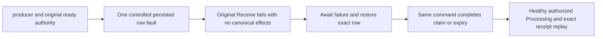

# Exact ready-index authority

REQ-QUEUE-READY-001: Preserve REQ-MSG-001/002/004/005 and ADR026/028. Every selected ready index must bind the same original ID in decoded metadata/body, the actual Ready state and a positive ReadySequence with byte-exact canonical ready key. Check before counters, expiry, strict-head admission, quota, projection or transition staging. Unknown/stale state or key refuses existing RecoveryRequired/QueueRetryProtocol.StaleDecision; foreign metadata/body identity refuses existing Corruption/MissingReadyBody. No reconstruction, silent drop, new wire/schema or authority.

AC-QUEUE-READY-001: A real node-local ZoneTree owner with a persisted worker and produced ready message receives one controlled fault-owned row: Scheduled metadata state, changed ReadySequence, foreign metadata ID, or foreign body ID. Both unexpired and due-expired business times must fail the original Receive with the exact corruption or recovery classification. Repeating the same command preserves its original bytes, the whole canonical image, storage position and applied cut, with no persisted outcome or staged effects.

REQ-QUEUE-READY-002: Await each synchronous atomic failure before restoring only the exact original fault-owned row. Apply the same command ID and original business input after repair. A refused atomic operation has no committed command index to recover, and row repair cannot advance the canonical applied cut.

AC-QUEUE-READY-002: Repair restores the original ready row and completes the same Receive. Unexpired input yields the original delivery, body and lease followed by atomic Processing document/inbox/ACK. Expired input yields no delivery, Expired metadata, null body and zero quota. Both variants complete a fresh authorized healthy enqueue/claim/Processing. Replay preserves exact stored outcomes and canonical bytes; a consumed original lease is stale. Two joined cold opens retain the same physical identity, applied cut, full storage image and original receive outcome. Source assertions remain unqualified until the owning cases run successfully.

The existing Unit Messaging `Cases/Queue/QueueDispatch/QueueReadyAuthorityTests.cs` cases own these checks. This local storage scope does not qualify cluster, network, Orleans or SDK behavior.
