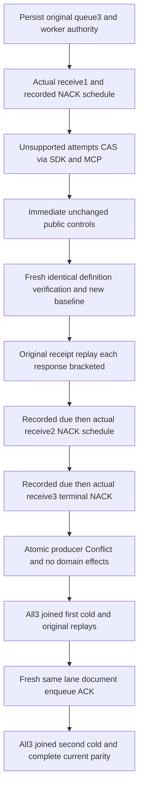

# Queue terminal policy retained public flow

Refines existing REQ-MSG-001/004/005 and AC-MSG-001/004/005 without changing any product policy/API. ADR: existing Messaging and ResourcePolicyUpdates contracts suffice; no new architecture/library/serializer/provider.

REQ-QUEUE-TERMINAL-POLICY-001: MaxAttempts is part of the immutable queue definition under the current policy CAS. A valid expected schema1 replacement schema2 changing MaxAttempts3 to1 MUST return UnsupportedCapability and preserve current public summary, every declared message/body/metadata, producer document absence and complete actual outbox. Do not implement the unsupported replacement or infer full definition from AdminResourceInfo. AC-QUEUE-TERMINAL-POLICY-001: new QueueTerminalPolicyClusterTests.UnsupportedAttemptsChangeCannotRewriteRecordedRetryTerminalReceiptsAcrossTwoColdOwners executes both real SDK and official MCP refusals. Check current controls immediately after each rejection. A bounded fresh identical original ConfigureResource, owning fresh GUID and complete result, verifies the full current definition; it is a real idempotent configuration command with legitimate metadata/clock advances, never a read-only cut. Retain and replay its GUID/result; capture the next declared public baseline after verification.

REQ-QUEUE-TERMINAL-POLICY-002: Three original admitted Receive/NACK rounds use unchanged MaxAttempts3. First and second NACKs schedule from replicated command time; wait only for actual recorded NotBefore through the existing due helper, then let real Receive/Sweep determine eligibility. Neither caller clock nor a wait declares success. Third current NACK produces literal AttemptsExhausted/DeadLettered complete metadata and retained body. Every original receive and complete receipt is immutable and replays without reexecuting its time transition. AC-QUEUE-TERMINAL-POLICY-002: Each SDK/MCP replay is immediately bracketed by full current message/body/metadata, declared document and complete outbox observations. Keep attempts1/2/3, state versions3/6/9, ready sequences1/2/3, lease versions1/2/3 and parked sequence1 literal; compare original dynamic signed lease and recorded deadline metadata exactly where appropriate. Opaque tokens/deadlines are retained original outputs, not independent clock arithmetic. No forced sleep, new clock, timer authority, longer timeout or custom worker.

REQ-QUEUE-TERMINAL-POLICY-003: Terminal identity cannot be resurrected by a same-domain producer. A batch stages a document then attempts duplicate terminal enqueue: Conflict and exact declared domain observations/outbox unchanged after EACH caller. New healthy same-lane enqueue plus document and actual ACK must succeed under original quotas. Original receipt replays and terminal/refusal outcomes survive two all-three-owner joined cold cycles. AC-QUEUE-TERMINAL-POLICY-003: Verify full literal healthy document/message, original complete receipts and current observations before/after every replay/refusal; first cold occurs after terminal+refusal, healthy follows it, second cold retains both original terminal and acknowledged healthy. Original caller tasks and scopes are joined before each kill; every owned Kill/Begin/Restart is observed and all errors retained. Existing keyed ClusterFixture owns Aspire resources and cleanup; original McpCallerDeadline bounds all work.

Raw lane counters/journal/image are NOT public observations here. Inspect validates retained counters/references; original quota and atomic producer behavior remain required, but this test does not advertise independently read raw counters. Public outbox is actual full OutboxStatus; metadata/clock advances from configuration/failed outcomes are legitimate and not classified as raw no-effects cuts.

Receive result replay is exercised immediately while its original lease is live, before completing that lease. cached Receive revalidates the current lease; successful stale Receive replay after NACK/ACK or cold is not claimed. The retained warm/cold successful replay set is the original producer, NACK/ACK and identical-configuration outcomes. Each exact ReceiveResult is retained and compared while admitted, with immediate current controls after each SDK/MCP response.

Before publication, the administrator independently captures the complete same-view partition witness through both actual callers. Every original receipt binds incarnation/atomic partition to that witness; positive position plus the complete original immutable receipt is retained for replay. This public flow does not assert an independently inspected replication entry index or raw journal image. The full partition witness is independently reread with current public controls after each replay/refusal/cold.
