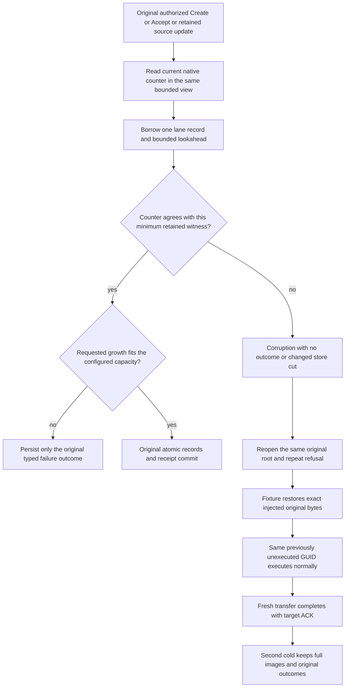

# Retained remote-transfer capacity authority

Applicable backend and native test surfaces are in this slice; frontend is N/A because this is a database admission invariant. Existing public SDK/official MCP, process recovery and Aspire replicated-cluster tests remain mandatory. Contracts: [Messaging](../Messaging.md), ADR-026, ADR-088, ADR-117 and ADR-125. Existing source intents, target dedup receipts, persisted authorization, stable command identities, node-local ownership and majority-acknowledged receipt authority are unchanged.

| Requirement / acceptance | Contract and genuine source mapping |
| --- | --- |
| REQ-XFER-002 / AC-XFER-002, AC-XFER-CAPACITY-001 | Optional absent authority is empty only for an empty lane. Required authority remains required. Missing/zero authority with rows, positive authority without rows, bytes smaller than the first original native value, and count one contradicted by a second row refuse Corruption. `RemoteTransferCapacityAuthorityTests.GenuineRetainedTransferRefusesInconsistentCapacityThenOriginalColdRepairAndHealthyFlow` declares source and target variants for five faults. |
| REQ-XFER-004 / AC-XFER-004, AC-XFER-CAPACITY-002 | Two original Create/Accept/Complete/claim/ACK flows retain source intents and target receipts after target body deletion. Native corruption then refuses both a new-GUID application reconciliation and a fresh mixed document/transfer command without an outcome, byte change or cut advance. The same original directory repeats refusal cold; exact original raw repair enables those same previously refused GUIDs. |
| AC-XFER-CAPACITY-003 | Independent full mutation receipts, every commit-token field, verified complete original signed claims, complete source/target records and their immutable token strings, ACK tombstones, counter accounting, bounded empty body/reference prefixes and original whole-store images survive a healthy continuation and second cold. Historical received results remain stored while consumed Receive replay refuses StaleLease. |
| AC-XFER-CAPACITY-004 | Source replacement checks remaining capacity before addition. `ActualRetainedSourceByteCeilingReturnsTypedWholeOutcomeThenColdExactRepairAndFreshCompletion` drives an actual pending source Complete with a positive maximal retained-byte counter. It requires the original ResourceExhausted result, exact own locator and clock, no business mutation, raw immutable failure history through cold/repair, a fresh successful completion, healthy transfer and second cold. |

The witness borrows one original value and uses existing native range lookahead, without copying or decoding that value. It is a bounded consistency check, not an exact recount or arbitrary-corruption checksum. Source billable history and receipt reservation can exceed the number or bytes of stored records; this change preserves that accounting. Native keys, signatures, Orleans aliases/field IDs, storage formats and public transport schemas do not change. No fallback, inferred repair, cache or new trusted role is introduced.

Native signed-token framing includes its original object-reference graph. Tests cryptographically verify every original claim against independent expected values and preserve original opaque signed strings across storage and replay; they do not require an independently allocated equivalent graph to produce identical signature framing. Receipt-value assertions include ordered private CompositionReferences in addition to public fields. Raw native row images and charged lengths retain exact-byte oracles.

These native single-process tests do not replace process recovery or the public SDK/official MCP flows on the replicated cluster. No speed, power-loss durability or production-readiness claim follows.
