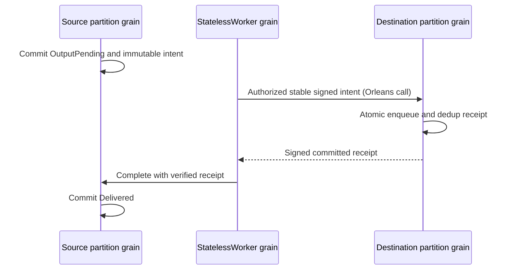
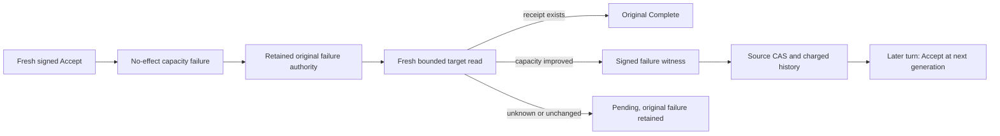

# RemoteTransfers within Messaging

Decision: [ADR-088](../../ADR/ADR-088-remote-queue-transfers.md). Cluster concept:
[ADR-136](../../ADR/ADR-136-orleans-partition-ownership.md).

A remote transfer is a durable queue-to-queue output within one tenant/database.
Source and destination atomic partitions differ, and each side commits on its own.
The feature provides separate source and destination commits delivered through
ordinary Orleans grain calls, never a distributed atomic commit or exactly-once
external handler execution. Each commit is acknowledged by every configured
`KeyLoad:ReplicaCount` copies of its own partition.

## Frozen source and destination protocol

Use three typed batch mutations: `CreateQueueTransfer(SourceQueue, TransferId,
Destination, Message)`, `AcceptQueueTransfer(DestinationQueue, IntentToken)` and
`CompleteQueueTransfer(SourceQueue, TransferId, ReceiptToken)`. IDs are nonempty
caller-stable GUIDs scoped by complete source QueueLaneRef. Immutable destination
and exact EnqueueMessage fingerprint are retained with the source intent. A
same-ID/same-body retry returns its existing outcome; different content conflicts.
The source is OutputPending until a destination receipt is verified and committed.

Core signs generated versioned intent claims using the database signing key.
Claims bind purpose, database incarnation, complete source and target, TransferId,
original persisted principal ID and exact message/fingerprint. Target requires the
current authenticated principal to match, reauthorizes QueuePublish and all target
field/header grants, then atomically enqueues and stores an immutable dedup receipt.
Target retries return the exact receipt without enqueueing again, even after the
message was acknowledged. It signs receipt claims over the complete identity,
payload fingerprint and committed target effect. Source verifies purpose,
incarnation, identity, target and fingerprint before moving to Delivered. Public
callers cannot invent a trusted receipt, role or timestamp.

Transfer administration and inspection are restricted to persisted administrators
and also check resource/data grants. A bounded `InspectQueueTransfer` read returns
the actual state and signed intent/receipt to that authorized operator; it does not
claim a general worker authorization model. Tokens and PII are never diagnostics.
Source stores an owned payload; it does not depend on a disposable source message
or unpinned external blob. Pending intents and destination dedup records are not
automatically expired or collected. Retained transfer state has no KeyLoad record
or byte cap; no guessed horizon may discard unresolved state. Destination
permission, schema, quota and expiry failures leave the source pending and explicit.
Retrying uses the original identity after timeout or unknown ACK; cancellation
cannot undo a committed enqueue. A remote DLQ is an ordinary durable destination
queue.

Atomic counters account the retained records and retained-state bytes of each
source/destination lane; they do not cap retention
([ADR-149](../../ADR/ADR-149-no-operation-limits.md)). Never commit an
intent which the destination cannot accept under its token contract. Administrator
status is checked on the original persisted principal; data/field/header checks
reuse the same authorization evaluator with ClusterAdministrator=false, preserving
the principal identity and normal grant/path semantics. Inspection also requires
QueueInspect and source field/header use before disclosing its signed token. The
destination receipt is exposed only by a separate committed, authorized
`InspectQueueTransferReceiptRequest(DestinationQueue, SourceQueue, TransferId)`
read, which requires current source and destination inspector grants. Its result
contains the persisted signed receipt and actual target commit token; it does not
assert source completion. Target enqueue MutationReceipt keeps its original shape
and contains no overloaded token. The worker performs a fresh authorized read
before using this proof to complete the source.

| Requirement | Acceptance and mapped tests |
|---|---|
| REQ-XFER-001: persist immutable source intent atomically | AC-XFER-001: producer rollback creates no intent; same identity replays; changed destination/payload conflicts; pending survives real store reopen. `RemoteTransferIntentTests` |
| REQ-XFER-002: target effect and dedup receipt are atomic | AC-XFER-002: repeat/unknown-ACK/reopen gives one enqueue and byte-identical receipt; failed quota/auth creates neither effect nor receipt. `RemoteTransferDestinationTests` |
| REQ-XFER-003: only authenticated committed receipt completes source | AC-XFER-003: wrong purpose/incarnation/principal/source/target/fingerprint/tampered receipt rejects; duplicate completion is stable; source stays pending on every target failure. `RemoteTransferReceiptTests` |
| REQ-XFER-004: retention and resources cannot lose unresolved work | AC-XFER-004: destination queue quota refusals, source message removal and destination ACK/retry preserve intent/dedup; no premature GC. `RemoteTransferRetentionTests` |
| REQ-XFER-005: Orleans owns bounded coordination and real clients | AC-XFER-005: Orleans grain calls perform source/destination/completion without network I/O under the apply gate; restart/loss at each stage through .NET and official MCP clients on the replicated cluster yields one target effect. Planned `RemoteTransferRecoveryTests`/`RemoteTransferClusterTests` |

## Ordered execution and ownership

1. Abstractions and Core Messaging own the QueueTransfer contracts, claims,
   state and helpers; the engine reuses existing Enqueue, Sign/Verify, policy and
   transactions.
2. Central mutation discrimination, validation, authorization and apply joins,
   public inspection dispatch and the SQL/SDK/MCP surfaces are integrated once. No
   new generic dispatcher or parallel command log; the canonical outbox is not
   repurposed as the transfer authority.
3. Real reopen, rollback and failure tests ship with the implementation and run
   against the Aspire-owned replicated cluster.
4. Bounded Orleans `[StatelessWorker]` grains follow: they accept pending-transfer
   events, buffer them in memory and on an Orleans timer (typed interval option)
   submit the Accept/Complete batch through the normal grain to ZoneTree-owner
   path. No leadership check; at most one transfer per flush turn, joined
   cancellation, logged retry timing and persisted-principal reload. Source
   admission can pause without discarding work.
5. Recurring and saga semantics follow a separately frozen stage; delayed queue
   fields alone do not satisfy it.

Rollback pauses transfers while preserving every intent and receipt record and
never reverts acknowledged target effects. UI is N/A.

## Three-stage cold scenario

REQ/AC-XFER-001/002/003/005 and ADR-088. A dedicated test on the Aspire-owned
replicated cluster uses independently generated source and destination atomic
partitions in one tenant/database. It reuses the .NET SDK, the official MCP client
and Q1 CALL, a persisted administrator with exact QueuePublish/Inspect/Consume/Ack/
Query and raw field/header grants, and the joined cold-restart lifecycle. It is not
a claim of distributed atomicity.

Stages: commit stable source Create with its immutable intent and cold-restart the
cluster; verify OutputPending and no target. Reject a tampered intent, a conflicting
source body and a freshly revoked target publisher through every existing route,
leaving target metadata and receipt absent and the source exactly as committed.
Restore the persisted publisher, commit target Accept, retain the original execution
receipt and signed target proof, and cold-restart with the source still
OutputPending. Complete only from that actual target receipt; cold-restart and
verify Delivered plus the original command receipts on every route. ACK the target
delivery, submit a new Accept command against the original intent and prove the
retained dedup (no resurrected message), then complete a fresh independent transfer.

No API, schema, alias, field ID or limit change. The original Create receipt
replays across the first cold restart. A persisted policy change (revoke then
restore, which increments the principal policy epoch) makes the same historical
Create return PermissionDenied on SDK, official MCP and both Q1 routes while the
original source intent and receipt evidence remain retained; fresh target Accept and
source Complete use new command IDs under current authority. A canceled caller is
never treated as a rollback and no unknown response is manufactured.

## Stateless transfer worker (finite stage)

One persisted technical principal may be selected by the nullable
`TransferCoordinatorPrincipalId`; null skips transfer discovery. The setting selects
an existing subject only, never creates credentials or grants roles, and that subject
must equal the retained source creator and tenant and is freshly authorized for each
signed source/target inspection and Batch. Silo-local discovery of pending intents is
bounded by the operation's count, byte and work ceilings and a fixed tail; the
cursor resets on the store incarnation. It emits pending-transfer events to Orleans
`[StatelessWorker]` grains, which buffer them in memory and, on an Orleans timer
whose interval is a typed option, submit the batch. No worker checks leadership or
elects a coordinator; the buffer is disposable and discovery rebuilds it after a
restart. A failed dispatch retains the discovered cursor so a known failed intent
does not starve later work. Only one enabled branch (recurring, queue deadline or
transfer) executes per flush turn.

Command IDs are deterministic digests of the immutable transfer tuple, so the same
immutable ID and body reconcile genuine uncertainty after a timeout or restart
without a new effect identity. The worker rereads the source intent, then the
target receipt; if no proof exists it submits one canonical Accept, then rereads the
target and treats a missing proof as UnknownWriteOutcome. Before Complete, source
and target receipt are reread again and a changed proof refuses. A known terminal
failed outcome stays pending; restoring policy or quota does not mint a new command
ID, and an authorized operator uses the public Accept/Complete.

### Bounded capacity retry and policy repair

`DatabaseLimits.MaxQueueTransferAcceptAttempts` is nullable, default null, and at
least 1 when set. A newly created source intent reserves
its immutable ceiling; only a genuine no-effect ResourceExhausted outcome of a
single Accept, a refusal by the destination queue's own `MaxStoredMessages` or
`MaxStoredBytes` quota, can retain the original failure authority. The source batch
`AdvanceQueueTransferAttempt` (alias `keyload.queue-transfer.advance-attempt`)
verifies the signed failure witness and the exact immutable intent, then appends one
history reference and increments the generation in one transaction, charging one
record plus its exact bytes. A target receipt that already exists always wins and an
acknowledged target message is never recreated. A failed Advance keeps its ID and
needs explicit authorized operator repair; the service dispatches at most one
Advance per turn. A similar `AdvanceQueueTransferRepair` batch handles a real
persisted policy-epoch change after a denied Accept or Complete. Its read checks
fresh authorization first and the current epoch against the epoch recorded with the
original failure, and a repaired command re-derives its ID from the immutable tuple
and the new generation.

A complete coordination read accounts every examined authorization, resource, intent,
history, outcome and receipt record in one read ledger with no configured record or
byte ceiling; a due-discovery page size does not truncate it
(REQ/AC-XFER-COORDINATION-READ-001). Cancellation or expiry fails the read without
partial output or effects.

## Status

Source implementation does not close recovery, worker or the original
Messaging acceptance gates. Open: process cuts at each stage, a genuine
lost-response/unknown-outcome boundary, aligned retention-horizon evidence, universal
automatic retry, and the exact-source Linux runtime qualification of the .NET and
official MCP flows on the Aspire replicated cluster.
