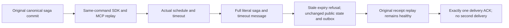

# job public publication regression

This is an additive regression for ADR-136 and the existing SagaDueClusterTests whole operation. It retains the existing Aspire-owned cluster, actual SDK and official MCP clients, deadline, due time, scheduling, ACK and no-second delivery assertions. It introduces no job endpoint, provider, protocol or retry.

REQ-EXECUTION-JOB-PUBLIC-001 / AC-EXECUTION-JOB-PUBLIC-001: validate all public creation receipt fields, literal mutation kind/resource/id/revision, actual cluster token identity/positive position and durability. Replay the same original command on SDK and MCP before timeout and after it, and after ACK. Public JSON omits CompositionReferences: decoded default arrays are not private-field proof.

REQ-EXECUTION-JOB-PUBLIC-002 / AC-EXECUTION-JOB-PUBLIC-002: independently compare every public projected SagaInspection and timeout MessageInspection field. A stale ExpireSaga command after the actual timeout must be refused on both interfaces. Complete public saga/message and administrator outbox status stay unchanged across refusal and original-success replay. Rejected outcomes may be persisted internally; this does not claim raw-store byte or commit-position invariance. All comparisons of full private-bearing DTOs are Boolean-only.

Both criteria map to the unchanged method declaration SagaDueClusterTests.AcDue003WaitingSagaTimesOutAutonomouslyAndLeavesNoSecondDelivery. ProcessDueAsync schedules through ILocalDurableJobManager and the IDurableJobHandler executes the timeout. Source routing alone is not evidence of actual runtime delivery; the whole real case must run.

REQ-EXECUTION-JOB-RECOVERY-001 / AC-EXECUTION-JOB-RECOVERY-001 retains the separate SagaTimeoutRestartTests.RuntimeRestartReclaimsRetainedJobAndCommitsOneStableTimeout gate. It observes a genuine retained job, same journal identity, changed owner/ETag and canonical owner generation before one stable timeout. Its preopened fixture is not the [production constructor test](../OrleansExecution/RuntimeConstructorCycle.md), cold-publication proof or Docker cluster qualification. Public terminal state alone is not claimed to identify the original retained scheduled job.

No performance, power-loss or production-ready claim follows.

