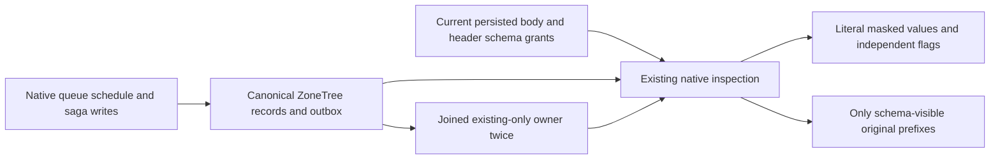

# Schema-visible recurring schedule and saga inspection

KL-064 / ADR-137 and REQ-SCHEMA-002/004/005/006 extend the existing Messaging REQ/AC-JOBS-004 inspection operation. Raw-read masking and schema metadata authority remain distinct persisted grants. This child contract supplements RecurringSaga.md and SchemaVisibleProjection.md; it adds no production API or acceptance relaxation.

| Requirement | Acceptance and mapped operation |
|---|---|
| REQ-SCHEMA-SAGA-001: independent persisted body/state and header schema visibility | AC-SCHEMA-SAGA-001: the single native operation below verifies literal schedule/state projections for no schema grants, body-only, header-only, both and revoked grants while raw values stay masked. Existing null-schema case remains independent. |
| REQ-SCHEMA-SAGA-002: current admission and unchanged canonical state | AC-SCHEMA-SAGA-002: the same operation verifies QueueInspect denial and original-token cancellation followed by healthy results, with full native records/capacity/resource/principals/outbox/outcomes and complete image/cut/journal/applied/identity before and after each observation/replay. |
| REQ-SCHEMA-SAGA-003: native retained outcomes and joined cold owners | AC-SCHEMA-SAGA-003: the same operation compares original complete receipts including private composition references, all three actual replay/resolution branches and two joined same-root existing-only cold continuations. Saga schema RF3 remains OPEN and is not substituted by this native method. |

The additive native method `RecurringSagaPolicyTests.SchemaHiddenScheduleHeadersAndSagaStateFollowCurrentGrantsThroughReplayAndTwoCold` retains the original null-schema method independently. It composes the existing admitted native `SafeProjectorOperationDatabase` owner and its genuine same-root existing-only cold lifecycle, without changing that owner or copying a host, provider or transport.

The operation configures one real WorkQueue with separate payload/state and header SchemaReadGrant policies. A separately persisted nonadministrator Scheduler belongs to the actual partition tenant and holds only SchedulerManage, QueuePublish and the required field-write grant. Its actual native Batch creates a future recurring schedule and a Waiting saga through ConfigureRecurringSchedule and CompareExchangeSaga. The bootstrap system administrator supplies neither creator identity nor bypass authority for that Batch. Original creator identity and epoch remain exact during reader schema repairs and all replay/cold observations. A persisted nonadministrator with QueueInspect but no raw-read/use/schema grants receives complete literal masked schedule/state DTOs, Redacted=true and empty paths. Schema-only body repair exposes payload:/secret and state:/secret while header paths remain hidden; header-only repair exposes headers:/secret while payload/state paths remain hidden. Both schema grants expose both schedule prefixes and state:/secret. Revocation returns true plus empty paths without changing value masks, schedule generation/watermark or saga state. A separate persisted subject lacking QueueInspect is denied on both operations. Original caller cancellation is preserved and followed by healthy inspection.

Before and after EACH read, refusal and replay, conserve full canonical store bytes, position, applied index, native journal cut and full identity; compare literal full schedule/saga records, retained capacity, resource/current principals, exact two-entry outbox and head, and full original admitted outcomes. Receipt comparison includes every private CompositionReferences field explicitly despite its JSON omission. Replay the original complete native commands and preserve their outcome bytes and native journal identities without reapplying effects.

After revocation, join the original owners and perform two actual same-root existing-only opens through the existing owner. At each open conserve the original full image/cut/journal/applied/identity, repeat masked and denied operations, verify canonical records/outbox/current policy and replay complete original outcomes. Independent operation/cleanup failures remain joined through the existing failure observer. Expected values and paths derive from literal configured data, not returned projections.

This is source preparation only. Native semantic compilation, actual operation execution, process recovery, Aspire Docker RF3 SDK/official MCP and exact-source Linux qualification remain OPEN. Native two-cold proof is not process-kill or RF3 evidence. The Saga RF3 schema matrix remains an explicit remaining gate; existing public autonomous tests remain unmodified.

