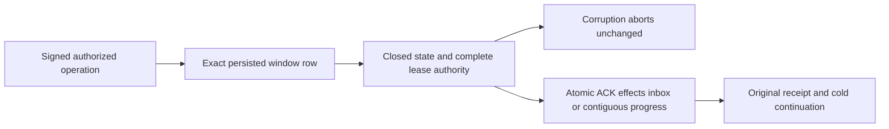

# Native subscription delivery authority

This scope preserves REQ-MSG-003 / AC-MSG-003 and REQ-MSG-002 / AC-MSG-002 under ADR-027 and ADR-026 and adds no architecture, public contract, persisted format, serializer identity, quota or transport.

Every source position strictly above the current checkpoint through IssuedPosition must retain its current-generation window record. Missing rows in that issued interval are Corruption; rows at or below the contiguous checkpoint are legitimately retired. A fresh Receive must never reconstruct an issued missing row with lease version one or make its old token valid. Filter-generation replacement checks the complete bounded issued-prefix row count before any deletion. A retained subscription window record must match its exact positive source position and closed delivery-state enum. A Leased record must retain its actual expiry, principal, positive attempt and lease version. Missing expiry cannot authorize ACK, renew, NACK, reclamation or CommitProcessing. Validation precedes all mutations and cached processing-ACK reconciliation; Corruption aborts the native transaction without an outcome or model effect. Completed/filter/pending records keep their existing historical fields and contiguous-gap semantics.

The native authority checks apply at claim traversal, current lease validation, contiguous prefix traversal, filter-generation replacement and inbox acknowledgement reconciliation. Existing fresh persisted authorization, signed scope/generation fences, majority acknowledgement and node-local ZoneTree ownership remain authoritative.

Acceptance controls use genuine ZoneTree claims and inject only their own saved window record: foreign position, missing lease expiry, undefined state and deleted issued window. Original claim and ACK/NACK/renew repetitions must preserve complete raw state and position, retain the original successful claim receipt and create no failed outcome. First cold reopen repeats the corrupt refusal; exact restoration permits the same operation GUID, second cold retains complete receipts, then fresh delivery and ACK close the prefix.

Mapped cases: SubscriptionLeaseAuthorityTests original three action arguments plus nine malformed lease/window arguments; SubscriptionDeliveryAuthorityTests four processing fault arguments; existing SubscriptionCheckpointAuthorityTests, SubscriptionFilterGenerationTests and SubscriptionTests remain mandatory.

