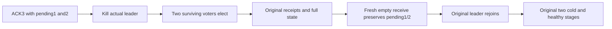

# Contiguous subscription gaps through real RF3 leader loss

REQ-MSG-003 / AC-MSG-003, architecture40.2 and ADR027/026 preserve independent per-source group progress. The existing complete SubscriptionFilterGenerationRf3Tests flow adds one genuine leader-loss stage after independent-group ACK3 while1/2 remain pending, before its original two whole-cluster cold cuts. The actual reported leader container is killed by the original Aspire fixture. Existing bounded status-only election observation requires a new leader, higher native consensus term, routing readiness and original3-voter membership on both survivors before any business operation. Business failures are not retried or replaced.

Fresh actual SDK and official MCP clients on surviving nodes verify both full literal group states/source history/placement/outbox and original producer/claim/refusal/ACK receipts. A fresh actual empty Receive commits while1/2 remain leased and3 is completed; exact original-ID MCP replay preserves that receipt and the0/3 gap; complete public invariants bracket each SDK/MCP replay. The exact stopped container rejoins via existing fixture restart, then original full state/replay checks and both existing cold/filter/healthy continuations remain mandatory. Original lease/clock/deadline/image/topology and cleanup contracts stay unchanged. Native original case identity remains CompetingWorkersPausedFilterCasAndContiguousGapsSurviveTwoColdCutsWithOriginalReceipts; this is an enhancement, not a duplicate test lane.

No runtime, qualification, throughput or power-loss claim follows from SourceN. Exact-source Linux native build/census/recovery/RF3 and original outputs remain required.

