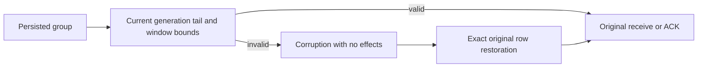

# Subscription progress authority

REQ-MSG-003 / AC-MSG-003 and ADR027 retain source-generation-local contiguous checkpoint authority. A negative checkpoint, issued position below checkpoint, or persisted checkpoint beyond the current source tail, issued position below checkpoint or beyond tail, or active issued gap beyond the existing configured MaxWindow is Corruption before Receive, ACK or status releases success. No source scan reconstructs progress. Genuine retained-away history keeps HistoryUnavailable; explicit seek/filter operations retain their original contracts. No public/schema/alias/format/default/capability change.

SubscriptionGroupProgressAuthorityTests performs eight genuine own-row corruptions after an actual three-event claim; repeated warm fresh Receive/cached nonempty+empty/ACK/NACK/renew/status preserve complete raw image/position/identity, as does the first same-root cold. Exact raw row restoration admits the SAME original operations, exact original claim replay, empty receive replay and ACK3 without advancing past pending1/2. ACK1/2 closes the prefix; second cold preserves original receipts and a complete healthy publish/claim/ACK.

Current-generation authority additionally requires the exact bounded window prefix: row count equals issued-checkpoint, each key/decoded position is within that interval, closed state and genuine Leased fields are valid. MaxScanRecords/raw-byte caps are charged before decode; HasMore refuses. A genuine originally leased3 with IssuedPosition corrupted3→2 cannot accept its old signed token or publish a plausible0/2 status/cached empty receipt. No row is synthesized/deleted by validation; no timer/wall-clock budget is added to deterministic ordered apply.

Authority accounting is scoped to the actual invocation: cachedReceive retains every original signed/token/policy/stale/expiry/projection check, charges point reads and proves the stable current window ONCE. Fresh receive charges its initial window proof and actual window/source bytes to the same budget; its owned deterministic mutations construct the already validated result without rescanning. Filter CAS shares its original budget across old/new generation proofs and deletes only the exactly proved old prefix, with no duplicate scan. No global cache or public trust flag is introduced.

SubscriptionWindowBudgetWholeFlowTests preserves a real three-event leased receipt while testing cumulative record and byte caps across point+full-window reads; each prior reset budget could pass but the one-operation budget must refuse. Full image/cut/identity and the original immutable outcome stay unchanged through warm/repeat/cold, default-config reconciliation and healthy contiguous ACK progression. SubscriptionPendingCounterAuthorityTests uses genuine NACKed Pending rows and the actual persisted AvailableAt as a deterministic logged operation time, not a new global clock. Negative Attempts/LeaseVersion must never produce a signed negative/zero reissued lease; repeated warm/cold fresh/cachedempty/status corruption keeps complete state unchanged, exact row repair permits the original request to reclaim attempt2/version2, preserves original NACK/empty receipts and closes the full prefix before second-cold healthy work. Pending initial0/0 and legitimate terminal fields remain admitted; after exact repair the genuine old NACKed claim remains StaleLease with unchanged original outcomes.

AdvanceCheckpoint now charges every actual contiguous-prefix point read to the SAME invocation budget as the full proof and Fill/lease reads; no uncharged reread loop remains. The valid positive Int64 lease-version ceiling receives ResourceExhausted only when actually eligible for a matching due claim, after original byte/policy/filter gates and before checked increment. SubscriptionLeaseVersionExhaustionTests uses a genuine NACKed Pending row, original AvailableAt evaluation, earlier byte-budget refusal, literal complete source/group/window no-effect image except exact original failed outcome+logged clock, immutable failed ID through warm/cold/exactrowrepair, fresh ID reclaim attempt2/version2 and full contiguous second-cold healthy continuation. No counter reset/saturation or time/default widening is introduced.

The shared pending/ceiling continuation now predicts actual preapply commit tokens for every publish, claim and ACK, compares complete typed receipts/results, signs and verifies full subscription claims against persisted incarnation/generation/policy scope, observes Leased row shape, and compares the complete four-event source and closed group/window. Each replay retains full byte/cut/identity invariance. Genuine NACK/empty or immutable failure receipts and every original ACK/healthy producer receipt survive the second cold cut; consumed claim results are never replayed as successful leases.
