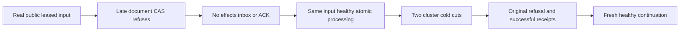

# Public subscription processing rollback

REQ-MSG-002 / AC-MSG-002 under ADR-026 and REQ-MSG-003 / AC-MSG-003 under ADR-027 preserve the same-partition ACK, inbox and database effects transaction. No architecture, public shape, native format, transport, policy, clock or quota changes are introduced.

The existing GenerationTwoChangedEffectsRefusesThenOriginalInboxCompletesAcrossSdkMcpAndTwoColdCuts operation gains a negative control before its first inbox exists: a real leased input stages the first new document and fails the second document's original expected-revision precondition. Genuine .NET SDK and official MCP retries retain RevisionConflict; both documents remain absent, source history and complete public subscription status remain unchanged, and the original claim is still byte-equivalent. The original healthy processing must create both documents once and acknowledge input atomically, proving failed processing did not retain an inbox.

The existing seek/refilter, changed-effects refusal, two actual same-volume cluster cold cuts, matching inbox reconciliation, original acknowledgements, policy/scope fences and healthy publisher/delivery continue. After each cold cut the same failed processing GUID retains its original refusal and cannot change either successful document or group progress. Original fixtures own Aspire readiness, real callers, bounded deadline and joined shutdown; no extra case, alternate harness or raw storage injection is added.

