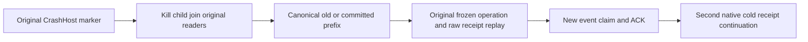

# Original subscription processing crash recovery

REQ-MSG-002 / AC-MSG-002 and REQ-MSG-003 / AC-MSG-003 under ADR-026/027 retain the existing seven SubscriptionProcessingCrashRecoversEffectsInboxOutcomeAndCheckpointTogether crash-cut arguments and actual subscription-processing CrashHost scenario. No new crash cohort, runner, product format, policy or timeout is introduced.

The original native child helper owns bounded stdout/stderr capture, the exact marker, process termination and joined readers; the wrapper preserves its original twenty-second operation deadline and existing bounded cleanup policy. Native storage opens only after actual child/readers settle and handles release. Failures retain their actual root and original exception.

Recovery checks one literal coherent prefix: unchanged source event1, generation/ownership1, issued1 and checkpoint0 with the original current lease, or checkpoint1 with no window and complete canonical completion/inbox/outcome/document effect. JournalFlushed and later require the committed prefix. Completed inbox and outcome retain the exact canonical document/ACK receipt. The saved typed operation is caller input only and is reapplied unchanged, including its original evaluation time; no sidecar defines persisted truth.

Whole continuation compares original same-GUID result and raw inbox/outcome bytes without store-position changes, verifies fresh input dedup without repeating effects, publishes/claims/ACKs a genuinely new event2, then performs a second actual same-directory cold reopen retaining the complete source, original effect, checkpoint and receipt. Process-kill recovery remains distinct from power-loss/endurance and actual SDK/MCP RF3 qualification. SourceN is not runtime proof; root owns current-source compilation/native execution and Linux acceptance.

