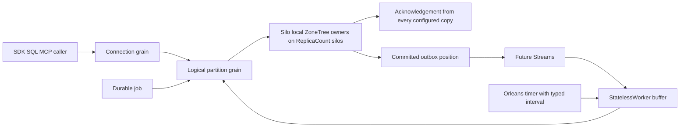

# OrleansExecution: Orleans capability review for KeyLoad

Date: 2026-10-05. Scope: documentation and source review of Orleans
capabilities; it changes no runtime behaviour. Related:
[ExecutionPrimitives](ExecutionPrimitives.md) (REQ/AC-ORL-001..010),
[RuntimeAdoption](RuntimeAdoption.md), [RuntimeJournal](RuntimeJournal.md),
[ADR-110](../../ADR/ADR-110-orleans-execution-primitives.md) and the
cluster concept in [ADR-136](../../ADR/ADR-136-orleans-partition-ownership.md).

## Cluster concept

Orleans does membership, silo discovery, failure detection, the distributed grain
directory, placement, activation migration and all internal communication;
KeyLoad adds no clustering of its own. A public operation runs on the client's
connection grain, which calls logical partition grains; they call the silo-local
ZoneTree owner Grain Service on their own or another node through ordinary
Orleans calls. Writes reach the owners on `KeyLoad:ReplicaCount` silos the same
way and are acknowledged after every configured copy confirms durable local apply.

## Decision method

The review covers the capability families in the
[official documentation index](https://learn.microsoft.com/en-us/dotnet/orleans/),
the [overview](https://learn.microsoft.com/en-us/dotnet/orleans/overview), linked
Learn topics, and APIs/source at
[v10.4.0](https://github.com/dotnet/orleans/releases/tag/v10.4.0). The current
central packages use [10.4.1](https://github.com/dotnet/orleans/releases/tag/v10.4.1),
with Journaling and Durable Jobs at 10.4.1-alpha.1. Updating packages does not
qualify the runtime criteria below or repeat every original source review.

`Source-present` means code or registration exists, not that its runtime gates
passed. `Candidate` means useful after an owning contract and real-operation
proof. `Defer` means no current matching requirement. Priorities are
architecture judgments; no measured speed or memory benefit is inferred.

## Messaging, execution and responses

| Capability / source | Current source and KeyLoad use | Required join |
|---|---|---|
| Direct RPC — [delivery](https://learn.microsoft.com/en-us/dotnet/orleans/implementation/messaging-delivery-guarantees) | Source-present: connection grain -> logical partition grains -> silo-local ZoneTree owner over ordinary grain calls. Default RPC is at-most-once; a timeout can hide a committed effect. | Stable command outcome identity, bounded retries and effect deduplication; fresh persisted authorization and acknowledgement from every configured copy stay the authority. |
| `IAsyncEnumerable` responses — [enumerator lifecycle](https://github.com/dotnet/orleans/blob/v10.4.0/src/Orleans.Core/Runtime/AsyncEnumerableGrainExtension.cs) | Source-present: CQRS chunks through `IConnectionGrain.ExecuteStreamAsync` with backpressure and joined disposal; Started plus a terminal chunk today. | enumeration methods are AlwaysInterleave; test cancellation, early disposal, slow consumers and identity isolation. No durable subscription claim. |
| Streams, subscriptions, providers — [overview](https://learn.microsoft.com/en-us/dotnet/orleans/streaming/) | Source-present: a memory-stream provider for event-feed notifications. Candidate: persistent post-commit delivery to index, projection and workflow consumers; StatelessWorker consumers only for live preprocessing. | Provider, outbox handoff, deduplication/checkpoint, ordering, replay, cache and lag bounds. Publishing acknowledges no write; cache rewind is not durable replay; EventStreams stay committed records. |
| Broadcast channels and observers — [broadcast](https://learn.microsoft.com/en-us/dotnet/orleans/streaming/broadcast-channel) | Candidate: "refresh may help" fan-out repaired by canonical revalidation. Defer observers until a status-push requirement exists. | No durable history; authorization, cache leases and write acknowledgements never become advisory signals. |
| OneWay, StatelessWorker, interleaving — [method matrix](ExecutionPrimitives.md) | Audited per method; StatelessWorker is also the background-work primitive (below). | Exact method, invariant, quotas and real fault/cancellation tests; no blanket attributes. |
| RequestContext and call filters — [context](https://learn.microsoft.com/en-us/dotnet/orleans/grains/request-context) | Source-present: subject-only context via ManagedCode.Orleans.Identity and Graph's default-deny call filters. | Context is metadata, not authority: reload persisted policy; never replay trusted roles. |
| Cancellation, deadlines, external tasks — [cancellation](https://learn.microsoft.com/en-us/dotnet/orleans/grains/cancellation-tokens) | Source-present: cancellation, deadlines and joined node-local search execution. | Cancellation does not prove rollback; no unjoined Task.Run or custom CQRS dispatcher. |

## State, transactions and scheduling

| Capability / source | Current source and KeyLoad use | Required join |
|---|---|---|
| Activation state and caches — [lifecycle](https://learn.microsoft.com/en-us/dotnet/orleans/grains/grain-lifecycle) | Candidate: bounded validated caches rebuilt after migration. | Read-cut/policy-epoch identity, byte budget, invalidation and restart tests; never write or credential authority. |
| `IPersistentState<T>` — [persistence](https://learn.microsoft.com/en-us/dotnet/orleans/grains/grain-persistence/) | Candidate: bounded snapshots through a ZoneTree adapter; no product grain uses it. | ETag CAS and uncertain-write recovery; never two writable copies of canonical state. |
| Transactions — [transactions](https://learn.microsoft.com/en-us/dotnet/orleans/grains/transactions) | Candidate: short multi-grain transactions or a cross-partition SQL stage; current atomic batches are same-partition. | ZoneTree calls do not enlist automatically; an adapter must persist prepare/commit/abort to ReplicaCount copies with acknowledgement from every configured copy and define read visibility before any ACID claim. |
| JournaledGrain and Orleans.Journaling — [journaling](https://github.com/dotnet/orleans/blob/v10.4.0/src/Orleans.Journaling/README.md) | Source-present under RuntimeJournal: the ZoneTree-backed journal provider used by Durable Jobs (10.4.1-alpha.1). Defer whole-history LogStorage. | binary format, ETag fencing, replay/compaction/corruption tests; recovery journals stay distinct. |
| Durable Jobs — [README](https://github.com/dotnet/orleans/blob/v10.4.0/src/Orleans.DurableJobs/README.md) | Source-present: job handlers for due, ANN projection and time-series chunk work; persisted, at-least-once. | Idempotent effects, occurrence fences, missed-due restart and cancel/dispatch-race tests; a running attempt may finish after cancellation. |
| Grain timers and reminders — [timers](https://learn.microsoft.com/en-us/dotnet/orleans/grains/timers-and-reminders) | Selected: the timer flush of StatelessWorker batches (not yet in source). Candidate: reminders for rare reconciliation; no provider today. | Bounded callback, joined disposal and a typed interval; a timer stops with its activation and never holds a durable schedule. |

## Local services, placement and hosting

| Capability / source | Current source and KeyLoad use | Required join |
|---|---|---|
| GrainService — [services](https://learn.microsoft.com/en-us/dotnet/orleans/grains/grainservices) | Source-present: `PartitionStorageGrainService` opens and owns the silo's stores, journals, file locks and ordered apply. | Runs on every silo; files never move with activations; background business work uses the StatelessWorker pattern. |
| Silo DI and lifecycle — [silo lifecycle](https://learn.microsoft.com/en-us/dotnet/orleans/host/silo-lifecycle) | Source-present: borrowed engines and admission in silo DI, storage open in Init and the [request drain](RequestDrainLifecycle.md) participant. | One instance per silo; fail initialization promptly; keep reverse shutdown; stop callbacks never own a durable effect. |
| Placement — [placement](https://learn.microsoft.com/en-us/dotnet/orleans/grains/grain-placement) | Source-present: ConnectionGrain and CommandPartitionGrain use PreferLocalPlacement with `[Immovable]`. | Placement decides where activations run, not where files live; audit migration eligibility per grain type; hints come only from server configuration. |
| Directory and repartitioning — [directory](https://learn.microsoft.com/en-us/dotnet/orleans/host/grain-directory) | Source-present: AddDistributedGrainDirectory and AddActivationRepartitioner with scoped experimental opt-ins. | Migration leaves ZoneTree handles with the silo-local owner; directory replication is not database replication. |
| Collection and queue limits — [collection](https://learn.microsoft.com/en-us/dotnet/orleans/host/configuration-guide/activation-collection) | Source-present: message-body bound and RequestWorkOwner limits/drain. Candidate: idle collection and per-activation queue thresholds. | load shedding targets gateways (KeyLoad's gateway port is zero), so it cannot replace public admission. |
| Serialization — [serialization](https://learn.microsoft.com/en-us/dotnet/orleans/host/configuration-guide/serialization) | Source-present: generated aliases/IDs and surrogates. Candidate: immutable DTOs. | Audit buffer ownership first; exact document bytes and checksums stay exact. |
| Aspire hosting and testing — [Aspire](https://learn.microsoft.com/en-us/dotnet/orleans/host/aspire-integration) | Source-present: AppHost-owned Docker cluster; TUnit suites through the real .NET SDK and official MCP client. | Orleans owns membership and discovery; tests use discovered endpoints, with no substitute topology or mocks. |
| Versioning, telemetry, TLS — [monitoring](https://learn.microsoft.com/en-us/dotnet/orleans/host/monitoring/) | Source-present: versioned interfaces and Microsoft.Orleans meters/activities in OpenTelemetry (REQ-ORL-012). Candidate: TLS, GC profiles, rolling deployment. | Low-cardinality telemetry without payloads or credentials; version selection converts no data; TLS rotation needs its own tests. |

## Background work pattern

Queue work (deadlines, due and recurring messages, remote queue transfers), ANN
projection and time-series chunk work use one pattern: Orleans `[StatelessWorker]`
grains accept events, buffer them in bounded memory and, on an Orleans grain timer
(for example every 5 seconds; the interval is a typed option), write the batch
through the normal grain -> silo-local ZoneTree owner path. Workers never gate on
leadership, leader hints or coordinator election. Buffered state is disposable
and never the authority for an acknowledged write; each batch checks current
persisted authorization and keeps stable idempotent command identities. Durable
Jobs remain the primitive for persisted scheduled work.

## Integration boundaries

- Streams: committed outbox position -> bounded authorized notification ->
  consumer -> fresh authorized operation; delivery success is never authority.
- Durable Jobs keep canonical recurrence, generations and catch-up; transactions
  need their own storage adapter before any cross-partition SQL ACID claim.
- Queue, GC and repartitioner budgets come only from an owned profile.

## Source joins

- [OrleansSiloConfiguration](../../../src/KeyLoad/OrleansHosting/Hosting/OrleansSiloConfiguration.cs) owns borrowed DI, the message bound, services, serializer registration, the directory/repartitioner, activity propagation and the event-feed stream provider.
- [PartitionStorageGrainService](../../../src/KeyLoad/StoragePartitions/GrainServices/PartitionStorageGrainService.cs) opens the silo's storage owner in Init.
- [RequestWorkOwner](../../../src/KeyLoad.Clustering/RequestExecution/Streaming/RequestWork/RequestWorkOwner.cs) and [OrleansNode](../../../src/KeyLoad/OrleansHosting/Hosting/OrleansNode.Composition.cs) own bounded admission, cancellation and drain before physical cleanup.
- [EventStreams](../EventStreams.md), [Messaging](../Messaging.md), [ChangeFeeds](../ChangeFeeds.md) and [ResourceExecution](../ResourceExecution.md) keep canonical data, effect, cursor and cache contracts.

Each candidate needs its own committed-operation tests through the Aspire-owned
cluster with the real .NET SDK and official MCP client; this review is not runtime
or performance evidence.
