# caller factory registration before task creation

Applies to [OrleansExecution](../OrleansExecution.md), the readonly ConnectionIdentityCollision helper roles, [ADR-125](../../ADR/ADR-125-connection-owned-execution.md), [ADR-035](../../ADR/ADR-035-memory-performance.md) and [ADR-117](../../ADR/ADR-117-tunit-ci-entry.md).

This is a test-owner contract for the connection-grain unit fixture: a duplicate caller registration must be refused before its factory creates a second operation.

REQ-CONNECTION-CALLER-FACTORY-001 / AC-CONNECTION-CALLER-FACTORY-001: `ConnectionCallerFactoryTests.DuplicateRegistrationDoesNotStartLosingCallerAndBothOriginalAndFreshFactoriesSettle`. An outer ConnectionCalls registry owns registration metadata but only borrows the SAME actual Task returned by scenario.CommandAsync; the scenario remains the producer and connection cleanup owner. The first inline factory creates the real signed Orleans command and returns that SAME Task by reference; it is held at actual RequestStarted. The losing duplicate registration reuses the first outer GUID; its factory would create a genuine second-principal command with a fresh request GUID. The duplicate registration must throw its fixed local duplicate detail BEFORE that factory is invoked: zero invocation count, null created Task and no observation for the fresh GUID. No canned replacement Task, callback failure or provider is introduced.

REQ-CONNECTION-CALLER-FACTORY-002 / AC-CONNECTION-CALLER-FACTORY-002: while the first producer is held, the observation object, probe identity, pending caller, store position, missing outcomes/documents and empty outbox stay unchanged. Release the first only afterward and require its complete ACK, document and outbox. A fresh outer registration with a fresh request GUID then executes the SAME second CommandRequest the losing factory intended; require its complete ACK, a different literal document and two complete outbox entries. Both original command IDs replay through fresh registrations on the same activation and return the original outcome bytes without new effects.

REQ-CONNECTION-CALLER-FACTORY-003 / AC-CONNECTION-CALLER-FACTORY-003: observe the whole body before registry Stop/Join and the scenario's close control. The registry is an awaited IAsyncDisposable owner scope: the body records its original failure, disposal releases the same hold, stops and joins the same borrowed tasks and awaits the same scenario close, recording every cleanup failure in one ordered ledger. Only a successful close plus terminal borrowed tasks permits registry disposal; an uncertain close retains the registry and the existing Unjoined error. No Task wrapper replaces the registered Task, and no deadline, dispatcher, transport or fake failure is added.

```mermaid
flowchart LR
 A[Inline factory returns same actual task] --> B[producer held]
 B --> C[Duplicate registration rejected before factory]
 C --> D[No second task and no effects]
 D --> E[First ACK and outbox]
 E --> F[Fresh registration creates second task]
 F --> G[Second ACK and both receipt replays]
 G --> H[Outer stop joins borrowed tasks]
 H --> I[Scenario close succeeds]
 I --> J[Registry dispose]
```

Qualification: this one-silo Orleans test fixture with real storage does not qualify the Aspire replicated cluster, process recovery, power-loss durability or production readiness.
