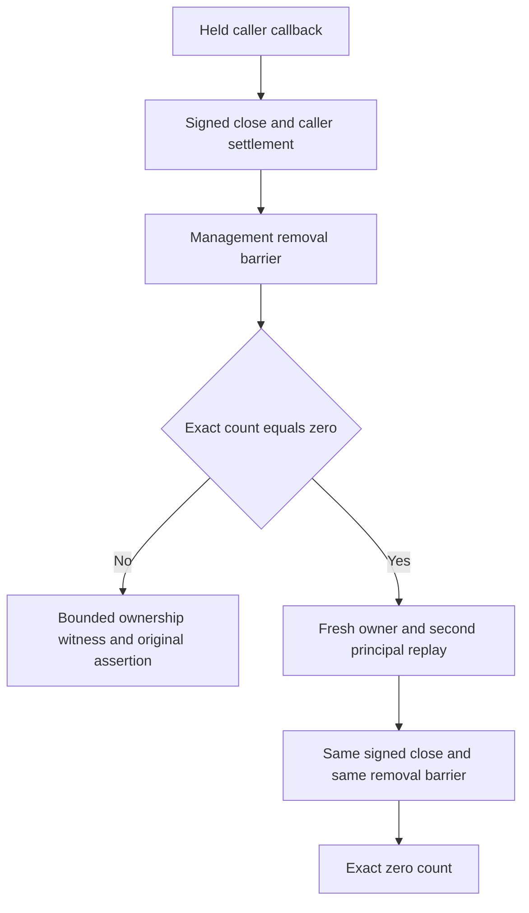

# connection close removal and exact count witness

Canonical parent: [OrleansExecution](../OrleansExecution.md). [ADR-117](../../ADR/ADR-117-tunit-ci-entry.md) and [ADR-125](../../ADR/ADR-125-connection-owned-execution.md) retain the test entry, stable server-owned connection identity, per-operation authentication, call-local producers and joined close. The two existing close cases and every expected-count-zero assertion are preserved: `ConnectionFailureTests.AcCrs054ConnectionCloseJoinsOriginalCallerBeforeSignedRemoval` and `ConnectionCloseAdmissionTests.SignedCloseRetainsOriginalCallbackLeaseThenFreshOwnerAndSecondPrincipalReplaySucceed`.

REQ-CONNECTION-CLOSE-001 / AC-CONNECTION-CLOSE-001: every independently created connection owner in the close continuations uses the same bounded management-removal barrier already used by the scenario's primary owner. Preserve signed close verification, the original cancellation token, the existing PollInterval and completion/shutdown deadlines; add no fixed sleep, timer, retry, count filtering or relaxed expected zero.

REQ-CONNECTION-CLOSE-002 / AC-CONNECTION-CLOSE-002: when the exact activation count assertion fails, preserve that same assertion exception and record one bounded ownership witness: expected/actual count, whether the management set contains the scenario's server-owned connection GrainId, and whether primary close was joined. Do not disclose caller principal, credentials, document payload, signed envelope or arbitrary exception text. Diagnostic failures stay secondary to the original assertion through the existing failure observer.

REQ-CONNECTION-CLOSE-003 / AC-CONNECTION-CLOSE-003: preserve the held callback charge, second-principal admission refusal, cancellation, store position/outcome absence, fresh-owner commands/replays and all primary/cleanup joins. Only the direct fresh-close to immediate count-zero gap is fixed, with the existing barrier.

Producer behaviour: `ConnectionGrain.CloseAsync` verifies the same signed owner, awaits `operations.CloseAsync`, then calls `DeactivateOnIdle` in `finally`. It does not await management-inventory removal, so test continuations that call it directly must use the same bounded removal barrier before requiring zero.

Ownership: the existing OrleansExecution unit fixture and its two close-continuation helpers; the product ConnectionGrain is unchanged unless a separate source-proven cause is found. No new case, public API, provider, topology, bound, persistence format or dependency. SDK/MCP, UI and benchmarks: N/A, this is a close lifecycle regression.
