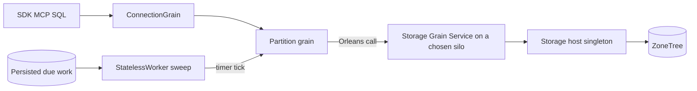

# OrleansExecution: Orleans execution primitives

Decision: [ADR-110](../../ADR/ADR-110-orleans-execution-primitives.md). Cluster concept: [ADR-136](../../ADR/ADR-136-orleans-partition-ownership.md). Connection grain: [ADR-125](../../ADR/ADR-125-connection-owned-execution.md).

This specification states which Orleans 10.4 primitive KeyLoad uses for each kind of work, and how each choice is verified. Frontend and client schemas are N/A: the public SDK, MCP and SQL operations are the entry points for verification.

## Primitives

| Work | Primitive | Key and identity |
|---|---|---|
| A connected client's operations | `ConnectionGrain`, `[Immovable]`, `[PreferLocalPlacement]` | Server-issued connection id |
| Commands of one logical partition | Partition grain | Canonical partition id from the shared ID helper |
| A node's ZoneTree files | Storage host DI singleton (lifecycle participant) plus one storage Grain Service per silo | One per silo; remote callers use `GetGrainService(SiloAddress)` |
| Copies of a write | Grain Service calls to the target silos | Target silos from `IClusterMembershipService` |
| Queue deadlines, due and recurring work, remote queue transfers, ANN projection, time-series chunks | `[StatelessWorker(1)]` grain that sweeps persisted work pages on a `RegisterGrainTimer` tick; one polling activation per silo | One pool key per work kind from the shared ID helper |
| Durable periodic work (≥ 1 minute) | Reminders | Owning grain |
| One-time due work | Durable Jobs with idempotent `IDurableJobHandler` | Target grain |
| Streamed results | `IAsyncEnumerable<T>` grain methods | Call-scoped |
| Per-call identity | `RequestContext` via ManagedCode.Orleans.Identity | Verified subject only |

## Connection and request lifetimes

One Orleans grain per accepted client connection runs that connection's independent operations in parallel within typed bounds (ADR-125). Each operation keeps its own request envelope id, fresh persisted authorization, cancellation and cleanup. No grain is created per request and no completed-request history is kept. Disconnect or idle expiry stops admission, joins the original operations and requests `DeactivateOnIdle`.

## Background work

Background work never checks leadership. Each silo hosts one polling activation per work kind; on every grain-timer tick it reads the next page of persisted due, deadline, transfer, chunk or projection records from the storage owner and dispatches them through the normal coordinator grain → partition grain → ZoneTree owner path. The sweep interval is a typed option (for example 5 seconds). Nothing is buffered in memory: the persisted records are the only work source, dispatch is idempotent through stable command identities, and clients are acknowledged only after the authoritative commit. Reminders are not used; the sweep replaces them.

## Requirements and acceptance

| Requirement | Acceptance |
|---|---|
| REQ-ORL-001: use the primitive listed above for each kind of work; do not add custom schedulers, coordinators, leader election or transports. | AC-ORL-001: a source review lists every grain, Grain Service, stateless worker, timer, reminder and durable job with the work it owns; none checks leadership or opens its own transport. |
| REQ-ORL-002: stateless worker pools stay bounded. | AC-ORL-002: each silo runs at most one polling activation per work kind, every sweep reads one bounded page, and a page that cannot be dispatched stays persisted for the next tick. |
| REQ-ORL-003: `[OneWay]` carries only advisory, loss-tolerant signals. | AC-ORL-003: dropping or duplicating such a signal changes no committed state and the affected operation still completes. |
| REQ-ORL-004: interleaving is enabled only where the invariant allows it. | AC-ORL-004: a long operation on a connection does not block close or cancel (`[AlwaysInterleave]`); concurrent operations keep separate identity and authorization. |
| REQ-ORL-005: durable jobs and reminders have idempotent effects. | AC-ORL-005: a job retried after a handler failure or a provider restart produces the effect exactly once or an explicit no-op. |
| REQ-ORL-006: efficiency claims need measurements. | AC-ORL-006: any performance claim for a primitive choice is backed by matched Linux benchmark runs. |
| REQ-ORL-007: ZoneTree is opened and closed by the storage host through the silo lifecycle, not in `GrainService.Stop()`. | AC-ORL-007: silo stop, cancelled stop and restart release the file locks once and reopen the same files with all acknowledged data. |
| REQ-ORL-008: Orleans messaging is not database history. | AC-ORL-008: committed events and queue messages are read from ZoneTree, never from Orleans streams, observers or broadcast channels. |
| REQ-ORL-009: only `ITransactionalState` participates in Orleans transactions. | AC-ORL-009: no document claims cross-partition ACID from Orleans transactions; same-partition atomic batches remain the atomicity contract. |
| REQ-ORL-010: identifiers come from one shared helper per identity kind. | AC-ORL-010: case-variant or non-canonical keys are rejected at routing and storage boundaries; the helper round-trips canonical keys unchanged. |
| REQ-ORL-011: background work uses stateless workers with timer sweeps and no leadership check. | AC-ORL-011: committed due records are dispatched within the configured interval; a silo crash between commit and sweep loses no acknowledged data because the next sweep reads the same persisted records. |
| REQ-ORL-012: Orleans telemetry is exported with fixed, privacy-safe metadata. | AC-ORL-012: exported spans, metrics and logs carry no credentials, payloads or unbounded labels and keep trace parentage across grain calls. |
| REQ-ORL-013: one connection grain owns its client's operations. | AC-ORL-013: repeated operations from one connection reuse one activation; independent principals and commands stay isolated; disconnect removes the activation. |

## Verification

Real TUnit operations through the .NET SDK and official MCP client against the Aspire-owned Docker cluster, plus focused unit tests of the stateless-worker sweep and the ID helper. AC-ORL-011 requires the current StatelessWorker sweep and grain-timer path; source presence does not qualify its actual cancellation and joined shutdown behavior.
