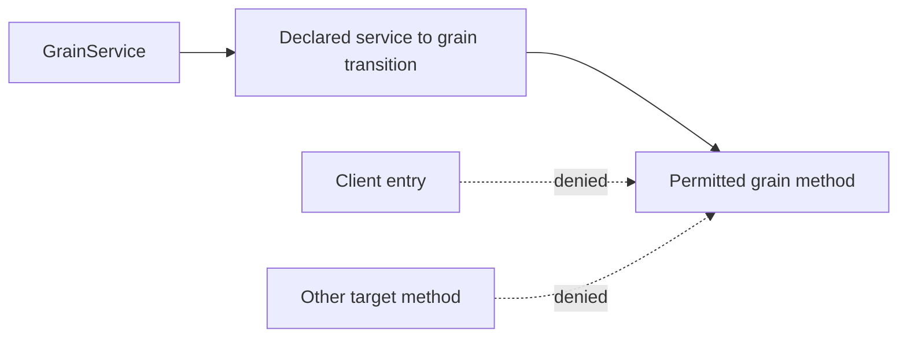

# GrainServiceGraph within OrleansExecution

Dependency-repair contract for [ADR-094](../../ADR/ADR-094-orleans-due-coordination.md) and the grain-call policy of [OrleansExecution](../OrleansExecution.md). ManagedCode.Orleans.Graph 10.0.9 admitted only `IGrain` sources in its fluent and attribute configuration. A Grain Service is an `IGrainService` system target. Giving it a client entry or fabricating caller context would weaken the intended service-to-grain boundary.

| Requirement | Acceptance |
|---|---|
| REQ-SGRAPH-001: service-source policy | AC-SGRAPH-001: the owning Graph package exposes `AddGrainServiceTransition<TService,TGrain>(params string[] targetMethods)`, constrained to the actual Orleans GrainService implementation and an `IGrain` target. It adds only the actual service type, explicitly any callback source method, and the supplied target methods. Empty/null/blank input fails before changing the existing graph; all previous method rules remain effective. |
| REQ-SGRAPH-002: real caller enforcement | AC-SGRAPH-002: a Orleans-hosted service callback outside a client request reaches the explicitly permitted application-grain method, a different target method is rejected, and direct client entry remains denied. The observed source is the actual service implementation, never CLIENT, UNKNOWN, the base Grain, a fabricated context or a reflection-order guess. Existing application-grain, system-target and async-stream regressions pass. |
| REQ-SGRAPH-003: published ownership and consumer join | AC-SGRAPH-003: repair source and focused regressions live in the sibling Orleans.Graph repository; its canonical patch release passes required checks and GitHub publication and is available from the real NuGet feed. Only then does KeyLoad update its central package reference and declare each Grain Service to grain edge it needs with the API, keeping the existing connection-to-partition default-deny edges. |

The Graph method is an additive startup configuration API. No KeyLoad public operation, serialization alias, persisted format or topology changes. The any-source-method rule represents service callbacks without a current incoming method; it does not allow another source type, target method or client. Runtime caller resolution is preserved unless a real hosted regression demonstrates a defect, which must be repaired and tested in the owning Graph repository. No consumer copy, project reference, AllowAll, client entry, filter bypass, guessed caller or context impersonation is permitted.

Background work: queue, ANN and time-series background work must not be driven by leader-gated Grain Service cycles. The accepted pattern is Orleans `[StatelessWorker]` grains that buffer events and, on an Orleans timer whose interval is a typed option, write the batch through the normal grain to ZoneTree owner path (see [OrleansExecution](../OrleansExecution.md#background-work)).

Frontend and new SDK/MCP syntax: N/A, this is internal routing configuration.
