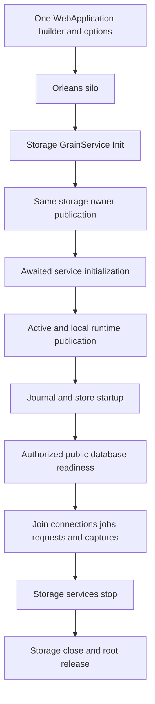

# One host and partition publication

Decision: [ADR-136](../../ADR/ADR-136-orleans-partition-ownership.md). Parent: [OrleansExecution](../OrleansExecution.md). Related: [SingleHostComposition](SingleHostComposition.md), [RuntimeConstructorCycle](RuntimeConstructorCycle.md), [RequestDrainLifecycle](RequestDrainLifecycle.md).

## Scope and invariants

One production WebApplication owns the Orleans silo and its one service container. The silo-local storage Grain Service opens the node's one PartitionHost (ZoneTree stores, WAL/journals, file locks and ordered apply) during its awaited Init. Migratable activations borrow that local execution; they never acquire files. Orleans membership, directory and activation migration stay separate from acknowledgement from every configured copy across ReplicaCount copies, ordered apply, the atomic command journal and the ZoneTree WAL.

`ServerConfiguration.BuildAsync` binds canonical `NodeOptions` post-configuration and validation through the OptionsFactory, resolves the DNS/IPv4 policy asynchronously, and registers `UseOrleans` on the same builder. It neither builds another production service provider nor opens storage. Authentication, strict JSON, HTTP/SQL/MCP framing, request observers, ServiceDefaults and OpenTelemetry stay on that same application. The PartitionHost is never a DI service: post-publication factories and request handlers borrow it through its owner. Disposable storage components and separately owned work are exposed only through bounded typed access delegates returning the same component, so the container cannot capture them for independent disposal. Genuine DI-created clients and runtime observers keep their original ownership.

## Requirements and acceptance

| Requirement | Concrete completion gate |
|---|---|
| REQ-ONEHOST-001: use one host and canonical validated options. | AC-ONEHOST-001: production BuildAsync completes with no node directory or lock acquisition; resolving all hosted-service and journal constructors does not open storage. Invalid settings and DNS/cancellation errors preserve their exact original outcomes. |
| REQ-ONEHOST-002: Init publishes the storage owner. | AC-ONEHOST-002: storage Init completes the same retained opening task; every dependent Init awaits the same `IPartitionStoragePublication` before resolving database/endpoint/router aliases. Concurrent initialization cannot open a second owner or resolve a premature null router. |
| REQ-ONEHOST-003: separate local runtime publication from database readiness. | AC-ONEHOST-003: Active publication makes silo services available without waiting for other silos. Database startup after Active opens the runtime journals and local store before public database admission; a failure keeps admission closed. No Host.Start self-wait or second host occurs. |
| REQ-ONEHOST-004: close borrowers before the storage owner. | AC-ONEHOST-004: connection operations, node request work, jobs and accepted administration captures join while their storage is live. maintenance producers, the connection registry and captured node borrowers also join before the storage close, including on direct container disposal. Only a settled Closing and actual CanReleaseRoot permit container disposal; an unknown close retains the application/root and original failures. |
| REQ-ONEHOST-005: recover actual acquisition failures. | AC-ONEHOST-005: pre-cancelled creation acquires no storage resources and preserves the captured root inventory. A genuine post-Init failure proves lock exclusion, the original error plus every cleanup failure, joined release, same-root cold recovery and healthy complete operations. Never-started silo cleanup keeps its guard. |
| REQ-ONEHOST-006: preserve real multi-node callers. | AC-ONEHOST-006: Aspire Docker replicated-cluster SDK/official MCP tests keep their real topology, clients, cancellation and joined cleanup; stored models, receipts and no-effects oracles stay exact. |
| REQ-ONEHOST-007: preserve observer and authorization identity. | AC-ONEHOST-007: the three `SiloOwnerPurposeRegistration` cases preserve exact borrowed/explicit observer identities. Effective omission-purpose precedence and the phase observer survive the single container. Each database operation still checks fresh persisted authority; no caller role is trusted. |

Frontend, new public SDK methods, SQL grammar, storage formats, migrations, packages and alternate transports are N/A: this is an internal ownership design. The optional internal lifecycle-participant factory enrols a fixture-owned observer in the original builder before Build; it does not create an alternate host, storage provider or authority.

## Ownership

- ServerConfiguration and OrleansSiloConfiguration own the single-builder join; protocol/serializer aliases and numeric field identities are preserved.
- `PartitionStorageRegistration` is registered first among Grain Services. StorageRecovery owns the opening/publication/closing tasks and root fences. Grain Service constructors are inert; service initialization awaits publication explicitly (sequential service initialization is not ordering of independent lifecycle callbacks).
- Shutdown closes admission and joins operation/capture producers before teardown. jobs keep their own shutdown. Storage services stop at the runtime storage stage and the same storage lifecycle closes below it. Failed-start callers may join that retained close after the host stop attempt; they never dispose another PartitionHost directly.

## Test mapping

| Acceptance | Existing test |
|---|---|
| AC-ONEHOST-001 | `RuntimeConstructorCycleTests.ProductionConstructorsAndPendingCatalogCancelBeforePhysicalPublication` (production BuildAsync, constructors resolved, data directory absent). |
| AC-ONEHOST-007 | `SiloOwnerPurposeRegistrationTests.ActualSiloRegistrationPreservesBorrowedAndExplicitPurposeOwnerIdentity`, all argument variants. |
| AC-ONEHOST-002..006 | No dedicated test is named here; they remain open. |

Process-kill evidence is not power-loss durability or production readiness.

