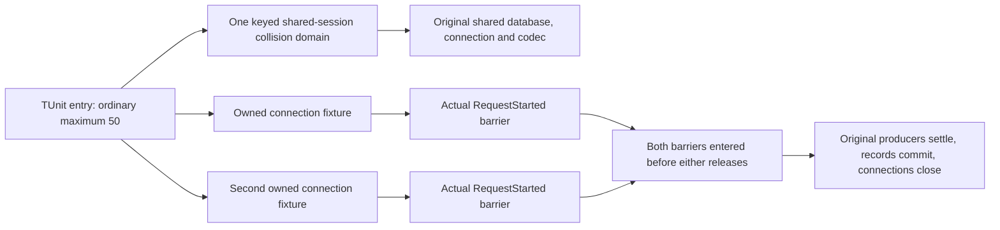

# regression scheduling

This supplement belongs to `OrleansExecution`, ADR-117's TUnit entry and ADR-125's connection execution. Tests use the original fixtures and TUnit scheduling.

The ordinary maximum is 50. A shared mutable fixture needs one collision domain; an independently owned fixture has its own lifecycle. Scheduling must reflect actual ownership without weakening substantive assertions or the isolation of heavy and Aspire replicated-cluster tests.

## Requirements and acceptance

| Requirement | Contract | Acceptance and source mapping |
| --- | --- | --- |
| REQ-EXECUTION-SCHEDULE-001 | Preserve ordinary maximum 50 and existing heavy and replicated-cluster test ownership. Use keyed `NotInParallel` for the default `RequestCqrsDataSource`'s mutable `PerTestSession` fixture. | AC-EXECUTION-SCHEDULE-001: `RequestCqrsFixtureScheduling.SharedSession` identifies the same collision domain in `RequestCqrsBoundaryTests`, `RequestCqrsFatalSettlementTests`, `RequestCqrsRoutingTests`, `MultiLaneReceiveWholeFlowTests` and `ConnectionProducerCleanupTests`. Existing methods and arguments remain unchanged; execute the original ordinary cohort. |
| REQ-EXECUTION-SCHEDULE-002 | Permit independent ANN, text and connection fixtures to overlap unrelated work while retaining original cancellation and joined shutdown. Shared serialization uses its existing concurrent provider registry and per-call serializer sessions. | AC-EXECUTION-SCHEDULE-002: `RequestCqrsAnnMaintenanceTests`, `RequestCqrsTextMaintenanceTests`, `ConnectionAwaitedSettlementTests` and `RequestCqrsAnnEnrollmentAckTests` have no blanket exclusion. Their actual owned factory or explicit constructor creates their database/runtime fixture. Run these original operation cases alongside the ordinary cohort. |
| REQ-EXECUTION-SCHEDULE-003 | Prove independent fixture overlap with observable original operation barriers, distinct ownership and substantive stored results. | AC-EXECUTION-SCHEDULE-003: `ConnectionFixtureConcurrencyTests.IndependentlyOwnedConnectionsReachBothOriginalBarriersAndSettle` starts two original `ConnectionScenario` fixtures. Both actual signed commands reach `RequestStarted` before either releases. Distinct directories, connection IDs, work owners and grain identities, persisted principal binding, producer disposal, both committed records and signed close are asserted. |
| REQ-EXECUTION-SCHEDULE-004 | Preserve actual global-resource exclusion until that resource's owner supplies a qualified narrower contract. Do not infer isolation from fixture names. | AC-EXECUTION-SCHEDULE-004: `OrleansRuntimeTelemetryTests` retains blanket exclusion for process-wide metric capture. Its bounded activity exporter selects traces registered before each owned operation starts, and privacy sentinels select the original caller parent. Both capture isolation and exhaustion controls remain mandatory ordinary tests. |

## Source map and evidence

The implementation paths are `tests/KeyLoad.FunctionalTests/OrleansExecution/{Cases,Fixtures,Helpers}/` and the existing `tests/KeyLoad.FunctionalTests/Messaging/Cases/MultiLane/MultiLaneReceiveWholeFlowTests.cs`. Changes comprise the shared-session key, guarded attribute changes and the genuine two-fixture whole operation case. Frontend, public SDK/MCP operations and server database execution are N/A: this work changes test scheduling and adds original-fixture evidence.

The named functional shard runner uses four concurrent test slots on local and CI
runners. This resource bound is declared in `ci-test-shards.json`; the Aspire-owned
TUnit entry retains its separately validated ordinary maximum of 50. Host startup
and operation phases retain their own deadlines, including flows owning two hosts.

Qualification: the focused cases and the ordinary cohort must run with maximum 50 through the TUnit entry; the solution build, process recovery and Aspire replicated-cluster .NET SDK/official MCP gates remain mandatory and are not proven by this document.
