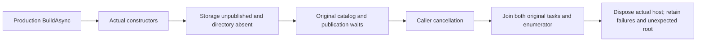

# runtime constructors before storage publication

[ADR-136](../../ADR/ADR-136-orleans-partition-ownership.md) requires the actual Generic Host
and Orleans providers to construct without borrowing unpublished physical
storage. This contract uses production ServerConfiguration.BuildAsync, not copied
composition, a mock resolver, manually opened database or simulated lifecycle.

REQ-EXECUTION-CONSTRUCTOR-001 / AC-EXECUTION-CONSTRUCTOR-001: before Start, resolve the
real hosted services, ILocalDurableJobManager and named journal provider
and catalog. Both journal interfaces identify the same provider. The
configured production topology remains unchanged and its fresh data
directory must remain absent. Constructors do not prove Active or Ready.

REQ-EXECUTION-CONSTRUCTOR-002 / AC-EXECUTION-CONSTRUCTOR-002: the actual named catalog
enumeration and same-owner storage publication wait remain pending while execution
admission/publication are closed. Cancel their real caller-linked token; settle
BOTH original tasks, then the actual enumerator, then the original production
host. Retain every unexpected fault and cleanup error. Any unexpected data root
is retained, never deleted to make the test pass. Cancellation does not open
admission, start storage, replace tasks or prove an unstarted physical opening.

Both criteria map to RuntimeConstructorCycleTests.
ProductionConstructorsAndPendingCatalogCancelBeforePhysicalPublication.
The separate [job public operation](../Messaging/RuntimeJobPublication.md)
exercises genuine SDK/MCP results through the replicated cluster. Existing RuntimeJournalStorageTests,
RuntimeJournalGraphCallerTests and SagaTimeoutRestartTests remain mandatory
regressions. Their preopened fixtures are not constructor-publication proof.

The pinned [LocalDurableJobManager.Start](https://raw.githubusercontent.com/dotnet/orleans/d114d7522a53b8cce4c6b97d44293e5c7273d766/src/Orleans.DurableJobs/LocalDurableJobManager.cs) launches background loops and
returns Task.CompletedTask at Active. It does not await initial catalog recovery
inside that callback. Closed database admission may suspend the background read;
shutdown must cancel and join that original work. This source fact does
not replace actual startup, shutdown or replicated-cluster qualification.

This document does not prove the recovery or Docker/Aspire SDK/official MCP
gates. Public schema, UI and performance are N/A.
No package, format, timeout or quota changes are introduced.

