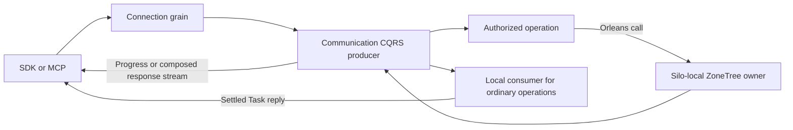

# CQRS response streams

The connection grain executes authorized database operations through the
centrally pinned ManagedCode.Communication packages. Ordinary operations without
a progress consumer drain the producer locally on the connection grain and return
one settled Orleans Task reply. Progress consumers and composed maintenance or
queue operations retain the Orleans
`IAsyncEnumerable<CqrsStreamChunk<TProgress, TResult>>` response from the same
producer. The decision is
[ADR-082](../../ADR/ADR-082-cqrs-streams.md).

## Requirements and acceptance

| Requirement | Acceptance | Existing test scope |
|---|---|---|
| REQ-NCQRS-001 | AC-NCQRS-001: real generated Orleans calls retain the allowed application edge and originating identity across Started, suspension and subsequent calls. Denied transitions do not enter the target. | `CqrsGraphTests` |
| REQ-NCQRS-002 | AC-NCQRS-002: bounded producer backpressure, cancellation and early enumerator disposal settle the actual producer before resources are released; the following stream succeeds. | `CqrsLifetimeTests` |
| REQ-NCQRS-003 | AC-NCQRS-003: progress and terminal outcomes retain their Communication shape; safe domain failures remain distinguishable from transport cancellation and persisted write outcomes. | `CqrsTerminalTests`, request-stream operation tests |
| REQ-NCQRS-004 | AC-NCQRS-004: independent concurrent streams do not share identity, policy context, history or results. | `CqrsIsolationTests` |
| REQ-NCQRS-005 | AC-NCQRS-005: SDK and official MCP callers consume actual progress/results, cancellation and failure behavior through the Aspire-owned database topology. | Public client integration suites |

## Ownership

`CqrsStream.Create` owns the capacity-one channel, sequences, result chunks,
terminal publication, cancellation and producer settlement. Use the package's
normalizer when adapting another chunk source. Orleans owns execution
response enumeration, batching, scheduling and disposal.

ManagedCode.Orleans.Graph enforces application call transitions and preserves the
originating context across Task calls and enumeration. The terminal Task entry
allows independent operations to interleave on the connection while storage stays
on the independent request path. KeyLoad checks fresh persisted policy,
request and result identity, operation-specific progress, byte/frame limits,
execution deadlines and concurrent resource admission. It must not duplicate the
library's producer, transport or dispatcher.

The request envelope and bounded progress contracts are in
[CqrsRequestV2](CqrsRequest.md). TestCluster mechanism cases use
the real published Graph, Communication and Orleans packages. Their observers
record actual runtime calls, context and producer settlement; they do not create
database success or replace public client integration tests.

Cancellation does not prove that a database effect was undone. A response stream
is not a durable job or a persisted command outcome. Release the operation's
storage resources only after its producer and admitted work have joined.

## Qualification

Keep mechanism tests, whole database operations, process recovery and actual
Aspire SDK/MCP checks distinct. Confirmed dependency defects follow the owning
repository repair and published-NuGet delivery rule. Local build/test results are
development evidence; exact-source Linux runtime artifacts qualify the product.

Focused local terminal-path checks cover a held operation alongside another read
on the same connection and physical owner, signed close and replay, fresh policy,
cancellation and awaited settlement. Small real SDK diagnostics verify every
stored document after measured reads and updates. These checks do not qualify
full partition fan-out, background catch-up, endurance or competitor rankings.
