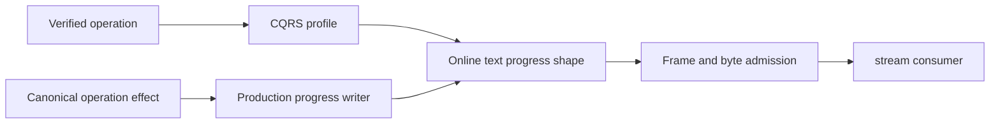

# online-text progress admission

Parent: [OrleansExecution](../OrleansExecution.md), [RuntimeCqrs](RuntimeCqrs.md), [ADR-082](../../ADR/ADR-082-cqrs-streams.md).

## Confirmed source defect and boundary

The OnlineTextParentFlow emits typed CQRS Progress frames after its real effects. CqrsStreamPurpose did not classify this operation and CqrsStreamAdmission handled only text, ANN and event-tail progress, so the first online-text progress frame fell into terminal validation and was rejected. No runtime failure of online-text maintenance has been observed for this defect, and no dependency or ZoneTree issue is asserted.

## Requirements

- REQ-EXECUTION-PROGRESS-ONLINE-001: only an actual verified MaintainOnlineTextIndex operation may admit OnlineTextPhase progress. The exact production grammar is Captured, Seeded, CaughtUp, Validated, Published, RetirementMarked. OnlineTextReplay emits no separate replay progress. Request identity, sequence, successful nonnull progress, exact fixed message/event type, absence of terminal data/event ID and absence of all other progress payloads are mandatory. Rejection must not advance the accepted shape.
- REQ-EXECUTION-PROGRESS-ONLINE-002: ResolveOriginal may return its retained result without any progress. A successful stream is therefore either Started plus Completed, or the complete six-phase fresh grammar plus Completed. Partial fresh progress cannot masquerade as retained completion. Failure may occur after any accepted prefix. The shape validates protocol, never publication authority.
- REQ-EXECUTION-PROGRESS-BOUNDS-001: reuse the CQRS stream, generated Orleans serialization, centrally validated MaximumStreamFrames, per-frame and aggregate byte limits, original cancellation, original producer joins and the connection grain. There is no alternate transport, unbounded buffering, synthetic final frame or timeout relaxation. Started frames reject every optional progress payload.

## Acceptance gates

- AC-EXECUTION-PROGRESS-UNIT-001: actual CQRS writers produce the complete online grammar; ordinal identity, mixed payload, skipped phase and post-refusal continuation are checked. Shared admission admits only the bound operation profile and enforces frame/byte limits and partial-prefix terminal refusal. No standalone synthetic producer proves a real publication effect.
- AC-EXECUTION-PROGRESS-WHOLE-001: the whole online-text maintenance operation runs through the Aspire-owned replicated cluster with the real .NET SDK and official MCP where required, persisted authority, canonical effects, replica acknowledgement, cold recovery and joined shutdown. Unit checks do not pass this gate.

