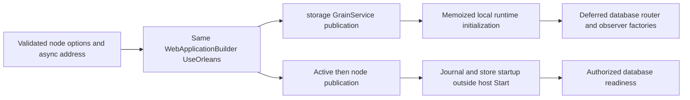

# single-host registration and deferred partition borrowers

Decision: [ADR-136](../../ADR/ADR-136-orleans-partition-ownership.md). Parent: [OneHostComposition](OneHostComposition.md). This is an internal registration design; no package, public ABI, format, provider, clock policy or database authority changes.

REQ-ONEHOST-REGISTRATION-001: one WebApplicationBuilder registers Orleans in its existing service collection without a nested host/container or storage acquisition during composition. AC-ONEHOST-REGISTRATION-001: canonical validated NodeOptions and the asynchronously resolved address feed `OrleansSiloConfiguration.Register(builder,node,address,localhost)`; the same options manager serves DI. Orleans clustering, serializer converters, the distributed grain directory and activation repartitioner, activity propagation and every Grain Service stay registered. options callbacks consume current typed `IOptions` policies; no competing configuration binding or provider is introduced. `PartitionStorageRegistration` registers the one storage owner before other service declarations; same-stage ordering is not assumed. The never-started-silo hosted-service guard remains.

REQ-ONEHOST-REGISTRATION-002: database and router services resolve only after storage publication and the shared local-runtime initialization. AC-ONEHOST-REGISTRATION-002: storage factories invoke the storage owner's `Borrow()` after publication; no raw PartitionHost is a DI factory result. Database/search factories borrow the same host, while optional model/graph routers select the same node's prepared fields. `RequireLocalRuntimePublished` rejects early optional resolution instead of caching a premature missing runtime. A disabled feature keeps its optional-null `GetService` result after successful preparation; no alternative implementation or provider is selected. No constructor may resolve these factories before its publication wait.

REQ-ONEHOST-REGISTRATION-003: preserve private observer identity and current telemetry ownership. AC-ONEHOST-REGISTRATION-003: the same sealed observer interface instance is registered by ServerConfiguration; canonical registration keeps explicit purpose/phase precedence. The one codec uses the omission purpose when present, then the explicit/borrowed purpose observer; a legitimately missing omission purpose cannot suppress that fallback. Borrowed disposable components are registered as execution `Func<T>` delegates: the DI descriptor factory captures the published component once at first resolution, and invoking the delegate only returns that reference without querying the provider, calling `Borrow` or repeating the publication guard. The container owns the delegate, not the disposable component. ANN/Text/Online child operation objects capture their delegate at construction, so `finally`/Abort work does not look it up through a disposed provider; such admitted work still enforces fresh authorization, resource bounds and closed admission. One host uses its own ILoggerFactory/ServiceDefaults and Orleans activity propagation; there is no parallel telemetry host.

Tests: `SiloOwnerPurposeRegistrationTests` keeps its three identity cases through the same `RegisterObservers` helper used by registration; its local service collection owns no database topology and is not evidence for the unified host lifecycle. Source registration order alone proves neither publication ordering nor storage-close settlement.
