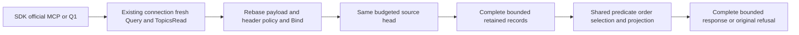
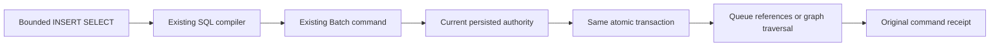

# QueryExecution

QueryExecution owns the authorized, bounded query surface of the database: typed AST queries, T-SQL lowered to the same operations, SQL views over events, queues and topics, typed joins, declarative model composition and distributed multi-partition queries. Every request runs on the caller's connection grain ([ADR-125](../ADR/ADR-125-connection-owned-execution.md)), reloads persisted authorization and shares one cancellation, deadline and read budget. Distributed queries are ordinary Orleans grain calls to the logical partitions whose silo-local ZoneTree owners answer, merged by the connection grain ([DistributedQueryExecution](QueryExecution/DistributedQueryExecution.md), [ADR-136](../ADR/ADR-136-orleans-partition-ownership.md)).

T-SQL syntax comes from Microsoft ScriptDOM: [requirements](QueryExecution/ScriptDom.md), [ADR-130](../ADR/ADR-130-microsoft-scriptdom-tsql.md) and the [conformance inventory](../implementation/sql-client-conformance.json). Grammar acceptance, executable semantics and wire protocol are separate gates; no complete-SQL, TDS or production qualification is claimed.


## Query core contract

`QueryPage.CutPosition` identifies the physical committed read cut. A cursor
retains its original cut while its existing ownership, source and authorization
fences remain valid. This position is distinct from the canonical command
sequence in `CommitToken.Position`: group commit can persist several commands in
one journal frame, and local derived commits can advance the physical position.
The two counters must not be compared as though they share one unit.

| Requirement | Acceptance | Automated evidence |
|---|---|---|
| REQ-QUERY-001: one cancellation/deadline/raw key-value budget covers SQL parsing plus point, index and full-scan candidates | AC-MP-003 | Real-store SQL/AST index-plus-point accounting, full-scan rejection before page copies, cancellation during a long SQL token, and pre-tokenization rejection above the byte cap |
| REQ-QUERY-002: prepare JSON paths/order keys once and retain only the prefix needed for the requested page | AC-MP-003 | Real-store mixed scalar ordering, ties, filters, page concatenation and large-value allocation cases |
| REQ-QUERY-003: preserve authorization, redaction, explain, cursor cut/epoch and complete response limits | AC-MP-003/012 | Existing QueryAdapter/Security/LiveQuery cases plus new exact metadata/output and negative cases |
| REQ-QUERY-008: SQL/AST/live and Search share node-local analytical admission even across engine instances | AC-MP-003/004/011/012 | Real ZoneTree saturation, cancellation/error release and independent-database cases in Features/ResourceExecution |

| Requirement | Acceptance / flows | Test mapping |
|---|---|---|
| REQ-QUERY-004: versioned capability and grammar never execute unsupported expressions | AC-QUERY-004: supported Q1/AST passes validation; an unknown version/operator, non-scalar parameter, malformed AST or unsupported CLR expression is explicitly rejected before any scan or execution of application code | Existing `AstRejectsUnknownVersionOperatorsAndNonScalarParametersBeforeScanning`, `MalformedPolymorphicAstIsRejectedByTheProtocolDeserializer`, `UnsupportedExpressionsNeverInvokeApplicationGettersOrDelegates` in QueryAdapterTests |
| REQ-QUERY-005: SQL, JSON and C# are adapters of one authorized AST with typed scalar semantics | AC-QUERY-005: equivalent requests return the same order, access path, PII omissions and an interchangeable cursor; null/missing/IN/parameters are defined; builder branches do not share a mutable query context | Existing `SqlJsonAndCSharpAdaptersHaveTheSameSeededResultsAndAccessPath`, `CursorContinuesAcrossEquivalentSqlJsonAndCSharpForms`, `NullMissingAndInHaveExplicitCanonicalSemantics`, `BuilderBranchesHaveIndependentQueryContexts` in QueryAdapterTests |
| REQ-QUERY-006: planner, Explain and continuation preserve cut, scope and policy authority | AC-QUERY-006: point, index and full-scan paths obey the same authorization; tampered, wrong-scope and stale cursors are rejected; a source or policy change invalidates the matching cursor; protocol metadata counts toward the result bound | Existing `InvalidCursorIsRejectedBeforeACollectionScan`, `CatalogAndOtherCollectionWritesPreserveTheCursorButSourceWritesInvalidateIt`; SecurityAndQueryTests revocation cases |
| REQ-QUERY-007: extended and distributed operators are declared only after versioned semantics and qualification | AC-QUERY-007: capability fixtures and real cluster tests prove the declared partition cuts, failure, cursor and budget semantics; unsupported joins, graph and search extensions remain explicitly unsupported, with no silent client-side evaluation | Distributed and extended AST ADR contract suites |
| REQ-QUERY-009: a query ordered by ascending document id pages through any collection with work bounded per page | AC-QUERY-009: each id-ordered page continues after the last id of the previous page instead of an offset; a full scan seeks to that key and stops one accepted row past the page, so every document is read once and each page examines only its own rows; no request asks storage for more records than one range read may examine | `QueryKeysetPagingTests`, `QueryKeysetDeletedRangesTests`, `StorageRangePagingTests`, `QueryCursorTests`, `QueryAdapterContractTests` |

Complete range traversal stops its internal visitor at the provider's record ceiling before a lookahead can exceed that physical page's work budget. It resumes after the last delivered storage key inside the same owning gate. An internal page boundary does not become the caller's terminal stop; an explicit caller stop remains terminal even at that boundary. A contiguous range of deleted documents can therefore span storage pages while the query continues collecting its requested live rows. Physical examined-record, byte, read-cut and cancellation checks remain enforced by their existing owners.

Q1 provides typed adapter validation, authorization, deterministic scalar order, a bounded current-cut query and cursor, and a capability manifest. A global serializable snapshot, arbitrary joins and user delegates, and cross-shard execution are not declared implemented. [Search](Search.md) and [ChangeFeeds](ChangeFeeds.md) have their own behavior contracts; a live scalar query uses the same safe query boundary.

Decisions: [ADR-147 id continuation](../ADR/ADR-147-id-ordered-query-continuation.md), [ADR-149 no operation limits](../ADR/ADR-149-no-operation-limits.md), [ADR-004](../ADR/ADR-004-committed-read-views.md), [ADR-010](../ADR/ADR-010-query-budgets-security.md), [ADR-013 AST](../ADR/ADR-013-authorized-query-ast.md), [ADR-020 contexts](../ADR/ADR-020-independent-query-contexts.md), [ADR-022 policy epoch](../ADR/ADR-022-policy-epoch-revocation.md). One integration owner holds the shared AST, codec, security and cursor contracts. Qualification comes only from the TUnit, recovery and Aspire cluster SDK/MCP runs.

## SQL as the central language

SQL exists because KeyLoad is one composable database for AI agents: documents,
typed tables, graphs, blobs, queues, events, vectors/search and time series can
reference and use one another. [DatabaseComposition](DatabaseComposition.md) /
[ADR-067](../ADR/ADR-067-composable-agent-database.md) specify queue -> linked
entities -> knowledge graph and graph -> queued actions in one authorized bounded
request. The first server-derived stage uses composing mutations through existing
canonical SQL CALL; full declarative model sources/JOIN/DML remain required under
ADR-065. One shared language must not stop at independent calls per model.

Full SQL syntax and a client connection protocol are required. [ADR-065](../ADR/ADR-065-full-sql-client-compatibility.md) owns
the ordered implementation contract; [conformance inventory](../implementation/sql-client-conformance.json)
distinguishes syntax, executed semantics and interoperability. Current
Q1/SELECT/CALL is a stage; full SQL and protocol remain pending.

| Requirement | Acceptance | Evidence |
|---|---|---|
| REQ-SQLC-001/006: full versioned typed SQL | AC-SQLC-001/006 | [Active T-SQL family inventory](../implementation/sql-client-conformance.json), explicit semantic stages and real differential fixtures |
| REQ-SQLC-002/003/004: bounded comments preserve canonical results/authority | AC-SQLC-002-004 | Real-store and cluster SDK/official MCP comment cases |
| REQ-SQLC-005: conservative SQL transport outcomes | AC-SQLC-005 | Exact commented/unknown-root write outcomes over genuine Kestrel |
| REQ-SQLC-009/010: honest performance and search choice | AC-SQLC-009/010 | Pinned ZoneTree.FullTextSearch review, then genuine correctness/fault/isolated workloads |
| REQ-AISQL-001: one server supports linked model operations with SQL central | AC-AISQL-001/005/006 | Strict compiler and real SDK/official MCP cluster differential cases |
| REQ-AISQL-003: versioned single-statement SQL preserves canonical authority and resources | AC-AISQL-005-007/011 | Rejection/ID/retry/permission/cancellation/metadata and initial-RPC failure cases |
| REQ-AISQL-004: indexed work and honest comparable performance | AC-AISQL-008-010 | Reversed equality real-store regressions and the Linux comparison workloads |

SQL is the central language for one linked AI database. [ADR-054](../ADR/ADR-054-central-sql.md) adds a versioned unified SQL operation envelope: existing Q1 SELECT plus CALL into the sole canonical public operation catalog. [RelationalStorage](RelationalStorage.md)/ADR-055 supplies typed rows using those same document query/index paths. This is the first invocation stage; declarative model sources, arbitrary JOIN and FK remain required pending product stages.


The bounded typed `BETWEEN` / `NOT BETWEEN` lowering (REQ-SQLC-006 / AC-SQLC-006A) is specified in [SqlBetween](QueryExecution/SqlBetween.md). Scalar/null/eager-error semantics, expanded AST budgets, field authority and cursors remain canonical.

## SQL model sources: events, queues and topics

[ADR-072](../ADR/ADR-072-authorized-sql-model-views.md) freezes the SQL/AST/SDK equivalence of the event, queue and topic sources. Existing query and full-SQL requirements remain mandatory.

| Requirement | Acceptance / positive, negative, edge and error | Automated mapping |
|---|---|---|
| REQ-SQLVIEW-001: SQL source syntax lowers to one normalized typed AST | AC-SQLVIEW-001: EVENTS/QUEUE_MESSAGES literals, aliases, existing predicates/order/LIMIT/EXPLAIN and JSON AST return equal rows/errors; quoted source-like collection names stay collections; wrong arguments, source enum/generation, extra statements and model UPDATE reject before execution | SqlModelViewParserTests, SqlModelViewAstTests, real SDK/MCP cluster |
| REQ-SQLVIEW-002: views are pure authorized reads in one cut | AC-SQLVIEW-002: current Query+EventsRead/QueueInspect are required, dead letters require their grant, SELECT leaves queue states/claims/stream head/store position unchanged, stale generation and corrupt identity/history fail closed | SqlModelViewReadTests, SqlModelViewAuthorityTests |
| REQ-SQLVIEW-003: protected input/output and delivery authority never leak | AC-SQLVIEW-003: payload/header field use is denied before row scans, unprivileged star/nested/alias output omits protected canaries, full grants expose expected values, no SQL row or Explain includes lease tokens/owner/fingerprint; revocation immediately denies the next request | SqlModelViewAuthorityTests plus actual persisted-policy cluster SDK/MCP |
| REQ-SQLVIEW-004: every model operator has bounded work and output | AC-SQLVIEW-004: AllowFullScan is explicit; the configured result ceiling, caller cancellation and explicit expiry reject whole requests, with no scan, raw-read, depth or token limit ([ADR-149](../ADR/ADR-149-no-operation-limits.md)), cursor is explicitly unsupported, empty/terminal rows and exact metadata bounds hold; a following authorized read works | SqlModelViewBudgetTests, real ZoneTree and bounded TUnit cancellation |
| REQ-SQLVIEW-005: deployment preserves canonical execution on the replicated cluster | AC-SQLVIEW-005: each SQL/AST/SDK/MCP request uses existing request/read actors and persisted rights; real Aspire cluster append/enqueue/read and node restart preserve rows and leave queue delivery state unchanged | SqlModelViewCluster parity/authority/validation tests |

Freeze REQ-SQLVIEW-001..005 / AC-SQLVIEW-001..005 before the additive Topic source. AC-SQLVIEW-TOPIC-001 requires an actual persisted PublishTopic command, full literal SourceEventRecord parity in SQL and AST, current Query|TopicsRead, payload AND header field-use/projection, pure bounded one-cut reads, stale/missing/changed retained history refusal then exact owned repair and healthy continuation. The source contract approved for this stage is TOPIC_EVENTS('topic'[,positiveGeneration]) → ModelQuerySourceKind.TopicEvents=2. Preserve Events=0, QueueMessages=1, the existing alias and Id0/1/2, SelectQuery ModelSource Id7/InnerJoin Id8, Q1/AST1 transports and every original source grammar. Quoted source-like identifiers remain collections. No new persisted record, map, pin, cursor, connection activation, dispatcher or trusted role.

One existing WithModelQueryView reads current principal/resource and requires Query|TopicsRead. ModelQueryPolicies.Rebase includes BOTH /payload and /headers policies; existing Bind runs before head/body enumeration and Project applies to star/alias/nested outputs. A private DatabaseEngine topic visitor borrows the SAME budgeted view, SourceHead and SourceRecord/SourceEventReader. The retained count uses overflow-safe arithmetic with no record ceiling, every point read charges key/value bytes before decoding, and the normal result-byte ceiling and cancellation still apply. SQL LIMIT is not permission to omit retained history validation. Invalid head/data fails Corruption; actual missing retained positions retain HistoryUnavailable. Empty configured sources create no row or authority.

correction: actual PurgeTopicHistory preserves Generation while advancing FirstAvailablePosition. This stage tests that retained-history purge and a request whose explicit generation does not match the real persisted head. It does not invent a purge-created generation. publication/source identities and field IDs are unchanged. Readers borrow the same captured view; cross-request CutPosition equality is never assumed.



REQ/AC-AUTH-005/006/009 and REQ/AC-SQLVIEW-002/003/005 require a failed event/queue SQL request to carry no partial page or protected payload/header metadata.  The existing two real persisted model-authority cases check the SDK error code only at field-use denial and have no actual foreign model partition. Extend those same whole flows using a second genuinely administrator-seeded event/queue partition with its own tenant. The original non-admin persisted own-tenant credential must receive exact PermissionDenied/safe scope detail for both foreign SQL model sources through SDK and official MCP. Every failed SDK result must be IsFailed, Value null and contain no credential or any of the four literal event/queue payload/header canaries in complete serialization; official MCP must retain its exact error envelope and omit those same canaries from the complete result. Apply the complete privacy/no-page oracle to the original same-tenant denied sensitive predicate too.

Before and after foreign rejections, actual administrator stream and message inspection plus SQL rows must equal the literal seeded histories and Ready/unclaimed queue state. Compare ordered logical rows and complete original records, require positive cuts, and never infer equal cluster-wide cuts across separate calls. The original authorized redacted SDK/MCP read follows the denials, then a real persisted field grant exposes the literal selected value, followed by actual revocation. Original transport, topology, grant epoch, deadlines and cleanup stay unchanged. No product fix or new runtime hook is presumed from this coverage gap.

REQ-SQLVIEW-002/003/005, AC-SQLVIEW-002/003/005, ADR072 and ADR125. Actual ModelQueueQueryRows.Accept checks DeadLettersRead only for DeadLettered, while current DatabaseEngine.InspectMessage requires it also for PendingDeadLetter. This is an owning SQL authorization defect, not a new grant or registry. Change only that existing pre-body predicate to include PendingDeadLetter; no public/IDs, routes, projection, dispatch, budgets or persisted format changes.

## Independent query output ceiling

Add nullable positive QueryExecutionOptions.MaximumResultBytes; null configures no KeyLoad result ceiling, and an explicit value is the only configured query/read output ceiling ([ADR-149](../ADR/ADR-149-no-operation-limits.md)); otherwise the grain reply and stream ceilings in GrainRoutingOptions bound delivered results. This is server-owned typed query/read output configuration, not a caller request field, command budget or persisted format. Existing Core ReadExecutionBudget adds a monotonic result-byte constraint over its cancellation and explicit expiry. It changes only bounded exact UTF8 output counting; it does not restart a clock, read/work grant, admission lease, authorization or read cut. Default null preserves original calls and clock checks. Callback/page state and complete response accounting remain shared across SQL/AST/SDK/official MCP execution.

Every existing output owner consumes the same bound: QueryEngine scalar/Q2/model/explain and GraphPath SQL, live-query snapshot/delta, partition query plan/leaf retained grants/merge/public mapping, SearchEngine text/vector/hybrid/graph results and SQL graph search consume the same bound. Existing cumulative selected-result/retained byte checks use the constrained budget; storage-owned range work bounds (ZoneTreeStorageExecutionOptions) remain unchanged. Exact final serializer accounting includes response metadata and must throw existing BudgetExceeded without a successful partial result. No serialization alias/field IDs, policy/authority, cursors, journal limits or HTTP input admission changes. Existing server QueryExecutionOptions binding/Validate remains configuration authority.

Graph search composition: REQ-QUERY-007 and AC-QUERY-007-GRAPH-002 require SQL graph parsing, graph owner admission, graph reachability, selected document/context projection and final protocol serialization to share the original ReadExecutionBudget. QueryEngine may receive a SearchEngine with different frozen options: effective output/retained cap is the monotonic minimum of the original ceiling, SQL owner configured cap and SearchEngine configured cap. No new clock/start, token, examined-record/read-byte grants or task boundary may replace that parser budget. SQL delegates to that same overload and retains existing final checks.

AC-QUERY-007-GRAPH-002 maps to SqlGraphSearchResultCompositionTests: actual persisted ZoneTree documents and graph, mismatched caps in both directions, exact projected-search cumulative BudgetExceeded diagnostic before final graph serialization, no returned partial result, complete ordered raw record bytes and commit position unchanged, then literal healthy graph hit/entity/revision/JSON/rank/empty-expansion oracle under the same owners. This specifically distinguishes early retained projection enforcement from post-allocation wrapper rejection.

REQ-QUERY-001/003, AC-MP-003/012 and REQ/AC-FEED-002/003 under ADR-004/010/013/022/118 require the existing constrained result budget to admit each retained selected live delta before retention. Core keeps its existing public ReadChangeFeedView signature and adds an internal synchronous before-retain overload, invoked only after original request.MaxBytes admits the change and before changes.Add/checkpoint advancement. LiveQueryResultByteAdmission uses exact original budget.MeasureResult and cumulative MaximumResultBytes; overflow is existing QueryEngine.ResultLimitExceeded BudgetExceeded, not partial success. Full wrapper serializer check remains. No operation clock/token/read grants/admission/read cut reset or new request/serialization/persistence field. Install this additional callback only for an explicit configured result cap; null/default preserves old feed behavior.

## Typed INNER JOIN

The Q2/AST2 INNER JOIN extends REQ-QUERY-007 only with the exact bounded Q2/AST2 Text primary-key INNER equijoin in [ADR-118](../ADR/ADR-118-bounded-relational-inner-join.md). AC-QUERY-007-JOIN-001/002 and AC-REL-004-JOIN-001..006 map to explicit language/AST admission, declared schemas/aliases, both persisted resource and row grants, join/order field-use, safe projection, one committed read-cut, deterministic ordinal order and cumulative existing work/byte/result/deadline limits. The linked ADR owns exact public optional metadata, version inventories, source roles, error/reopen/concurrency and real Aspire cluster SDK/official-MCP flows. Q1 and
AST1 operations stay current.

REQ-QUERY-Q2-CAPABILITY-001 maps the public operator semantics/cost/permission and preserved AST fixtures to existing REQ-QUERY-007, AC-QUERY-007-JOIN-001/002 and ADR118. Scope is only existing declared Q2.InnerJoin, not every manifest profile.

| Existing Q2 operator | Semantics | Bounded cost class | Required persisted authority |
|---|---|---|---|
| INNER JOIN Text foreign field to right Text primary key | Same atomic partition, distinct aliases/typed collections; null/missing/unmatched foreign key yields no pair; sources retain original entity IDs/revisions | Bounded left scan plus right primary-key probes; cumulative read/retained/output grants | Query and DocumentsRead on both resources; current row/field policy filtering before result |
| Explicit source-qualified projection | Declared selected fields/aliases with immutable source references | Selected JSON retained/output byte budget | Current field read/redaction policy on both source resources |
| Left declared primary-key ASC ordering plus LIMIT | Deterministic ordinal left entity order, bounded one page, no continuation/EXPLAIN/filter profile | Bounded scan/results limit, no unrestricted sort/pagination promise | Same current authorized cut as join/projection |
| AST2/SQL dialect2 admission | Preserved version2 typed fixture can be JSON and generated-binary roundtripped, then actual evaluator must return identical complete page | Request structure/byte/depth validation before query access | Version fixture grants no identity; engine uses current persisted principal |

AC-QUERY-Q2-CAPABILITY-001: Q2CapabilityWholeFlowTests roundtrips a complete typed AST2 fixture through actual public JSON and generated binary codecs, executes each on genuine seeded ZoneTree, and compares complete pages against real SQL dialect2 plus literal source IDs/revisions/name/total. Snapshot whole store/position unchanged. Six roundtripped unsupported fixtures (AST1, unknown AST3, predicate, EXPLAIN, alias collision, self-source) must return exact UnsupportedCapability/safe detail before ANY point/range work on that same owner, retain complete store/position, and a following roundtripped healthy AST2 must still produce complete literal page and SQL parity.

REQ-QUERY-JOIN-FILTER-001 / AC-QUERY-JOIN-FILTER-001: Q2.InnerJoin.LeftPredicate extends the existing two-table typed primary-key INNER JOIN with the existing safe PredicateEvaluator forms over declared top-level LEFT columns: literal/parameter comparisons, AND/OR/NOT, IN/NOT IN, BETWEEN lowering, IS NULL and IS MISSING. Reuse original parameter count/scalar/depth/node/IN/text/request-byte limits. No one-parameter-only constraint or new public AST field. Canonical example: SELECT l.order_id AS order_id, r.name AS customer_name, l.total AS total FROM orders AS l INNER JOIN customers AS r ON l.customer_id = r.id WHERE l.total >= @minimum AND NOT (l.total IS NULL) ORDER BY l.order_id ASC LIMIT 10. Projection remains existing source-qualified declared fields. Existing Q1 and unfiltered Q2 semantics remain.

REQ-QUERY-JOIN-FILTER-002 / AC-QUERY-JOIN-FILTER-002: Reject right-source/nested/metadata predicate fields and missing referenced parameters before the view. Inside the same authorized view, validate declared LEFT columns and persisted field Use before document IO, including empty tables. Reuse QueryFieldAuthorization and PredicateEvaluator; evaluate after LEFT row visibility and before an actual right Text-PK probe. Every filtered-out LEFT scan record/byte remains charged; no false/unknown row incurs a right probe. Existing single-view cut, ordinal order, LIMIT retention, both resource/row policies, source identities/revisions, right projection redaction, cumulative byte/record/work/result/deadline/cancellation and all-or-error page remain exact.

REQ-QUERY-JOIN-FILTER-003 / AC-QUERY-JOIN-FILTER-003: SqlLeftFilteredJoinTests is one full ZoneTree operation with literal +parameter/logical SQL/AST parity, complete raw source bytes/cut, missing/wrong parameter/right/nested predicate refusals, cancelled caller, genuine scan+probe work refusal, filtered-record accounting, persisted field-Use deny→repair→mask→revoke→healthy (independent filter.read remains granted while filter.use changes; policy defaults are not assumed), original seed receipt replay and two strict same-authority cold cuts. LeftFilteredJoinClusterTests uses genuine SDK Query/SQL plus official MCP Query/SQL, current persisted principal/field grants, full literal source/result metadata, unchanged original receipt, mask/revoke/repair and two genuine joined all-node same-volume cold cuts. Existing literal WHERE rejection inputs become genuinely unsupported right-source predicates; method declarations and all full refusal/no-effects/healthy assertions stay intact. Literal WHERE is covered as a positive full operation.

### Typed endpoint INNER JOIN insertion

The typed endpoint join maps DatabaseComposition REQ/AC-COMP-TYPED-ENDPOINT-JOIN-001..003 to existing SqlOperationCompiler/DocumentsCommit, not a separate query-and-write dispatcher. At queryDialectVersion2 the closed statement is:
```sql
INSERT INTO GRAPH_EDGES(@graph, @prefix)
SELECT LINKS FROM QUEUE_MESSAGES(@queue) AS q
INNER JOIN COLLECTION(@from) AS f ON q.from = f.entity_ref
INNER JOIN COLLECTION(@to) AS t ON q.to = t.entity_ref
LIMIT @limit WITH COMMAND @command
```
LINKS projects exactly the original canonical from/to/label/attributes; entity_ref is the canonical endpoint identity whose declared collection uses its validated Text primary key. Aliases and join direction are fixed, all seven parameters have an exact closed census, and WITH COMMAND preserves the original nonempty caller ID. Existing text/token/depth/envelope/JSON/cancellation bounds remain. Q1 ordinary forward and reverse INSERT keep their original payload shape; Q2 reverse/arbitrary projection/predicate/outer/cross JOIN are unsupported, not silently lowered.

Both endpoint declarations lower into the same QueueToGraph leaf inside the original transaction. Resource absence/field denial cannot become an empty successful join. Replay performs fresh declared-resource/field checks before outcome lookup and validates only retained original effect references under charged bounds; no source rescan, generated retry ID or receipt restamping. The dedicated real SDK/official MCP case additionally proves an original zero-effect receipt stays exact after a genuinely malformed declared-endpoint source is appended, while a new explicit caller ID refuses Validation with the full original source/target unchanged through the second cold; complete SDK/MCP graph parity is checked at every snapshot. The case, roundtrip control DatabaseCompositionContractTests.AC_COMP_007_PublicAndCommandRoundTripsPreserveConcreteCompositionTypes, original COMPLETE12 and CALL scopes are required distinct gates.

## Queue and event reference joins

REQ-QUERY-QUEUE-SELECT-001 / AC-QUERY-QUEUE-SELECT-001: Dialect2/AST2 additionally accepts one QUEUE_MESSAGES left source joined to one declared typed collection with ON q.payload.to = d.entity_ref. The source operand is exactly the existing complete canonical EntityRef payload field; right entity_ref is an identity operand, not a newly stored column. The existing schema validator requires a declared nonnullable Text primary key. Projection is explicit scalar queue virtual/payload/header fields and declared right fields, ORDER BY left id ASC, LIMIT uses the unchanged existing bounds, and full-scan consent remains mandatory. All normalized safe predicates and bound scalar parameters may reference only the left queue view; current token/depth/nodes/IN/parameter/bytes limits remain. No one-parameter-only product restriction is introduced.
```sql
SELECT q.id AS message_id, d.name AS customer_name, q.payload.score AS score
FROM QUEUE_MESSAGES('joinedqueue') AS q
INNER JOIN queuecustomers AS d ON q.payload.to = d.entity_ref
WHERE q.payload.score >= @minimum ORDER BY q.id ASC LIMIT 10
```

The named capability profile is finite. Other model sources, arbitrary reference paths, right-side predicates, outer/multi joins, implicit star/object projections, cursor and explain remain unsupported. This is not full SQL or SQL-client interoperability. Parameters are normalized and referenced parameters/left predicate paths validated before storage; a value/type mismatch discovered against an actual queue scalar keeps the predicate Validation behavior.

REQ-QUERY-QUEUE-SELECT-002 / AC-QUERY-QUEUE-SELECT-002: Fresh persisted QueueInspect/Query, right Query/DocumentsRead and current reference/primary-key/predicate/order field Use are required before candidate selection, including an empty queue. Missing declared resources and declared field denial never become an empty success. The source retains actual queue-view authority; its synthetic empty RowAccess is not treated as a document ACL. Right stored document row ACL/deletion is applied independently. Missing/null references and absent/deleted/row-denied targets are omitted; malformed references or mismatching full PartitionRef/declared collection refuse Validation before a point probe. The current queue row visibility, dead-letter authorization and corruption checks remain unchanged.

REQ-QUERY-QUEUE-SELECT-003 / AC-QUERY-QUEUE-SELECT-003: One original WithModelQueryView read gate supplies the cut, queue metadata/body and right key probes. Every observed principal/catalog/meta/body/document byte uses the same ReadExecutionBudget and actual storage observation; false-filter rows retain their source scan charge. Result bytes, cancellation and admission/release remain execution. Candidate memory retains at most LIMIT, ordered ordinally by original message id; QueryRow sources include exact message StateVersion and target revision. Projection uses independently authorized safe views, retaining every redaction field and source identity.

REQ-QUERY-JOIN-ALIAS-001 / AC-QUERY-JOIN-ALIAS-001: SQL WHERE parsing retains the actual declared right INNER JOIN alias long enough to reject every explicitly right-qualified operand with UnsupportedCapability before any left-path lowering or storage enumeration. This includes right aliases named payload or headers; they must not be interpreted as left model roots. Preserve explicit left alias-qualified nested paths and existing unqualified left semantics. No right-predicate capability, AST field, public schema, quota, default or compatibility path is introduced.

REQ-QUERY-EVENT-SELECT-001 / AC-QUERY-EVENT-SELECT-001 extends only Q2/AST2 with Q2.EventEntityRefJoin:
SELECT e.eventId AS event_id, d.name AS customer_name, e.payload.score AS score
FROM EVENTS('joinedevents','source',1) AS e INNER JOIN eventcustomers AS d
ON e.payload.to = d.entity_ref WHERE e.payload.score >= @minimum ORDER BY e.revision ASC LIMIT 10.
One retained StreamSet source and one declared typed Collection in the request's full PartitionRef; ON is exactly /payload/to to logical /entity_ref. Right ValidateSchema requires its existing nonnullable Text PK. Explicit scalar projection, left-only bounded predicates and all existing scalar parameters, full-scan consent, revision ascending, no cursor/explain/star. Queue-reference and typed joins remain unchanged. Topic/eventfeed/vector joins, right-source predicates, multiple/outer joins, arbitrary reference paths, cross-partition execution and full SQL conformance remain unsupported.

REQ-QUERY-EVENT-SELECT-002 / AC-QUERY-EVENT-SELECT-002: use the SAME WithModelQueryView and ReadExecutionBudget for current persisted principal, Query|EventsRead StreamSet authority, actual resource/head/generation/contiguous retained events and event-id identity, plus declared right Query|DocumentsRead and current right schema/PK Use. Rebased payload/header reference and predicate Use checks run before enumeration, including a configured empty stream. Full EntityRef Partition/Collection/Id validation precedes any target point read; never derive target authority from ID alone or probe another partition. Missing/null reference, missing/deleted/row-denied target omit the pair; missing declared resource, denied declared field, malformed or mismatched reference fail the whole request. Source event RowAccess is a virtual adapter and cannot substitute for stream authority. Project both resources through their current policies, with complete original source IDs/revisions/redaction; event ordering uses revision rather than lexicographic event IDs.

REQ-QUERY-EVENT-SELECT-003 / AC-QUERY-EVENT-SELECT-003: every principal/catalog/head/retained event/identity/probe record and byte stays charged; LIMIT bounds candidate memory without suppressing full retained-history validation. Existing cancellation/deadline/result admission and corruption/stale-generation refusals remain exact. One read gate/cut; no source mutation, append, outcome restamp, dispatcher, provider, schema/alias/ID/default/quota changes. Actual seed append and missing-target repair retain their original same-ID receipts across two joined strict existing-store cold cuts. Unit covers complete raw images/positions, SQL/AST full pages, persisted deny/revoke/repair and empty-source preauthorization, malformed/foreign reference, stale generation, budget and original caller cancellation, then literal healthy results. cluster uses actual SDK and official MCP with full StreamPage/event-data/head/record metadata and document oracles, current persisted credentials, all original owners joined before two same-volume cold cuts. Source review/preview is not compiler/runtime/Linux acceptance.

REQ-QUERY-COMPOSED-LINEAGE-001 / AC-QUERY-COMPOSED-LINEAGE-001: Q2/AST2 queue-to-typed INNER JOIN projections retain exact declared SourceAlias on every selection. Unknown source, right nested model path and left path forged from a right typed column refuse UnsupportedCapability without storage effects; source alias cannot grant field read authority. The existing projector applies current persisted left rebased and right typed field policies BEFORE resolving scalar paths. A denied parent reference masks its selected nested ID; a denied right name remains null, with exact alias-qualified redaction and source ID/revision metadata. Use may allow joining without Read, and repair/revoke must be observed from the current same-view persisted principal.

REQ-QUERY-COMPOSED-PLAN-001 / AC-QUERY-COMPOSED-PLAN-001: equivalent existing SQL and AST projections consume the SAME bounded queue/reference query plan, declared typed target and cut; no alternate dispatcher, source inference, right WHERE, AST field/alias/Id, defaults, quotas or optimization permission shortcuts. Complete independently literal rows/metadata are required in both paths before page parity is compared. Missing target and row-denied target remain distinct authorized omissions.

REQ-QUERY-COMPOSED-LINEAGE-002 / AC-QUERY-COMPOSED-LINEAGE-002: Preserve the original single Unit declaration and all forged-source/no-effect/seed+repair-replay/two-cold assertions. Add a genuine queue score field policy with independent score.read and score.use. Current reference Use permits resolution without reference Read; each source projection masks only its denied fields. Revoking predicate Use while keeping predicate Read and reference Use must refuse PermissionDenied without changing complete source bytes or cut. Repair the persisted principal with a higher epoch, then independently revoke reference Use and repair it. Current source aliases remain explicit; right WHERE remains unsupported before left lowering. No production changes are justified by this acceptance gap. REQ-QUERY-COMPOSED-PLAN-002 / AC-QUERY-COMPOSED-PLAN-002: ComposedProjectionLineageClusterTests uses the existing Aspire ClusterFixture and actual SDK ExecuteSql/official MCP Sql tool, persisted resource+principal updates and original QueueReferenceSelect corpus. Independently assert every projected field, both source identities/revisions, ordinal order, redaction metadata and bounded page before transport parity. Predicate/ref-use refusals and forged right WHERE must retain all original source documents, all queue metadata/payload/headers, and exact original seed receipt replay. Repair the missing target with a genuine acknowledged command; preserve the seed receipt at the first same-volume all-node cold continuation and both seed+repair receipts at the second using existing ModelSqlClusterCold. No fake storage, dispatcher, caller roles, right-predicate capability, new limit/deadline, public schema or package change.

REQ-REL-001/003, AC-REL-004-JOIN-002/003/006 and AC-QUERY-007-JOIN-002 require exact same-partition source identities in Q2. Canonical Core Put constructs DocumentRecord.Reference from its admitted partition, collection and identifier before writing the corresponding record. Q2 must validate each actually observed left record against its real ZoneTree key and declared partition/collection before deleted/row-ACL/predicate omission, and each non-null actual right primary-key probe against its exact declared partition/collection/probed identifier before deletion/ACL/retention. Inconsistency is the existing Corruption category with a closed, data-free relational-source diagnostic; no successful partial page is returned. No additional right scan, schema/type policy, default, wire field, serialization/storage format, quota, dispatcher, budget clock/token/cut reset or error normalization is introduced. The ordinary document read owner is outside this scoped Q2 correction.

REQ-REL-001/003, AC-REL-004-JOIN-002/003/006 and ADR055/118 freeze nonnullable Text primary-key equality with the canonical EntityRef.Id. Existing ResourcePolicyUpdates prohibits typed-schema changes. Q2 validates this existing identity for each actually observed readable nondeleted left row before its predicate, and each readable nondeleted right probe before LIMIT retention, using the same view/read cut and existing data-free Corruption detail. Preserve original deletion/row-ACL skips, persisted FieldUse checks, budgets, cancellation and the intentionally unobserved right source when a valid left predicate is false. This is not new arbitrary schema/type validation or a storage-format change.

REQ-COMP-TYPED-ENDPOINT-JOIN-001 / AC-COMP-TYPED-ENDPOINT-JOIN-001 and REQ-REL-001/003 require each visible retained typed endpoint's JSON object to contain its declared Text primary key equal to the canonical EntityRef.Id before it participates in a new QueueToGraph edge. Missing/deleted/row-denied endpoints retain existing omission; a malformed, non-object, missing, non-Text or foreign retained primary key refuses the entire original mixed command with existing Corruption/TypedJoinRecordMismatch. Caller write validation and its Validation category remain unchanged. Catch only JsonException from retained parsing. Parse with the System.Text.Json default maximum depth (64) and dispose the original parsed document.

Carry the exact primary-key names returned by the existing current persisted schema/field-Use authorization into the same typed selection. This private call-local metadata does not create a cache, new authority or API and performs no extra resource reads. All four existing authorization call sites retain their complete checks; the typed forward selection consumes the returned keys. Preserve both charged endpoint probes, current same-transaction view/cut, shared byte/record grants, limits, cancellation and settled lifetime.

REQ-REL-001/003 and AC-REL-004-JOIN-002/003/006 require exactly one declared primary property in every retained Q2 source row JSON object. Last-wins JSON lookup must not admit a foreign primary value followed by a canonical value. Preserve existing Corruption, original whole-history checks independent of WHERE/LIMIT, same read cut/cancellation/read costs and exact no-effects. SqlInnerJoinPrimaryIdentityTests retains its original declaration and now includes independent duplicate-last-canonical faults in each real retained source, using its unchanged SQL/AST refusal, exact repair, seed receipt and two dirty/two healthy cold full operation flow. See the [typed composition uniqueness contract](DatabaseComposition.md#retained-primary-uniqueness).

## Declarative model composition

REQ-COMP-DML-001 / AC-COMP-DML-001: Add a closed parameterized INSERT…SELECT model-composition grammar to existing SqlOperationCompiler. Forward: `INSERT INTO GRAPH_EDGES(@graph, @prefix) SELECT LINKS FROM QUEUE_MESSAGES(@queue) LIMIT @limit WITH COMMAND @command`. Reverse: `INSERT INTO QUEUE_MESSAGES(@queue, @prefix) SELECT LINKS FROM GRAPH_TRAVERSE(@graph, @start, @depth, @vertices, @edges) WITH COMMAND @command`. Every argument is an explicitly bound JSON parameter, including the original nonempty caller command ID. No generated command identity. Exact bound parameter census; no extra/duplicate placeholders. Existing SQL text/token/depth/parameter/byte/cancellation admission applies unchanged. INSERT accepts only envelope1/dialect1, no cursor/full-scan flag, and no trailing statements.

REQ-COMP-DML-002 / AC-COMP-DML-002: Lower directly to the existing single CommandRequest containing QueueToGraph or GraphToQueueMutation and existing DocumentsCommit descriptor. Preserve payload encoding, stable identity, persisted current authorization, same atomic transaction/read cut, cumulative observed reads/bytes, expanded mutation cap, lookahead refusal, unknown-write behavior and ordered apply. No new dispatcher, persisted alias/field, schema, policy authority or provider. Same-ID CALL/SDK/MCP replay must return the original complete receipt; changed body remains Conflict under existing authority precedence.

REQ-COMP-DML-003 / AC-COMP-DML-003: A new public whole flow seeds two literal typed rows and one canonical link, refuses malformed/trailing/missing bound input without model effects, executes forward through real SDK and reverse through official MCP, checks complete independent literal references/payload/Ready state/no lease/zero attempts and single mutation receipts, then replays through both surfaces and the original typed SDK API. Reuse actual CompositionSqlColdTrial for both same-root cold cuts, persisted authority revocation/repair and healthy continuation. Existing method declarations and all original CALL cases remain unchanged.

The declarative insertion maps to QueryExecution, DatabaseComposition and ADR054/067: structural insertion in SqlOperationCompiler and a dedicated DeclarativeCompositionClusterTests case.

This is a bounded KeyLoad model DML extension, not general relational INSERT/JOIN/DML. QueueToGraph validates both endpoint entities and rejects missing or hidden references; it is NOT INNER JOIN row exclusion. Existing Q2 join and broader SQL/client-protocol gates remain unchanged.



REQ-COMP-DML-004 / AC-COMP-DML-004: Preserve the actual cancellation boundary. An already-cancelled SDK caller token before SendAsync returns the existing complete UnknownWriteOutcome Problem, with the original safe write-response detail. Fresh authorized full source/target observations prove no effects. The exact same original nonempty command ID then succeeds under the ordinary SQL request and retains the complete receipt through SDK/MCP/typed replay and both genuine cold cuts. This is pre-send caller cancellation, NOT proof of cancellation during traversal/replicated apply. Core composition expansion intentionally constructs its deterministic ReadExecutionBudget without caller cancellation; never mutate that invariant or add a test product callback.

REQ-COMP-DML-005 / AC-COMP-DML-005: Configure two distinct fixture-owned resources using existing current SDK commands, seed exactly two genuine ready links from the literal typed rows, and execute INSERT with MaxMessages1. charged range lookahead refuses BudgetExceeded through SDK and official MCP. Keep the SAME failed command and verify exact replay. Every failure must leave complete source message records/payload/state/attempts/lease and empty target graph unchanged. A NEW explicit caller command with MaxMessages2 produces exactly two edges with independently literal sorted IDs, references, label, attributes and revision1, while preserving both full original messages. It is a changed-body command, not generic random retry authority or cap widening.

REQ-COMP-DML-006 / AC-COMP-DML-006: Add only a feature-local test cold owner helper. Reuse actual ModelSqlClusterCold, original CompositionSqlColdAuthority/Assertions, and fixture-owned RequestCqrsClusterCallers. The helper observes complete main-model and budget-model state, original SQL and typed receipt replay, and retained failed command refusal AFTER EACH of the two original same-volume cold cuts. Every original CALL method and CompositionSqlColdTrial remains untouched. No clock, timeout, quota, health, provider, persisted DTO/alias or dispatcher change.

## Plans and vector attachment

REQ-QUERY-PARAMETER-PLAN-001 / AC-QUERY-PARAMETER-PLAN-001 refine existing REQ-QUERY-004/005/006 and AC-QUERY-004/005/006 under ADR004/010/118. Real SQL named decimal/string parameters, preserved JSON AST with same typed parameters and C# Q1 builder literal lowering execute same indexed predicate/order/projection. Actual EXPLAIN pages must byte-match all three inputs, with independent literal accessPath/atomicPartition/runtimeScanBudget plan, complete literal rows/source revisions and full-store/position invariance. Fresh persisted denied principal must yield exact same PermissionDenied safe detail on all three actual input operations; no returned partial page. Following privileged full literal results must remain healthy. This is real executor work, not static normalized-AST getter equality.

REQ-QUERY-VECTOR-ATTACH-001 / AC-QUERY-VECTOR-ATTACH-001 map REQ-QUERY-007 and existing graph-search profile to actual SQL named vector-array attachment, typed C# GraphSearchRequest and its public JSON roundtrip. Persist two real cosine vectors/raw documents, execute SQL SearchSqlAsync and GraphSearchAsync for both typed/public JSON inputs, compare complete results with independent literal document/entity/revision/JSON/rank score/empty expansion. Wrong dimension must reject exact Validation before access, preserve full store/cut, then valid actual operation completes. SQL parser safe detail and typed-search validator safe detail are distinct existing contract messages and remain exact; code parity does not fabricate message equivalence.

REQ-QUERY-VECTOR-ATTACH-001 / AC-QUERY-VECTOR-ATTACH-001 and REQ-QUERY-007 under ADR-090: `KeyLoadQuery<T>.Take(limit).AttachVector(field, vector, space, scope)` translates only the existing non-evaluating member path and constructs the same canonical GraphSearchRequest v1 consumed by GraphSearchAsync. The vector is an immutable attachment bounded by existing MaximumConstantArrayItems; scope is explicit bounded GraphScope. No new planner, result materialization, wire model, trusted caller role or query dispatcher. Scalar Where/order/project/Explain state is rejected UnsupportedCapability rather than silently omitted. Take is preserved as the canonical search limit. Server validation remains responsible for finite values, dimension/profile, current persisted policy, scoped read cut, shared budget and cancellation. Named SQL, builder request, typed/JSON requests must return complete independent literal ranks and errors; SQL's existing parser detail remains distinct from typed validation detail. Real ZoneTree wrong dimension/unsupported/overattachment/denied-principal operations must preserve complete store and position then produce the complete healthy literal result.

REQ-QUERY-VECTOR-ATTACH-001 / AC-QUERY-VECTOR-ATTACH-001, REQ-QUERY-007 and ADR-090: supplement the existing Order whole flow with three actual builder Where, custom projection and Explain states. Construct each supported scalar state successfully before AttachVector; require exact UnsupportedCapability and no lowered request, unchanged read diagnostics, complete canonical storage bytes and position. Then execute the valid C# attachment through the real ZoneTree SearchEngine and retain the existing independent full literal two-document ranks, revision, JSON, redaction, empty expansion and equivalent SQL/typed/JSON results. Preserve the same complete storage and cut after healthy continuation. No planner/public scope change.

## Model-specific SQL operations

REQ-MSG-007 / AC-MSG-007 and ADR-026 freeze the new bounded ordered queue receive composition in [Messaging](Messaging.md#multi-lane-receive). SQL envelope v1 CALL `keyload_messages_receive_across_lanes(@args)` at queryDialectVersion1 decodes that same command; it does not extend SELECT dialect2 or full SQL/protocol conformance. Official MCP discovery uses the bounded gateway and explicit typed schema; the initial tool set is unchanged.

REQ-SERIES-024 / AC-SERIES-024 under [TimeSeries](TimeSeries.md) and [ADR120](../ADR/ADR-120-bounded-persisted-series-rollups.md) binds Q1/dialect1 `CALL keyload_series_read_rollup(@arguments)` to the same current authorized scoped read as SDK/MCP. The parameter is the exact public MCP argument envelope `{request: ReadSampleRollupRequest}`; SQL does not bypass schema, result bounds or persisted grants. Existing `CALL keyload_documents_commit(@arguments)` accepts the new generated typed refresh/drop Batch mutations with the canonical commandId in its request; it does not add another write dispatcher or weaken receipts.  SampleRollupClusterTests covers literal four-path read parity and SDK/MCP stable write replay. No new SELECT syntax, full SQL or SQL-client protocol compatibility is claimed.

[REQ/AC-EVENT-RETENTION-001–003](EventStreams.md) and [ADR-030](../ADR/ADR-030-retention-paused-restore.md) govern PurgeTopic through existing Batch. SDK CommitAsync, official MCP keyload_documents_commit and SQL CALL keyload_documents_commit use the same typed mutation decoder and fresh authorized connection-grain operation; no operation catalog/route/SQL dialect expansion. Canonical mutation schema now includes the explicitly frozen purgeTopic discriminator (28 total after the rollup and purge join) with topic, throughPosition and generation. Current raw backup/snapshot includes bounded identity tombstones inside existing topic-event-id family without a format migration. Read-cut/restore authority, receipts, paused groups and other models remain unchanged. Existing AcMcp001EveryCanonicalMutationIsRepresentedAndRoundTripsThroughTypedDecoder plus real TopicRetentionClusterTests and TopicRetentionOperationTests bind this join.

REQ-AISQL-003 and AC-AISQL-005/006, REQ-SQLC-003/004/005: preserve original AcAiSql005RejectsMalformedCallQuotedNamesLiteralArgumentsAndTrailingStatements and every prior refusal. Add genuine compiler-to-canonical-command-to-ZoneTree operation proof. Before any dispatch, malformed/multi-operation CALL, unknown target and unknown envelope key must reject with exact codes and no partial decoded command, no document, outcome or complete image/cut change. The following valid commented CALL preserves original command ID and complete literal two-document Unicode/quoted-key payload through generated deserialization; its real authorized atomic Batch returns both independently expected mutation receipts/full documents. Original same-ID replay retains the full original receipt and complete unchanged bytes. Changed body under the same ID is Conflict, no partial model effects. Genuine joined close and same-volume reopen preserves identity/cut/bytes, exact replay and full original documents, followed by a fresh acknowledged SQL CALL write and replay. No product defect is claimed: original Complete and closed envelope already enforce these refusals.

## SQL session

The bounded PostgreSQL 3.0 session profile that carries selected T-SQL (statement/portal limits, bound parameters, decimal and int2 binding, cancellation and closed command catalog) is specified in [ClientApi](ClientApi.md#sql-transports).
