# QueryExecution

The owner selected T-SQL through Microsoft ScriptDOM on 2026-10-13. [Current replacement requirements](QueryExecution/ScriptDom.md) and [ADR-130](../ADR/ADR-130-microsoft-scriptdom-tsql.md) supersede the prior working PostgreSQL dialect. The centrally pinned package has restored successfully and the native parser, SELECT adapter, EXEC catalog lowering and bounded queue/graph INSERT replacement are integrated in the working source. Complete semantic/analyzer repairs, obsolete-source retirement, the solution build and real operation qualification remain open; historical source/test evidence does not qualify this new language selection.

Active grammar/execution planning is exclusively the [T-SQL requirements](QueryExecution/ScriptDom.md) and [current conformance inventory](../implementation/sql-client-conformance.json). PostgreSQL-specific lexical/TABLE/CALL source recipes and NEXT parser plans later in this accumulated record are superseded historical language stages, not active syntax promises. Their generic model/authorization/receipt/bounds/recovery requirements remain mandatory and must map to selected-language whole operations; original source/CI results are preserved with their original identities. The genuine PostgreSQL wire/Npgsql transport and benchmark competitor remain separate current workstreams. No complete SQL, TDS or production qualification is claimed.


TASK-QUERY-FACTORY-WHOLE-OPERATION replaces the two shape-only
`KeyLoadQueryFactoryTests` cases under REQ/AC-ROC-005 and the existing bounded
query execution requirements. AC-QUERY-FACTORY-001 requires the public
`KeyLoadQuery.From<T>` builder, including predicate/projection/order/limit, to
execute against the actual TestDatabase/ZoneTree QueryEngine and return the
independently expected rows, canonical references, revisions and scoped read
cut. AC-QUERY-FACTORY-002 retains null partition/collection/expression rejection,
then requires an unchanged native store position and a successful query against
the same seeded database. Initial AST/getter assertions alone cannot qualify
these cases or contribute functional coverage. Use the current builder and
executor APIs, persisted operation state and existing bounded test options;
no duplicated translator, fake store or new product behavior is permitted.

ADR-041 owns the existing factory contract and ADR-033/117 own functional
test/coverage qualification; no new public or persisted contract is introduced.
Canonical ownership is UnitTests `Features/ClientApi/Cases/KeyLoadQueryFactoryTests.cs`
and cohesive same-slice helpers if required. Backend/client contracts remain
unchanged; frontend, new transport and RF3 fixture changes are N/A to this
unit-operation gap. Root freezes, reviews, joins and runs native owning
normal/scalar tests; a Luna worker prepares a private guarded source packet.
Source integration and exact-source Linux qualification remain pending. All
broader query/ClientApi gates stay mandatory.

## Event and queue SQL sources in the 104-task completion

[ADR-072](../ADR/ADR-072-authorized-sql-model-views.md) freezes the following
concrete implementation stage for KL-095 and SQL/AST/SDK equivalence. Existing
query/full-SQL requirements remain mandatory. Implementation precedes broad
stabilization; tests are authored with code and run after coherent self-review.

| Requirement | Acceptance / positive, negative, edge and error | Automated mapping |
|---|---|---|
| REQ-SQLVIEW-001: SQL source syntax lowers to one normalized typed AST | AC-SQLVIEW-001: EVENTS/QUEUE_MESSAGES literals, aliases, existing predicates/order/LIMIT/EXPLAIN and JSON AST return equal rows/errors; quoted source-like collection names stay collections; wrong arguments, source enum/generation, extra statements and model UPDATE reject before execution | SqlModelViewParserTests, SqlModelViewAstTests, real SDK/MCP RF3 |
| REQ-SQLVIEW-002: views are pure authorized reads in one cut | AC-SQLVIEW-002: current Query+EventsRead/QueueInspect are required, dead letters require their grant, SELECT leaves queue states/claims/stream head/store position unchanged, stale generation and corrupt identity/history fail closed | SqlModelViewReadTests, SqlModelViewAuthorityTests |
| REQ-SQLVIEW-003: protected input/output and delivery authority never leak | AC-SQLVIEW-003: payload/header field use is denied before row scans, unprivileged star/nested/alias output omits protected canaries, full grants expose expected values, no SQL row or Explain includes lease tokens/owner/fingerprint; revocation immediately denies the next request | SqlModelViewAuthorityTests plus actual persisted-policy RF3 SDK/MCP |
| REQ-SQLVIEW-004: every model operator has bounded work and output | AC-SQLVIEW-004: AllowFullScan is explicit; configured scan/raw/result/depth/token limits and cancellation/deadline reject whole requests, cursor is explicitly unsupported, empty/terminal rows and exact metadata bounds hold; a following authorized read works | SqlModelViewBudgetTests, real ZoneTree and bounded TUnit cancellation |
| REQ-SQLVIEW-005: deployment preserves canonical RF3 execution | AC-SQLVIEW-005: each SQL/AST/SDK/MCP request uses existing request/read actors and persisted rights; real Aspire RF3 append/enqueue/read and follower restart preserve rows and leave queue delivery state unchanged | root-owned SqlModelViewRf3 parity/authority/validation tests, exact-source CI; source review for unchanged transport/native fields |

Canonical slice map and task graph are in ADR-072. Root owns Abstractions and
transport/integration/docs/status; one Luna/high worker owns the specified
Query/Core read helpers and matching new tests. Search, movement, native sessions,
JOIN/DML and all foreign benchmark changes remain separate stages of the same
parent plan. Source-stage completion does not close KL-095 until its full mapped
acceptance and qualification pass. UI N/A; no dependency or persisted migration.

REQ-SQLC-006 / AC-SQLC-006A / TASK-SQLC-BETWEEN adds the bounded typed
[SqlBetween stage](QueryExecution/SqlBetween.md) under Accepted ADR065. Existing
scalar/null/eager-error semantics, expanded AST budgets, field authority and
cursors remain canonical. First-authored real ZoneTree and genuine RF3 SDK/MCP
tests qualify the new syntax at source7d1196 with44 original execution rows;
the receipt (report removed from repository) retains
full exact-source CI. Coverage, full SQL/native protocol and measured performance
remain unfinished.

REQ-SQLC-003 / AC-SQLC-003P adds independent full public/native value and
same-instance native writer tests under the Accepted
[ADR-065 oracle stage](../ADR/ADR-065-full-sql-client-compatibility.md).
Existing SQL-to-canonical byte parity, original IDs/kinds/input and disposal
ownership remain mandatory. Actual366 normal CI has47passed/1error among48
selected SQL/backup cases; the invalid trailing byte oracle requires correction
without hiding a serializer defect. Full source/scalar/RF3 remain unqualified.
Canonical test paths are UnitTests QueryExecution SQL compiler/comment tests and
ClientApi typed corpus/new McpNativePayload cases; production/frontend/data
changes are N/A because this stage corrects evidence only.

SQL exists because KeyLoad is one composable database for AI agents: documents,
typed tables, graphs, blobs, queues, events, vectors/search and time series can
reference and use one another. [DatabaseComposition](DatabaseComposition.md) /
[ADR-067](../ADR/ADR-067-composable-agent-database.md) specify queue -> linked
entities -> knowledge graph and graph -> queued actions in one authorized bounded
request. The first server-derived stage uses composing mutations through existing
canonical SQL CALL; full declarative model sources/JOIN/DML remain required under
ADR-065. One shared language must not stop at independent calls per model.

Owner clarification2026-10-03 makes full SQL syntax and a client connection
protocol required. [ADR-065](../ADR/ADR-065-full-sql-client-compatibility.md) owns
the ordered implementation contract; [conformance inventory](../implementation/sql-client-conformance.json)
distinguishes syntax, executed semantics and native interoperability. Current
Q1/SELECT/CALL is a stage; full SQL and native protocol remain pending.

| Requirement | Acceptance | Task/test/evidence |
|---|---|---|
| REQ-SQLC-001/006: full versioned typed SQL | AC-SQLC-001/006 | TASK-SQLC-R7/FULL; [active T-SQL family inventory](../implementation/sql-client-conformance.json), explicit semantic stages and real differential fixtures pending; previous183-command PostgreSQL index is historical only |
| REQ-SQLC-002/003/004: bounded comments preserve canonical results/authority | AC-SQLC-002–004 | TASK-SQLC-I1/Q1/S1/I2; first-authored shared/parser/compiler real-store and RF3 SDK/official MCP comment cases; source/qualification pending |
| REQ-SQLC-005: conservative SQL transport outcomes | AC-SQLC-005 | TASK-SQLC-C1; exact commented/unknown-root write outcomes over genuine Kestrel, pending |
| REQ-SQLC-009/010: honest native performance and search choice | AC-SQLC-009/010 | TASK-SQLC-R4/FULL; pinned ZoneTree.FullTextSearch review then genuine correctness/fault/isolated workloads, pending |

The lexical stage uses one internal allocation-free scalar trivia reader and
existing configured byte/token/depth/cancellation budgets; quote readers retain
their exact contents. No second statement, DTO/data format, package or alternate
authority. Backend Query/Server/Abstractions, Client and matching tests use the
same QueryExecution slice; frontend N/A because callers use APIs. Root owns shared
contracts/docs/Git and actual final evidence; disjoint worker scopes and rollback
are fixed by ADR-065. TUnit/MTP runs only in GitHub; source checks are not passes.

Owner direction2026-10-02 requires SQL as the central language for one linked AI
database. [ADR-054](../ADR/ADR-054-central-sql.md) adds a versioned unified SQL
operation envelope: existing Q1 SELECT plus CALL into the sole canonical public
operation catalog. [RelationalStorage](RelationalStorage.md)/ADR-055 supplies typed
rows using those same document query/index paths. This is the first invocation
stage; declarative model sources, arbitrary JOIN and FK remain required pending
product stages. Exact source/qualification coverage is [central SQL evidence](../implementation/central-sql.md).

| Requirement | Acceptance | Task/test/evidence |
|---|---|---|
| REQ-AISQL-001: one server supports linked model operations with SQL central | AC-AISQL-001/005/006 | TASK-AISQL-004/006/008, strict compiler and real SDK/official MCP RF3 differential cases |
| REQ-AISQL-003: versioned single-statement SQL preserves canonical authority and resources | AC-AISQL-005–007/011 | TASK-AISQL-006/008/011, rejection/ID/retry/permission/cancellation/admission/metadata and initial-RPC native failure cases |
| REQ-AISQL-004: native indexed work and honest comparable performance | AC-AISQL-008–010 | TASK-AISQL-007/008, reversed equality real-store regressions and exact GitHub gates |

TASK-DBHP-012/AC-DBHP-012 adds a bounded genuine SDK observation to the existing
AC-AISQL-007 RF3 admission flow. The node and verified-scope control counts must
both reach exactly zero within five seconds after completed direct HTTP/MCP
control operations. Fifty-millisecond polls preserve caller cancellation and
every SDK failure. The native MCP server retains admission until its endpoint
drains, so client receipt alone is not the zero-count observation boundary.
[ADR-054](../ADR/ADR-054-central-sql.md) owns the unchanged lifetime contract and
ordered test-only repair. Original Tests37113337508 at9e053 RF3 is62/63; new
exact-source CI qualification is required before claiming this repair passes.

Status: Accepted repair contract; qualification pending. Requirements map to
[ResourceExecution](ResourceExecution.md), AC-MP-003/012 and
[ADR-035](../ADR/ADR-035-memory-performance.md).

| Requirement | Acceptance | Automated evidence |
|---|---|---|
| REQ-QUERY-001: one cancellation/deadline/raw key-value budget covers SQL parsing plus point, index and full-scan candidates | AC-MP-003 | Real-store SQL/AST index-plus-point accounting, full-scan rejection before page copies, cancellation during a long SQL token, and pre-tokenization rejection above the byte cap |
| REQ-QUERY-002: prepare JSON paths/order keys once and retain only the prefix needed for the requested page | AC-MP-003 | Real-store mixed scalar ordering, ties, filters, page concatenation and large-value allocation cases |
| REQ-QUERY-003: preserve authorization, redaction, explain, cursor cut/epoch and complete response limits | AC-MP-003/012 | Existing QueryAdapter/Security/LiveQuery cases plus new exact metadata/output and negative cases |
| REQ-QUERY-008: SQL/AST/live and Search share node-local analytical admission even across engine instances | AC-MP-003/004/011/012 | TASK-MP-006C real ZoneTree saturation, cancellation/error release and independent-database cases in Features/ResourceExecution |

Owning paths: Query/Features/QueryExecution/ helpers and matching UnitTests feature
tests. Existing QueryEngine, QueryAst evaluator and LiveQueries files are ADR-032
migration debt; repairs must not add layer folders. Abstractions query contracts
and Core shared JSON/storage budgets belong to the lead. Server cancellation
forwarding is serialized through the lead; no database schema or SQL/AST wire
format change. UI: N/A, typed caller operations are the entry point.

The preserving quality join is specified by AC-CQ-011/012 in
[quality-gates acceptance](CodeQuality.md) and ADR-033.
QueryEngine keeps the public SQL/AST/live facade; its private live owner is
`Features/ChangeFeeds/LiveQueryExecutor.cs`. Actual query suites cover the owning
operation results, authorization, cancellation and budget boundaries.
The numeric-enabled Query build is clean; exact-SHA test qualification is pending.

AC-CQ-014 accepts the preserving migration of the three legacy adapter/live/security
query test files to this canonical feature test slice. All original method/assertion
coverage remains, with internal cohesive classes, invariant inputs and explicit
deterministic200-document/50-query and100-mutation/12-identity flow assertions.
REQ-QUERY-003..006 map to this additional test-source acceptance and TASK-MP-010UQ;
the detailed matrix, exact worker ownership and required GitHub proof are in
the [CodeQuality](CodeQuality.md) acceptance and execution contract.
Existing SqlParserContract/QueryResource cases retain their error-precedence,
cancellation and budget boundary assertions where paired with whole operations.
ADR-033/032 suffice: only test ownership/input selection changes, no production
or public/data contract. Canonical paths/evidence are updated after the source join.

TASK-QUERY-BYTE-ASSERT preserves AC-QUERY-003/005 in QueryAdapterTestSupport,
LiveQueryTests and the RF3 AuthorizedQueryScenario. Canonical UTF8 arrays are
compared with explicit ordered SequenceEqual, rather than array identity or an
unordered byte comparison. The reported RF3 failure is run36988949282; UnitTests
were blocked by governance in that run. New exact-SHA UnitTests/RF3 evidence is
required before declaring the correction qualified. ADR: N/A, the canonical
query/replay contract and all production boundaries are unchanged.


TASK-MP-006 owns QueryEngine/QueryAst/LiveQueries and new QueryExecution helpers
and tests only; it cannot change parser/validation, public DTOs, core, server,
Search or central settings. New optional caller cancellation and an operation
clock do not alter the host clock. Tests use actual ZoneTree and real persisted
policies, without service doubles. Release build precedes GitHub TUnit/recovery/
RF3 checks. No performance or numeric-coverage result is inferred from source.

## Повний query contract

Актори: .NET/SQL/JSON caller і authorized reader. Entry points: [QueryEngine](../../src/KeyLoad.Query/Features/QueryExecution/Queries/QueryEngine.cs), [SqlParser](../../src/KeyLoad.Query/Features/QueryExecution/Execution/SqlParser.cs), [public AST](../../src/KeyLoad.Abstractions/Features/QueryExecution/Contracts/QueryAst.cs), [SDK query builder](../../src/KeyLoad.Client/Features/QueryExecution/Queries/KeyLoadQuery.cs), [HTTP query operations](../../src/KeyLoad.Server/ApiEndpoints.cs). Current Q1 — bounded read-only scalar dialect, а не PostgreSQL wire/full SQL compatibility.

| Вимога | Acceptance / flows | Test mapping |
|---|---|---|
| REQ-QUERY-004: versioned capability/grammar не виконують unsupported expressions | AC-QUERY-004: supported Q1/AST проходить validation; unknown version/operator, non-scalar parameter, malformed AST або unsupported CLR expression дає explicit rejection до scan чи execution application code | Existing `AstRejectsUnknownVersionOperatorsNonScalarParametersAndBudgetsBeforeScanning`, `MalformedPolymorphicAstIsRejectedByTheProtocolDeserializer`, `UnsupportedExpressionsNeverInvokeApplicationGettersOrDelegates` у [QueryAdapterTests](../../tests/KeyLoad.UnitTests/QueryAdapterTests.cs) |
| REQ-QUERY-005: SQL/JSON/C# є adapters одного authorized AST і typed scalar semantics | AC-QUERY-005: equivalent requests повертають той самий order/access path/PII omissions та interchangeable cursor; null/missing/IN/parameters визначені; builder branches не ділять mutable query context | Existing `SqlJsonAndCSharpAdaptersHaveTheSameSeededResultsAndAccessPath`, `CursorContinuesAcrossEquivalentSqlJsonAndCSharpForms`, `NullMissingAndInHaveExplicitCanonicalSemantics`, `BuilderBranchesHaveIndependentQueryContexts` у QueryAdapterTests |
| REQ-QUERY-006: planner/Explain і continuation зберігають cut, scope та policy authority | AC-QUERY-006: point/index/full-scan paths obey однакову authorization; tampered/wrong-scope/stale cursor відхилено; зміна source/policy invalidates відповідний cursor; protocol metadata входить у result bound | Existing `InvalidCursorIsRejectedBeforeACollectionScanUsesItsBudget`, `CatalogAndOtherCollectionWritesPreserveTheCursorButSourceWritesInvalidateIt`, `QueryResultByteBudgetIncludesIdentityAndRedactionMetadata`; [SecurityAndQueryTests](../../tests/KeyLoad.UnitTests/SecurityAndQueryTests.cs) revocation cases |
| REQ-QUERY-007: extended/distributed operators оголошуються тільки після versioned semantics і qualification | AC-QUERY-007: PLANNED capability fixtures та real RF3 tests доводять declared partition cuts/failure/cursor/budget semantics; unsupported joins/graph/search extensions залишаються explicit unsupported, без client-side silent evaluation | PLANNED suites для KL-037/055/095 та distributed/extended AST ADR contracts |

Q1 source-present: typed adapter validation, authorization, deterministic scalar order, bounded current-cut query/cursor та capability manifest. Global serializable snapshot, arbitrary joins/user delegates, cross-shard execution і всі proposed graph/event/search extensions не оголошені реалізованими. [Search](Search.md) і [ChangeFeeds](ChangeFeeds.md) мають власні behavior contracts; live scalar query використовує той самий safe query boundary.

Рішення: [ADR-004](../ADR/ADR-004-committed-read-views.md), [ADR-010](../ADR/ADR-010-query-budgets-security.md), [ADR-012 dialect](../ADR/ADR-012-sql-dialect.md), [ADR-013 AST](../ADR/ADR-013-authorized-query-ast.md), [ADR-020 contexts](../ADR/ADR-020-independent-query-contexts.md), [ADR-022 policy epoch](../ADR/ADR-022-policy-epoch-revocation.md). Один integration owner володіє shared AST/codec/security/cursor contracts; parser/planner/executor work scopes відділені після freeze. Qualification тільки exact GitHub TUnit/recovery/RF3 SDK/MCP; test source не є passing outcome.

## Unit test traceability crosswalk

These candidate references do not certify an AC or a native run. The R111 input was a failed, normal-only census and is used only for historical case identities.

| Existing case family | Candidate REQ/AC traceability | Functional contributor boundary |
|---|---|---|
| `PartitionQuery*` cases | REQ/AC-PQUERY-001..005 as listed per method in the current contributor registry and private per-case map | The 25 unique unit methods already in the registry are explicit candidates; contract-only assertions count only when paired in the same method with a real query outcome/state. REQ/AC-PQUERY-006 remains the separate RF3 gate. |
| `LiveQueryTests` | REQ/AC-FEED-003; cursor/policy subflows additionally REQ-QUERY-003 / AC-MP-003, AC-MP-012 where asserted | Snapshot/tail, replay, or persisted policy outcomes are actual operation candidates. Does not close all ChangeFeeds behavior. |
| `EqualityAccessPath*` | REQ-AISQL-004 / AC-AISQL-008; budget/security subflows also REQ-QUERY-001/003 / AC-MP-003 | Real indexed query outcomes are candidates; they do not establish comparative performance or full SQL. |
| `SqlBetween*` | REQ-SQLC-006 / AC-SQLC-006A; store, authority, boundary, and recovery methods use the exact subcriteria listed per case | Real ZoneTree SQL/AST results, null/missing query outputs and state-preserving retry are candidates. Parser/lowering-only grammar checks and parser rejection helpers remain contract evidence, not standalone operation contributors. Field authorization and cancellation cases are candidates only where the method asserts the healthy admin/retry result. |
| `SqlGraphPath*`, `SqlGraphSearch*` | REQ/AC-GRAPH-007..010 and REQ/AC-GSEARCH-002..006, only the per-case criteria actually asserted | Direct-vs-SQL real-store comparisons, authenticated policy outcomes, bounded positive-label/terminator flows, and reject-then-healthy-retry methods are candidates. Parser-only, standalone typed-rejection without state oracle, and capability-descriptor methods are not product coverage contributors. |
| Query adapter/resource/cursor tests | REQ-QUERY-001..006 and REQ-QUERY-008; the per-case map selects AC-MP-003/012 or AC-QUERY-004..006 only where the method asserts them | Real data, budget, cursor, cancellation, or store-preservation flows are candidates; parser/constructor guards alone are not. |
| SQL comment/parser/budget tests | REQ/AC-SQLC-002..004, REQ-AISQL-003 / AC-AISQL-007, and REQ-QUERY-004 / AC-QUERY-004 where applicable | Parser shape and byte-boundary checks are traceable but not sufficient contributor flows by themselves; query execution/result assertions are required. |

Existing comments on `NativeQueryCursorTests` (`AC-IS-001`) and parser cases (`AC-ROC-006`) do not match their current owning criteria and should not be copied into the crosswalk.

TASK-OWNER-REJECTED-TRIVIAL-PRUNE removes the standalone null-constructor case
under the owner's whole-flow test rule. It never executes a query or establishes
an owning acceptance criterion. Preserve all actual query operation cases and
production guards. Root owns the source deletion, full build and normal/scalar
operation regressions; regenerate the native coverage census after removal.
ADR: N/A, no product behavior, public/data contract or architecture changes.


TASK-REL-004-INNER-JOIN-001..006 extends REQ-QUERY-007 only with the exact bounded
Q2/AST2 Text primary-key INNER equijoin in [ADR-118](../ADR/ADR-118-bounded-relational-inner-join.md).
AC-QUERY-007-JOIN-001/002 and AC-REL-004-JOIN-001..006 map to explicit language/AST
admission, declared schemas/aliases, both persisted resource and row grants,
join/order field-use, safe projection, one committed read-cut, deterministic
ordinal order and cumulative existing work/byte/result/deadline limits. The
linked ADR owns exact public optional metadata, version inventories, source
roles, error/reopen/concurrency and real Aspire RF3 SDK/official-MCP flows. Q1 and
AST1 operations stay current. Arbitrary/distributed joins, FK semantics, full SQL
and native SQL client protocol remain required and open. This first operator's
source is joined; local native evidence is recorded below. Current-source public
RF3/Linux qualification remains pending; its contract alone closes no plan task.

TASK-REL-004-INNER-JOIN-007 additionally maps AC-QUERY-007-JOIN-002 and the
existing relational limit/caller criteria to actual RF3 work, read-byte and
result-byte rejection followed by a healthy join. ADR-118 freezes the complete
typed test-fixture limit mapping, exact shared/test source ownership and state
oracle before code. Existing unit boundary arithmetic and all current query,
authorization, cancellation and complete-suite gates remain mandatory.

TASK-REL-004-INNER-JOIN-008 maps the native R270 corrections in ADR-118 to the
same AC-REL-004-JOIN-001/003/004/005 and AC-QUERY-007-JOIN-002. Required initialized
capability arrays preserve native schema export; repaired persisted policy epochs,
canonical AST pointers and nullable edge fixtures must exercise successful real
operations. SQL retains its existing over-limit Validation result while the typed
AST proves BudgetExceeded, unchanged state and a healthy boundary query. This
correction adds no language, storage, authority or qualification exception.

The same task also owns the three observed R272 failures: exact additive MCP
schema enumeration, independent join-key raw-read/field-use grants with safe
projected-name redaction, and 32 concurrent-cut joins scheduled within the
existing reader admission limit. ADR-118 freezes exact file ownership, every
retained operation/state oracle, joined task cleanup and final healthy read
before these corrections. The failed 602/605 cohort is development evidence;
normal/scalar follow-up, recovery and real RF3/Linux qualification are required.

Stage VII source includes TASK-REL-004-INNER-JOIN-009's admitted declared-column
repair and real ZoneTree whole-flow regression. It executes the exact accepted
`r.id` SQL, literal complete projections, SQL/AST page parity, source identities
and committed cut, unchanged position and healthy Q1 metadata read. R290 full
Release and R294 formatter pass; R291/R292 owning normal/scalar each 606/606 and
R293 real indexed/idempotency process recovery 2/2 pass without source/assembly
drift or skips. See the exact hashes and failed-original retention in the
[status tracker](../implementation/status.json). The private 52-flow rejection
inventory, admitted server-work RF3 cancellation, actual new SDK/official-MCP
RF3 and current-source Linux qualification remain open. No full SQL, native
client protocol, complete product coverage or parent REQ closure is inferred.


## Independent query output ceiling, TASK-QUERY-RESULT-CAP-001

REQ-QUERY-007 / AC-QUERY-007-JOIN-001 and AC-REL-004-JOIN-004/006 require the literal4096 complete joined-result rejection without disabling native RF3 startup. Authentic run37612238705 attempt1 SHA24c0ac47 job112762012221 retains node1/node2/node3 native startup failures: RuntimeJournalClient.ValidateOptions rejects default MaximumJournalBytes2097152 against MaxBatchBytes4096 minus required EnvelopeMetadataBytes65536. Even a minimum journal cannot fit a negative capacity. These are actual original log diagnostics; no bind or image mismatch is established. Raising4096 or reducing invalid journal quotas is inadmissible.

Freeze before implementation: add nullable positive QueryExecutionOptions.MaximumResultBytes; null applies the existing MaxBatchBytes ceiling, explicit values add a ceiling min(configured, native MaxBatchBytes), never expand it. This is server-owned typed query/read output configuration, not a caller request field, native command budget or persisted format. Existing Core ReadExecutionBudget adds a monotonic result-byte constraint over its original captured limits, cancellation and deadline. It changes only bounded exact UTF8 output counting; it does not restart a clock, native read/work grant, admission lease, authorization or read cut. Default null preserves original calls and clock checks. Callback/page state and complete response accounting remain shared across SQL/AST/SDK/official MCP execution.

Map every existing output owner before implementation: QueryEngine scalar/Q2/model/explain and GraphPath SQL, live-query snapshot/delta, partition query plan/leaf retained grants/merge/public mapping, SearchEngine text/vector/hybrid/graph results and SQL graph search consume the same bound. Existing cumulative selected-result/retained byte checks use the constrained budget; native store scanned-byte/record limits remain unchanged. Exact final serializer accounting includes response metadata and must throw existing BudgetExceeded without a successful partial result. No serialization alias/field IDs, policy/authority, cursors, native journal limits, HTTP input admission or database MaxBatchBytes changes. Existing server native QueryExecutionOptions binding/Validate remains configuration authority.

Ownership: Core ReadExecutionBudget owns monotonic counter constraint; Query QueryExecution/Validation/QueryResultBudgetPolicy.cs resolves/composes the typed ceiling; existing feature execution owners consume it. Integration ClusterFixture gets an explicitly validated query-options overload and feature-local ClusterReplication helper applies only the explicit MaximumResultBytes environment setting to every owned Aspire node before Build. Existing twenty DatabaseLimits properties are unchanged. Result-budget RF3 case keeps4096 and all original source/payload/no-effect/error/healthy SDK/official MCP assertions, configuring only the independent query cap with default valid native batch/journal limits. Existing work/read-byte cases remain unchanged.

Native QueryExecution QueryResultByteLimitTests must execute real scalar and Q2 SQL/AST large-page rejection at4096, default successful baseline, complete persisted-source equivalence and a complete healthy smaller projection with unchanged position; null/default and explicit larger cap cannot expand native MaxBatchBytes. Shared constraint uses original token/deadline and no reset. Root owns guarded join/fresh strict build/native normal/scalar/current RF3 and original Linux gates; this private source stage is unexecuted. Original151/165 report and all node diagnostics remain immutable. No performance/SIMD/durability/readiness claim. Rollback removes this query configuration and its consumer composition, never changes stored bytes, native admission or old outcomes.


TASK-QUERY-RESULT-CAP-002 composition amendment (source-stage; unqualified): REQ-QUERY-007 and AC-QUERY-007-GRAPH-002 require SQL graph parsing, graph owner admission, native graph reachability, selected document/context projection and final protocol serialization to share the original ReadExecutionBudget. QueryEngine may receive a SearchEngine with different frozen options: effective output/retained cap is the monotonic minimum of the original native ceiling, SQL owner configured cap and SearchEngine configured cap. No new clock/start, token, examined-record/read-byte grants or task boundary may replace that parser budget. The public SearchEngine GraphSearchAsync entry still creates its original budget, then delegates to one feature-local internal owned-budget overload; that overload constrains its own frozen output policy, admits with the original initiating token, awaits the original worker, and disposes its actual admission. SQL delegates to that same overload and retains existing final checks. No duplicated dispatcher or worker exists.

AC-QUERY-007-GRAPH-002 maps to SqlGraphSearchResultCompositionTests: actual persisted ZoneTree documents and graph, mismatched caps in both directions, exact projected-search cumulative BudgetExceeded diagnostic before final graph serialization, no returned partial result, complete ordered raw native record bytes and commit position unchanged, then literal healthy graph hit/entity/revision/JSON/rank/empty-expansion oracle under the same owners. This specifically distinguishes early retained projection enforcement from post-allocation wrapper rejection. Root must run native full normal/scalar, focused graph cases and RF3 gates; this amendment does not claim runtime qualification. Rollback removes the shared-budget composition and regression coherently with its accepted query-cap contract; native journal/auth/storage/SQL dialect contracts remain unchanged.


## Live delta retained output composition, TASK-QUERY-RESULT-CAP-LIVE-002

REQ-QUERY-001/003, AC-MP-003/012 and REQ/AC-FEED-002/003 under ADR-004/010/013/022/118 require the existing constrained result budget to admit each retained selected live delta before retention. Core keeps its existing public ReadChangeFeedView signature and adds an internal synchronous before-retain overload, invoked only after original request.MaxBytes admits the change and before changes.Add/checkpoint advancement. LiveQueryResultByteAdmission uses exact original budget.MeasureResult and cumulative MaximumResultBytes; overflow is existing QueryEngine.ResultLimitExceeded BudgetExceeded, not partial success. Full wrapper serializer check remains. No operation clock/token/read grants/admission/read cut reset or new request/serialization/persistence field. Install this additional callback only for an explicit configured result cap; null/default preserves old feed behavior.

LiveQueryResultCompositionTests use actual ZoneTree Start->multirow mutation->Read, individually fitting changes whose combined output exceeds4096, exact terminal error/noPartial/fullnative store bytes and position invariance, healthy smaller literal projection and complete checkpoint/cut/receipt/row metadata. A separate original request.MaxBytes page/resume flow proves candidates excluded by original pagination are not charged against retained query cap. Root owns discovery/native normal/scalar/full RF3 proof; source-only packet is unexecuted. Rollback removes internal callback, live admission helper and matching cases together; R2 default cap/native journal/auth contracts remain unchanged.


## Original KL013 indexed/reference whole operation, TASK-KL013-INDEX-REFERENCE-WHOLEFLOW-001

REQ-QUERY-002/003/005/006, AC-QUERY-005/006 and AC-MP-003 under ADR-004/010/012/013/020/022 retain the original KL013 acceptance: index plan/reference scan agreement, stable declared pagination, tampered/expired cursor rejection. IndexedReferenceWholeFlowTests uses real ZoneTree and four ASC/DESC x page-size1/2 instances. Fixed operation UTC comes from the owning DatabaseEngine.EvaluationClock, passed through the existing operation clock API. No direct static system UTC sampling, sleep, production hook or storage fake.

Freeze before code: indexed status='open' versus reference status='open' OR number=-1. All seeded numbers are >=0, so both select exactly the literal b/a/d/g corpus order (or g/a/d/b descending), preserving null/missing nonmatches and number ties. Actual QueryCandidateReader.Equalities decomposes AND only and yields no OR index equality, so reference must assert bounded-full-scan while indexed asserts index:status. Current Compare returns unknown on null/missing; Or with false stays unknown; no production semantic change or relaxed expected rows. Full literal projected JSON/revision/redaction/source metadata, every page cut/path/terminal cursor, tampered/expired exact errors/noPage, original healthy continuation and complete native store/position invariance are required.

Root must discover/execute all four under /*/*/IndexedReferenceWholeFlowTests/* after guarded build and normal/scalar/current required gates. Historical original23 selected query cases per lane and global three failures remain separate; this source stage does not close KL013 or qualify full SQL/feature/RF3.

## TASK-KL087-MULTI-LANE-RECEIVE-001

REQ-MSG-007 / AC-MSG-007 and ADR-026 freeze the new bounded ordered queue receive composition in [Messaging](Messaging.md#task-kl087-multi-lane-receive-001). SQL envelope v1 CALL `keyload_messages_receive_across_lanes(@args)` at queryDialectVersion1 decodes that same native command; it does not extend SELECT dialect2 or full SQL/protocol conformance. Official MCP discovery uses the bounded gateway and explicit typed schema; the initial tool set is unchanged. No runtime or Linux qualification is claimed.

## SQLC-SERIES-ROLLUP-001 — bounded explicit derived buckets

TASK-KL026-BOUNDED-ROLLUP-001 / REQ-SERIES-024 / AC-SERIES-024 under [TimeSeries](TimeSeries.md) and [ADR120](../ADR/ADR-120-bounded-persisted-series-rollups.md) binds Q1/dialect1 `CALL keyload_series_read_rollup(@arguments)` to the same current authorized scoped native read as SDK/MCP. The parameter is the exact public MCP argument envelope `{request: ReadSampleRollupRequest}`; SQL does not bypass schema, result bounds or persisted grants. Existing `CALL keyload_documents_commit(@arguments)` accepts the new generated typed refresh/drop Batch mutations with the canonical commandId in its request; it does not add another write dispatcher or weaken receipts. SampleRollupRf3Tests is authored literal four-path read parity and native SDK/MCP stable write replay; native execution is pending. No new SELECT syntax, full SQL or SQL-client protocol compatibility is claimed.


## TASK-KL098-TOPIC-RETENTION-001 contract join

[REQ/AC-EVENT-RETENTION-001–003](EventStreams.md) and [ADR-030](../ADR/ADR-030-retention-paused-restore.md) govern PurgeTopic through existing Batch. SDK CommitAsync, official MCP keyload_documents_commit and SQL CALL keyload_documents_commit use the same typed mutation decoder and fresh authorized request grain; no operation catalog/route/SQL dialect expansion. Canonical mutation schema now includes the explicitly frozen purgeTopic discriminator (28 total after the rollup and purge join) with topic, throughPosition and generation. Current raw backup/snapshot includes bounded native identity tombstones inside existing topic-event-id family without a format migration. Read-cut/restore authority, receipts, paused groups and other models remain unchanged. Existing AcMcp001EveryCanonicalMutationIsRepresentedAndRoundTripsThroughTypedDecoder plus real TopicRetentionRf3Tests and native TopicRetentionOperationTests bind this join; build/runtime/exact-SHA Linux recovery/RF3 qualification remains pending.


## TASK-KL045-Q2-OPERATOR-MATRIX-001 — preserved versioned whole-operation fixtures

REQ-KL045-Q2-001 maps original KL045 public operator semantics/cost/permission and preserved AST fixtures to existing REQ-QUERY-007, AC-QUERY-007-JOIN-001/002 and ADR118. Scope is only existing declared Q2.InnerJoin.v1, not every manifest profile.

| Existing Q2 operator | Semantics | Bounded cost class | Required persisted authority |
|---|---|---|---|
| INNER JOIN Text foreign field to right Text primary key | Same atomic partition, distinct aliases/typed collections; null/missing/unmatched foreign key yields no pair; sources retain original entity IDs/revisions | Bounded left native scan plus right primary-key probes; cumulative native read/retained/output grants | Query and DocumentsRead on both resources; current row/field policy filtering before result |
| Explicit source-qualified projection | Declared selected fields/aliases with immutable source references | Selected JSON retained/output byte budget | Current field read/redaction policy on both source resources |
| Left declared primary-key ASC ordering plus LIMIT | Deterministic ordinal left entity order, bounded one page, no continuation/EXPLAIN/filter profile | Bounded scan/results limit, no unrestricted sort/pagination promise | Same current authorized cut as join/projection |
| AST2/SQL dialect2 admission | Preserved version2 typed fixture can be JSON and native-generated-binary roundtripped, then actual evaluator must return identical complete page | Request structure/byte/depth validation before native query access | Version fixture grants no identity; engine uses current persisted principal |

AC-KL045-Q2-001: Q2CapabilityWholeFlowTests roundtrips a complete typed AST2 fixture through actual public JSON and generated native binary codecs, executes each on genuine seeded ZoneTree, and compares complete pages against real SQL dialect2 plus literal source IDs/revisions/name/total. Snapshot whole store/position unchanged. Six roundtripped unsupported fixtures (AST1, unknown AST3, predicate, EXPLAIN, alias collision, self-source) must return exact UnsupportedCapability/safe detail before ANY native point/range work on that same owner, retain complete store/position, and a following roundtripped healthy AST2 must still produce complete literal page and SQL parity. Metadata catalog/getter checks alone are not acceptance.

Ownership UnitTests QueryExecution Cases/Helpers using existing typed relational fixtures and QueryEngine; no production/public contract/dependency change. Freeze contract then author tests; root joins guarded source, formats/builds, genuine postjoin inventory and normal/scalar execution plus existing recovery/RF3/Linux gates. Original failures remain. Rollback only test/spec appendix. Original KL045 remains open for modelViews/GraphSearch/Path/change-feed/live-query full operator inventory and qualification.


## TASK-KL051-NORMALIZED-PLAN-ERROR-001 — actual adapter plans and vector attachment boundary

REQ-KL051-PLAN-001 / AC-KL051-PLAN-001 refine existing REQ-QUERY-004/005/006 and AC-QUERY-004/005/006 under ADR004/010/118. Real SQL named decimal/string parameters, preserved JSON AST with same typed parameters and native C# Q1 builder literal lowering execute same indexed predicate/order/projection. Actual EXPLAIN pages must byte-match all three inputs, with independent literal accessPath/atomicPartition/nativeScanBudget plan, complete literal rows/source revisions and full-store/position invariance. Fresh persisted denied principal must yield exact same PermissionDenied safe detail on all three actual input operations; no returned partial page. Following privileged full literal results must remain healthy. This is real executor work, not static normalized-AST getter equality.

REQ-KL051-VECTOR-001 / AC-KL051-VECTOR-001 map REQ-QUERY-007 and existing graph-search profile to actual SQL named vector-array attachment, typed C# GraphSearchRequest and its public JSON roundtrip. Persist two real cosine vectors/raw documents, execute SQL SearchSqlAsync and native GraphSearchAsync for both typed/public JSON inputs, compare complete results with independent literal document/entity/revision/JSON/rank score/empty expansion. Wrong dimension must reject exact Validation before native access, preserve full store/cut, then valid actual operation completes. SQL parser safe detail and typed-search validator safe detail are distinct existing contract messages and remain exact; code parity does not fabricate message equivalence.

Source-proven boundary: KeyLoadQuery<T> currently explicitly supports scalar Q1 expression lowering only; at that original source stage there was no C# LINQ vector attachment/parameter-marker API; TASK-KL051-VECTOR-LINQ-ATTACHMENT-001 below now owns its bounded implementation. SQL vector attachments use Q1.Search.v1/SqlGraphSearchRequest, not scalar SELECT. These tests do not introduce a builder/parallel planner or claim three-input LINQ vector plan equivalence. Original KL051 remains open for complete vector-builder lowering and equivalent public profile errors; actual supported subset may be qualified only after original native execution. No unsupported expression is silently evaluated client-side.

Ownership UnitTests QueryExecution Cases/Helpers, existing ZoneTree/TestDatabase/QueryEngine/SearchEngine and actual public KeyLoadQuery APIs. Docs then tests; root guarded join/format/build/current native discovery normal/scalar/recovery/RF3/Linux gates; preserve originals and no source-only PASS. Rollback only tests/appendix, no production/dependency/protocol change.

## TASK-KL013-ORIGINAL-ACCEPTANCE-CLOSEOUT-001

Original KL013 bounded acceptance is supported by authenticated [Linux verify run37666943488/job112948571657](https://github.com/managedcode/KeyLoad/actions/runs/37666943488/job/112948571657) at `4e18ba1ba29ae31970302e6bfa43ad9c04ead7e0`. All four native `IndexedReferenceWholeFlowTests.Kl013IndexedAndReferencePagesAgreeAndRejectedCursorsPreserveState` arguments pass in both normal/scalar lanes. REQ-QUERY002/003/005/006 and AC-QUERY005/006 +AC-MP003 map through TASK-KL013-INDEX-REFERENCE-WHOLEFLOW-001 and ADR004/010/012/013/020/022: real indexed/reference literal rows, stable tied order/pagination, exact tampered/expired rejection, full native store/position invariance and healthy continuation. Original native test MVID `6aa5ad29-ba69-4fe5-8a22-ef3e923b6ff7`, matching portable PDB and declared source hashes bind that executed cohort; the source identity receipt alone is not execution proof. Normal TRX SHA256 `725e41e17c55e3df4209650d5ce2e8842ab15c8b1748f0348e12a7aaabadd092`; scalar `b35fe02f99453a80313af6f8123099a2d9c0274b7fc70fee7ff4f1dcff2880da`. This closes original task criteria only; preceding source-stage pending wording is historical. Changed StageXI, full SQL/protocol, broader planner/operator capabilities and whole-feature/RF3 qualification remain separate. Original failed/superseded receipts are retained.

## TASK-KL051-VECTOR-R441-INPUT-REPAIR-001

REQ-KL051-VECTOR-001 / AC-KL051-VECTOR-001 retains the actual Q1.Search.v1
boundary under ADR-054/090: SqlGraphSearchRequest requires AllowFullScan true
and SEARCH requires a graph scope/retriever/expansion operator. The native R441
failure used a false opt-in and vector-only statement, so it rejected the
envelope before vector dimension validation. AdapterVectorWholeFlow now uses
explicit opt-in and a depth-zero graph scope seeded by both persisted vector
entities; identical typed/public JSON requests carry that same scope. The
native graph is configured with no edges. Scope preserves both literal ranks
and null expansion. Exact wrong-dimension parser/typed diagnostics, pre-read
rejection, full state/cut preservation and healthy complete result remain
mandatory. This repairs test input only; no SQL support/public contract change
or runtime PASS is inferred. Original R441 receipt remains immutable and fresh
native execution is required.

## Observed native scalar/index query work budget evidence

TASK-QUERY-OBSERVED-WORK-001 supplements REQ-QUERY-001/003 and AC-MP-003 under
ADR-035/054. QueryObservedWorkBudgetTests executes eight real QueryEngine SQL/AST
index/full-scan cancellation/deadline flows over isolated canonical ZoneTree.
The owning operation TimeProvider triggers only after the same store native
RangeExaminedBytes increases. Original cancellation token or elapsed two seconds
against the original one-second cap must reject the entire page; deadline code
and safe detail remain exact. Full persisted bytes, receipts and position stay
unchanged; a fresh same-request budget returns both literal rows, revision,
redaction defaults, cursor, access path and cut. No storage substitution or
production hook is introduced. This is authored test scope, pending native
normal/scalar discovery and execution and exact-source Linux evidence, not
original KL014 acceptance or expanded SQL qualification.

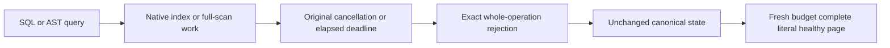

## TASK-KL051-VECTOR-LINQ-ATTACHMENT-001

REQ-KL051-VECTOR-001 / AC-KL051-VECTOR-001 and REQ-QUERY-007 under ADR-090:
`KeyLoadQuery<T>.Take(limit).AttachVector(field, vector, space, scope)` translates
only the existing non-evaluating member path and constructs the same canonical
GraphSearchRequest v1 consumed by GraphSearchAsync. The vector is an immutable
attachment bounded by existing MaximumConstantArrayItems; scope is explicit
bounded native GraphScope. No new planner, result materialization, wire model,
trusted caller role or query dispatcher. Scalar Where/order/project/Explain
state is rejected UnsupportedCapability rather than silently omitted. Take is
preserved as the canonical search limit. Server validation remains responsible
for finite values, dimension/profile, current persisted policy, scoped read cut,
shared budget and cancellation. Named SQL, builder request, typed/JSON requests
must return complete independent literal ranks and errors; SQL's existing
parser detail remains distinct from native typed validation detail. Real
ZoneTree wrong dimension/unsupported/overattachment/denied-principal operations
must preserve complete store and position then produce the complete healthy
literal result. Root must execute native normal/scalar and official RF3 public
paths before original KL051 closure; authored source is not qualification.

## TASK-KL051-VECTOR-SCALAR-STATE-002

REQ-KL051-VECTOR-001 / AC-KL051-VECTOR-001, REQ-QUERY-007 and ADR-090: supplement
the existing Order whole flow with three actual builder Where, custom projection
and Explain states. Construct each supported scalar state successfully before
AttachVector; require exact UnsupportedCapability and no lowered request, unchanged
native read diagnostics, complete canonical storage bytes and position. Then execute
the valid C# attachment through the real ZoneTree SearchEngine and retain the existing
independent full literal two-document ranks, revision, JSON, redaction, empty expansion
and equivalent SQL/typed/JSON results. Preserve the same complete storage and cut after
healthy continuation. No planner/public scope change. Authored cases require native
normal/scalar execution and existing public RF3 gates; source is not qualification.

R467 typed seed repair: VectorAttachmentDocument is instantiated as each actual committed document. Default absent vector attachment is omitted by WhenWritingDefault; member remains supported by the existing field translator. Independent literal full JSON equality is checked before native commit. Native vector records, document bytes/revisions, SQL/typed/JSON rank oracles remain unchanged. No dummy/public type/suppression.


### TASK-AUTH-KL015-MODEL-VIEW-DENIAL-001

REQ/AC-AUTH-005/006/009 and REQ/AC-SQLVIEW-002/003/005 require a failed event/queue SQL request to carry no partial page or protected payload/header metadata. Freeze before the test extension under unchanged ADR-014/015/022/072. The existing two real persisted model-authority cases check the SDK error code only at field-use denial and have no actual foreign model partition. Extend those same whole flows using a second genuinely administrator-seeded event/queue partition with its own tenant. The original non-admin persisted own-tenant credential must receive exact PermissionDenied/safe scope detail for both foreign SQL model sources through SDK and official MCP. Every failed SDK result must be IsFailed, Value null and contain no credential or any of the four literal event/queue payload/header canaries in complete native serialization; official MCP must retain its exact error envelope and omit those same canaries from the complete native result. Apply the complete privacy/no-page oracle to the original same-tenant denied sensitive predicate too.

Before and after foreign rejections, actual administrator native stream and message inspection plus SQL rows must equal the literal seeded histories and Ready/unclaimed queue state. Compare ordered logical rows and complete original native records, require positive cuts, and never infer equal cluster-wide cuts across separate calls. The original authorized redacted SDK/MCP read follows the denials, then a real persisted field grant exposes the literal selected value, followed by actual revocation. Original transport, topology, grant epoch, deadlines and cleanup stay unchanged. No product fix or new runtime hook is presumed from this coverage gap.

Ownership: existing QueryExecution Cases/SqlModelViewRf3QueueAuthorityTests.cs and SqlModelViewRf3EventAuthorityTests.cs; new feature-local Helpers/SqlModelViewRf3ForeignTenantFlow.cs and Assertions/SqlModelViewRf3DenialAssertions.cs; requirements here and Authorization/QueryExecution with ADR072. Root alone joins/compiles/formats/delivers. Stages: contract, guarded source-only test repair, coherent native build/discovery, both actual Aspire RF3 flows, exact-source original Linux TRX and source/image/artifact receipts. Native discovery, source review and historical weaker passes cannot qualify these stronger flows. Rollback removes these case extensions and private helpers together; wire, provider, public API, persisted format and UI are N/A. KL015 remains open until current repaired C1 and all required acceptance gates are proven.


# TASK-KL095-PENDING-DLQ-SQL-PARITY-001

REQ-SQLVIEW-002/003/005, AC-SQLVIEW-002/003/005, ADR072 and ADR125. Actual native ModelQueueQueryRows.Accept checks DeadLettersRead only for DeadLettered, while current DatabaseEngine.InspectMessage requires it also for PendingDeadLetter. This is an owning SQL authorization defect, not a new grant or registry. Change only that existing pre-body predicate to include PendingDeadLetter; no public/native IDs, routes, projection, dispatch, budgets or persisted format changes.

Meaningful regression reuses original full native lifecycle and four-route RF3 cold scenarios. AFTER their genuine first cold and genuine original parked-message cancellation, BEFORE ParkPending, the only retained DLQ body is PendingDeadLetter. This placement isolates the new guard: the old DeadLettered row cannot accidentally cause the expected refusal. Create an actual scoped persisted Query|QueueInspect reader; SQL and AST and corresponding SDK/official MCP/Q1 reads must refuse PermissionDenied, no page, with original lane image unchanged. Native Inspect has the same refusal. Grant actual DeadLettersRead through existing persisted policy update; independent complete expected pending row and cancelled row must agree with native inspected metadata/body, without any lease authority fields. Revoke only DeadLettersRead via new current policy epoch and repeat denial. Original lifecycle then parks/redrives/ACKs and preserves all receipts, healthy enqueue and second same-volume cold assertions.

Owned source: Core QueryExecution/Queries/ModelQueueQueryRows.cs; Unit QueryExecution/Helpers new SQL pending helper invoked in existing Messaging QueueLifecycleContinuation; Integration QueryExecution/Helpers+Assertions new pending flow invoked between existing cancel/park in QueueLifecyclePublicPhase.Continuation, passing existing fixture from QueueLifecyclePublicCold. No KL096 cached receive work, KL084 coverage map, new owner or duplicate scenario. Full SQL/JOIN/conformance/client wire and all original Event SQL tests remain mandatory separate gates.

Root-only native preview/apply/build/discovery/Linux normal+scalar Unit and genuine four-route RF3. Source assertions cannot close qualification. Exact old source identities and argument counts retained; no new blanket scheduling. Rollback all narrow predicate+test calls/helpers as one stage. Existing clocks/lifetimes/defaults/quota/read-cut and original primary/cleanup ledger remain unchanged.


## TASK-KL095-TOPIC-SQL-COMPOSITION-COLD-001 — guarded source stage

Freeze REQ-SQLVIEW-001..005 / AC-SQLVIEW-001..005 before the additive Topic source. AC-SQLVIEW-TOPIC-001 requires an actual persisted PublishTopic command, full literal SourceEventRecord parity in SQL and AST, current Query|TopicsRead, payload AND header field-use/projection, pure bounded one-cut reads, stale/missing/changed retained history refusal then exact owned repair and healthy continuation. The source contract approved for this stage is TOPIC_EVENTS('topic'[,positiveGeneration]) → ModelQuerySourceKind.TopicEvents=2. Preserve Events=0, QueueMessages=1, the existing alias and Id0/1/2, SelectQuery ModelSource Id7/InnerJoin Id8, Q1/AST1 transports and every original source grammar. Quoted source-like identifiers remain collections. No new persisted record, map, pin, cursor, connection activation, dispatcher or trusted role.

One existing WithModelQueryView reads current principal/resource and requires Query|TopicsRead. ModelQueryPolicies.Rebase includes BOTH /payload and /headers policies; existing Bind runs before head/body enumeration and Project applies to star/alias/nested outputs. A private DatabaseEngine topic visitor borrows the SAME budgeted view, SourceHead and SourceRecord/SourceEventReader. The retained count is checked with overflow-safe arithmetic against MaxScanRecords, every point read charges native key/value bytes before decoding, and the normal complete result budget/cancellation still applies. SQL LIMIT is not permission to omit retained history validation. Invalid head/data fails Corruption; actual missing retained positions retain HistoryUnavailable. Empty configured sources create no row or authority.

Native correction: actual PurgeTopicHistory preserves Generation while advancing FirstAvailablePosition. This stage tests that retained-history purge and a request whose explicit generation does not match the real persisted head. It does not invent a purge-created generation. Native publication/source identities and field IDs are unchanged. Readers borrow the same captured view; cross-request CutPosition equality is never assumed.

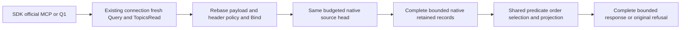

Authored complete operation identities (source-only, not discovered UIDs): TopicSqlNativeTests.ActualTopicPublishSqlAstRetainedPurgeAndOriginalReceiptReplayPreserveOneCut; ActualTopicCurrentGrantsPayloadAndHeaderUseRefusalRevokeThenHealthyProjectionLeaveNativeBytes; TopicSqlNativeRecoveryTests.ActualTopicMissingAndChangedRetainedRecordRefuseWithoutMutationThenExactRepairReadsHealthy; ActualTopicCompleteHistoryScanOverflowAndOriginalCancellationRejectThenPurgeMakesReadHealthy. Real ZoneTree store records and position are compared in full before/after reads and refusals. Missing/changed faults operate only on the original fixture-owned retained row, restore exact bytes, retain the original native command/receipt and require following healthy reads. This is supporting native-owner coverage, not Docker RF3 evidence.

TopicSqlRf3Tests.ActualTopicSqlAstCurrentPolicyOriginalReceiptAndUntouchedQueueSurviveTwoColdRestarts has typed route arguments0/1/2/3 for actual SDK/official MCP/Q1 SDK/Q1 MCP. Each drives SQL AND AST plus native source reads, fresh persisted Query/TopicsRead/field grant refusal→restore→revoke→healthy, complete literal topic data/heads and original command receipt across all four replay routes. A genuinely seeded queue's complete MessageInspection must remain unchanged. Dispose original SDK/MCP owners before two actual same-volume three-resource cold stops/restarts; retain original incarnation/storage authority and all original failures. The class shares the existing RF3 fixture and its cold resources, so its narrow scheduling remains exclusive; independent Unit cases use native ordinary concurrency. The existing original McpCallerDeadline remains unchanged.

AC-COMP-SQL-COLD-001 strengthens the EXISTING DatabaseCompositionRf3Tests.AC_COMP_007_SqlReadsQueuedLinksAndWritesGraphThenOfficialMcpEnqueuesGraphActions under ADR-067; AC_COMP_004 late invalid-reference rollback stays unchanged. Preserve its original four effects, forward/reverse SDK/MCP/Q1 receipts and literal source/derived queue links. Retain full original document results, graph vertices/edges and both queue inspections. After actual first cold, fresh minimally scoped GraphWrite refusal rejects the whole mixed marker+QueueToGraph command with all original models unchanged and the separate target graph/marker absent. Restore the actual principal at its next persisted policy epoch; the already failed command keeps its original failure, a DISTINCT healthy command commits and replays through all four public routes, then actual second cold preserves original and healthy receipts/models. No source claim/lease, cross-partition transaction or redispatch promise is added.

Source ownership: Abstractions QueryExecution ModelQuerySource; QueryExecution parser/source parser/syntax/validation/executor; Core QueryExecution scope/topic visitor/validation; Unit and Integration QueryExecution TopicSql roles; existing DatabaseComposition RF3 case plus its capture/assertion/authority/cold roles. Existing native Topic publication/purge/recovery APIs are reused unchanged; no storage format implementation or process recovery path changes. Existing native Topic/event process recovery remains mandatory together with these exact-source normal/scalar and Docker/Aspire RF3 flows.

Qualification OPEN: root-only coherent build/analyzers/formatter, native discovery and original Linux Source/DLL/PDB/typed-argument UID census, full normal/scalar/recovery/RF3 execution. This stage does not change strict selectors/status/counts or claim PASS. Dedicated Topic raw/result-byte and deadline edge qualification still requires original execution of the owning common budget cases and Topic corpus; malformed-head and foreign public-tenant cases beyond the authored native source checks remain explicitly unmapped to a new passing case. Declarative model JOIN/DML, full SQL conformance and native SQL client-wire interoperability stay OPEN/unsupported as currently declared; procedural CALL is not a JOIN implementation. Rollback source support and its regression stage together; preserve original public/persisted identities and all immutable historical evidence.


### TASK-KL095-TOPIC-SQL-COMPOSITION-COLD-001 — current Phase2/PendingDeadLetter source rebase

This finite successor preserves the original R1 source contract, all eight Topic query fields and unchanged source/position/generation, current Query+TopicsRead field privacy, original raw/result/cancel budgets, same-generation purge, four actual Unit declarations, four original RF3 route arguments and existing complete CALL composition/cold cases. Preserve the current PendingDeadLetter SQL documentation and Phase2 pending/parked/order/current capability semantics; Topic is a pure existing event-source reader, not a new queue decoder or a replacement query inventory. All original public aliases/field IDs/operation IDs and SQL/Q1 version declarations remain exact; TopicEvents appends after Events/QueueMessages, and full SQL/JOIN/DML/client-wire gates remain OPEN.

Native API preflight establishes SourceHead/SourceRecord in the same DatabaseEngine partial and SourceEventReader's exact Topic source+position validation; IKeyValueView.ReadOwnedValue is an instance member, while StorageRecords.GetRecord is the existing KeyLoad.Storage extension. SqlRf3Protocol belongs to KeyLoad.IntegrationTests.Features.QueryExecution, and original request/AST/event/data/row/permission constructors retain their current shapes. Correct the private composition tuple to global::KeyLoad.GraphTraversal so the sibling GraphTraversal namespace cannot capture the type; materialize the original direct-or-Q1 official MCP request into an explicitly bounded object before generic CallAsync<T>, preserving the exact DTO value and official Arguments serializer. No API/signing/transport/schema/lifetime behavior is changed by these compile-intent corrections.

Root alone joins, builds/analyzes, discovers native identities and executes current-source Linux normal/scalar plus real process and Aspire RF3. Focused canonical selections after coherent build are scripts/Features/TestInfrastructure/run-tests.mjs with Suite=unit or unit-scalar and Filter=/*/*/(TopicSqlNativeTests|TopicSqlNativeRecoveryTests)/*, and Suite=rf3 with Filter=/*/*/(TopicSqlRf3Tests|DatabaseCompositionRf3Tests)/*. Preserve native50 ordinary and existing exclusive RF3 fixture groups, original deadlines, every original required suite and exact source/DLL/PDB/runtime/cleanup artifacts. Declarations/arguments/previews are not native UIDs, compiler success or PASS.


### TASK-KL095-TOPIC-RETAINED-ORACLE-002

REQ-SQLVIEW-001/003/005 and AC-SQLVIEW-TOPIC-001 retain the original full publish, SQL/AST projection, replay/conflict, purge, stale-generation and healthy boundary flow. After genuine PurgeTopic through position1, the native default after-position0 MUST refuse HistoryUnavailable with the complete raw store image and commit position unchanged. The positive native oracle MUST explicitly start after position1 and return the sole retained position2 record before comparing the complete SQL result. Use the existing ReadEventSourceRequest.AfterPosition contract through a test-local overload; keep the original default reader unchanged. No production history fence, SQL limit, scan/read/result budget, deadline, generation, API or test identity changes.

Root owns the two existing QueryExecution test files and these requirement/ADR records. Stages: contract first; guarded native preview/apply; coherent build/formatter; execute the same original complete cases in normal/scalar; retain original failed report and current source/DLL/PDB/native UID/result artifacts. Linux recovery and Aspire RF3 remain mandatory and unqualified by this local repair. Rollback only this explicit native oracle and its additional negative/no-effect assertions together. The separate strict one-record scan fixture failure is unresolved and is not hidden by this repair.


### TASK-KL095-TOPIC-STRICT-SCAN-FLOW-081

REQ-SQLVIEW-004/005 and AC-SQLVIEW-004/005/TOPIC-001 preserve the original one-record scan fixture, two genuinely published records, LIMIT 1 refusal and original cancellation token. Assert complete native bytes and cut after cancellation and again after the separate healthy flow. That original owner cannot perform a positive one-record purge: native purge validates the retained record, identity and purged-identity absence against the same global scan budget. Retain the original failed report; do not increase that owner's limit, change production budgets or describe its failed purge as success.

The same original TUnit identity additionally drives a separate real ZoneTree owner with a fixed 32-record budget. Publish the original two-record command plus 31 independently identified native events, retain both complete command receipts, and require the genuine 33-record complete-history scan to refuse BudgetExceeded even with LIMIT 1, with every native byte and cut unchanged. Perform actual PurgeTopic through position 8 under that unchanged 32-record configuration. The exact retained positions 9..33 and complete literal EventData must agree with the native source page and complete ordered SQL output; default after-position 0 remains HistoryUnavailable. Reads and exact replay of all three original publish/append/purge commands preserve every post-purge byte, receipt and cut. Both owned stores are joined and disposed by their original fixture lifetimes. This 33-record correctness fixture is not scale/performance evidence.

Root owns existing TopicSqlNativeRecoveryTests and feature-local Helpers/TopicSqlScanBudgetFlow.cs. Stages: this contract and ADR-072 first, fresh guarded native patch/new-file admission, coherent solution build/format/diagnostics, same original case in normal/scalar, original source/DLL/PDB/UID/TRX retention and exact-source Linux qualification. No public or persisted contract, deadline, quota/default, SQL limit semantics, authorization, topology or selector changes. Rollback the case extension/helper together; existing Topic RF3 and process-recovery gates remain mandatory and open.


## TASK-KL095-TOPIC-RETAINED-BOUNDARY-082

REQ-SQLVIEW-001..005 / AC-SQLVIEW-TOPIC-001 and ADR-072 retain the existing
whole native publish/SQL/AST/purge/receipt scenario. Its final invalid-syntax,
full-scan-consent, cursor-refusal and ordinary-collection continuation runs
after the genuine purge of FirstPosition. Pass that exact original purged
position explicitly to TopicSqlNativeBoundary.RunAsync and use the existing
ReadEventSource AfterPosition API for its final retained native-versus-SQL
comparison. The earlier original AfterPosition0 HistoryUnavailable refusal,
complete unchanged native byte/cut oracle, one retained literal event, stale
generation refusal and receipt/conflict checks remain unchanged. Recheck the
complete storage bytes and cut after the final healthy retained SQL read too.

Only the existing Unit QueryExecution helper and calling whole case change;
no product, public, persistence, authorization, retention, budget, deadline,
transport or topology contract changes. ADR-072 is sufficient for this test
oracle correction. Preserve the original normal coverage failure and scalar
result; execute both complete original Topic SQL classes on the successor
compiled source. Native local checks are development evidence, and the
original SDK/official MCP/Q1 RF3, process and delivered Linux gates stay open.


## TASK-KL065-ROW-CANDIDATE-SWAP-001

Architecture KL065/29.3 and REQ/AC-AUTH-005/007 + REQ/AC-QUERY-004/005 under ADR014 map to the same four `AcAisql008ReversedPointAndIndexPredicatesPreservePersistedRowOwnership` arguments. Preserve first point/index ownership refusals, then real acknowledged two-document owner swap with exact original bodies/revision CAS, same-engine normal/reversed current row filtering, independently literal full row/plan/current-cut, whole native no-effect images, exact original receipt/outcome replay, and joined same-root cold/current-policy healthy work. This does not claim a cache hit or add cache/public/store contracts.

Ordered implementation: existing spec/ADR appendix → original case invokes feature-owned continuation → literal query/receipt/no-effect helper → original factory/cold cleanup helper. Native preflight all existing APIs and per-new-path creation refusal precede private code. Original typed limits, clocks, deadlines, four Args/UIDs and native50 remain. Rollback removes only this case extension/helpers and appendix, preserving every original case/assertion. Root joins main and runs required complete solution/Linux gates; local development controls are not RF3 or complete KL065 closure.


Embedded durability clarification: actual ZoneTreeIdentityFile.Open creates ProcessDurable; DatabaseEngine constructor retains that identity profile and ExecuteBatch writes it into the complete original receipt. The four Unit cases independently require literal ProcessDurable, preserving true synchronous native process durability and never manufacturing RF3 acknowledgement proof. Original R4 normal4 failures from an erroneous QuorumProcessDurable fixture oracle are retained; scalar was not executed on that failed oracle. Full original request/receipt/native bytes/read cut/row/plan/replay/cold invariants remain exact. The native discovery child completed before four runtime results, but the runner was launched before waiting its pending process result; preserve that original orchestration ordering mistake separately and use sequential completed discovery before the corrected run. No durability options/product/timeouts/defaults changed.

## Numeric refusal and healthy cold SQL continuation


REQ-SQLC-003/004/006 and AC-SQLC-003P/004/006A: extend only original AcSqlc006AMalformedDelimiterDoesNotAdvanceAndValidRetryUsesSameEngine. Preserve its declaration and all original assertions. Existing invariant-culture int/decimal TryParse already rejects overflowing LIMIT/operands with Validation; no product fix is claimed. Add independently literal complete rows, null cursor, bounded-full-scan access path, native cut and complete bounded key/value image after integer/decimal/exponent refusal, actual original pre-cancellation, and the valid downward result byte ceiling1. Each refusal must return no partial page and be followed by the same engine's healthy exact page. Decimal endpoint literals remain valid and produce the same complete rows. Gracefully close the original owned store, reopen the same volume through existing checksummed ZoneTree owner APIs, preserve identity/incarnation/nondecreasing read generation/full bytes, and repeat original refusal plus full healthy reads. Body and disposal failures remain joined through ServerFailureObserver.

No new case/UID, public type, product/schema/storage change, clock, timeout, default budget, caller authority, provider, numeric arithmetic dialect or compatibility path. Native source/API preview is source proof only; current compiled discovery/normal SIMD native50/Linux execution remain OPEN. SDK/MCP/RF3 and full SQL qualification remain separate mandatory gates.


## TASK-SQL-CALL-NO-PARTIAL-WRITE-001


REQ-AISQL-003 and AC-AISQL-005/006, REQ-SQLC-003/004/005: preserve original AcAiSql005RejectsMalformedCallQuotedNamesLiteralArgumentsAndTrailingStatements and every prior refusal. Add genuine compiler-to-canonical-native-command-to-ZoneTree operation proof. Before any dispatch, malformed/multi-operation CALL, unknown target and unknown envelope key must reject with exact codes and no partial decoded command, no document, outcome or complete native image/cut change. The following valid commented CALL preserves original command ID and complete literal two-document Unicode/quoted-key payload through native generated deserialization; its real authorized atomic Batch returns both independently expected mutation receipts/full documents. Original same-ID replay retains the full original receipt and complete unchanged bytes. Changed body under the same ID is Conflict, no partial model effects. Genuine joined close and same-volume native reopen preserves identity/cut/bytes, exact replay and full original documents, followed by a fresh acknowledged SQL CALL write and replay. No product defect is claimed: original Complete and closed envelope already enforce these refusals.

This is native compiler/DB Unit operation evidence, not production ASP.NET/MCP authentication, RF3, SQL-client protocol or complete SQL qualification. No new Test/UID, limits, clock, timeout, provider, public DTO or compatibility reader. Compiler/runtime/Linux remain OPEN. Numeric READY5 is an independent predecessor only for shared docs append union; its case/helpers are untouched.

The peer-reviewed R2 original-result oracle retains JSON full-value equality and additionally compares the canonical generated-native full CommitReceipt bytes on each warm/cold same-ID replay. MutationReceipt composition references are native Id4 but excluded from public JSON; JSON alone must not qualify exact native receipt identity. Original decoded command, literal documents/mutations, every no-effect byte/cut assertion and the single genuine cold reopen remain unchanged. A second cold cycle is not claimed by this bounded packet. This is an oracle correction only, with compiler/runtime/Linux gates OPEN.


## KL095 bounded declarative model insertion — source proposal

REQ-KL095-DML-001 / AC-KL095-DML-001: Add a closed parameterized INSERT…SELECT model-composition grammar to existing SqlOperationCompiler. Forward: `INSERT INTO GRAPH_EDGES(@graph, @prefix) SELECT LINKS FROM QUEUE_MESSAGES(@queue) LIMIT @limit WITH COMMAND @command`. Reverse: `INSERT INTO QUEUE_MESSAGES(@queue, @prefix) SELECT LINKS FROM GRAPH_TRAVERSE(@graph, @start, @depth, @vertices, @edges) WITH COMMAND @command`. Every argument is an explicitly bound JSON parameter, including the original nonempty caller command ID. No generated command identity. Exact bound parameter census; no extra/duplicate placeholders. Existing SQL text/token/depth/parameter/byte/cancellation admission applies unchanged. INSERT accepts only envelope1/dialect1, no cursor/full-scan flag, and no trailing statements.

REQ-KL095-DML-002 / AC-KL095-DML-002: Lower directly to the existing single CommandRequest containing QueueToGraph or GraphToQueueMutation and existing DocumentsCommit descriptor. Preserve native payload encoding, stable identity, persisted current authorization, same atomic transaction/read cut, cumulative observed reads/bytes, expanded mutation cap, lookahead refusal, unknown-write behavior and ordered apply. No new dispatcher, persisted alias/field, schema, policy authority or provider. Same-ID CALL/SDK/MCP replay must return the original complete receipt; changed body remains Conflict under existing authority precedence.

REQ-KL095-DML-003 / AC-KL095-DML-003: A new public whole flow seeds two literal typed rows and one canonical link, refuses malformed/trailing/missing bound input without model effects, executes forward through real SDK and reverse through official MCP, checks complete independent literal references/payload/Ready state/no lease/zero attempts and single mutation receipts, then replays through both surfaces and the original typed SDK API. Reuse actual CompositionSqlColdTrial for both same-root cold cuts, persisted authority revocation/repair and healthy continuation. Existing method declarations and all original CALL cases remain unchanged. New native UID is pending real discovery; source proposal is not runtime qualification.

TASK-KL095-DML-001 maps to QueryExecution, DatabaseComposition and ADR054/067. Reserve only SqlOperationCompiler structural insertion plus the three named new feature-local helper paths and a dedicated DeclarativeCompositionRf3Tests case (original DatabaseCompositionRf3Tests remains untouched). Canonical docs append proposals precede implementation; no Main writes or build/test allowed in this freeze.

This is a bounded KeyLoad model DML extension, not general relational INSERT/JOIN/DML. QueueToGraph validates both endpoint entities and rejects missing or hidden references; it is NOT INNER JOIN row exclusion. Full queue/document/table/graph declarative JOIN remains OPEN and requires a distinct authorized plan with defined endpoint-miss behavior. Existing Q2 join and broader SQL/client-protocol gates remain unchanged. Required Linux/SDK/MCP/source-image tests remain OPEN.

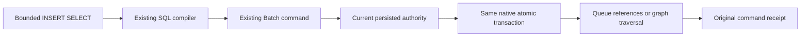

The dedicated `DeclarativeCompositionRf3Tests.AcKl095DeclarativeInsertRefusesMalformedInputThenReplaysBothModelsAcrossColdAuthorityRepair` declaration is proposed, not discovered or executed. Original CALL cases remain unchanged. It preserves SDK/official MCP/refusal/replay/conflict and reuses original same-root two-cold authority/healthy continuation, then independently replays both INSERT statements after cold. Compiler/native50/SIMD/Linux/RF3 and new UID qualification remain OPEN. Required deterministic cancellation/point+range budget refusal coverage must be verified in the owning operation cohort; existing cancellation gates are preserved and no new result claim is made.


# KL095 controlled cancellation and native lookahead successor

REQ-KL095-DML-004 / AC-KL095-DML-004: Preserve the actual native cancellation boundary. An already-cancelled SDK caller token before SendAsync returns the existing complete UnknownWriteOutcome Problem, with the original safe write-response detail. Fresh authorized full source/target observations prove no effects. The exact same original nonempty command ID then succeeds under the ordinary SQL request and retains the complete receipt through SDK/MCP/typed replay and both genuine cold cuts. This is pre-send caller cancellation, NOT proof of cancellation during traversal/replicated apply. Core composition expansion intentionally constructs its deterministic ReadExecutionBudget without caller cancellation; never mutate that invariant or add a test product callback.

REQ-KL095-DML-005 / AC-KL095-DML-005: Configure two distinct fixture-owned resources using existing current SDK commands, seed exactly two genuine ready links from the literal typed rows, and execute INSERT with MaxMessages1. Native charged range lookahead refuses BudgetExceeded through SDK and official MCP. Keep the SAME failed command and verify exact replay. Every failure must leave complete source message records/payload/state/attempts/lease and empty target graph unchanged. A NEW explicit caller command with MaxMessages2 produces exactly two edges with independently literal sorted IDs, references, label, attributes and revision1, while preserving both full original messages. It is a changed-body command, not generic random retry authority or cap widening.

REQ-KL095-DML-006 / AC-KL095-DML-006: Add only a feature-local test cold owner helper. Reuse actual ModelSqlRf3Cold, original CompositionSqlColdAuthority/Assertions, and fixture-owned RequestCqrsRf3Callers. The helper observes complete main-model and budget-model state, original SQL and typed receipt replay, and retained failed command refusal AFTER EACH of the two original same-volume cold cuts. Every original CALL method and CompositionSqlColdTrial remains untouched. No clock, timeout, quota, health, provider, persisted DTO/alias or dispatcher change. Authenticated SDK/MCP/real Aspire/native50/SIMD/Linux/compiler/UID gates remain OPEN until executed. Source is a conditional successor to immutable READY9, not a passed operation.

## TASK-KL079-SAME-QUERY-CUT-013

REQ-QUERY-CUT-PROBE-001: optional observation captures the actual scalar AST query's completed native read cut and persisted authority inside the SAME WithQueryView Store.Read callback, then invokes the SAME synchronous observer only after that callback returns. Maps to AC-QUERY-CUT-PROBE-001–004.

AC-QUERY-CUT-PROBE-001: QueryReadCutObservationDispatch extracts canonical NodeId, Incarnation, ReadGeneration, actual Store.Position, returned QueryPage.CutPosition, persisted principal ID/PolicyEpoch, resource SchemaVersion, normalized QueryHash and actual Partition. Both cuts are preserved independently; require returned cut >=0 and <= actual physical position. No StoreIdentity/SigningKey, row payload, roles, cursor or public schema is added. Join/model-source/explain execution is outside this scalar completed-page observation scope.

AC-QUERY-CUT-PROBE-002: SAME enabled RequestCqrsProbeObserver owns the adjunct. An original RequestStarted/Hold AstQuery arm authenticates the real request claim and is normally released before query execution. AuthorizationReload captures the actual IGrainContext for that same RequestContext request/command/connection. QueryReadCutCaptured is unarmable and only observes; no callback, file owner lock, publication, hold, await or native reentry while the actual read gate is held. Original marker and Released proof, active exact arm and current request/connection/principal must match before immutable atomic witness+marker publication. Existing per-record8192/file400/aggregate/gate4/arm32 limits remain unchanged.

AC-QUERY-CUT-PROBE-003: disabled registration leaves the observer null; dispatch returns before allocating metadata. Enabled nonmatching requests produce no sidecar. Publication/refusal/cancellation fails closed, preserves initiating and callback cleanup exceptions via ServerFailureObserver, and joins original callback/ProducerDisposed/host resources. Native kernel regression uses real TestDatabase native replica admission, generated full-page parity and current persisted policy/refusal/readback; this is not RF3 qualification.

AC-QUERY-CUT-PROBE-004 — OPEN until actual Main join/execution: original SDK and official MCP live/cursor no-effects queries each receive a genuine separate arm and returned-cut witness, actual signed full-generation discovery verifies witness silo/voter, and complete independent Rows/Cursor/AccessPath/outbox plus current persisted policy are checked. Stable physical owner across separate calls is not assumed from endpoint status. Readcut owner correlation is NEW private instrumentation, not an existing public capability; actual original live flow/probe profile/compiler/Linux RF3 gates remain open.

Canonical map: QueryExecution Contracts/Models/Execution own Orleans-free in-process metadata; QueryEngine captures it after BuildPage succeeds inside native view; scalar dispatch publishes after WithQueryView returns. Server ClusterRouting Diagnostics owns exact existing claim/context, strict immutable owner files and original probe lifecycle; existing DI enables it only in the RequestCqrsProbe profile. Unit QueryExecution owns actual native-store callback/authority regressions. No frontend/public client/MCP operation change (N/A).

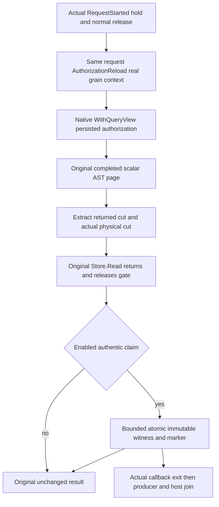


REQ-QUERY-CUT-PROBE-005 / AC-QUERY-CUT-PROBE-005: the immutable operation-local metadata is captured inside the genuine scalar read view and handed to the SAME observer after original WithQueryView/Store.Read releases its gate. Null observer allocates no metadata; explain, join and model paths remain excluded. No view escapes and no extra storage read is added by production capture. Capture-time owner/generation/physical position/returned cursor cut are observed coordinates, not current-owner proof at later publication or a cross-call snapshot. ActualObservedAndUnobservedQueriesPreserveCompleteNativePageAndStore now performs a genuine native Store.Read inside the observer callback and independently preserves complete original rows/position/page bytes, proving that callback invocation does not recursively enter the original store read gate. Original persisted authority/refusal, cancellation, bounded fail-closed publication and callback/producer/resource joins remain required. Compiler/native TUnit/Linux/RF3/DI gates are OPEN.

REQ-QUERY-CUT-PROBE-006 / AC-QUERY-CUT-PROBE-006: reuse the original native ActivationId canonical parser unchanged through RequestCqrsProbeActivationValidation.RequireActivationId; original command/live validation retains its existing identity and marker rules. Query witness pairing requires the exact same SessionId. The actual bounded RequestCqrsProbeJson reader must refuse missing, unknown, duplicate or escaped fields, invalid nested Partition, invalid UTF8, records beyond the original8192 bound and malformed/default/noncanonical native activation metadata, then accept the original declared input unchanged. RequestCqrsQueryReadCutValidationTests supplies five focused native parser/shape cases, including a genuine ActivationId.NewId canonical positive and a valid JSON record exactly8192 bytes. These controlled validator inputs are not silo ownership, ACK, activation lifetime, storage cut or RF3 proof. Actual observation, compiler/TUnit/Linux/RF3 gates remain OPEN. REQ/AC005 remains the separate capture-inside/publish-after-gate contract; original parser reuse is included here rather than replacing its meaning.

## KL095 left-filtered typed SELECT JOIN — frozen source proposal

REQ-KL095-SELECT-001 / AC-KL095-SELECT-001: Q2.InnerJoin.LeftPredicate.v1 extends the existing two-table typed primary-key INNER JOIN with the existing safe PredicateEvaluator forms over declared top-level LEFT columns: literal/parameter comparisons, AND/OR/NOT, IN/NOT IN, BETWEEN lowering, IS NULL and IS MISSING. Reuse original parameter count/scalar/depth/node/IN/text/request-byte limits. No one-parameter-only constraint or new public AST field. Canonical example: SELECT l.order_id AS order_id, r.name AS customer_name, l.total AS total FROM orders AS l INNER JOIN customers AS r ON l.customer_id = r.id WHERE l.total >= @minimum AND NOT (l.total IS NULL) ORDER BY l.order_id ASC LIMIT 10. Projection remains existing source-qualified declared fields. Existing Q1 and unfiltered Q2 semantics remain.

REQ-KL095-SELECT-002 / AC-KL095-SELECT-002: Reject right-source/nested/metadata predicate fields and missing referenced parameters before the native view. Inside the same authorized view, validate declared LEFT columns and persisted field Use before document IO, including empty tables. Reuse QueryFieldAuthorization and PredicateEvaluator; evaluate after LEFT row visibility and before an actual right Text-PK probe. Every filtered-out LEFT scan record/native byte remains charged; no false/unknown row incurs a right probe. Existing single-view cut, ordinal order, LIMIT retention, both resource/row policies, source identities/revisions, right projection redaction, cumulative byte/record/work/result/deadline/cancellation and all-or-error page remain exact.

REQ-KL095-SELECT-003 / AC-KL095-SELECT-003: SqlLeftFilteredJoinTests is one full ZoneTree operation with literal +parameter/logical SQL/AST parity, complete raw source bytes/cut, missing/wrong parameter/right/nested predicate refusals, cancelled caller, genuine scan+probe work refusal, filtered-record accounting, persisted field-Use deny→repair→mask→revoke→healthy (independent filter.read remains granted while filter.use changes; native policy defaults are not assumed), original seed receipt replay and two strict same-authority cold cuts. LeftFilteredJoinRf3Tests uses genuine SDK Query/SQL plus official MCP Query/SQL, current persisted principal/field grants, full literal source/result metadata, unchanged original receipt, mask/revoke/repair and two genuine joined all-node same-volume cold cuts. Existing literal WHERE rejection inputs become genuinely unsupported right-source predicates; method declarations and all full refusal/no-effects/healthy assertions stay intact. Literal WHERE is covered as a positive full operation. Changed argument UIDs and new cases await real discovery. No runtime/CI/RF3 acceptance claim.

TASK-KL095-SELECT-001 current inventory: typed LEFT predicates/projection under the named profile are proposed; right-side predicates, model-source or queue/document/graph cross-model SELECT JOIN, projection expressions, outer/cross/multiple JOIN, cursors and full SQL/client interoperability remain OPEN. The atomic queue→typed endpoint→graph INSERT proposal is a separate unjoined scope. No persisted schema/alias/Id/default/provider/dispatcher change.

## KL095 typed endpoint INNER JOIN insertion contract

TASK-KL095-TYPED-ENDPOINT-JOIN-001 maps DatabaseComposition REQ/AC-KL095-TYPED-ENDPOINT-JOIN-001..003 to existing SqlOperationCompiler/DocumentsCommit, not a separate query-and-write dispatcher. At queryDialectVersion2 the closed statement is:
```sql
INSERT INTO GRAPH_EDGES(@graph, @prefix)
SELECT LINKS FROM QUEUE_MESSAGES(@queue) AS q
INNER JOIN COLLECTION(@from) AS f ON q.from = f.entity_ref
INNER JOIN COLLECTION(@to) AS t ON q.to = t.entity_ref
LIMIT @limit WITH COMMAND @command
```
LINKS projects exactly the original canonical from/to/label/attributes; entity_ref is the canonical endpoint identity whose declared collection uses its validated Text primary key. Aliases and join direction are fixed, all seven parameters have an exact closed census, and WITH COMMAND preserves the original nonempty caller ID. Existing text/token/depth/envelope/JSON/cancellation bounds remain. Q1 ordinary forward and reverse INSERT keep their original native payload shape; Q2 reverse/arbitrary projection/predicate/outer/cross JOIN are unsupported, not silently lowered.

Both endpoint declarations lower into the same native QueueToGraph leaf inside the original transaction. Resource absence/field denial cannot become an empty successful join. Replay performs fresh declared-resource/field checks before outcome lookup and validates only retained original effect references under native charged bounds; no source rescan, generated retry ID or receipt restamping. The dedicated real SDK/official MCP case additionally proves an original zero-effect receipt stays exact after a genuinely malformed declared-endpoint source is appended, while a new explicit caller ID refuses Validation with the full original source/target unchanged through the second cold; complete SDK/MCP graph parity is checked at every snapshot. The case, native roundtrip control DatabaseCompositionContractTests.AC_COMP_007_PublicAndNativeCommandRoundTripsPreserveConcreteCompositionTypes, original COMPLETE12 and CALL scopes are required distinct gates. All new actual native UID/build/RF3/Linux gates remain OPEN. General typed cross-model joins and full SQL interoperability remain OPEN.

## Q2.QueueEntityRefJoin.v1: bounded canonical-reference SELECT

REQ-KL095-QUEUE-SELECT-001 / AC-KL095-QUEUE-SELECT-001: Dialect2/AST2 additionally accepts one QUEUE_MESSAGES left source joined to one declared typed collection with ON q.payload.to = d.entity_ref. The source operand is exactly the existing complete canonical EntityRef payload field; right entity_ref is an identity operand, not a newly stored column. The existing schema validator requires a declared nonnullable Text primary key. Projection is explicit scalar queue virtual/payload/header fields and declared right fields, ORDER BY left id ASC, LIMIT uses the unchanged existing bounds, and full-scan consent remains mandatory. All normalized native safe predicates and bound scalar parameters may reference only the left queue view; current token/depth/nodes/IN/parameter/bytes limits remain. No one-parameter-only product restriction is introduced.

```sql
SELECT q.id AS message_id, d.name AS customer_name, q.payload.score AS score
FROM QUEUE_MESSAGES('joinedqueue') AS q
INNER JOIN queuecustomers AS d ON q.payload.to = d.entity_ref
WHERE q.payload.score >= @minimum ORDER BY q.id ASC LIMIT 10
```

The named capability profile is finite. Other model sources, arbitrary reference paths, right-side predicates, outer/multi joins, implicit star/object projections, cursor and explain remain unsupported. This is not full SQL or SQL-client interoperability. Parameters are normalized and referenced parameters/left predicate paths validated before storage; a value/type mismatch discovered against an actual queue scalar keeps the native predicate Validation behavior.

REQ-KL095-QUEUE-SELECT-002 / AC-KL095-QUEUE-SELECT-002: Fresh persisted QueueInspect/Query, right Query/DocumentsRead and current reference/primary-key/predicate/order field Use are required before candidate selection, including an empty queue. Missing declared resources and declared field denial never become an empty success. The source retains actual native queue-view authority; its synthetic empty RowAccess is not treated as a document ACL. Right stored document row ACL/deletion is applied independently. Missing/null references and absent/deleted/row-denied targets are omitted; malformed references or mismatching full PartitionRef/declared collection refuse Validation before a point probe. The current native queue row visibility, dead-letter authorization and corruption checks remain unchanged.

REQ-KL095-QUEUE-SELECT-003 / AC-KL095-QUEUE-SELECT-003: One original WithModelQueryView read gate supplies the cut, queue metadata/body and right native key probes. Every observed native principal/catalog/meta/body/document byte uses the same ReadExecutionBudget and actual storage observation; false-filter rows retain their source scan charge. Result bytes, cancellation and admission/release remain native. Candidate memory retains at most LIMIT, ordered ordinally by original message id; QueryRow sources include exact message StateVersion and target revision. Projection uses independently authorized native safe views, retaining every redaction field and source identity.

Automated whole flows are SqlQueueReferenceJoinTests.AcKl095QueueEntityReferenceJoinRefusesThenRepairsPersistedPolicyAndReplaysLiteralRowsAcrossTwoColdCuts and QueueReferenceSelectRf3Tests.AcKl095QueueReferenceSelectRepairsPersistedUseAndMissingTargetThenReplaysLiteralSdkMcpRowsAcrossTwoColdCuts. They preserve complete raw no-effects/cut (Unit), genuine SDK/official MCP Query+SQL parity, literal matched/missing/hidden/filtered/null corpus, wrong-partition Validation, missing declared target, empty-source Use denial/repair, persisted Use revoke/repair and name masking, actual false-filter scan budget and caller cancellation (Unit), real missing-target repair, exact original seed/repair receipts, joined clients and two original same-root cold cuts. New actual UID/compiler/runtime/RF3/Linux evidence remains OPEN. Existing typed JOIN, INSERT/CALL and original cases are retained independently.


## KL095 right-alias collision refusal

REQ-KL095-JOIN-ALIAS-001 / AC-KL095-JOIN-ALIAS-001: SQL WHERE parsing retains the actual declared right INNER JOIN alias long enough to reject every explicitly right-qualified operand with UnsupportedCapability before any left-path lowering or storage enumeration. This includes right aliases named payload or headers; they must not be interpreted as left model roots. Preserve explicit left alias-qualified nested paths and existing unqualified left semantics. No right-predicate capability, AST field, public schema, quota, default or compatibility path is introduced.

The whole native SqlJoinAliasCollisionTests.AcKl095RightAliasCollisionRefusesWithoutEffectsThenLeftPredicateReplaysAcrossTwoColdCuts seeds the existing actual queue/typed document fixture, proves both collision refusals with complete raw bytes and cut unchanged, checks full literal e.payload healthy rows, performs existing persisted policy/missing-target repair, then replays the SAME original seed receipt and repeats full refusal/healthy assertions across two joined strict existing-store cold cuts. Existing Queue26 case and its lifecycle successor remain unchanged. UID/compiler/runtime/Linux qualification remains pending real discovery and execution.

## TASK-KL095-EVENT-ENTITY-SELECT-001 — bounded canonical reference SELECT

REQ-KL095-EVENT-SELECT-001 / AC-KL095-EVENT-SELECT-001 extends only Q2/AST2 with Q2.EventEntityRefJoin.v1:
SELECT e.eventId AS event_id, d.name AS customer_name, e.payload.score AS score
FROM EVENTS('joinedevents','source',1) AS e INNER JOIN eventcustomers AS d
ON e.payload.to = d.entity_ref WHERE e.payload.score >= @minimum ORDER BY e.revision ASC LIMIT 10.
One native retained StreamSet source and one declared typed Collection in the request's full PartitionRef; ON is exactly /payload/to to logical /entity_ref. Right native ValidateSchema requires its existing nonnullable Text PK. Explicit scalar projection, native left-only bounded predicates and all existing scalar parameters, full-scan consent, revision ascending, no cursor/explain/star. Queue-reference and typed joins remain unchanged. Topic/eventfeed/vector joins, right-source predicates, multiple/outer joins, arbitrary reference paths, cross-partition execution and full SQL conformance remain unsupported.

REQ-KL095-EVENT-SELECT-002 / AC-KL095-EVENT-SELECT-002: use the SAME WithModelQueryView and ReadExecutionBudget for current persisted principal, Query|EventsRead StreamSet authority, actual resource/head/generation/contiguous retained events and event-id identity, plus declared right Query|DocumentsRead and current right schema/PK Use. Rebased payload/header reference and predicate Use checks run before enumeration, including a configured empty stream. Full EntityRef Partition/Collection/Id validation precedes any target point read; never derive target authority from ID alone or probe another partition. Missing/null reference, missing/deleted/row-denied target omit the pair; missing declared resource, denied declared field, malformed or mismatched reference fail the whole request. Source event RowAccess is a virtual adapter and cannot substitute for native stream authority. Project both resources through their current policies, with complete original source IDs/revisions/redaction; event ordering uses native revision rather than lexicographic event IDs.

REQ-KL095-EVENT-SELECT-003 / AC-KL095-EVENT-SELECT-003: every native principal/catalog/head/retained event/identity/probe record and byte stays charged; LIMIT bounds candidate memory without suppressing full retained-history validation. Existing cancellation/deadline/result admission and corruption/stale-generation refusals remain exact. One read gate/cut; no source mutation, append, outcome restamp, dispatcher, provider, schema/alias/ID/default/quota changes. Actual seed append and missing-target repair retain their original same-ID receipts across two joined strict existing-store cold cuts. Unit covers complete raw images/positions, SQL/AST full pages, persisted deny/revoke/repair and empty-source preauthorization, malformed/foreign reference, stale generation, budget and original caller cancellation, then literal healthy results. RF3 uses actual SDK and official MCP with full native StreamPage/event-data/head/record metadata and document oracles, current persisted credentials, all original owners joined before two same-volume cold cuts. Source review/native preview is not compiler/runtime/Linux acceptance.

The current event-reference join constrains its existing native read budget before
`WithModelQueryView` reads the principal or resource catalog. The configured
`MaxScanRecords` therefore bounds cumulative native records, including event
identity validation and target probes, rather than each individual range alone.
The same original whole-operation test keeps its fixed ten-record owner and
requires `BudgetExceeded` for the ordinary predicate, an always-false predicate
and `LIMIT 1`, then checks unchanged complete storage and a healthy literal page.
The original local R21 failure is retained: this case returned no exception at
the first budget refusal. The scoped source repair does not qualify the case;
fresh native execution, RF3 and exact-source Linux gates remain required.

| Criterion | Automated whole operation | Required oracle |
| --- | --- | --- |
| AC-KL095-EVENT-SELECT-001 | SqlEventReferenceJoinTests.AcKl095EventEntityReferenceJoinRefusesThenRepairsPersistedPolicyAndReplaysLiteralRowsAcrossTwoColdCuts | SQL/AST parity; nonlexical event IDs ordered by revisions; unsupported right filter |
| AC-KL095-EVENT-SELECT-002 | same Unit + EventReferenceSelectRf3Tests.AcKl095EventReferenceSelectRepairsPersistedUseAndMissingTargetThenReplaysLiteralSdkMcpRowsAcrossTwoColdCuts | empty denied Use; genuine policy repair/revoke; full canonical ref refusal/noeffects; literal row ACL/masks |
| AC-KL095-EVENT-SELECT-003 | same Unit + RF3 case | native budget/caller cancellation/stale generation; full source histories, exact original receipts, healthy repair and two cold |

Ordered implementation: contract before source; QueryExecution parser/bind/executor/capability extension after actual queue-reference predecessor; distinct full Unit/public operation helpers; root native previews/compiler/discovery then native50/SIMD full owning controls and real RF3; exact-source Linux required. EventStreams production remains independently owned. New declarations have no assigned native UID until real discovery. No migration/legacy reader. Rollback removes this operator and its cohesive new operation flows together.

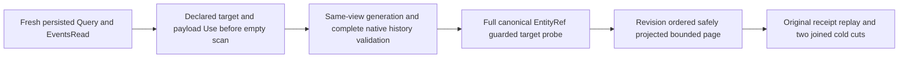


## KL048/049 composed projection source lineage

REQ-KL048-COMPOSED-LINEAGE-001 / AC-KL048-COMPOSED-LINEAGE-001: Q2/AST2 queue-to-typed INNER JOIN projections retain exact declared SourceAlias on every selection. Unknown source, right nested model path and left path forged from a right typed column refuse UnsupportedCapability without storage effects; source alias cannot grant field read authority. The existing projector applies current persisted left rebased and right typed field policies BEFORE resolving scalar paths. A denied parent reference masks its selected nested ID; a denied right name remains null, with exact alias-qualified redaction and source ID/revision metadata. Use may allow joining without Read, and repair/revoke must be observed from the current same-view persisted principal.

REQ-KL049-COMPOSED-PLAN-001 / AC-KL049-COMPOSED-PLAN-001: equivalent existing SQL and AST projections consume the SAME native bounded queue/reference query plan, declared typed target and cut; no alternate dispatcher, source inference, right WHERE, AST field/alias/Id, defaults, quotas or optimization permission shortcuts. Complete independently literal rows/metadata are required in both paths before page parity is compared. Missing target and row-denied target remain distinct authorized omissions.

ComposedProjectionLineageTests.AcKl048ComposedProjectionMasksSourceFieldsRefusesForgedLineageThenRepairsAndReplaysAcrossTwoColdCuts uses actual Queue26 seed, persisted restricted principal, simultaneous nested-left/right masks, forged AST source/path refusals, genuine current grant repair/revoke, missing-target repair and full SQL/AST results. It replays BOTH exact original seed and repair receipts after two joined strict same-root cold cuts, preserving raw bytes and positions and all initiating/disposal failures. Existing Queue26/Event24/product source remains unchanged. Native declaration UID, compiler/runtime/RF3/Linux qualifications are OPEN until original discovery/execution; this source proof does not close the broader binder/optimizer task.


## KL048/049 composed projection and predicate authority successor
REQ-KL048-COMPOSED-LINEAGE-002 / AC-KL048-COMPOSED-LINEAGE-002: Preserve the original single Unit declaration and all forged-source/no-effect/seed+repair-replay/two-cold assertions. Add a genuine queue score field policy with independent score.read and score.use. Current reference Use permits resolution without reference Read; each source projection masks only its denied fields. Revoking predicate Use while keeping predicate Read and reference Use must refuse PermissionDenied without changing complete source bytes or cut. Repair the persisted principal with a higher epoch, then independently revoke reference Use and repair it. Current source aliases remain explicit; right WHERE remains unsupported before left lowering. No production changes are justified by this acceptance gap.
REQ-KL049-COMPOSED-PLAN-002 / AC-KL049-COMPOSED-PLAN-002: ComposedProjectionLineageRf3Tests uses the existing Aspire ClusterFixture and actual SDK ExecuteSql/official MCP Sql tool, persisted resource+principal updates and original QueueReferenceSelect corpus. Independently assert every projected field, both source identities/revisions, ordinal order, redaction metadata and bounded page before transport parity. Predicate/ref-use refusals and forged right WHERE must retain all original source documents, all queue metadata/payload/headers, and exact original seed receipt replay. Repair the missing target with a genuine acknowledged command; preserve the seed receipt at the first same-volume all-node cold continuation and both seed+repair receipts at the second using existing ModelSqlRf3Cold. No fake storage, dispatcher, caller roles, right-predicate capability, new limit/deadline, public schema or package change. New case UID/compilation/native50/SIMD/RF3/Linux remain OPEN.

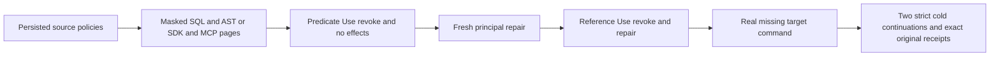

REQ-KL048-COMPOSED-LINEAGE-003 / AC-KL048-COMPOSED-LINEAGE-003: Installing the independent score policy must use the current persisted queue schema version as `ExpectedSchemaVersion` and increment that version exactly once. The existing Unit whole-flow must require a successful native resource result and compare its complete definition with the persisted resource before exercising predicate Use refusal; every principal revoke/repair must require success and full result/persisted-policy equality. The existing SDK/MCP RF3 whole-flow must discover the current queue schema through the real SDK, require the native CAS result's complete definition to match, verify its persisted catalog version, and compare every successful principal policy result in full. Preserve the original forged-source rejection, independent score Read/Use and reference Use contracts, unchanged source bytes/cuts after denial, literal projections, original seed and missing-target repair receipts, and both cold continuations. The original local R21 no-exception failure came from an unchecked policy installation rejected for failing to increment the schema; it does not justify weakening product authorization or adding a parser workaround. Both existing whole-flow declarations remain the mapped regressions; repaired-source execution and exact-source Linux/RF3 qualification remain open until original successful evidence exists.

REQ-SQLVIEW-003 / AC-SQLVIEW-003 independent event authority continuation: retain the original PersistedEventGrantsRedactCanariesDenyFieldUseAndHonorRevocation declaration and foreign-tenant, redaction, initial denial, scalar projection and final authentication revocation checks. On its existing SDK and official MCP sessions, persist Read without Use, independently require readable full literal event rows and payload/header predicate PermissionDenied, then repair Use and verify both predicates against complete original event data and metadata. Repeat genuine persisted Use revoke/repair. Capture a fresh complete native StreamPage after each policy transition and require byte-exact equality after each query before the next policy mutation. No local image admission changes; source implementation does not establish runtime or Linux RF3 qualification.

REQ-KL095-EVENT-SELECT-002 / AC-KL095-EVENT-SELECT-002 full-history reference validation: every retained event carries its full declared PartitionRef/Collection/Id validation before left WHERE elimination. A foreign or malformed reference refuses the entire SQL/AST operation even when the left predicate is false; only the target point read stays after predicate acceptance. The existing real-store whole-flow now queries the original foreign-reference stream with a false score predicate through both adapters, requires Validation, unchanged complete storage bytes and position, then independently checks its healthy literal page. Original persisted Use refusal/repair, missing-target acknowledged repair, original same-ID seed and repair receipts, and two joined same-store cold continuations remain intact. No new authority, protocol, topology or local image admission; repaired-source compilation and runtime/Linux RF3 acceptance remain open.

REQ-KL095-QUEUE-SELECT-004 / AC-KL095-QUEUE-SELECT-004: Validate each observed non-null full EntityRef before a false left predicate can eliminate its pair. A foreign partition or malformed reference remains a whole-request Validation refusal even when its score is below the bound minimum; only the target point read is skipped by the predicate. Preserve fresh declared field Use and native queue authority, the same authorized read cut, complete observed-source record/byte charging, cancellation, bounded candidates and read-only execution. The original SqlQueueReferenceJoinTests complete flow exercises SQL and AST false-filter refusals against its genuine retained foreign queue, unchanged full store bytes/position, original healthy literal pages, persisted policy/target repair and same-ID receipts. Both original strict same-root cold cuts repeat these SQL/AST refusals and complete no-effect checks. Runtime and exact-source Linux RF3 gates remain open.

AC-KL095-EVENT-SELECT-002/003 cold continuation retains both original same-root native reopen cuts. After replaying both complete original seed and missing-target repair receipts, each reopened owner executes both SQL and AST false-filter foreign-reference requests. Each refusal independently retains the full ordered storage image, exact position and complete serialized store identity, then returns the independently literal repaired healthy page. Original owner disposal and primary/cleanup failure aggregation remain unchanged; local source review is not passing cold/runtime qualification.

REQ-SQLVIEW-002 / AC-SQLVIEW-002 and AC-KL095-EVENT-SELECT-003 retained metadata integrity: the native model event scan enforces existing append/replay format invariants before invoking query candidate callbacks: valid EventType identifier, positive SchemaVersion and EventSequence. SqlModelEventRecordIntegrityTests.AcSqlView002InvalidRetainedEventMetadataCannotBeHiddenByWhereOrLimitAndRepairsAcrossTwoColdCuts owns the actual native revision5 record, separately commits each malformed replacement, and requires Corruption through normal, false-WHERE and LIMIT1 SQL/AST operations with independent complete expected storage image, position and identity. It restores the exact original raw row through the native commit gate, verifies complete healthy literal pages, and preserves original seed plus acknowledged target-repair receipt replay across both existing same-root cold cuts. No new format, capability, quota, protocol or authority; native source join is not passing compiler/runtime/Linux qualification.


## TASK-KL095-EVENT-METADATA-COLD-REFUSAL-001

REQ/AC-SQLVIEW-002 and AC-KL095-EVENT-SELECT-003 retain the original metadata-integrity full operation. Hot malformed EventSequence, SchemaVersion and EventType refusals plus a healthy two-cold replay do not establish malformed retained metadata refusal after cold open. Extend the same existing case, without a new UID or public API: after the original full seed/target-repair receipt replay, commit each exact damaged row through the native gate, close the real owner and reopen that same root twice. At each cold cut, all six normal/false-WHERE/LIMIT1 SQL and AST operations must return the original Corruption detail and preserve the independently authored complete damaged image, position and identity. Restore the exact original bytes through the native gate, close/reopen again and require healthy complete SQL/AST pages and unchanged complete repaired image. Preserve primary and disposal failures together; no provider, timeout, admission or product validation changes. Root-owned actual compiler/census and required runtime/Linux gates remain open.

## TASK-REL-JOIN-RF3-ADMITTED-CANCELLATION-001

AC-REL-004-JOIN-004/006 and AC-QUERY-007-JOIN-002 retain the original pre-cancelled RelationalSqlRf3JoinCancellationTests member as a separate control. A distinct four-case whole operation with two Boolean arguments uses the existing Aspire-owned RequestCqrsRf3Wave.StartProbedAsync current-image RF3 lane and genuine SDK/official MCP SQL and independently constructed AST callers. The private bounded AuthorizationReload hold follows the actual ReadCapability admission and RF3 read barrier, before the fresh persisted principal reload. It proves genuine admitted-operation cancellation only; it does not prove Q2 native row progress. The independent original SqlInnerJoinCancellationTests native RangeExaminedBytes scenario owns row-progress cancellation evidence.

After persisted scoped identity, both declared Text-primary-key schemas and genuine seeded rows, retain the original public task and initially live caller token. Require a validated AuthorizationReload/Observed marker from current signed discovery before cancelling that original token. Require AuthorizationReload/Cancelled and ProducerDisposed/Observed for the same session, arm, original signed request ID, empty read command ID, voter, silo and retained native identity; await the original public task, then retire its arm. SDK must return its existing safe Cancelled failure without a page; official MCP must interrupt with OperationCanceledException without a result. The original 20-second McpCallerDeadline and existing startup, hold and cleanup ceilings remain unchanged. No artificial pause, retry, fake producer, public endpoint/counter, Q2 instrumentation, local-image admission change or protocol change is introduced.

Before and after each original cancellation, compare complete caller-visible source document records and outbox state, original complete joined page and cut. Fresh independently constructed SQL and AST operations through both SDK and official MCP must return the complete independent literal page: ordered output JSON, row IDs/revisions, both source aliases/IDs/revisions, redaction metadata, null cursor, unchanged original cut and native join access path. Preserve fresh persisted authentication/permissions. Always join cancelled tasks, held callbacks and original producers; cancel/release only still-open arms, dispose original clients, join all Aspire resources and observers, then dispose controls and delete the owned root only after successful joins. Preserve primary and cleanup failures and original evidence. Native source preview and local development proof do not qualify Linux RF3 acceptance or full SQL/KL075.


## TASK-REL-JOIN-RETAINED-IDENTITY-001

REQ-REL-001/003, AC-REL-004-JOIN-002/003/006 and AC-QUERY-007-JOIN-002 require exact same-partition source identities in Q2. Canonical Core Put constructs DocumentRecord.Reference from its admitted partition, collection and identifier before writing the corresponding native record. Q2 must validate each actually observed left record against its real ZoneTree key and declared partition/collection before deleted/row-ACL/predicate omission, and each non-null actual right primary-key probe against its exact declared partition/collection/probed identifier before deletion/ACL/retention. Inconsistency is the existing Corruption category with a closed, data-free relational-source diagnostic; no successful partial page is returned. No additional right scan, schema/type policy, default, wire field, serialization/storage format, quota, dispatcher, budget clock/token/cut reset or error normalization is introduced. The ordinary document read owner is outside this scoped Q2 correction.

SqlInnerJoinLifecycleTests.AcQ2RetainedIdentityFaultsRefuseWithoutEffectsAndRepairAcrossTwoColdCuts owns the real-store regression, with no Args and no inferred UID. A genuine typed four-document seed and original batch receipt precede six independent retained identity faults: valid foreign partition, collection and identifier on the last left row and the last probed right row, preserving exact native keys. SQL and independently constructed AST must refuse normal and LIMIT1 reads; false left WHERE also refuses a corrupt observed left row. A valid false left predicate skips an unobserved corrupt right row and returns an independently literal empty page. Every operation compares complete ordered native bytes, physical position and store identity; expected whole SQL/AST pages preserve projection JSON order, both IDs/revisions/Sources, redaction metadata, null cursor, join access path and the actual original operation cut. Each fault includes a hot read, two actual same-root dirty cold owners, exact raw-byte repair and two fresh healthy cold owners; original same-ID receipt replay is byte-exact without further effects. Original owner acquisition/use/disposal, primary and cleanup failures are joined through the existing ServerFailureObserver. Existing Q2 native progress cancellation and RF3 pre-cancel controls remain independent and unchanged.

This coherent source correction is implemented. Source integration is neither semantic compilation nor execution. Root owns compilation, fresh discovery and focused whole-operation execution; Linux RF3 and the complete existing required gates remain open. No Docker admission, full SQL, public transport or KL075 qualification is claimed. Rollback removes only the coherent observed-identity guards, owning regression helpers/case and this task note; persistence and public contracts remain unchanged.

REQ/AC-COMP-002/004/005 also require SQL CALL to preserve the [native QueueToGraph source authority](DatabaseComposition.md#r28-canonical-retained-queuetograph-authority). DatabaseCompositionSafetyTests.AcComp002RetainedQueueAndEndpointIdentityRefuseAtomicallyThenRepairAcrossTwoColdOwners lowers each genuine compound request through the existing compiler and verifies atomic refusal, exact repair and two cold continuations; no declarative syntax or public protocol change.

REQ/AC-KL095-JOIN-ALIAS-002 and AC-REL-004-JOIN-001 declaration admission: every declared Q2 left alias uses existing native identifier validation, including right-only projections; a valid projection SourceAlias must name one of the two declared sources before the native view. Preserve existing typed Validation / bounded relational join invalid and queue/event UnsupportedCapability / each existing closed join detail; invalid identifiers retain existing Validation detail. Schema/declared-field/current persisted permission checks stay in the same authorized view. No new public fields, syntax, quotas, format, policy authority or error normalization.
The original SqlQueueReferenceJoinTests and SqlEventReferenceJoinTests retain their whole fault/policy/repair/replay/two-cold operations and add independent empty/control alias JSON/native-binary roundtrip refusals with null page, zero native read movement and complete unchanged storage image/position/identity. Repair only the request alias and require full independent literal right-only SQL and AST pages at both original cold owners, including both sources, revisions, redactions, null cursor and exact original cut.
SqlInnerJoinSourceBindingAdmissionTests.UnboundDeclaredProjectionRefusesBeforeNativeReadsThenRepairsReplaysAcrossTwoColdOwners separately owns genuine typed/queue/event source-binding flows (Args typed/queue/events, no inferred UID): exact existing per-model refusal for unknown projection source before any point/range work, request-only source repair, independently literal full SQL/AST pages and byte-exact original same-GUID batch receipt replay, repeated on two strict same-root cold owners. Shared complete page and no-effects assertions are authored independently; primary and owner-disposal failures remain joined. These finite source contracts do not qualify current compilation/runtime/Linux RF3, full SQL or SQL-client interoperability.

## R30 bounded lexical token-kind admission (source packet)

REQ-SQLC-002/003 and SQLC-LEX require single-quoted string and parameter tokens to remain operands. They cannot replace SELECT/FROM, logical connectives, separators or comparison symbols. Existing identifier/symbol token matching retains unquoted case-insensitive keywords and quoted identifier behavior; comparisons require an actual symbol. No new grammar, dialect, protocol, quota, authority or diagnostic is introduced. Existing Validation invalid-syntax and UnsupportedCapability trailing-syntax errors remain distinct.

SqlLexicalAdmissionTests.StringAndParameterTokensCannotReplaceGrammarAndRepairReplaysAcrossTwoColdOwners owns a genuine typed Q2 seed and original complete GUID receipt, seven independent malformed public SQL operations, null result, exact original error, zero native point/range read movement and complete unchanged ordered storage bytes/position/identity. It repairs only SQL text, requires independently literal complete SQL and AST pages, retains keyword/symbol-like values as strings through an actual left IN predicate, and replays the same GUID without effects. Two strict same-root cold owners repeat every refusal/repair/healthy/replay contract with joined primary and disposal failures. This source packet does not qualify compiler/runtime/Linux RF3, full SQL or native client interoperability.

## Q2 retained primary-key JSON identity (next source contract)

REQ-REL-001/003, AC-REL-004-JOIN-002/003/006 and ADR055/118 freeze nonnullable Text primary-key equality with the canonical EntityRef.Id. Existing ResourcePolicyUpdates prohibits typed-schema changes. Q2 validates this existing identity for each actually observed readable nondeleted left row before its predicate, and each readable nondeleted right probe before LIMIT retention, using the same view/read cut and existing data-free Corruption detail. Preserve original deletion/row-ACL skips, persisted FieldUse checks, budgets, cancellation and the intentionally unobserved right source when a valid left predicate is false. This is not new arbitrary schema/type validation or a storage-format change.

SqlInnerJoinPrimaryIdentityTests.RetainedJsonPrimaryKeysCannotContradictNativeIdentityAndRepairAcrossTwoDirtyAndHealthyColdOwners owns real canonical two-pair typed writes and the original full GUID receipt. Ten native raw replacements independently supply foreign, missing and non-Text primary JSON values, syntactically malformed JSON and valid non-object JSON for the last left and last right rows while keeping real keys/references/revisions unchanged. The retained parser catches only JsonException into the same existing Corruption; generic request/public boundary categories remain unchanged. Reuse the existing complete retained-identity lifecycle and literal pages: SQL/AST normal/LIMIT1, false-left-WHERE refusal and valid unobserved-right empty control, complete independently substituted native images/positions/identity, hot and two dirty cold owners, exact original raw repair, original GUID receipt replay and two fresh healthy cold owners. The new case has no Args; native UID and runtime remain unobserved. Preserve initiating and disposal failures together. Source implementation joined; compiler/runtime/Linux RF3/full SQL qualification pending.


## Typed saved canonical endpoint replay identity

REQ-KL095-TYPED-ENDPOINT-JOIN-003 and REQ/AC-COMP-005 require every saved canonical endpoint observed by the typed composition replay read grant to match its actual retained DocumentRecord.Reference. Keep the existing current persisted authority, charged VisibleVertex probe, read grant lease settlement and data-free Corruption/TypedJoinRecordMismatch; compare only after that same original probe. No source rescan, changed receipt, schema/alias, public protocol, clock, quota, scheduling or GraphTraversal change.

TypedQueueGraphReplayTests.AcKl095TypedSavedEndpointFaultRefusesOriginalReplayThenRepairsAcrossDirtyAndHealthyColdOwners owns six genuine two-typed-collection PK seeds and canonical SQL CALL-lowered forward receipts, alongside original reverse receipt controls. Independently literal initial records, graph and queue models are checked before partition/collection/id raw faults on each endpoint. Original-GUID Apply and ResolveOutcome must refuse without full ordered native image/position/identity effects; two dirty same-root cold owners preserve refusals, exact raw bytes repair restores full original receipts, a distinct next GUID writes the literal healthy continuation and reverse message, and two fresh healthy cold owners preserve all receipts and models. Reuse the existing full assertion/lifetime helpers without weakening original cases. New NoArgs native identity and source/compiler/Unit/Linux/RF3 execution remain pending; this N-only packet is unimplemented until its guarded source join and makes no public RF3 or full SQL claim.

## Typed initial retained JSON primary identity

REQ-KL095-TYPED-ENDPOINT-JOIN-001 / AC-KL095-TYPED-ENDPOINT-JOIN-001 and REQ-REL-001/003 require each visible retained typed endpoint's JSON object to contain its declared Text primary key equal to the canonical EntityRef.Id before it participates in a new QueueToGraph edge. Missing/deleted/row-denied endpoints retain existing omission; a malformed, non-object, missing, non-Text or foreign retained primary key refuses the entire original mixed command with existing Corruption/TypedJoinRecordMismatch. Caller write validation and its Validation category remain unchanged. Catch only native JsonException from retained parsing. Use the original owner MaxJsonDepth and dispose the original parsed document.

Carry the exact primary-key names returned by the existing current persisted schema/field-Use authorization into the same typed selection. This private call-local metadata does not create a cache, new authority or API and performs no extra native resource reads. All four existing authorization call sites retain their complete checks; the typed forward selection consumes the returned keys. Preserve both charged endpoint probes, current same-transaction view/cut, shared byte/record grants, limits, cancellation and settled lifetime.

TypedQueueGraphPrimaryIdentityTests.AcKl095TypedRetainedPrimaryJsonRefusesAtomicCompositionThenRepairsOriginalIdAndColdContinuation owns ten independent real retained faults across the two declared typed endpoints. Each fresh native owner seeds literal typed rows and a canonical queue link through the existing SQL CALL compiler. The original mixed marker+QueueToGraph command must refuse twice with complete native image/position/identity and unchanged queue/empty graph; two dirty same-root owners retain refusal, exact original raw bytes repair restores the original GUID's literal full receipt, and two healthy cold owners replay it. A distinct genuine reverse command and next continuation GUID produce complete independent queue/document receipts/models, then two additional healthy cold owners replay all original/continuation receipts. Outer/inner native observers retain both initiating and disposal failures. This is a ready N-only successor: compiler, native discovery, Unit/Linux/RF3 qualification remain pending; no delivered full SQL claim.

## TASK-REL-JOIN-RETAINED-PRIMARY-UNIQUENESS-001

REQ-REL-001/003 and AC-REL-004-JOIN-002/003/006 require exactly one declared primary property in every retained Q2 source row JSON object. Last-wins JSON lookup must not admit a foreign primary value followed by a canonical value. Preserve existing Corruption, original whole-history checks independent of WHERE/LIMIT, same read cut/cancellation/read costs and exact no-effects. SqlInnerJoinPrimaryIdentityTests retains its original declaration and now includes independent duplicate-last-canonical faults in each real retained source, using its unchanged SQL/AST refusal, exact repair, seed receipt and two dirty/two healthy cold full operation flow. See the [typed composition uniqueness contract](DatabaseComposition.md#task-kl095-retained-primary-uniqueness-001).

The [typed forward/reverse public contract](DatabaseComposition.md#task-kl095-typed-forward-reverse-public-001) maps the existing distinct typed JOIN RF3 case to both existing declarative directions and fresh persisted target QueuePublish through SDK/official MCP, complete receipts/no-effects and both original cold cuts. This adds no syntax, quota, public diagnostic or client transport. Native discovery and fresh execution remain required; local source proof does not qualify Linux RF3/full SQL/client protocol.

The reverse persisted subject is distinct from the original forward subject while retaining its exact row owner and grants. Policy-epoch advancement fences both old successful and denied reverse GUIDs with the existing PermissionDenied policy-change detail through SDK and official MCP, even after QueuePublish restoration; a distinct current-epoch GUID yields the complete second literal message/receipt. Forward identity/epochs and original forward receipts remain unchanged across both cold cuts.

The existing reverse SQL atomicity requirement is specified by [TASK-KL095-REVERSE-TARGET-QUOTA-PUBLIC-001](DatabaseComposition.md#task-kl095-reverse-target-quota-public-001). Its genuine SDK/official MCP RF3 flow proves the second derived enqueue quota refusal, all-or-nothing no effects, actual target schema-CAS repair, failed original GUID retention, new GUID's two literal outputs/full receipts and two original cold cuts. It adds no SQL/client-wire syntax and does not qualify Linux fault/resource gates from source alone.


## Native SQL transport preserves canonical operation results

The closed ADR-065 native PostgreSQL3.0 TLS session profile selects existing Q1/Q2 via configured query dialect and explicit full-scan consent. CALL keeps canonical envelope/query dialect1; one SQL request still executes one existing authorized bounded cut or one same-partition atomic batch. The profile emits the entire canonical result in one JSONB `keyload_result` row so empty pages, complete reference/source identities, read cut, cursor and redactions survive transport. It does not relabel HTTP as wire compatibility or add general PostgreSQL grammar/transactions.

REQ/AC-SQLC-005/007/008 and CLIENT-CONNECTION-001/002 are exercised by the genuine Npgsql RF3 session whole flow, with real SDK and official MCP parity, persisted grant/credential repair, original CALL receipt/conflict, admitted original-token cancellation, bounded prepared-state repair and two cold continuations. Full SQL/native-client qualification and unsupported families remain open pending their original acceptance gates.


Native SQL lifetime correction (implemented source; qualification pending): a single TimeProvider-backed admission budget uses the existing DatabaseLimits.QueryDeadlineSeconds across the first SSLRequest byte, TLS, startup, password, fresh persisted verifier and initial authenticated Ready flush. Expiry closes the actual ServerConnectionFeature; all frame/credential/backend/connection resources and original failure/cleanup are joined. Authenticated idle expiry reuses the existing GrainRoutingOptions.ConnectionIdleTimeout native owner contract; active canonical operations keep its original scheduling rules.

Execute owns the original CancelRequest scope and unchanged configured query deadline through fresh verification, native CQRS producer completion, complete encoded result delivery, bounded IngressScratchBytes DataRow chunks, terminal flush and reply admission disposal. End joins the actual cancellation task afterwards. Control/error flushes use the same configured bound. If delivery has started and is interrupted, the actual transport closes rather than writing an ErrorResponse into a partial DataRow. Possible-write interruption remains the existing UnknownWriteOutcome; original command GUID replay resolves the retained receipt.

The same RF3/Npgsql full flow contains three genuine incomplete raw TCP/TLS admission phases (pre-SSL header, post-TLS startup, password after genuine challenge), each reaching server close with its original bounded caller token still live, exact no-effects, then real healthy Npgsql/SDK/official MCP continuation. A separately persisted scoped principal and four literal 512KiB records prove native reply backpressure: actual AuthorizationReload original request marker is released, matching ProducerDisposed is joined, a real DataRow header is received, client reading is held on its owned task with bounded receive buffer, and the original backend CancelRequest interrupts that delivery. Truncated native row/transport closure, actual reader/control/cancellation joins, complete stored images and same-GUID quorum receipt, independent healthy full pages through all three callers, and two same-volume cold continuations are mandatory. ProducerDisposed alone is not claimed as reply-flush proof. These are unexecuted source tests, not Linux qualification.

## Coherent bounded SQL source increment — original full conformance remains OPEN

REQ-SQLC-006 / AC-SQLC-006 (SQLC-SET/READ), REQ/AC-QUERY-004/006, REQ/AC-SQLC-007/008 and ADR-065/125: this guarded source candidate combines explicit Q1 NULLS FIRST/LAST, Q1/Q2 INNER JOIN initial OFFSET, FETCH FIRST/NEXT optional positive unsigned count ROW/ROWS ONLY, exact native statement-to-portal retirement, single-result positive Execute limits and original failure-delivery retention. It does not complete full SQL, general SQL session commands, transaction semantics, suspended multirow portals or PostgreSQL compatibility.

Ordering adds optional generated Id2 NullsFirst with JSON null omission. Genuine JSON null placement precedes ascending/descending inversion; MissingValue remains distinct, and original ascending reference/IdKey tie-breaks remain. Omitted placement preserves original ordering and digests. SelectQuery adds request-only generated Id9 Offset with JSON default omission. Q1 applies the initial window once and resumes its original signed absolute cursor; changed initial windows expire. Q2 validates and charges full retained source history before WHERE/LIMIT elimination, retains only Offset+Limit and returns literal canonical source identities/revisions. Long Offset+Limit must fit the unchanged MaxResults. Existing full-scan consent, persisted field Use, same committed read view, cancellation, record/byte budgets, output limits and deadline remain. Model/live/partition-query nonzero windows refuse explicitly; physical placement and native WAL/storage formats do not change.

One feature-owned SqlWindowSyntax parses LIMIT/OFFSET in their existing two clause orders and the separate FETCH form. FIRST/NEXT and ROW/ROWS are synonyms; omitted FETCH count is one. Zero/negative/fractional/quoted/parameterized/overflowing counts are Validation. Duplicate or mixed LIMIT/FETCH and FETCH/OFFSET combinations, WITH TIES, DISTINCT and set operators remain UnsupportedCapability or their existing closed unsupported diagnostic. Shared grammar constants and capability profiles Q1.NullOrdering.v1, Q1.Offset.v1, Q2.InnerJoin.Offset.v1 and SQL.FetchCount.v1 are declared once. Only frozen literal regression commands are added to the genuine Npgsql test command inventory.

Native Close(statement) and unnamed replacement retire portals referencing that exact statement object; identical SQL under another statement name survives. The complete old/new byte grant is validated before metadata changes. Simple Query clears prior portals and unnamed statement; Sync retains named statements. Existing eight statement/portal slots and all byte/frame/reply limits remain. Execute row limit zero or a positive Int32 delivers the same one complete JSONB canonical result; it never truncates QueryPage, allocates by that count or emits PortalSuspended. Negative counts are Validation and repeated completed Execute remains explicitly unsupported. Credential subject verification and fresh persisted authorization still precede every admitted canonical execution. Original cancellation/deadline and reply disposal ownership remain through delivery and flush. If safe ErrorResponse publication fails, the joined ledger retains the original operation failure first followed by actual delivery/cleanup failures; successful safe publication retains normal Sync recovery.

Whole Unit flows use actual ZoneTree owners, independently literal rows/source identities, valid signed cursor continuation, malformed/unsupported refusal followed by healthy repair, current policy epochs, original-token pre-cancel controls, full raw image/position/identity conservation, byte-exact original receipt replay and two same-volume cold opens. Whole Aspire RF3 flows use genuine TLS raw frames where protocol controls are required, pinned Npgsql prepared/unprepared commands, SDK and official MCP SQL/AST, complete literal results, current policy denial/repair, minimum-token full document reads, original GUID receipt replay, no partial replies, and two real cold waves after every caller/transport is disposed. Positive Execute reuses the genuine original admitted Npgsql cancellation/ProducerDisposed flow with the default all-rows setting; it does not claim positive-limit-specific admission progress.

QueryPage.CutPosition remains opaque local metadata in RF3 and is never compared to replicated receipt positions. Public document/outbox equality is caller-visible conservation, not physical owner/incarnation or raw-store proof. AC-FEED-REFUSAL-AUTHORITY-002 remains OPEN. A deterministic genuine receiver failure at ErrorResponse publication has not yet been proven; the failure-ledger fix is source-bound and that regression gate remains OPEN. New-role compilation/native UID census, Linux RF3/fault/resource/endurance and full SQL/client conformance remain required; no current runtime result is inferred from these prepared texts. The authentic R35 DI startup failures precede protocol work and stay immutable; their minimal certificate registration correction and the original minimum-token oracle correction are separate retained parent-owned patches.


### Native ErrorResponse receiver-failure operation (next guarded source candidate)

REQ/AC-SQLC-007/008 and REQ/AC-CLIENT-CONNECTION-001/002 under ADR-065/125 require the original native operation error to remain first when publishing its safe ErrorResponse fails. This candidate arms only the existing private, authenticated three-voter test profile: actual persisted Query revocation causes PermissionDenied in the genuine native Execute. A bounded closed witness records that the real ErrorResponse was encoded before the original configured control-flush deadline holds delivery. The exact owned TLS receiver is then aborted; actual ConnectionClosed releases the hold and the original FlushAsync observes the original linked cancellation token. No exception, fake producer, fake RequestContext, payload-bearing diagnostic or artificial endpoint is injected.

The same owner retains primary object identity before actual flush failure through backend, catalog, credential, transport connection and connection-grain cleanup. Binary create-only owner/arm/witness records are session/voter bound, byte/count limited and atomically published; successful cleanup is proved before deleting the fixture-owned controls, and failures retain originals. The original control-flush deadline includes the hold; no timeout, session capacity, frame/reply limit or native authorization rule is increased.

The full Q1/Q2 Aspire RF3 cases preserve complete caller-visible document/outbox images, exact persisted denied/restored principals, original command-GUID receipts, genuine minimum-token document reads and independent literal SQL/AST full pages. After fresh policy repair they exercise real Npgsql prepared/unprepared, SDK and official MCP callers, then two original-volume cold continuations after original caller/receiver task disposal. Public query cuts remain opaque and are not compared with replicated receipt positions. This is N-only source evidence; compilation, actual runtime, Linux fault/resource qualification and full SQL/client compatibility remain open.

REQ-SQLC-006 / AC-SQLC-006 (SQLC-READ), REQ/AC-QUERY-004/005/006 and ADR-065: source candidate SQL.NullDistinct.v1 adds IS DISTINCT FROM and IS NOT DISTINCT FROM through the existing canonical Predicate nodes. For two present non-null scalar operands DISTINCT means existing not-equal; two JSON nulls are not distinct and exactly one JSON null is distinct. KeyLoad MISSING remains distinct from JSON null: either missing operand yields unknown for both forms, preserving NOT/AND/OR three-valued behavior. Existing incompatible non-null scalar types still refuse Validation; no implicit coercion is introduced. This is the bounded comparison family, not SELECT DISTINCT, set operators or full SQL.

The parser requires exact identifier-kind IS/[NOT]/DISTINCT/FROM tokens and a real bounded operand; it lowers into existing Comparison, NullTest, Logical and Negation nodes, then the unchanged normalizer charges the entire expansion, query bytes, token/depth limits, field Use, original cancellation and read view. No new serialized predicate node, wire contract, public endpoint, authority store, fallback or budget is introduced.

SqlNullDistinctWholeFlowTests and SqlNullDistinctRf3WholeFlowTests independently author literal outputs and equivalent ASTs for null/non-null/missing/self/NOT/OR cases. The genuine native ZoneTree and Aspire RF3 Npgsql prepared/unprepared/SDK/official MCP flows include malformed grammar refusal, original-token pre-cancel control, persisted Query denial and exact epoch repair, a real acknowledged bool-vs-decimal source mutation causing whole-query Validation with no partial page, exact revision-CAS repair, immutable original seed/fault/repair receipt replay, and healthy continuation through two same-volume/actual-container cold waves. Unit checks full raw image/position/identity; public RF3 checks exact full document images with real minimum tokens plus outbox conservation. RF3 QueryPage cut stays opaque; no physical owner/cut or admitted-cancellation claim is added.

Native preview/new-file absence is source evidence only. New-role compilation, actual native identities, original operation/failure/cold joins, Linux RF3 and full client conformance remain OPEN. Existing SELECT DISTINCT remains unsupported.

R37 retained diagnostic correction: REQ/AC-SQLC-006/007 and AC-QUERY-004 preserve the original malformed `score IS DISTINCT FROM` followed by `ORDER BY` Validation expectation. ORDER BY is the next clause, not a right operand. Reject that exact unquoted two-token clause boundary before lowering; a quoted identifier remains an ordinary operand. Preserve the original Unit/RF3 whole-flow declarations, every malformed/type/policy/no-effect/receipt/two-cold oracle and the authentic R37 UnsupportedCapability failure. This scoped source correction does not qualify a new execution or full SQL.

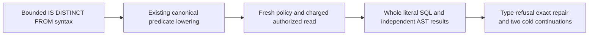


### Exact native decimal parameter binding — guarded source contract

REQ/AC-SQLC-005/007/008, REQ/AC-QUERY-004/006 and ADR-065/125 extend the existing TLS/API-key profile with numeric OID 1700 for exact .NET decimal values. Parse accepts the same bounded parameter slots; Bind decodes text or native base-10000 numeric framing before unchanged canonical JSON parameter dispatch. Finite values must fit the native 96-bit coefficient and scale 0–28 exactly. No rounding, truncation, floating-point conversion, arbitrary-precision allocation, new dispatcher or retained grant is introduced. Malformed numeric framing/sign/digits/exponent syntax is Validation. NaN/infinities, nonrepresentable finite values and binary dscale hiding nonzero precision are UnsupportedCapability. The last refusal deliberately differs from PostgreSQL's permissive hidden-digit truncation; the closed profile does not advertise general PostgreSQL numeric compatibility. Trailing zero coefficient normalization preserves mathematical value, not original numeric display scale.

All existing frame/parameter/session/read/output byte limits, TimeProvider deadlines, native Communication result ownership, one connection grain and separate request grain, persisted API-key verification and fresh per-operation permissions remain. QueryPage results remain one whole canonical JSONB image; local cuts are opaque. PostgresDecimalRf3WholeFlowTests is a prepared whole genuine Aspire RF3 scenario: real Npgsql10.0.3 prepared/unprepared decimal parameters at extrema and fractional precision, SDK/official MCP SQL plus independent AST parity, literal complete pages, malformed/unsupported native Bind then Sync and healthy Bind on the original TLS owner, current Query revoke/exact restore, original-token pre-cancel control, minimum-token full document/outbox conservation, original seed GUID receipt replay and two existing same-volume cold waves after every transport is joined/disposed. It makes no admitted-cancel, physical owner, performance, Linux or full SQL qualification claim. Fresh source integration, compilation, exact native census and original runtime gates remain OPEN.

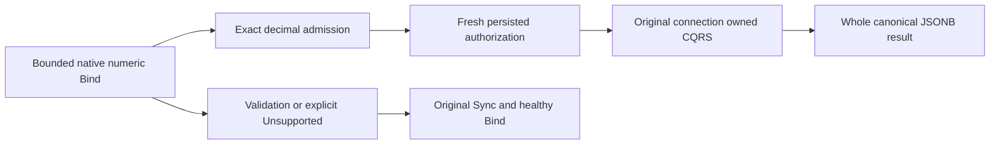

### Native signed Int16 parameter binding — next guarded source contract

REQ/AC-SQLC-005/007/008 and REQ/AC-QUERY-004/006 under ADR-065/125 add PostgreSQL int2 OID21 to the same closed native TLS/API-key parameter profile. Bind accepts exactly two big-endian bytes for binary Int16, or invariant signed integral text within -32768..32767. The canonical JSON numeric value is exact; it uses the original parameter dictionary, query normalizer, source policy and native CQRS admission. Wrong binary width, malformed integral text and overflow return the existing Validation error; other unsupported OIDs keep their original UnsupportedCapability. Existing frames/slots/retained grants, query read/output budgets and operation/admission/deadlines are unchanged. No new query syntax, lossy conversion, fallback dispatcher, numeric domain expansion or general PostgreSQL compatibility is promised.

PostgresInt16Rf3WholeFlowTests is a prepared genuine Aspire RF3 whole operation: built-in Npgsql Smallint prepared/unprepared execution at signed extrema and ordinary values, SDK and official MCP SQL and independent AST full literal pages; original native Parse then malformed/overflow Bind refusal, Sync and fresh healthy Bind on the same TLS owner; persisted Query revoke/exact whole-principal repair and both public APIs plus Npgsql refusal; original-token pre-cancel control; exact original seed GUID receipt replay; minimum-token full literal documents/outbox conservation; and two real cold waves after original callers and native transports join/dispose. Query cuts stay opaque. Native semantic binding, original runtime, Linux/fault/resource and complete SQL/client qualification remain OPEN.

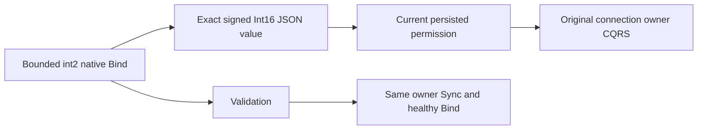

## NEXT bounded Boolean truth-test operation family

REQ-SQLC-006 / AC-SQLC-006 SQLC-READ and REQ/AC-QUERY-004/005/006, ADR-065: NEXT N-only SQL.BooleanTruth.v1 lowers IS [NOT] TRUE/FALSE/UNKNOWN into existing charged canonical Comparison/NullTest/Logical/Negation nodes. Present Booleans and JSON null follow PostgreSQL18 truth-test semantics; KeyLoad MISSING remains unknown under every form/NOT, and incompatible present scalar types refuse existing Validation without implicit conversion. Quoted keywords, malformed IS targets and absent parameter targets remain Validation; unsupported operators/statements retain their original diagnostics. Dedicated actual ZoneTree and Aspire-owned SDK/official MCP/Npgsql simple/prepared flows independently require full literal rows, numeric field fault/no partial result/no-effect/type repair, current policy epoch fence, exact original seed/fault/repair receipt replay and two cold continuations. Public cut stays opaque, pre-cancellation remains pre-cancellation, all original owners/primary+disposal ledgers remain joined. Existing System.Boolean/JsonElement and native typed nodes suffice; no new library, AST type/version/serializer/schema, provider, request dispatcher, quota or deadline. Source, compiler/census/runtime/Linux/RF3/physical-owner/fullSQL gates remain independent.

### Symmetric range source candidate

REQ-SQLC-006 / AC-SQLC-006A and AC-SQLC-006 SQLC-READ; REQ/AC-QUERY-004/005/006; ADR-065: Guarded N-only candidate SQL.BetweenSymmetric.v1 adds BETWEEN SYMMETRIC and NOT BETWEEN SYMMETRIC by lowering two inclusive ordered ranges through existing Comparison/Logical OR/Negation nodes. Ordinary BETWEEN remains ordered and unchanged. Existing normalizer charges every generated node; parameter, path, authorization, scan/read/output/depth limits and cancellation remain unchanged. Null/MISSING retain unknown; incompatible present scalar operands refuse existing Validation. No implicit conversion, AST version, serializer or package change. Independent literal forward/reversed/equal/null/field-bound SQL+AST pages, malformed refusal, genuine type fault to repair and exact original GUID receipt replay, fresh persisted query-policy denial to restore, original-token pre-cancel, complete SDK/official MCP/Npgsql simple/prepared continuation and two cold opens are source candidates; no admitted row-progress cancellation or physical-owner cut proof is claimed. Native binding, source-qualified Linux RF3, recovery and resource gates remain OPEN; this family does not complete full SQL.

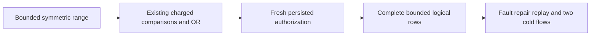

## NEXT bounded standard OFFSET/FETCH operation closure

REQ-SQLC-006 / AC-SQLC-006 (SQLC-SET), REQ/AC-QUERY-004/005/006 and ADR-065: NEXT N-only bounded standard OFFSET/FETCH source candidate accepts OFFSET unsigned-count [ROW|ROWS] FETCH FIRST|NEXT [positive-count] ROW|ROWS ONLY through the existing canonical Limit/Offset tuple. Existing long-checked MaxResults, read/output budgets, cancellation, persisted policy, signed logical cursor, Q1/Q2 full-history validation and unsupported WITH TIES/duplicate/mixed LIMIT refusal remain unchanged. Preserve original SqlOffsetWholeFlowTests/SqlOffsetRf3WholeFlowTests/SqlFetchCountRf3WholeFlowTests declarations and all controls; extend full literal Q1 cursor continuation and Q2 SQL/AST rows, negative/overflow/zero/duplicate/TIES refusal, repaired policy, original seed replay and two cold workflows. Real Npgsql simple/prepared plus SDK/MCP compare independent complete offset b/c JSONB pages. Public cut remains opaque; no physical-owner, full SQL, compile/runtime/Linux or qualified protocol claim. Current source is unchanged until a later reviewed writer slot.


### Explicit ALL and implicit projection-label source union

REQ-SQLC-006 / AC-SQLC-006 SQLC-READ and REQ/AC-QUERY-004/005/006, ADR-065: NEXT guarded SQL.SelectAll.v1 accepts one unquoted ALL directly after SELECT, preserving the same canonical SelectQuery, default duplicate-preserving rows, bounds, authorization and connection owner. Quoted identifiers remain ordinary fields. SELECT DISTINCT and all unsupported families retain original diagnostics; this does not add deduplication. Original NullOrdering wholeflow declarations/Args/UIDs remain unchanged. Complete SQL ALL/default/canonical AST row pages, two independent identical projected null rows with distinct canonical row IDs, SDK/official MCP/Npgsql simple/prepared parity, original malformed-refusal to same-connection healthy repair, original-token pre-cancel, current persisted query permission denial to restore, complete raw Unit image/cut/identity plus public document/outbox image, exact seed receipt replay and two cold continuations are required. Public cuts remain opaque and physical owner correlation, actual admitted cancellation and Linux/fullSQL qualification remain separate OPEN. No library/AST version/serializer/schema/quota/timeout change.

REQ-SQLC-006 / AC-SQLC-006 SQLC-READ and REQ/AC-QUERY-004/005/006, ADR-065: NEXT bounded SQL.ImplicitProjectionAlias.v1 accepts ordinary identifier or quoted output label without AS through the existing Selection and canonical identifier/source binding rules. Explicit AS/default path label remain unchanged. Bare currently parsed structural keywords are not consumed as labels; quoting permits ORDER/FROM labels. This is not a complete PostgreSQL keyword-table or full-grammar compatibility promise; those conformance gates stay OPEN. Existing duplicate output aliases refuse Validation before execution. Existing native .NET FrozenSet holds the closed current structural word set once; no library/package/AST/version/serializer/admission/store change. Complete independently literal projected_score/ORDER/FROM JSON rows, original SQL AS and independent AST equality, canonical Q2 joined source lineage with implicit projection/table labels, SDK/official MCP and Q1/Q2 Npgsql simple/prepared outputs, malformed/duplicate-label refusal then same-wire healthy continuation, persisted policy denial/restore, original-token pre-cancel, full Unit raw image/cut/identity and caller-visible RF3 document/outbox parity, exact original seed receipt replay and two cold continuations are required. All original wholecase declarations/Args/lifetimes remain; public query cuts stay opaque and physical-owner/admitted-cancel gates remain separate OPEN.

The two profiles share one current parser/catalog/manifest patch. All original BooleanTruth/BetweenSymmetric profiles and wholeflow declarations remain unchanged. Native preview and fresh new-file admission are OPEN until actual service Ready; no source or runtime qualification follows from this prepared union.

### Natural ordering-operator source candidate

REQ-SQLC-006 / AC-SQLC-006 SQLC-SET and REQ/AC-QUERY-004/005/006, ADR-065: next guarded SQL.OrderUsing.v1 accepts ORDER BY a currently supported field USING < or USING >, with the original optional NULLS FIRST/LAST, by lowering to the existing natural ascending/descending Ordering. Default placement, KeyLoad MISSING ordering, full-reference tie break, source validation, supported-model restrictions, per-operation persisted permissions, native read cut, read/output/depth limits and signed canonical cursor stay unchanged. This closed natural-operator profile does not implement arbitrary PostgreSQL operator families, user-defined type/collation/default-null semantics, expressions or full SQL. Missing/literal/parameter direction refuses Validation; other valid symbolic or qualified operators and mixed/duplicate direction refuse UnsupportedCapability before result publication. No custom comparator/delegate, library, AST/version/serializer/store/protocol/deadline change. Preserve original NullOrdering and SqlOffset wholeclass declarations, Args, UIDs and all ALL/alias/order controls. Independent complete ascending/descending/null-first/null-last SQL/AST rows, native SQL-to-AST-to-SQL cursor continuation, seven malformed/unsupported operator refusal-to-healthy flows on the same original SDK/MCP/Npgsql owner, current persisted policy deny-to-exact epoch repair, original-token pre-cancel-to-healthy, complete Unit raw image/cut/identity and RF3 document/outbox image, original seed receipt replay and two actual fixture-owned cold waves are required. Public cuts remain opaque; admitted cancellation, physical-owner correlation, integrated compiler/runtime/Linux RF3/resource/recovery and full SQL/client compatibility remain separate OPEN.

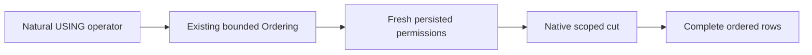

### Explicit ordered range source candidate

REQ-SQLC-006 / AC-SQLC-006 SQLC-READ and REQ/AC-QUERY-004/005/006, ADR-065: next guarded SQL.BetweenAsymmetric.v1 accepts explicit BETWEEN ASYMMETRIC / NOT BETWEEN ASYMMETRIC as the existing ordered inclusive comparisons and optional Negation. It never swaps endpoints; reversed endpoints produce false, NOT reverses that result, JSON null and KeyLoad MISSING retain existing unknown semantics. SYMMETRIC, implicit ordered BETWEEN, quoted identifiers and all original unsupported operations remain unchanged. Same canonical nodes are charged by the original normalizer, limits, authorization, cut, depth, cancellation and output accounting; no library, AST/version/serializer/transport/deadline change. Preserve original range wholeclass declarations, Args, UIDs and all controls. Six independent literal SQL/AST pages, malformed rejection then healthy same original SDK/MCP/Npgsql connection, true retained scalar-type fault then exact revision3 repair, persisted policy epoch1->2->3 refusal/healthy continuation, original-token pre-cancel, complete Unit raw image/cut/identity and public document/outbox image, exact seed/fault/repair receipt replay and two original owned cold waves are required. Public cut is opaque; physical owner correlation, admitted row-progress cancellation, integrated compiler/runtime/Linux RF3/resource/recovery and full SQL/native protocol qualification remain separate OPEN.

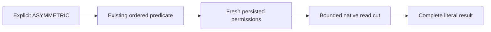

### NEXT default INNER JOIN spelling

REQ-SQLC-006 / AC-SQLC-006 SQLC-JOIN, REQ-QUERY-007 / AC-QUERY-007-JOIN-001/002 and existing AC-REL-004-JOIN criteria under ADR-118/065: NEXT guarded SQL.DefaultInnerJoin.v1 recognizes unquoted JOIN as the standard optional-INNER spelling of the existing closed Q2 InnerJoinClause. Both source aliases, same atomic partition, Text primary-key equijoin, model-reference/row integrity, current field/resource permissions, one admitted read cut, full retained-source validation and all native cumulative record/byte/depth/output limits remain unchanged. Q1 still refuses joins with UnsupportedCapability; quoted JOIN stays an ordinary identifier. This adds no OUTER/CROSS/NATURAL/USING/multi-join or AST/version/library/serializer/transport capability. Real ZoneTree full joined rows/source lineage, malformed missing-ON refusal then original healthy repair, Q1 refusal, fresh persisted query-policy denial/restore, original-token pre-cancel, complete raw image/cut/identity, SDK/official MCP and Npgsql simple/prepared same-connection pages, original seed receipts and two cold continuations are required. Query cuts remain opaque publicly; admitted row-progress cancellation, physical-owner authority and exact-source Linux/fault/resource/fullSQL gates remain separate OPEN. Current source draft is not source Y or qualification.


### Closed PostgreSQL null-predicate synonyms source candidate

REQ-SQLC-006 / AC-SQLC-006 SQLC-READ and REQ/AC-QUERY-004/005/006, ADR-065: guarded SQL.NullPredicateSynonyms.v1 accepts PostgreSQL18 nonstandard ISNULL and NOTNULL for currently supported scalar operands. Both lower to the original NullTest(value, negated, missing:false) used by IS NULL and IS NOT NULL, preserving exact existing JSON-null versus KeyLoad MISSING behavior; this is not row-valued PostgreSQL null-test compatibility or a standard-SQL/full-SQL claim. Existing token-kind/quoted identifier/source alias validation, charged canonical predicate depth/read/output limits, scoped cut, fresh persisted authority and connection-owned Orleans dispatch remain unchanged. No library, AST/version/serializer, provider, settings, deadline or architecture change. Original NullDistinct wholecase declarations/Args/UIDs and source type-fault/repair/seed/fault/repair receipt replay stay intact. Independent full SQL/AST literal null/MISSING/present rows, malformed refusal followed by healthy results on the same original SDK/MCP/Npgsql owner, current query-policy epoch denial and exact restoration, original-token pre-cancellation, complete Unit raw image/position/identity and RF3 caller-visible document/outbox parity, warm and two original owned cold continuations are required. Public query cuts remain opaque; physical-owner correlation, admitted row-progress cancellation, coherent compiler/runtime/Linux RF3/resource/recovery and full SQL/client interoperability qualification stay separate OPEN.

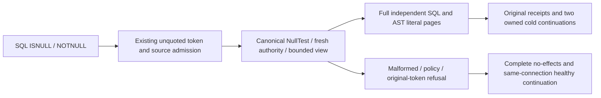

Source-to-operation mapping: `SqlNullDistinctWholeFlowTests` owns genuine native ZoneTree full images/position/identity and original warm/two-cold SQL/AST flow; `SqlNullDistinctRf3WholeFlowTests` owns real SDK/official MCP/Npgsql simple+prepared calls, fresh policy fences, original receipts and fixture-owned RF3 cold/disposal. Original declarations and Args remain unchanged. Native source preview is a preimage check, never compiler or executed acceptance proof.

Native PredicateEvaluator confirms NullTest(missing:false) compares null directly: JSON nulls select null_a/null_b; NOTNULL and NOT ISNULL select high/low/missing because the existing MissingValue sentinel is distinct from null. NOT NOTNULL selects null_a/null_b. These independently literal results preserve current IS [NOT] NULL semantics; they do not change MISSING into PostgreSQL SQL NULL.

### Closed positive numeric literal spelling

REQ-SQLC-006 / AC-SQLC-006 SQLC-LEX/READ and REQ/AC-QUERY-004/005/006, ADR-065: guarded SQL.PositiveNumericLiteral.v1 accepts an adjacent leading + before a decimal digit through the existing bounded numeric token and invariant native .NET decimal parser, exactly as the current adjacent minus literal path. Existing exponent signs and negative literals remain unchanged. PostgreSQL treats signs as operators; this is a closed literal-folding profile, not general unary expression/arithmetic, whitespace-separated sign, parameter/field unary operators or full PostgreSQL numeric grammar compatibility. No AST/version, library, serialization, schema, provider, grant, deadline or storage change. LIMIT/OFFSET/FETCH remain unsigned counts through existing NumberStyles.None and existing checked limits; +count refuses Validation. Exact decimal overflow, repeated/bare/non-numeric signs and unsupported separated sign refuse the original safe Validation without a partial result.

Preserve original SqlNullDistinctWholeFlowTests and SqlNullDistinctRf3WholeFlowTests declarations/Args/UIDs and original warm/cold, type-fault and receipt controls. Eight independent complete SQL/AST literal pages include equality, comparison, ordered BETWEEN, IN, distinctness, signed exponent, original negative control and decimal.MaxValue. Genuine malformed/count refusals then healthy continuation on the same original SDK/MCP/Npgsql owner, persisted query-policy denial/exact restoration, original-token pre-cancel/healthy, actual retained Boolean type fault with original and new numeric SQL/AST refusals then exact revision3 repair/original fault+repair receipts, full Unit raw image/position/identity and caller-visible RF3 document/outbox parity, original seed receipt replay and two actual fixture-owned cold continuations are required. Query cuts remain opaque publicly; physical owner correlation, admitted row-progress cancellation, coherent native compiler/runtime/Linux/resource/recovery/full SQL and native-driver qualification remain separate OPEN.

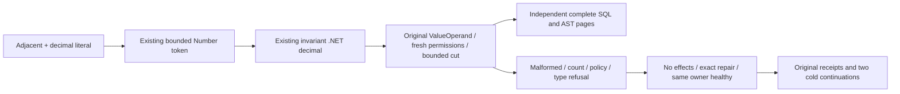

### Closed leading-decimal-point literal spelling

REQ-SQLC-006 / AC-SQLC-006 SQLC-LEX/READ and REQ/AC-QUERY-004/005/006, ADR-065: guarded SQL.LeadingDecimalLiteral.v1 accepts a decimal point followed by a digit, optionally with the current adjacent literal sign, through the existing Number token and invariant native .NET decimal ValueOperand path. Existing digit-first/trailing-point/exponent literal behavior remains; ordinary field/source dots followed by identifiers or quoted names stay separators. Bare/repeated points, absent exponent digits and non-numeric signs retain safe Validation. This is a closed decimal literal spelling within the existing decimal domain, not general unary operators/arithmetic, whitespace-sign forms or full PostgreSQL literal grammar/type compatibility. Existing token/depth/SQL/read/output bounds, cancellation and source positions remain; LIMIT/OFFSET/FETCH keep NumberStyles.None and refuse fractional counts. No AST/version/library/serializer, policy, schema, grants, deadline or topology change.

Original SqlNullDistinctWholeFlowTests and SqlNullDistinctRf3WholeFlowTests declarations/Args/UIDs stay unchanged. Independent complete SQL/AST .5/-.5/+.5/exponent/IN/ordered-range/distinctness pages, malformed/fractional-count refusal followed by same original SDK/MCP/Npgsql healthy continuation, actual Boolean retained-type fault then original and leading-literal SQL/AST refusals before exact revision3 repair/receipt replay, current persisted query-policy denial/restoration, original-token pre-cancel/healthy, full Unit raw image/cut/identity plus public RF3 document/outbox parity, seed/fault/repair original GUID receipts and two actual owned cold continuations are required. Public query cuts remain opaque. Compiler/census/runtime/Linux/resource/recovery, admitted row-progress cancellation, physical-owner correlation and full SQL/native-client qualification remain separate OPEN.

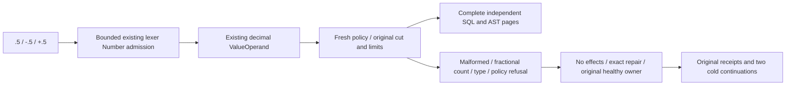
### NEXT closed hexadecimal integer literal source

REQ-SQLC-006 / AC-SQLC-006 SQLC-LEX/READ and REQ/AC-QUERY-004/005/006, ADR-065: NEXT guarded SQL.HexadecimalIntegerLiteral.v1 recognizes 0x/0X with hexadecimal digits and the current adjacent literal sign, preserving raw token text and existing bounded lexer checks. Native first-party Char.IsAsciiHexDigit and UInt128.TryParse(span, AllowHexSpecifier, InvariantCulture) decode the magnitude only within the existing exact decimal integer domain; empty/malformed prefix and magnitude above decimal.MaxValue refuse original safe Validation. No custom arbitrary-precision provider or package. Decimal/scientific/leading-point forms stay unchanged. Binary/octal, hexadecimal fractional forms, visual separators and general unary/arithmetic remain explicit UnsupportedCapability. This is not complete PostgreSQL integer type inference/literal grammar or full SQL compatibility.

The same approved ValueOperand, normalizer, fresh field/resource authorization, connection-owned Orleans execution, node-local bounded cut/read/output/depth/cancellation and public canonical result remain. Unsigned LIMIT/OFFSET/FETCH still use NumberStyles.None and reject hexadecimal counts. Preserve original SqlNullDistinctWholeFlowTests/SqlNullDistinctRf3WholeFlowTests declarations/Args/UIDs. Independent complete SQL/AST upper/lower/sign/range/IN/distinctness/decimal-boundary rows and quoted-string control, malformed/overflow and unsupported/count refusal followed by healthy results on the same original SDK/MCP/Npgsql owner, real Boolean type fault then original/hex SQL+independent AST refusal before exact revision3 repair/full receipts, persisted policy denial/restoration, original-token pre-cancel/healthy, full Unit raw image/cut/identity and public RF3 document/outbox parity, original GUID seed/fault/repair replay and two owned cold continuations are required. Source N/native admission/compiler/runtime/Linux/resource/recovery/fullSQL and physical-owner gates remain independent OPEN.

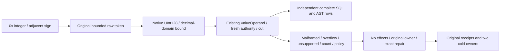


NEXT hex operation coverage also reuses the original PostgresNativeSessionRf3Tests scalar/join instances and existing PostgresRf3Parity caller/wire scopes: three independently true exact decimal-domain hexadecimal predicates precede the original ORDER BY and preserve each full original seeded page through actual SDK/MCP and Npgsql simple/prepared execution. This does not add seed fields, AST capabilities, request declarations, deadlines, or physical-owner/cut correlation. Original whole owner/no-effect/receipt/policy/cancellation/cold lifecycle remains; dedicated Q2 numeric-field type-repair and new-hex independent AST lowering beyond the scalar full-flow stay separate OPEN, not inferred from parity.
REQ-SQLC-006 / AC-SQLC-006 SQLC-LEX and REQ/AC-QUERY-004/005/006, ADR-065: NEXT guarded SQL.EscapeStringLiteral.v1 accepts adjacent E/e single-quoted string literals using C-style escapes, octal/hex UTF-8 byte escapes and validated Unicode scalar/surrogate-pair escapes (u/U widths may be mixed; a backslash-x without hex digits is the literal x), lowered to the same original String ValueOperand. Invalid UTF-8, malformed Unicode, NUL, incomplete escape/quote refuse the existing fixed Validation diagnostic; ordinary strings, quoted identifiers, parameters and original unsupported operations remain unchanged. Native PostgreSQL positional-parameter rewriting must preserve escaped quotes and literal $n content and map only actual external parameters to original source positions. Native .NET Rune/UTF8Encoding/ArrayBufferWriter are used with original source/token/read/depth/output bounds and original cancellation; no package, AST/version/serializer, authorization, connection owner, admission quota or deadline changes. Independent complete scalar SQL/AST literal pages, real SDK/official MCP/Npgsql simple/prepared parity and a genuine bound positional argument outside an escaped literal, malformed refusal followed by healthy operation on the original connection, current persisted query-policy denial and exact epoch restoration, real retained scalar-type fault and revision3 repair, original-token pre-cancellation, seed/fault/repair receipt replay, complete Unit raw image/position/identity and RF3 public document/outbox image, warm and two original owned cold waves are required. Public query cuts remain opaque. Physical-owner correlation, admitted row-progress cancellation, native binding/compilation/runtime/Linux RF3/resource/recovery and full SQL/client compatibility remain separate OPEN; this is a prepared source contract, not delivered capability.

REQ-SQLC-006 / AC-SQLC-006 SQLC-LEX, ADR-065: NEXT SQL.StringContinuation.v1 joins single-quoted fragments separated by ASCII SQL whitespace/line-comments containing actual CR or LF. Same-line fragments, block-comment-only separators, prefixed later fragments, dollar/bit/U& literals remain unsupported. E escaping is inherited across subsequent plain fragments and UTF-8 byte validation occurs after the whole literal; each original fragment consumes the unchanged token budget. Original source retention, cancellation/deadlines, persisted policy, read cuts and complete caller/receipt/cold contracts remain unchanged. Source/compiler/runtime/Linux qualification and physical owner correlation remain OPEN.

The existing whole operation also requires explicit same-line/block-comment/later-prefix UnsupportedCapability and incomplete/invalid-byte Validation, exact native SQLSTATE, complete no-effects and healthy continuation on the same real SDK/MCP/Npgsql connection. A genuine source-sized empty-fragment operation exceeds original MaxQueryTokens while fitting the byte bound, then returns the full healthy original page. UTF-8 bytes spanning segments, literal $n through prepared/unprepared binding, current-policy/type repair, original receipt replay and two cold continuations remain literal full-result assertions; no new case UID or transport architecture is introduced.

REQ-SQLC-006 / AC-SQLC-006 SQLC-LEX and existing REQ/AC-QUERY-004/005/006 under ADR-065: NEXT guarded SQL.DollarQuotedString.v1 lowers untagged or current identifier-letter/underscore tagged dollar literals to the existing String ValueOperand. Ordinal case-sensitive delimiters preserve quotes, backslashes, Unicode, other tags and literal $n as data; the native parameter translator shields the same bounded quote spans and translates only actual external parameters. Require separation from preceding identifiers. No identifier grammar, library, AST/version/serializer, procedural language, automatic concatenation or transport expansion. Original query bytes/tokens/depth, cancellation, fresh persisted authority, connection-owned Orleans/CQRS and joined failure/disposal ownership remain unchanged. Native span comparison is first-party; resource/performance qualification stays OPEN.

Original NullDistinct/Offset/native-session declarations/Args/UIDs remain. Independent complete SQL+AST literal pages, malformed/mismatched delimiter and unsupported adjacency refusal followed by healthy SDK/MCP/Npgsql on the original connection, genuine external positional parameter shielding in simple/prepared driver execution, policy denial/restoration, real Boolean fault then exact revision3 repair/full receipts/replay, original canceled token plus independent healthy execution and two owned cold continuations are required. Q1/Q2 original native-session parity adds independently true dollar predicates and full original seeded pages. Unit full raw image/position/identity and RF3 document/outbox parity stay distinct; public cuts remain opaque. Raw NUL driver framing, physical-owner authority, compiler/runtime/Linux/fault/resources/fullSQL gates remain OPEN. This NEXT N source is not delivery or qualification.

REQ-SQLC-006 / AC-SQLC-006 SQLC-LEX and existing REQ/AC-QUERY-004/005/006 under ADR-065: NEXT guarded SQL.BinaryOctalIntegerLiteral.v1 adds adjacent signed 0b/0B and 0o/0O integers to the current hexadecimal reader within the unchanged exact .NET decimal96-bit magnitude. Reuse native UInt128 binary/hex parsing and bounded octal arithmetic; no new library, AST/version/serializer/provider/transport or general unary operator. First invalid radix digit/empty prefix/positive or negative magnitude2^96 refuse Validation; original trailing-token/fraction/visual-separator/later incompatible-digit forms remain UnsupportedCapability. Unsigned LIMIT/OFFSET/FETCH refuse radix/sign counts. Decimal/scientific behavior and original raw source remain.

Independent full SQL+AST literal rows and exact maximum/minimum true-constant predicates distinguish arithmetic correctness from an empty filtered page. Complete existing SDK/MCP/Npgsql simple/prepared Q1/Q2 pages, malformed/count refusals followed by healthy original owner, both binary/oct policy denial and Boolean type-fault SQL+AST refusal before exact original repair/receipts/replay, original canceled token plus independent healthy token, full Unit raw image/position/identity and RF3 document/outbox parity across two original cold continuations are required. Same current authority/cut/read/output/cancellation/producer/disposal limits remain; physical-owner/fullSQL/Linux/fault/resources/compiler/runtime gates OPEN. The combined planned profile order preserves current HEX/E/continuation then dollar then binary/oct. Existing parent N/NF/NS are retained as history; this combined future source still needs fresh actual admission after the shared lease.

REQ-SQLC-006 / AC-SQLC-006 SQLC-LEX and existing REQ/AC-QUERY-004/005/006, ADR-065: NEXT SQL.UnicodeStringLiteral.v1 accepts adjacent U/u& single-quoted Unicode strings through the same original String ValueOperand. Default backslash or explicit UESCAPE supports four hexadecimal digits, plus-six digits, mixed-width adjacent surrogate pairs, doubled escape, doubled quotes and the original newline string continuation. Preserve exact raw SQL and original positional parameter mapping. UESCAPE consumes a current ordinary/E/dollar simple string whose decoded UTF-8 value is one non-NUL ASCII byte, excluding hex digits, plus, quotes and ASCII whitespace, matching the native PostgreSQL18 parser contract. Invalid scalar/surrogate/hex/NUL/unfinished literal or escape option refuses the existing fixed Validation. Each original fragment and the two UESCAPE source tokens consume unchanged MaxQueryTokens; original source/depth/read/output/cancellation/producer/connection ownership limits remain. Use current native .NET Rune, existing hex/trivia/strict literal helpers, no package, AST/version/serializer/provider or authority-store change.

Original wholecase declarations/Args/UIDs, full SQL+AST literal low/empty/emoji/mixed-surrogate/doubled-escape/continuation pages, actual SDK/official MCP/Npgsql simple/prepared parity, external bound $1 beside a protected raw Unicode literal containing $1, malformed-to-same-owner healthy continuation, fresh query-policy epoch denial/restore, actual Boolean field fault/exact repair and seed/fault/repair receipt replay, exact original canceled token plus independent healthy token, full Unit raw image/position/identity, public RF3 document/outbox parity and two owned cold continuations are required. Native positional rewriting already preserves the ordinary quote/continuation raw source; no second translator is introduced. Public query cut stays opaque. U& quoted identifiers, general encodings/settings, admitted row-progress cancellation, physical-owner authority, compiler/runtime/Linux RF3/fault/resources and full SQL/client interoperability remain separate OPEN. This NEXT source-only candidate is not qualification.

### SQL.BooleanPredicate.v1 (source candidate; not qualified)

REQ-SQLC-006 / AC-SQLC-006 SQLC-READ and REQ/AC-QUERY-004/005/006, ADR-065: a Boolean field, scalar Boolean parameter or TRUE/FALSE/NULL operand may be a complete WHERE predicate and may participate in NOT/AND/OR/grouping. Lower it to the existing Comparison(value, equals, true) AST. Native null/missing three-valued semantics remain: NOT NULL and NOT missing do not admit a row; do not lower bare NOT to IS NOT TRUE. Non-Boolean retained values refuse the existing Validation diagnostic; no numeric/string truth coercion. Only existing end, group, logical, ORDER and bounded LIMIT/OFFSET/FETCH boundaries terminate a bare operand; incomplete comparison, missing parameter, malformed predicate and unsupported operators retain their existing safe diagnostic contract. No AST/version/serializer/protocol/library, policy/read-cut, deadline or resource-limit changes.

Preserve original SqlBooleanTruth Unit and Aspire RF3 declarations/Args/UIDs. Extend their genuine native whole flows with independently authored full SQL/AST rows for bare and negated fields, TRUE/FALSE/NULL, grouped/logical predicates and real Boolean true/false/null parameters; SDK and official MCP plus Npgsql simple/prepared execute the same complete results. Malformed refusal must be followed by a healthy request on the original native connection. Original persisted query-permission denial/restoration, retained scalar-type fault and exact revision3 repair, original cancellation token, seed/fault/repair receipt replay, full native store image/position/identity and public document/outbox image, warm and two owned cold waves remain mandatory. Query cuts remain opaque publicly. Source/native admission, compilation, runtime, Linux RF3/recovery/resource, physical-owner correlation and full SQL/client compatibility gates remain OPEN until actual evidence.


### SQL.NumericDigitSeparators.v1 — source candidate, qualification OPEN

REQ-SQLC-006 / AC-SQLC-006 SQLC-LEX/READ and REQ/AC-QUERY-004/005/006 under ADR-065: bounded decimal mantissa/exponent and binary/octal/hexadecimal integer digit groups may contain one underscore between valid digits. One underscore directly after a radix prefix is accepted, including adjacent existing signs. Separators cannot be repeated, trailing, adjacent to decimal point/exponent/sign, or separate invalid base digits. Normalize only for the original native decimal/radix value parsing; preserve raw SqlToken.Text and source spelling. The private nullable NumericText token value is ephemeral parser metadata, not public JSON, persistence or an AST/version/serializer change. Original lex bytes/source-token count, native read/deadline/cancellation cadence, decimal.MaxValue/MinValue domain, fixed safe errors, field authority and canonical ValueOperand remain unchanged. The one exact normalized string is allocated only for a token containing separators; normalized characters never exceed raw token characters. Both bounded passes check the original read budget and cadence. No package, provider, deadline or limit changes.

LIMIT/OFFSET/FETCH retain original unsigned Int32 NumberStyles.None parsing and original limit-plus-offset validation. Grouped decimal counts are supported; signs, radix, fractions, exponents and Int32 overflow remain Validation, even if numerically integral. Duplicate or mixed trailing clauses retain the original UnsupportedCapability contract. Non-decimal fractional forms and invalid trailing base digits remain UnsupportedCapability where the original lexer/parser already defines them; malformed separator groups refuse the existing fixed Validation diagnostic. Ordinary identifiers, quoted strings, parameters, unsupported operators and all other original diagnostics remain unchanged. This is a defined product subset, not full PostgreSQL numeric type/coercion or full SQL compatibility.

The formerly unsupported 0x1_0, 0b1_0 and 0o1_0 now have independent complete SQL/AST literal results (16, 2 and 8 respectively) inside the original whole-flow cases. Their unsupported fraction successors 0x1_0.0, 0b1_0.0 and 0o1_0.0 retain explicit refusal/no-effects/same-connection healthy controls. No original native whole-class declaration, Args or UID is retired or filtered away. Original native/Aspire owners, literal rows/revisions/refs/access paths, persisted policy denial and exact epoch restoration, real scalar-type fault and revision3 repair, original fault/repair GUID receipt replay, original canceled token and independent healthy token, full native image/position/identity and caller-visible public image, warm and two original joined cold waves remain required.

Original SqlNullDistinct Unit/RF3 cases execute complete decimal/radix maxima and signed/grouped mantissa/exponent rows, malformed/count-overflow and unsupported refusals followed by healthy SDK/official MCP/Npgsql on the original wire owner. Original SqlOffset pages execute grouped windows with independent scalar/Q2 AST pages and original signed continuation. Native-session Q1/Q2 parity runs grouped constant predicates and genuine SDK/MCP/Npgsql positional parameter values, simple and prepared; scalar parameter SQL/AST and grouped count pages repeat across warm/two cold. Original primary/cleanup observers and fixture ownership remain unchanged. Public cuts remain opaque; exact physical-owner correlation, admitted row-progress cancellation, resource/performance/fault/endurance and Linux RF3 qualification stay OPEN. No source/native preview/compilation/runtime result is inferred from this candidate.

### NEXT bounded Unicode delimited identifiers

AC-SQLC-006 SQLC-LEX; REQ/AC-QUERY-004/005/006; ADR065. U& escaped double-quoted identifiers decode using existing bounded Unicode codec and optional original ASCII-only UESCAPE, then canonical Identifier Quoted=true. Existing field/source/projection alias validation remains authoritative: no identifier alphabet/length/case/authorization widening or PG truncation promise. Double quotes double themselves; newline-adjacent identifiers never concatenate. Quoted decoded keywords never become grammar. Existing raw SQL byte/token/depth/read/cancel budgets retained; UESCAPE tokens charged through original helper. No AST/version/library/serializer/deadline change. Native compilation/runtime/fault/resource/Linux/full SQL/physical owner gates OPEN. Q2 literal source-alias proof also preserves existing REQ-QUERY-007 / AC-QUERY-007-JOIN-001/002 and AC-REL-004-JOIN contracts. Original whole Unit and Aspire RF3 SDK/official MCP/Npgsql simple/prepared flows require independent full scalar and typed Q2 SQL/AST pages, real external parameter, malformed same-owner refusal→healthy continuation, current policy denial/restore, true retained type fault/repair/original receipt replay, original-token cancellation and two existing owned cold waves. Unit retains complete raw image/position/identity; public pages retain complete document/outbox and seed/fault/repair receipts. Public cuts remain opaque; compiler/runtime/Linux/resource/fault/physical-owner gates remain OPEN.

## SQL TABLE shorthand candidate — existing READ conformance

REQ-SQLC-006 / AC-SQLC-006 SQLC-READ and REQ/AC-QUERY-004,005,006 admit `SQL.TableShorthand.v1`: unquoted `TABLE collection` lowers to the existing star-projection `SelectQuery`. The collection remains an ordinary persisted resource. Existing `ORDER BY`, bounded `LIMIT`/`OFFSET`/`FETCH`, optional terminal semicolon and existing `EXPLAIN` behavior retain their current typed execution, fresh persisted permissions, read-cut, signed continuation, read/output budgets and original cancellation. SQL versions and public AST serialization are unchanged.

The closed profile does not admit aliases, `WHERE`, joins, model-source function syntax, qualified schema names, inheritance modifiers, set operations, aggregates or locking. Unknown trailing syntax retains `UnsupportedCapability`; missing source and malformed resource counts retain `Validation`. No scalar-only or wire profile is advertised as full SQL or complete PostgreSQL compatibility. The [PostgreSQL TABLE command](https://www.postgresql.org/docs/18/sql-select.html#SQL-TABLE) is the syntax reference; its larger execution families remain separately unimplemented.

The original Unit offset whole-flow owns independent complete star rows b/c/d, original SELECT/AST equivalence, signed continuation, malformed refusal/no-effects, current policy denial/repair, original receipt replay, exact original-token pre-cancellation and two existing joined cold owners. The original native-session RF3 whole-flow owns real SDK, official MCP and Npgsql simple/prepared TABLE/SELECT/AST pages, same-connection refusal followed by healthy operations, persisted policy fences, genuine admission-only cancellation through the existing AuthorizationReload hold/ProducerDisposed original task/token, and original two-cold continuation. Public query cut positions remain opaque. Exact fresh native admission, compilation, actual runtime, Linux delivery, resource and physical owner gates remain OPEN until authenticated original evidence exists.

## NEXT bounded ORDER BY output ordinals

REQ-SQLC-006 / AC-SQLC-006 SQLC-READ; REQ/AC-QUERY-004/005/006; ADR065. `SQL.OrdinalOrder.v1` lowers an unquoted positive Int32 decimal integer ordinal (including already approved decimal digit separators) to the corresponding existing explicit projection field, indexed left-to-right. Current ASC/DESC/USING, NULLS placement, window, signed cursor, fresh persisted Query/FieldUse, read/output/cancel budgets and connection-owned operation dispatch remain authoritative. No AST version, serializer, transport, new library, expression evaluator, schema enumeration or full SQL compatibility promise is added. Invalid zero, out-of-range, overflow, negative, fractional and exponent ordinals retain Validation. Star expansion is UnsupportedCapability. Q2 keeps the existing left-source-only ordering boundary; selecting a right projection ordinal retains Validation before any view admission. Quoted numeric identifiers remain ordinary field names.

The genuine original four-row native offset owner must retain independent full ascending b/c/d and descending c/b/a projected rows after OFFSET1, SQL/AST continuation and no effects, current denial/repair, original receipts, exact original-token cancellation and two joined cold owners. SDK/official MCP own signed cursor pages; Npgsql simple/prepared owns one independent complete bounded three-row result, without a wire cursor claim. The larger wire profile/fixture and owner lifecycle must be proven from actual existing APIs before admission. Public cuts remain opaque and no cross-node receipt-position inequality is claimed. Native binding/N/NF/creation, compiler/runtime, Linux, resource and physical-owner gates remain OPEN. Syntax reference: [PostgreSQL ORDER BY](https://www.postgresql.org/docs/18/sql-select.html#SQL-ORDERBY).
