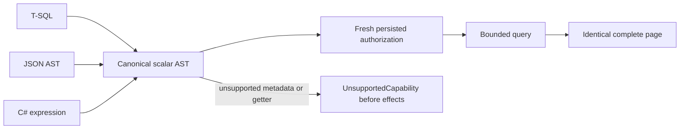

# Null, missing and IN adapter equivalence

REQ-QUERY-005 / AC-QUERY-005 and ADR013: the original NullMissingAndInHaveExplicitCanonicalSemantics declaration retains its three original documents, retired TSQL IS MISSING Validation refusal and C# Missing-or-Null result. Those two predicates are not equivalent. A common supported IN-and-IS-NULL request must now execute SQL, independently authored public JSON AST and C# expression adapters with complete literal QueryPages, order, cut and access path.

Each operation observes the original failure before unconditional full image/position/identity checks. Fresh persisted principal denial and exact same-principal epoch repair repeat through the original store and two joined same-directory cold owners. Each actual full outcome is replayed with its original GUID; the seed independently authors its complete CommitReceipt. Real pre-cancel requests retain the exact original cancellation token then the same owner completes healthy requests. This is functional Unit scope; real official SDK/MCP cluster, admission/compiler, exact Linux execution, all model/vector scopes and performance remain separate qualification gates. No new parser/operator behavior or implicit client evaluation is introduced.

## Original genuine cluster SDK caller

The unchanged ClusterTests.SqlJsonAndCSharpUseTheSameAuthorizedHttpQueryContract method owns AuthorizedQueryScenario. Its retired trailing LIMIT1 prevented every later actual public operation under the selected TSQL parser. Move that exact bound to TOP(1), retaining quoted collection/alias/IN-independent original predicate/order and all original row-a, row-b cross-adapter cursor, PII omissions, typed C# rows, denied secret-field, real live/change-feed update, malformed command no-publication and healthy status checks. Preserve the original two-minute CTS/token, original operation identities and existing fixture diagnostics/cleanup. No default cap or SQL/AST/public result oracle changes. This original scenario uses the real SDK; it does not by itself qualify official MCP or two cold cluster owners.

## Existing dispatched ALL and alias pages

SqlAllClusterPages.DuplicatesAsync and SqlImplicitAliasClusterPages.HealthyAsync are genuine success operations reached from the original SqlNullOrderingClusterWholeFlowTests whole class and reused by its persisted-denial/pre-cancel owners. Translate only positive trailing LIMIT5 to TOP(5). Keep SELECT ALL before TOP, preserve the ALL/default pair and all duplicate-cardinality full pages. Preserve three implicit/explicit alias spellings, exact case-sensitive result names, two independently literal rows and separate AST results across SDK, official MCP and prepared/simple wire calls. Prefix/tail producers are changed together; no replacement silently becomes a no-op. Whole denial/cancellation/cold/token/receipt/deadline owners and original declarations stay byte-for-byte unchanged.

The enclosing original explicit-null-ordering workflow still contains unrelated retired NULLS FIRST/LAST and USING spellings; selected TSQL lowering does not gain these from this literal repair. FETCH-without-OFFSET and U& scalar families remain separate source-confirmed adaptation work. This bounded batch cannot be reported as whole enclosing cluster success before those genuine original cases execute under their complete supported semantics. Unused Topic Predicate/LimitedSql constants are excluded from this actual-caller fix. No malformed/negative control is altered.

## Serialized collections and unsupported CLR metadata

The original UnsupportedExpressionsNeverInvokeApplicationGettersOrDelegates declaration now executes real seed/receipt/readback/replay/two-cold operations. Standard List<T> is a JSON array; KeyLoad's StrictImmutableArrayJsonConverter also serializes its backing array. CLR Count, Length and IsEmpty are not persisted JSON object members. The existing field walker must reject traversal into an IEnumerable receiver before it invents paths such as /values/count. The one guard uses only declared type metadata, never getters, converters, enumerators or compiled application delegates. Direct collection fields and existing binary array-index lowering are unchanged.

The genuine typed two-document seed independently checks complete JSON before commit and full receipt. Every original unsupported getter/delegate/cast case plus collection predicate/order/projection metadata refusal preserves exact UnsupportedCapability detail, zero unsafe-getter calls, unchanged read diagnostics and whole storage/cut/identity. Same owner then returns independent complete SQL/JSON/C# scalar pages and unchanged supported array-index/explicit-AST pages. Full original outcome replays and two same-directory cold owners preserve all bytes and identity. This is not a new JSON pointer, LINQ aggregate, SQL collection function or client evaluation capability. Official framework contract: https://learn.microsoft.com/en-us/dotnet/standard/serialization/system-text-json/supported-types .

