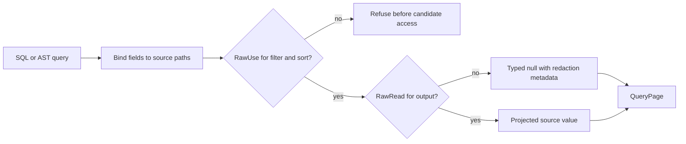

# Source field lineage and independent grants

QueryExecution. This bounded acceptance stage covers single-document source paths, quoted dotted keys and numeric array extraction. It does not duplicate composed model projections or change parsing.

REQ-QUERY-FIELD-LINEAGE-001: Project protected source fields only after persisted RawRead authorization; output aliases never change source authority. A public source renamed to a protected-looking output remains its public value. Wildcard array field policy applies to a numeric array component. REQ-QUERY-FIELD-LINEAGE-002: RawUse grants authorize filter and sort access independently of RawRead. Read-only may project the secret but cannot filter or sort by it; use-only may filter and sort while selected secrets stay null and retain original redaction paths. REQ-QUERY-FIELD-LINEAGE-003: A live QueryEngine must observe every advanced principal epoch, whole-principal revocation and repair without rebuilding the engine. Static none/read/use/both principals retain the same truth table after restart.

AC-QUERY-FIELD-LINEAGE-001: Actual T-SQL, direct AST, JSON AST and generated native AST return the same literal complete QueryPage: entity/revision, all projected values, original classification paths, read cut, null cursor and bounded-full-scan access path. Complete original ZoneTree records and position remain unchanged around successful and refused reads. AC-QUERY-FIELD-LINEAGE-002: LOWER, CAST and COALESCE projection attempts fail with exact native UnsupportedCapability diagnostics and no returned page. These are intentionally unsupported expressions, not implemented function whitelist/type inference or proof of zero metadata I/O. AC-QUERY-FIELD-LINEAGE-003: Exact original mutation/receipt fields and same-ID replay survive two genuine existing-only opens of the same root, including full image, position and identity equality. All owned resources join and independent failures remain retained.

No product defect or performance improvement is claimed from this source packet.

## Typed predicate binding before candidate access

This contract implements the type-inference and pre-data-access binding requirement for the existing single-source typed Collection predicates and ordering. A known WholeNumber field compared with a string was previously validated only when a candidate row reached the evaluator; an empty table could return a page for the same invalid expression. This is a source-confirmed cardinality-dependent gap, not a measured runtime failure.

After existing fresh persisted field-use permission and parameter validation, `QueryFieldAuthorization.Bind` resolves predicate and ordering fields against the same-cut `ResourceDefinition.RelationalSchema`, using native schema validation. Unknown predicate/order fields and incompatible known operand domains reject with Validation and exactly `The typed query binding is invalid.` before candidate access. Native schema validation retains its existing classification, detail and bounds: an unsupported declared scalar type fails with `The relational schema is invalid.`, and an excessive schema retains its native ResourceExhausted limit. Existing Comparison, IN, logical, negated and null-test nodes are visited completely. WholeNumber/FixedPoint preserve the existing decimal comparison domain; Text/UtcTimestamp preserve string comparison; Boolean remains boolean. NULL keeps existing three-valued semantics. No cast, conversion, function, grammar, schema, serializer or public AST is added.

Projection paths and source masking/aliases retain their existing behavior, including unknown projection paths. Untyped documents and joins/model sources retain their existing independent contracts; shared `Validate` is unchanged. Principal permissions are reloaded per operation and are never cached by binding.

The native `RelationalQueryBindingWholeFlowTests` operation owns an actual unindexed ZoneTree typed table. It repeats invalid SQL/direct/JSON/native AST comparisons, IN, nested predicates and unknown predicate/order paths before and after a literal acknowledged seed, checks zero additional native range attempts, and preserves full image/cut/identity. Metadata point I/O remains permitted; this is not zero-storage-I/O or indexed-path evidence. Literal numeric/field/null controls, fresh persisted denial/repair, original-token cancellation, exact seed receipt replay and two same-root cold continuations remain mandatory.

The single-source typed slice does not complete field lineage for composed sources.

