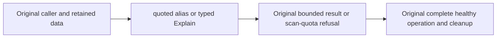

# T-SQL caller aliases and typed Explain

Canonical slice: QueryExecution. ADR-130 and REQ/AC-QUERY-004/006 preserve the original full caller operations while selecting Microsoft ScriptDOM T-SQL. AC-QUERY-EXECUTION-CALLER-001 keeps the exact projected alias `key` through the quoted identifier `AS [key]`; QueryResultByteLimitFixture preserves all original row/result-byte refusal and healthy operations. AC-QUERY-EXECUTION-CALLER-002 keeps both original QueryResourceTests scan-quota explanation calls as typed `SelectQuery.Explain=true`, with the same validated options, full explanation/cut assertions, read admission and original budget. Explain must not evaluate the deliberately malformed nested score before the scan-quota refusal.

These two existing callers preserve their original declarations, limits, errors, data and cleanup. No product parser, field mapping, budget or authorization changes are introduced.

