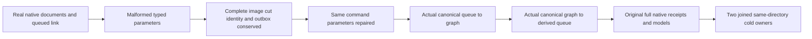

# Typed composed INSERT parameter native operations

REQ/AC-COMP-DML-001/002 and [ADR-130](../../ADR/ADR-130-microsoft-scriptdom-tsql.md) require exact named parameter census and typed bound values for canonical queue↔graph insertion. This bounded acceptance slice exercises that existing implementation; it selects no production defect or new SQL grammar.

## Whole operation

`SqlCompositionParameterWholeFlowTests.OrdinalTypedCompositionParametersRefuseWithoutEffectsThenForwardReverseReplayAndTwoColdOwners` reuses the real `QueueGraphIdentityFlow.SeedAsync` native TestDatabase corpus: two complete original documents and one canonical queued link. Existing collection, graph and queue options and persisted root authority stay unchanged; a distinct derived queue prevents reverse output from changing the original forward source census.

| Requirement | Independent operation oracle |
| --- | --- |
| REQ/AC-COMP-DML-001 typed parameters | Compile actual current ScriptDOM INSERT…SELECT. Missing queue, wrong string shape, null string, wrong-case key in an actual OrdinalIgnoreCase Dictionary, and unused input refuse complete Validation before native execution. Reverse also refuses a scalar instead of EntityRef. All complete input parameters remain unchanged. No mocked dictionary or impossible duplicate enumeration is used. |
| REQ/AC-COMP-DML-001 exact census repair | The complete original command ID/body is retained while the parameter dictionary is repaired. Actual named keys in an OrdinalIgnoreCase caller dictionary are copied by the real owning compiler and succeed; wrong spelling is never granted by the caller comparer. Complete decoded generated-native command equals the independent expected QueueToGraph or GraphToQueueMutation. |
| REQ/AC-COMP-DML-002 actual canonical effects | Execute the real compiled Batch through the same native DatabaseEngine and ZoneTree. The forward effect is exactly one first-revision related edge with original two references/weight7. The reverse effect is exactly one Ready message in the distinct queue, original link/empty headers, zero attempts, first state/ready versions and no lease. Both complete receipts include independently expected private composition references. |
| COMP-002/003/004/005 conservation | Every malformed compile and original replay unconditionally checks complete native ordered bytes, cut and all nine native identity fields even after primary failure. Original documents/source queue/graph/derived queue and marker absence are exact. All five actual outbox entries, typed commit tokens, mutation types, complete receipts, native document before/after images and head payload-byte accounting are independent; malformed compiler input has no outcome or model effect. |
| Original replay and cold | Native Apply and ResolveOutcome return the complete original seed/forward/reverse receipts without effects. Two joined same-directory native cold owners repeat malformed-input refusals, complete models/outbox and every original replay. Same input operation business timestamps remain original; no TimeProvider replacement or current-time qualification is claimed. |

The source fixture retains the original native acquisition/close settlement and failure identities. The original source is joined before cold acquisition, every native cold attempt is registered before construction, an unknown attempt prevents another open/root deletion, and the original failed close is sticky. Lexical using remains inside the original outer failure observer; original body and independent cleanup errors share the same ledger. Only known original physical release authorizes final root deletion.

## Boundaries and gates

Only new QueryExecution Unit roles and this child specification change. Product, shared fixture, SQL public B helper, parser, packages, configuration, serialized contracts and provider/clock/host paths are unchanged. Frontend and new public transport are N/A; SDK/MCP cluster, Linux, process recovery, broader distributed composition/SQL semantics and performance remain their original independent gates.

Source review and cached Roslyn preflight do not imply a passing compiler, native test UID, execution or measured coverage gain. The native test entry follows [ADR-117](../../ADR/ADR-117-native-tunit-ci-entry.md).

