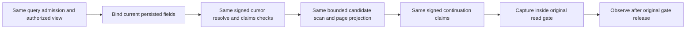

# Query cursor execution ownership — R104

This source-only responsibility extraction preserves REQ-QUERY-001/002/003 and AC-MP-003/012 under the existing QueryExecution contract, ADR-010/013/022 and AC-CQ-011/012/ADR-033. The original native KLD0031 receipt reported the WHOLE five-part QueryEngine type at211 code lines, maximum200. Moving code to a new partial, formatting/compression or changing that policy is prohibited.

## Frozen implementation
The public QueryEngine SQL/AST/live/partition/graph API and both constructors/default arguments stay byte-for-byte unchanged. Existing QueryEngine.cs delegates only complete signed cursor resolution and continuation signing to feature-local Execution/QueryCursorExecution. The helper borrows the same DatabaseEngine/view/authorized principal/resource/request hash/operation clock and frozen cursor lifetime. Its internal readonly State is transient value state; it has no serializer, alias, persisted field, public DTO or new storage owner.

Resolve retains the exact original read order: Store.Position then DocumentEpoch; native Verify<QueryCursorClaims>; TokenInvalidated-to-CursorExpired translation; all purpose/incarnation/NodeId/read-generation/principal/policy/schema/hash/source-epoch/cut/expiry/offset checks in their original order, strict operators and safe details. No renewed read view, policy, budget, clock or token is introduced. SignNext retains next<eligibleCount and the exact original QueryCursorClaims constructor, same purpose, property sequence and operation-clock expiry. QueryCursorContract alias keyload.query.cursor.claims.v1 and generated Id0..11 remain untouched.

Bind occurs before cursor resolution. Candidate scan, JSON/filter/prepared page, redaction, Explain, incremental result bytes, full CheckResult and original ReadExecutionBudget/AdmitQuery are unchanged. RelationalInnerJoinDispatch and QueryReadCutObservationDispatch stay unchanged: current authorized WithQueryView owns page+capture; after that original gate returns, Publish/Observe runs with the SAME original budget/caller and pre/post checks. No observation move across a gate.

## Acceptance mapping
| Existing requirement | Existing complete operation selector |
| --- | --- |
| REQ-QUERY-003 cursor native claims, indexed continuation and tamper/incorrect-query refusal followed by healthy continuation | /*/*/NativeQueryCursorTests/* |
| REQ-QUERY-001/003 original readcut vs new position, literal full observed/unobserved pages/store, persisted revoke before observation and actual repair | /*/*/QueryReadCutObservationTests/* |
| REQ-QUERY-002/003 independent indexed/reference ASC/DESC pagination and original malformed/expired token gates | /*/*/IndexedReferenceWholeFlowTests/* |

Native source declarations/body proofs supply these selector pointers, not manufactured UIDs or execution. Existing original tests/declarations/Args remain untouched; no mirror tests are introduced for a behavior-preserving extraction.

## Evidence and open checks
Action-first exact original KLD0031 location LiveQueries.cs3:1 returned NotFound and is retained. Existing complete native patch preview=N and exact helper new-path NotSupported retained. Root applies docs-first, native existing patch/new authored creation and then owns current whole-class analyzer/compiler/format and meaningful original operation regressions. Until those checks run, aggregate closure is SOURCE ONLY; no runtime, coverage or performance PASS is transferred.

