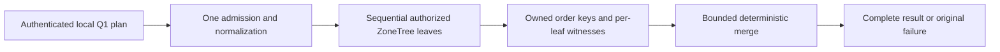

# Distributed query prerequisite: bounded local partition-leaf merge

Status: Accepted internal prerequisite; implementation and qualification pending.

This is a prerequisite-only internal stage. It exercises the existing Q1
operator against multiple real atomic partitions in one `TestDatabase` and
merges its bounded leaf outputs. Every leaf remains on the same
`DatabaseEngine`/ZoneTree owner and must report that owner's actual node,
incarnation and read generation. The atomic partition is a logical unit; the
replica copies that hold it are not separate partitions. This stage adds no
route, public contract, grain fan-out, cursor, or claim of distributed
execution. Full distributed query execution remains pending the Orleans partition-grain fan-out
and the later SDK/official-MCP stages.

## Requirements and acceptance

| Requirement | Acceptance | Automated evidence for this prerequisite |
|---|---|---|
| REQ-DQUERY-PREREQ-001: represent a validated bounded Q1 read plan and leaf evidence without widening public admission | AC-DQUERY-PREREQ-001: generated internal plan accepts 1–`QueryExecutionOptions.MaximumPartitions` (default and ceiling 8) unique partition leaves only; every leaf carries its partition, the shared Q1 request and a candidate count equal to the root limit, and no read-byte, record or retained-byte allowance. Request version/shape, a nonzero offset, empty, over-limit or duplicate partitions, and a receiving leaf whose partition, tenant, cursor, EXPLAIN, model source or candidate count disagree with its plan fail before storage reads. No caller identity or trusted role is carried in the plan. | Real ZoneTree validation tests; exact/one-over leaf-count cases; generated Orleans serializer round-trip |
| REQ-DQUERY-PREREQ-002: execute each leaf through canonical local persisted authorization and expose its actual scoped evidence | AC-DQUERY-PREREQ-002: each leaf invokes the existing `QueryEngine`/`DatabaseEngine.WithQueryView` path with the authenticated principal supplied by the existing caller, reloading persisted principal, resource, row and field policy. A denial in any leaf fails the whole operation without returning earlier leaf rows. Each result retains full `EntityRef`, local cut position, policy epoch, schema version, owner node/incarnation/read generation and access path. No scalar global cut is synthesized. | ZoneTree positive tests across 2+ real atomic partitions; persisted denial/revocation and healthy-follow-up cases; per-leaf witness assertions |
| REQ-DQUERY-PREREQ-003: merge exact Q1 order before projection can erase sort data | AC-DQUERY-PREREQ-003: each leaf retains canonical encoded ORDER BY keys before projection. Merge compares each key using Q1 direction semantics, then breaks complete ties by ordinal `EntityRef` components `(TenantId, DatabaseId, TransactionDomainId, PartitionKey, Collection, Id)`. It emits at most `request.Limit` rows; duplicate full references across leaves are `Corruption`. An independent central oracle compares full identity, revision, projected JSON/redaction and exact order, including a sort field omitted from projection. | Real multi-partition store, shuffled insertion, identical textual IDs across partitions, tie and duplicate-result cases, independent in-memory seeded oracle |
| REQ-DQUERY-PREREQ-004: one admission and one operation cover every leaf and the merge | AC-DQUERY-PREREQ-004: canonical request parsing/admission occurs once, and one `ReadExecutionBudget` (caller cancellation and explicit expiry) covers all leaves and the merge. No leaf carries a read-byte, record or retained-byte allowance and nothing is measured or charged ([ADR-149](../../ADR/ADR-149-no-operation-limits.md)). Each leaf retains at most `Limit` candidates and the merge emits at most `Limit` rows. There is no work stealing or per-leaf reset of the operation. | Real ZoneTree multi-partition reads and merge; no partial rows on failure; later healthy query |
| REQ-DQUERY-PREREQ-005: preserve one operation token/expiry and honest leaf completion | AC-DQUERY-PREREQ-005: the existing caller token and the request's explicit expiry cover validation, all sequential leaf reads and merge; there is no fixed query deadline. Caller cancellation remains cancellation; an elapsed explicit expiry uses the existing typed budget error. Each synchronous local leaf has settled before the next starts or the method returns. During-work cancellation is asserted only through an actual read-progress observation that cancels a real `ReadExecutionBudget`, then proves no result and a healthy follow-up. A persisted authorization failure or elapsed expiry in a later leaf produces no partial page. | Real progress-observed cancellation following existing graph/partition cancellation patterns; persisted-failure and healthy-follow-up tests |

### Frozen internal contract

These are internal Orleans-generated value contracts in
`KeyLoad.Query.QueryExecution`; they are not published or sent to a
grain by this prerequisite. Every type has `[GenerateSerializer]`, a unique
`keyload.query.<name>` alias and the stable field IDs listed below; an unlisted ID is unassigned. The exact names, field order and aliases are frozen for this internal stage.

| Type / alias | Ordered fields |
|---|---|
| `PartitionQueryPlan` / `keyload.query.partition-query-plan` | 0 `Version:int`, 1 `NodeId:Guid`, 2 `Incarnation:Guid`, 3 `ReadGeneration:long`, 4 `ImmutableArray<PartitionQueryLeafPlan> Leaves`, 5 `Limit:int` |
| `PartitionQueryLeafPlan` / `keyload.query.partition-query-leaf-plan` | 0 `Version:int`, 1 `Partition:PartitionRef`, 2 `AstQueryRequest Request`, 6 `MaxCandidates:int` |
| `PartitionQueryCandidate` / `keyload.query.partition-query-candidate` | 0 `Version:int`, 1 `EntityRef Reference`, 2 `QueryRow Row`, 3 `ImmutableArray<ImmutableArray<byte>> OrderKeys` |
| `PartitionQueryLeafResult` / `keyload.query.partition-query-leaf-result` | 0 `Version:int`, 1 `Partition:PartitionRef`, 2 `NodeId:Guid`, 3 `Incarnation:Guid`, 4 `ReadGeneration:long`, 5 `CutPosition:long`, 6 `PolicyEpoch:long`, 7 `SchemaVersion:long`, 11 `AccessPath:string`, 12 `ImmutableArray<PartitionQueryCandidate> Candidates` |
| `PartitionQueryResult` / `keyload.query.partition-query-result` | 0 `Version:int`, 1 `bool Complete`, 2 `ImmutableArray<PartitionQueryLeafResult> Leaves`, 3 `ImmutableArray<PartitionQueryCandidate> Rows` |

Field order is stable and version is `1`. Principal identity is supplied only
from the existing authenticated operation context; the plan contains no
principal, role, signing key, SQL text, or policy authority. The plan factory
builds every leaf from the one normalized request, replacing only its partition
and clearing the cursor; a receiving owned leaf whose `Partition` differs from
`Request.Partition`, whose request has a cursor, EXPLAIN or non-null
`ModelSource`, or whose `MaxCandidates` differs from the query limit fails
`Validation`. All leaf plans share the same Q1 query, parameters, scan opt-in
and limit. Each leaf's `Limit` is the root result limit, so the global top-L is
contained in the union of each leaf's top-L. Leaf candidate storage retains
the canonical Q1 sort bytes while the result exposes only the authorized
projected `QueryRow`.

The owner identity in this prerequisite is copied from the actual single
`DatabaseEngine.Store.Identity`, not selected by a caller. All results must
match it. `CutPosition`, `PolicyEpoch` and `SchemaVersion` are per-leaf
witnesses. Policy epochs must agree across all completed leaves; otherwise the
operator fails closed with `OwnershipLost`. Cuts may differ and are never
collapsed into a global position. An unauthorized leaf preserves the existing
`PermissionDenied` result. Invalid inputs map to `Validation`, malformed
duplicate/result identity to `Corruption`, ownership/witness mismatch to
`OwnershipLost`, an elapsed explicit expiry to `BudgetExceeded`, and cancellation to
the original `OperationCanceledException`. There is no incomplete/partial
success mode.

### Bounds and operation order

1. Validate the leaf shape, duplicate full partitions, leaf consistency,
   common Q1 AST, cursor/model/EXPLAIN exclusions and the partition count before
   a database read. Admit once using current `QueryEngine` admission.
2. Create one root operation budget (caller cancellation and explicit expiry)
   and normalize or compile Q1 once. Order the leaves over the canonical
   ordinally sorted partition list.
3. Execute leaves sequentially through the existing local query operator.
   Each leaf keeps its top `Limit` candidates with their owned order keys.
   Preserve the current Q1 predicate, access-path, field authorization,
   projection/redaction and local read view. Do not expose a
   `PreparedRow`/borrowed `IKeyValueView` outside its `Store.Read` callback.
4. Require identical owner identity and policy epoch. Keep one cut/policy/schema
   witness per leaf. Merge the already bounded sorted runs with a k-way
   comparator. Validate the complete bounded output before returning
   `Complete=true`.
5. Any failure or cancellation returns no rows. Each current leaf is synchronous
   and fully settled before continuation. There is no concurrent leaf queue or
   backpressure claim in this prerequisite.

The partition query has no KeyLoad query-byte, token, AST-depth, deadline,
examined-record, read-byte, result-byte or row ceiling ([ADR-149](../../ADR/ADR-149-no-operation-limits.md)). An execution-stack
check guards SQL recursion, caller cancellation and explicit expiry stop the
operation, the storage range page bounds each storage read, and the caller's
`Limit` bounds retained candidates and returned rows.

### Explicit boundaries still open

This prerequisite cannot prove Orleans fan-out across partition grains, remote
producer backpressure/settlement, bounded node availability, SDK/official MCP
transport parity, partial-result policy, query statistics epochs or any
replicated-cluster distributed behavior. Current `QueryEngine.Execute` and
`WithQueryView` are synchronous; a deterministic slow in-flight *remote* leaf
oracle does not exist without the later Orleans leaf route. Do not add a
fake provider, artificial delay hook, or production observer to simulate one.
The synchronous local leaf still proves persisted later-leaf failure, real
during-work cancellation and whole-result failure.
Slow-node timeout, capacity-one stream backpressure, original
remote-task join, and a real multi-node exact-source cluster run remain pending
and must be added only with their owning contract.

## Source basis and ownership

The original architecture acceptance is
[`product-specification.md:765-770`](../../design/product-specification.md).
Current Q1 contracts are `QueryRequest`/`AstQueryRequest`, `QueryPage`, and
`QueryRow` under `src/KeyLoad.Abstractions/QueryExecution/Contracts/`.
The local operator is `src/KeyLoad.Query/QueryExecution/Queries/QueryEngine.cs`;
`PreparedQuery` owns canonical encoded order keys and currently ties on only
encoded `EntityId`; `QueryCandidateReader` applies the existing read
budget and candidate scan. `DatabaseEngine.WithQueryView` at
`src/KeyLoad.Core/DocumentStorage/Execution/Documents.cs:107` provides
per-leaf persisted authorization and scoped read view.
`ReadExecutionBudget` at `src/KeyLoad.Core/ReadExecutionBudget.cs` provides
the operation's cancellation token and explicit expiry. `TestDatabase` opens a
real temporary `ZoneTreeStore`, bootstraps persisted root identity and exposes
its actual `DatabaseEngine`; no mock storage seam is needed.

Source ownership is limited to Query feature-local internal contracts,
models, validation/admission and executor helpers plus a narrow private
`QueryEngine` join, with real ZoneTree tests in UnitTests `Features/QueryExecution`
role folders. Query owns no storage ownership or transport.

The exact broader target remains in `docs/design/product-specification.md`;
this file is a prerequisite-only stage. The implementation must not mark distributed query execution complete. UI, SDK, MCP, SQL grammar, server
and Orleans routing are N/A for this stage.

## Canonical slice and implementation map

| Owner | Exact owned paths |
|---|---|
| QueryExecution values | `src/KeyLoad.Query/QueryExecution/Contracts/PartitionQuery/PartitionQueryPlan.cs`, `PartitionQueryLeafPlan.cs`, `PartitionQueryCandidate.cs`, `PartitionQueryLeafResult.cs`, `PartitionQueryResult.cs` |
| Query validation and execution | QueryExecution feature-local `Validation/` and `Execution/`, with `Execution/PartitionQueryExecution.cs` and one internal owner accessor in `Queries/QueryEngine.cs` |
| regression cases | `tests/KeyLoad.FunctionalTests/QueryExecution/Cases/PartitionQuery*Tests.cs`, with actual fixtures and assertions in their owning role folders |
| Core operation dependency | Existing `src/KeyLoad.Core/ReadExecutionBudget.cs` (cancellation and explicit expiry) |
| Durable ADR | [ADR-100](../../ADR/ADR-100-local-partition-query-merge.md) |

This internal stage does not export a product result stream. Orleans
fan-out and ManagedCode.Communication streaming remain required for distributed execution before any public SDK or MCP route is delivered.

## Leaf ordering and top-L

The internal leaf and merge use ordinal full-reference ties consistently
before top-L selection, including Unicode boundary cases. Existing public
Q1 `PreparedQuery` UTF-8 ID tie ordering remains its current contract.

The internal leaf top-L uses one binary heap in `PreparedQuery` backed by
exactly L+1 reference slots. It compares canonical order bytes and ordinal full
EntityRef before admission; the public Q1 PriorityQueue and its existing UTF-8
EntityId tie contract remain unchanged. Draining the heap yields the leaf's
candidates in order and releases its slots. The existing canonical KeyCodec
remains unchanged; this stage makes no peak-RSS claim.

## Public multi-partition SDK/MCP contract

Status: contract accepted before implementation; source integration and all runtime qualification remain open. This stage does not complete distributed execution.

This stage publishes a typed multi-partition request over the already implemented bounded partition-leaf merge. The caller's connection grain ([ADR-125](../../ADR/ADR-125-connection-owned-execution.md)) executes the request: it calls the logical partition grains through ordinary Orleans calls, each leaf runs against its ZoneTree owner, and the connection grain merges the leaves into one page. The stage adds no global transaction snapshot, cursors or SQL grammar. The cluster concept is described in [ADR-136](../../ADR/ADR-136-orleans-partition-ownership.md).

## REQ/AC

- REQ-PQUERY-001: expose a bounded generated request that carries only up to eight full atomic `PartitionRef`s, one existing `SelectQuery`, existing query parameters, full-scan opt-in, and AST version. AC-PQUERY-001: reject default/empty/over-eight or duplicate partitions, invalid AST version/shape, oversized request, cursor-bearing or otherwise unsupported query semantics, `Explain`, and non-null `ModelSource` before any storage read; do not accept caller identity, roles, cut or deadline.
- REQ-PQUERY-002: retain the persisted-authority path. AC-PQUERY-002: each SDK/MCP call follows request envelope verification, request identity validation, connection-grain admission, request freshness validation, persisted principal and policy reload, and normal query-capability execution. No admin-only API is invoked for a non-admin.
- REQ-PQUERY-003: bind each authorized leaf to its own scoped read cut. AC-PQUERY-003: every leaf executes inside the existing `WithQueryView` callback, after it has loaded the persisted principal and passed `Authorization.Require(Query | DocumentsRead)` for that leaf's partition/collection, and reports its own cut, policy epoch, schema version and access path. Leaves may differ in cut and access path; policy epochs must agree. An unauthorized leaf fails `PermissionDenied`, an inconsistent witness fails `Corruption` or `OwnershipLost`, and no partial page is returned.
- REQ-PQUERY-004: reuse exact DQUERY semantics. AC-PQUERY-004: one admission/normalization/compilation and one original `ReadExecutionBudget` (caller token and explicit expiry) cover all leaves and merge. Each leaf rechecks persisted principal/resource/row/field policy, the local store identity/read-generation and the policy epoch. Any later denial or witness mismatch returns no rows. Preserve separate per-leaf cut positions; never synthesize a scalar global cut. Keep the internal DQUERY exact comparator, full EntityRef tie-break, the `Limit` candidate bound and no partial result.
- REQ-PQUERY-005: expose only complete typed replies through the existing CQRS stream. AC-PQUERY-005: the connection grain returns one typed `PartitionQueryPage` after all leaves and the merge settle; faults/cancellation dispose/join the actual stream under existing lifecycle rules. SDK and official MCP logical results match; no second dispatcher, unbounded materialization, or partial-page mode.
- REQ-PQUERY-006: qualify the public capability on the real Aspire-owned replicated cluster. AC-PQUERY-006: direct .NET SDK and official MCP cover independent ordered oracle, same textual IDs in distinct partitions, hidden sort fields, ties, empty/no-hit partitions, persisted denial/revocation on a later leaf, caller cancellation/limits with healthy follow-up, acknowledged write/read through a surviving node, and malformed/version/oversized input. The real official MCP schema oracle checks exact request/result properties and required fields; nested `PartitionRef` includes computed `atomicPartitionId` as an optional schema property in addition to its four required identity strings. For nullable `Parameters: Dictionary<string, JsonElement>?`, the type oracle admits only scalar `object`, singleton type-array `[object]`, or the exact unordered two-member set `{object, null}`; the latter is permitted only at this nullable dictionary site. Non-nullable schema fields accept only their exact scalar or singleton type array. Extra, duplicate, empty, non-string, or contradictory type arrays fail. Local references remain bounded to depth 8. Ordered tie fixtures use the non-unique rank index without changing duplicate-rank inputs; separate unique-index rejection cases remain mandatory. Every row with `Redacted == false` has a present, initialized `RedactedFields` collection with zero entries; a null collection is not equivalent. Rows that redact data retain the exact omitted field paths. Evidence does not claim full distributed execution.

## Public generated contracts

The frozen public error map distinguishes the request envelope from the AST: an unsupported `PartitionQueryRequest.Version` returns `Validation`; an unsupported `AstVersion` returns `UnsupportedCapability`. Neither returns a successful partial page. Empty, duplicate or over-limit leaves are `Validation`; an elapsed explicit expiry is `BudgetExceeded`.

All contracts live in `KeyLoad` alongside current query contracts; aliases are feature-local named constants in Abstractions `Features/QueryExecution/Serialization`, not a new global alias layer.

- `PartitionQueryRequest`, alias `keyload.contract.partition-query-request`: `[Id(0)] int Version` (must be 1); `[Id(1)] ImmutableArray<PartitionRef> Partitions`; `[Id(2)] SelectQuery Query`; `[Id(3)] Dictionary<string, JsonElement>? Parameters`; `[Id(4)] bool AllowFullScan`; `[Id(5)] int AstVersion` (must be 1). `SelectQuery.Limit` remains the sole row-limit field. Cursor, explanation, and model-source are absent/rejected. The server caps partitions at `QueryExecutionOptions.MaximumPartitions` (default and ceiling 8) and enforces the HTTP request body limit; there is no read, scan, result or retention limit and no caller-settable work grant.
- `PartitionQueryRow`, alias `keyload.contract.partition-query-row`: `[Id(0)] EntityRef Reference`; `[Id(1)] QueryRow Row`. The full reference distinguishes equal textual IDs in different partitions. No canonical sort bytes or unprojected record is public.
- `PartitionQueryLeafWitness`, alias `keyload.contract.partition-query-leaf-witness`: `[Id(0)] PartitionRef Partition`; `[Id(1)] long CutPosition`; `[Id(2)] long PolicyEpoch`; `[Id(3)] long SchemaVersion`; `[Id(4)] string AccessPath`. The local store's NodeId/incarnation/read-generation are validated internally and are not exposed. These are per-leaf witnesses and can differ in cut/schema/access path; policy epoch and actual store identity must agree.
- `PartitionQueryPage`, alias `keyload.contract.partition-query-page`: `[Id(0)] int Version`; `[Id(1)] ImmutableArray<PartitionQueryRow> Rows`; `[Id(2)] ImmutableArray<PartitionQueryLeafWitness> Leaves`; `[Id(3)] bool Complete`. Every successful reply has `Complete=true`; all failure paths return no rows and there is no incomplete mode.

## Ordered ownership and joins

1. Contract review freezes aliases/IDs/error map/response witnesses and explicitly says no global cut claim.
2. Query owns the public generated DTOs/aliases, bounded request validation, mapping to the existing internal `PartitionQueryExecution`, and projection from internal candidates to the complete public page. It retains the existing QueryEngine/one-budget path; no second admission/deadline.
3. The server owns append-only `GrainReadKind.PartitionQuery` and `GrainQueryReadCapabilities` binding inside `DatabaseReadGrain`, existing request-envelope/payload validation and capability inventory; no second grain/dispatcher.
4. The server owns HTTP `POST /query/partitions`, SDK `PartitionQueryAsync(PartitionQueryRequest, CancellationToken)`, MCP `keyload_query_partitions` at `/query/partitions` with read-only hints/catalog description, and typed response mapping, all through the normal signed read path.
5. Add generated-codec/strict public-input cases; real ZoneTree unit tests; then genuine Aspire-owned cluster .NET SDK + official MCP tests. Build/format/analyzers and complete unit/recovery/cluster gates precede any acceptance claim.

## Source-grounded current joins

- `SelectQuery` is generated Q1 and already owns `Limit` (IDs 0–7; `QueryAst.cs`); `AstQueryRequest` has one `Partition`, optional `Cursor`, and `AstVersion` (IDs 0–5). The proposed public request deliberately does not embed it.
- `PartitionQueryExecution.ExecutePartitionQuery` is internal and already creates one `ReadExecutionBudget`, admits once, normalizes once, executes sequential real local leaves and merges complete output.
- `PartitionQueryLeafExecutor.Execute` calls existing `DatabaseEngine.WithQueryView`, whose callback runs only after persisted principal/resource authorization. It captures owner identity and per-leaf cut/policy/schema/access-path witnesses.
- `DatabaseReadGrain` validates the request envelope, selects an available canonical owner through Orleans, checks its required read cut and reloads persisted authority before `GrainQueryReadCapabilities.ExecuteAsync`. Existing numeric operation identities remain stable.
- Existing transport joins are `QueryApi.Map`, `KeyLoadClient`, `McpReadCatalog`, `McpToolNames`, `McpToolRoutes`, `McpToolHints`, and `ApiGrainDispatch`; the server owns all of them.

## Public mapping

The public mapper has this exact operation shape: `PartitionQueryPage MapPublic(PartitionQueryResult result, ReadExecutionBudget budget)`. It wraps the already owned internal rows and leaf witnesses and checks the operation's cancellation and expiry for each element. `EntityRef`, `QueryRow`, their strings, and the existing partition/access-path values are references reused from the internal result; no payload/sort-key/JSON bytes are copied and nothing is measured. It opens no second budget/deadline and leaves the internal result unreachable after return.

The final public page field order is fixed as accepted: Version `[0]`, Rows `[1]`, Leaves `[2]`, Complete `[3]`. Exact aliases and IDs in the preceding tables remain unchanged.

### Acceptance mapping

`PartitionQueryExecution.ExecutePartitionQuery` retains its existing internal calls unchanged. Public normalization validates every requested partition first and uses the first canonical sorted partition as the server-generated `AstQueryRequest.Partition` anchor. All leaves remain in the plan and are authorized separately.

REQ/AC-PQUERY-001/004/005 map to `PartitionQueryPublicContractTests` and `PartitionQueryPublicMergeTests` under `tests/KeyLoad.FunctionalTests/QueryExecution/Cases/`; REQ/AC-PQUERY-002/003 map to `PartitionQueryPublicAuthorizationTests`; AC-PQUERY-006 maps to `PartitionQueryPublicClusterTests` under `tests/KeyLoad.ClusterTests/QueryExecution/Cases/`. Root joins the append-only read kind, persisted authority path, signed SDK/HTTP/MCP route and complete independent MCP inventory/schema/codec corpus. All of these tests use the Aspire-owned caller. A focused pass is development evidence; original full Linux unit/scalar/recovery/cluster/fault/endurance evidence remains required.

### Complete-flow contract regressions

The seven `PartitionQueryMcpContractTests` cases under REQ/AC-PQUERY-001/005 and REQ-CQ-009/AC-CQ-021 are complete operations. Each positive test configures an actual persisted collection,
commits a literal document to genuine ZoneTree, decodes the real execution/public
request, executes `QueryEngine.QueryPartitions`, and checks the full returned
reference, projected content, persisted revision, leaf witness and unchanged
committed state. Alias/field-ID, schema/effect-hint and writer equality checks
remain additional assertions inside those operations. Page serialization consumes
the actual returned page, never a constructed successful reply.

The canonical MCP request without full-scan permission executes and rejects with
`UnsupportedCapability`, preserving the stored document and position. Decode a
request with explicit permission through the same catalog and execute a healthy
follow-up on that same store. Invalid envelope/AST versions retain their actual
pre-storage rejection, exact errors, zero storage reads and unchanged position.
Keep the existing test names and normal/scalar contributor identity. These local
codec flows do not replace the official MCP/SDK cluster AC-PQUERY-006 cases.

Canonical MCP AST/partition-query fixtures use a valid RFC6901 field pointer
while preserving their identifier alias. A bare identifier path is malformed
input and must not mask the intended full-scan denial. The same decoded canonical
request must pass normal validation, produce the specified consent rejection,
then return the complete persisted row after explicit consent; correcting fixture
input does not weaken production validation or change its error contract.

Ownership: existing ClientApi/Cases/PartitionQueryMcpContractTests.cs and
ClientApi/Fixtures/Distribution/PartitionQueryMcpTestData.cs in the QueryExecution test slice;
production contracts, aliases, field IDs and execution paths are unchanged.
ADR: the existing ADR-100 public-query contract is sufficient; no new boundary,
data format or transport is introduced. First complete source review and the
strict Release build, then run the normal/scalar functional profile through
Aspire with fresh source/DLL/PDB/contributor guards and retain its original execution
reports. Actual collection and complete mandatory suites remain acceptance gates.

## Bounded parallel leaf execution

REQ/AC-DQUERY-PREREQ-005 and REQ/AC-PQUERY-004/005/006, ADR-100: the centrally validated downward `MaximumConcurrentPartitionLeaves` defaults to 2, has ceiling 8 and never exceeds the actual plan leaves, `MaximumPartitions` or existing admissions. Every leaf is prepared in plan order on the original parent budget, and fixed result slots are allocated, before dispatch. A prepared leaf owns only an immutable request and its own call; it does not receive or mutate the parent budget or read view while running. Each leaf call carries a child envelope with the parent operation's expiry and runs against the same authorized cut. No shared read view or mutable aggregate ledger is passed concurrently.

A bounded batch admits at most the configured concurrency. Leaf calls start independently as ordinary Orleans grain calls, never through an alternate dispatcher. All leaf terminal replies and cleanup settle before serialized validation and merge. Closed per-leaf result slots bound simultaneous buffering. Caller cancellation or the first admitted leaf failure stops further batches, cancels all admitted work with the original linked operation token, and joins every admitted leaf; every primary/cleanup failure is retained. No partial public page; all leaves must succeed before the existing deterministic merge and public mapping. Deadline semantics and the original caller token remain unchanged; cancellation classification never masks additional cleanup faults.

Whole flows: independent ZoneTree stores, concurrent leaf work under the owning injected clock and observable read phase, original caller cancellation with joined workers and unchanged full bytes/cuts and a null page, then a complete literal healthy merge. The Aspire-owned cluster SDK/official MCP/Q1 flow cancels only after actual leaf observation, joins the producer and original clients, and performs a fresh literal healthy merge. No sleeps/retries/quota increase/fake clients/provider/test hook; performance/resource scalability remains unqualified pending comparable Linux GitHub evidence.

## Distributed statistics and modality execution

Pre-implementation owning contract. REQ-DQUERY-GLOBAL-001 / AC-DQUERY-GLOBAL-001 requires exact lexical and vector candidate windows from every queried logical partition before weightedRrfV1 fusion. It reuses TextRanker BM25 arithmetic, the VectorRanker metric/scalar/SIMD contract, GlobalBranchWindowMerger full-reference order and SearchRankFusion. Local fused top-k cannot substitute per-modality global windows. The exact profile rejects a candidate window that is truncated, incomplete, approximate or incomparable; there is no silent exact claim. Approximate ANN/provider profiles remain explicitly unsupported by this exact route and their separate existing APIs remain unchanged. No distributed graph, aggregate SQL or ANN approximation completion is inferred.

REQ-DQUERY-GLOBAL-002 / AC-DQUERY-GLOBAL-002 requires one server-derived statistics epoch over the exact ordered vector of actual partition cuts, principal policy epochs, resource schemas and query-term/profile identity. Each partition captures its actual authorized visible document count (including documents without the text field), total canonical token length and per-query-term document frequency. The connection grain sums these finite summaries with checked arithmetic, using canonical query-term order and distinct full atomic partitions. Every candidate phase revalidates its original partition cut and current persisted authority before applying the shared global BM25 values. Changed cuts/policy/generation refuse `OwnershipLost` with no partial page; no automatic recapture/retry. The epoch is ephemeral operation evidence, not persisted global coordinator authority or a caller-selected freshness token. Independent partition cuts are never equated or replaced by a scalar global cut. ACL-visible corpus statistics cannot be returned publicly.

REQ-DQUERY-GLOBAL-003 / AC-DQUERY-GLOBAL-003 requires all effects and read phases to run through the existing server-owned connection grain with freshly signed bounded call-local read work and ManagedCode.Communication streaming. The connection grain authorizes every partition/collection first; each partition leaf reloads the same authenticated subject from persisted database state and enforces Query/DocumentsRead, vector and field policy before reads. No roles, grants, raw credentials, caller statistics or borrowed storage views are accepted. Default existing PartitionQuery Q1 request validation and ModelSource rejection remain unchanged.

REQ-DQUERY-GLOBAL-004 / AC-DQUERY-GLOBAL-004 bounds the statistics, modality-candidate, selected projection and final revalidation phases by the centrally validated MaximumPartitions/MaximumConcurrentPartitionLeaves; there are no scan, raw-read or result-byte ceilings, and summaries, candidates and selected documents are neither measured nor charged. All phase work shares one original token and explicit expiry; no per-phase reset, work stealing, new quota or limit. A bounded batch retains original tasks until all settle; first failure cancels all admitted leaves, stops later phases and joins all readers/providers before response/store shutdown. No partial success; server-only statistics or raw secret fields never enter public output, hints or logs.

REQ-DQUERY-GLOBAL-005 / AC-DQUERY-GLOBAL-005 requires actual multi-partition ZoneTree flows and the Aspire-owned cluster flow: independently centralized lexical/vector/fusion literal oracle; ties/identical text IDs under distinct full references; empty/nonmatching/missing fields/skew; changed statistics/cut/policy and leaf denial; actual in-flight cancellation/deadline followed by unchanged full canonical images/independent cuts and healthy continuation; same-root cold restart/replay; all SDK/official MCP/Q1 caller/schema/privacy parity. No benchmark, power-loss, resource or performance claim is supplied by source.

### Stable component contracts

`DistributedTextStatistics` alias `keyload.query.distributed-text-statistics`, IDs0 Terms:ImmutableArray<string>,1 DocumentCount:int,2 TotalLength:long,3 DocumentFrequencies:ImmutableArray<int>. Version belongs to the encompassing typed request; this statistics record has no identity/roles/epoch supplied by callers. Its actual Terms are produced by existing canonical SearchTerms under execution limits, and every value is validated. Existing execution/public aliases and IDs are unchanged. TextRanker local Rank continues its original field-based arithmetic without a new default allocation; global Rank consumes exactly this validated summary through the SAME scoring body.

Subsequent source shipment must freeze complete private statistics/candidate/projection request/result aliases and IDs plus the additive public DistributedSearch route/schema tuple before their code. No partial ingress is joined alone. Stages: actual statistics/scoring component, same-view exact-cut leaf, authorized multi-partition coordinator in the connection grain, public SDK/MCP/Q1 composition, independent Unit/process/cluster oracles, fresh root-owned census/build/Linux acceptance. Rollback withdraws only the additive operation and removes disposable stats; no persistent current format or migration fallback is introduced.

### Per-leaf statistics witness

Each partition leaf captures its witness (partition, node, read generation, cut position, policy epoch, schema version, resource policy digest and text statistics) from the actual `WithPartitionQueryFenceView` read, after fresh persisted Query/DocumentsRead/field authorization. The complete current store identity and resource digest/cut must match before any candidate read; absence or change refuses, never reopening an old cut. The common opaque epoch is the canonical SHA256 of the bounded generated epoch input over all leaf witnesses. Statistics capture and candidate copies check the original operation's cancellation and expiry; nothing is measured or reserved. No hard-coded operational cap. Returned terms are canonicalized by the actual TextRanker; local Rank() still avoids the new DTO allocation and delegates the same exact arithmetic. No identity, secret canary, statistics count or resource digest is published in the public epoch value.

### Statistics witness and candidate contract

`DistributedTextWitness` has IDs 0 Partition, 1 Owner, 2 NodeId, 3 ReadGeneration, 4 CutPosition, 5 PolicyEpoch, 6 SchemaVersion, 7 ResourcePolicyDigest, 8 Statistics and 11 Incarnation; it reports no read or examined-record counters. Statistics-only TextRanker construction retains no candidate corpus; it preserves the exact tokenizer/frequency/length path. Each receiver statistics leaf owns the original database.AdmitQuery permit once for the complete synchronous operation.

Vector-only scope records the actual authorized visible canonical document count with no selected text terms/frequencies or text length, rather than fabricating a text query/field. Fresh VectorSearch and vector-field-use policy precedes capture; hybrid scope requires both actual field capabilities. Empty normalized text terms in statistics-only construction still measure the selected text field corpus; old local empty-text ranking remains unchanged.

DistributedSearchCandidateLeaf alias keyload.query.distributed-search-candidate-leaf: Id0 original statistics witness, Id1 nullable actual text GlobalBranchWindow, Id2 nullable actual vector GlobalBranchWindow. Existing GlobalBranchWindow/Candidate/Scope aliases and fields are reused unchanged. Full source windows are captured only after successful complete canonical scans; each score is rebound at that exact cut to its actual full document reference/revision before bounded retention, then sorted with existing full-reference GlobalBranchOrder. No leaf top-k discards candidates before global per-modality merge.

The existing PartitionQueryParallelBatch remains the task owner. Its exact original WhenAll/sibling-cancellation/primary+cleanup join body is factored once into a typed generic overload; Q1 delegates through a static noncapturing runner with one original task array. New typed phases reuse that same bounded owner, not a new dispatcher or scheduling authority. Supporting tests execute actual multi-partition statistics/ranking/projection, an actual committed policy-epoch failure, fresh complete literal results and owning cold reopen. These are supporting operation tests, not public cluster qualification.

### Additive public operation boundary

`DistributedSearchRequest` alias `keyload.distributed-search-request`, IDs0 Version:int,1 Partitions:ImmutableArray<PartitionRef>,2 Search:SearchRequest. The EXISTING SearchRequest is the one common caller-visible typed search shape/defaults/weights/vector/allowlist/explain contract; its logical template partition must equal the first declared partition, all partitions are unique and bounded by existing QueryExecutionOptions.MaximumPartitions, and each internal leaf replaces only that logical partition. No copied defaults, owner proofs, identity, roles, statistics, expiry or grants are accepted. Version1 only. TextIndex selection is explicitly UnsupportedCapability in this canonical distributed profile; existing selected Search/ANN APIs remain unchanged.

`DistributedSearchPage` alias `keyload.distributed-search-page`, IDs0 Version:int,1 Hits:ImmutableArray<RankedDocument>,2 Leaves:ImmutableArray<PartitionQueryLeafWitness>,3 StatisticsEpoch:string,4 Complete:bool. Hits are actual fully projected same-cut documents with independent full references/revisions/redaction and weightedRrfV1 scores/explanation. Leaves reuse the existing public scoped per-partition cut/policy/schema/access-path witness, without exposing private proof or resource-policy bytes. StatisticsEpoch is opaque descriptive evidence only and cannot authorize another read. Complete means exact requested top-k over complete global per-modality windows; no partial/approximate candidate result is admitted by this profile.

New public read name `DistributedSearch` maps the same typed request/result across SDK, official MCP and Q1 CALL, under current ADR125 bounded connection-owned call-local/ManagedCode.Communication read execution. Shared GrainReadKind append composes AFTER OnlineTextMaintenance, and current connection-owned capability/codec/catalog additions compose against exact immutable ancestors. The complete literal catalog and current metadata count come from the integrated source; no count is guessed here. No partial public ingress is integrated alone.

### Receiving phases and final projection

ADR-125 governs execution: ingress and every leaf call retain independent signed call identities, current persisted authorization, context, cancellation and joined work in the existing bounded connection-grain/call-local pipeline. No completed call history or new activation per call is introduced.

The private leaf phases are Statistics, Candidates, Projection and Revalidate. The centrally validated partition bounds and the operation's explicit expiry constrain every phase; no lifetime reset or public phase input exists. Before any result the projection leaf freshly requires the same cut/current principal/resource and all original text/vector field capabilities, then checks each selected full reference and actual canonical document revision. No deleted/revised/foreign selected document is projected. Explain is attached from the parent's globally fused rank contributions, not generated by an unrelated local ranking pass. Final revalidation repeats actual current modality capabilities and the original witnesses before the response.

Canonical-only leaves call the original TextRanker scoring kernel directly, so SearchBranchExecution/selected-reader lifecycle is not replaced. The provisional shared rank overload is excluded. The existing GlobalBranchWindowMerger has no server record or result ceiling ([ADR-149](../../ADR/ADR-149-no-operation-limits.md)); a complete globally ranked branch is never replaced by a local/global top-k approximation. Existing original Search/ANN profiles and defaults remain unchanged.

### Complete caller schema and canonical SQL delegation

The public current bounded profile adds tool literal keyload_query_distributed_search and POST /query/distributed-search, input exactly DistributedSearchRequest {version,partitions,search}, output exactly DistributedSearchPage {version,hits,leaves,statisticsEpoch,complete}. Nested search retains all existing SearchRequest fields/defaults and explicit selected generation is UnsupportedCapability for this new canonical corpus profile. SDK DistributedSearchAsync, official MCP descriptor and Q1 CALL keyload_query_distributed_search(@payload) all delegate to this same read kind through the existing canonical gateway and bounded discovery; no new SQL parser/dispatcher, extra public privileged field, cursor or global-cut claim. Hints are ReadOnly=true, Idempotent=true, Destructive=false. Initial gateway discovery remains unchanged. All old catalog entries retain exact schemas/routes/hints; independent Unit+officialSDK schema/literal expectations must add this tuple separately before whole join. Two private appended read kinds follow actual current OnlineTextMaintenance and preserve all previous ordinals.

### Complete schema and decoder

REQ-DQUERY-GLOBAL-001/003/005 and AC-DQUERY-GLOBAL-001/003/005 plus AC-MCP-001 map to the existing `McpCatalogTests.AcMcp001EveryFrozenOperationHasItsExactRouteAndOneCapability`. Preserve its complete independent inventory; append feature-local distributed-search assertions for the literal tool/route/read capability/hints, strict public version/partitions/search schema (all fourteen existing nested fields and optional Limit), complete five-field result and nested document/explanation/scoped witness schema. Execute actual public JSON to descriptor decode to generated request and public roundtrip, reject caller-authority/unknown outer and nested fields, and perform healthy decode after each refusal. Complete independent result literals must roundtrip through actual public JSON and generated serializers. These prove schema/decoder behavior only; the separately mapped true two-owner SDK/official MCP/Q1/cold cases and exact-source Linux outcomes remain required and unqualified until executed. No catalog count, discovery or PASS is inferred from this source.

### Expiry and cancellation

REQ/AC-DQUERY-PREREQ-005 and REQ/AC-DQUERY-GLOBAL-004/005 distinguish actual caller cancellation from an elapsed explicit expiry. The coordinator constrains its one `ReadExecutionBudget` to the request envelope's expiry; once that instant passes, the next budget check fails `BudgetExceeded` with the safe detail "The read execution deadline is exceeded.". Each leaf call carries a child envelope with the same expiry, which its receiving grain enforces. Caller cancellation remains the original `OperationCanceledException`. The coordinator runs no timer of its own and does not reclassify leaf failures: all admitted children settle before the owning batch exposes the first failure, and a batch preserves multiple failures as an aggregate.

The cause-bearing factory `Errors.Fail(ErrorCode code, string detail, Exception cause)` checks the cause and calls the internal four-argument `KeyLoadException` constructor with `Errors.Status(code)`. Every other overload, alias/ID, code/status and public safe problem detail is unchanged.

### Shared error primitive responsibility

Root approves exact extraction of entire existing KeyLoadException and Errors types from Abstractions/Contracts.cs into Abstractions/KeyLoadException.cs and Abstractions/Errors.cs respectively. These are solution-wide shared primitive owners under the existing root building-block exception, not feature layers or partial files. Preserve namespace KeyLoad, all original members/bodies, Alias/field IDs and ABI except the already approved internal four-argument constructor and additive cause factory. Contracts remains below400; each extracted type below200. No friend assembly, rule exemption or binary format/JSON change. Integration is one guarded atomic source cohort; rollback is the exact original source cohort before compilation/publication, not a persisted-state migration. checkOnly preview/new-path NotSupported and whole canonical build plus same original deadline/caller/mixed-operation controls are required; source movement is not runtime proof.
