# Distributed query source authority during fan-out (KL037)

## Contract and complete operation

REQ/AC-PQUERY-REMOTE-002..005 and AC-QUERY-007 require every admitted leaf and final bounded merge to remain attached to the original source authority. This new-only operation uses actual StartProtectedDocumentsAsync: two independently configured physical owners, each genuine RF3/Aspire group, source PMAP/directory routing, native Orleans PartitionQuery/PartitionQueryLeaf capabilities, original finite grants and actual public SDK/official MCP callers. It adds no product hook, new dispatcher, trusted principal or changed timeout.

The existing two-row corpus has the SAME textual document ID in different full partitions; title ordering places destination before source. The complete independent rows include revision1, exact projected JSON, redacted secret field and distinct full EntityRefs. Every public leaf independently requires its actual positive scoped cut, expected policy epoch/schema version/access path; a cut is never ordered against a logical CommitToken or another node. The full page includes Complete=true and all leaves. Native source metadata/physical-owner fields remain private and are not fabricated into public witnesses.

The current prior remote case checks initial destination denial, healthy native query/cancellation and a restarted receiving process. It does not alter a source resource digest after actual parent preparation. This case holds the ORIGINAL parent AuthorizationReload, releases it, then observes the ORIGINAL local PartitionQueryLeaf AuthorizationReload under the same signed source profile. Preparing all immutable fixed-grant leaves occurs before dispatch; thus the actual source resource fence exists before this second marker. While the original SDK or official MCP request is pending, administrator commits a real resource-policy CAS1→2 changing only the already-private secret classification. The selected title remains readable and principal epoch2 unchanged. Release the SAME child; source digest revalidation must refuse the WHOLE request with no partial page: full SDK OwnershipLost safe detail, official generic safe Problem. Both original tasks/parent+child producers settle and arms retire. No returned row or fake slow provider counts as this refusal.

Repair CAS2→3 restores the original secret classification under a new schema version; fresh queries through SDK, official MCP and their existing central SQL EXEC delegation must return complete literal pages. Receiving principal epoch3 revokes Query while retaining DocumentsRead; full SDK/MCP PermissionDenied returns no earlier local leaf. Genuine epoch4 restores Query and every caller returns the same independent rows. The original armed in-flight cancellation flow is reused unchanged and followed by healthy complete query. No assertion changes a source/receiver epoch to force equality: they are independent physical catalogs.

Every response/refusal independently captures source/destination applied positions and both Outbox models before work, then unconditionally checks both full unredacted administrator documents, both original write receipts through SDK+MCP, documents again, unchanged local applied positions and complete outboxes before aggregated error throw. Receipts independently retain original issued GUID, actual registered physical incarnation/placement, exact atomic partition, positive opaque position, sole literal putDocument revision1 and QuorumProcessDurable. Public JSON exposes four mutation fields; no hidden fifth native field is inferred. Same-GUID replay is immutable and never seed replacement.

After all original callers/tasks/producers/admin scopes join, the existing bounded offline six-store seam stops the ORIGINAL AppHost, checks all owner locks and captures full canonical record bytes/native positions under original limits. Two independent all-six AppHost reopen attempts retain exact roots/configuration/keys/physical identities. Each executes complete current SDK/MCP/SQL pages and original receipt replays before disposing every caller and stopping again. All six canonical images/positions and separately captured complete native StoreIdentity bytes must equal the captured original; second cold and conservation are attempted after earlier failures. This is clean process restart, not power-loss, packet-loss, natural slow-shard timeout, endurance or performance proof. No fixed-overwrite container restart receipt is introduced.

## Requirement mapping and open gates

| Criterion | Whole operation evidence intent | Still open |
|---|---|---|
| AC-QUERY-007 / AC-PQUERY-REMOTE-002/004 | Source resource digest mutation after real leaf preparation → whole no-partial refusal → repair; current receiving grant denial/repair | Original compiled UID and executed exact-source Linux outcomes |
| AC-PQUERY-REMOTE-001/003/005 | Existing actual signed routing/fixed grants, separate physical groups, independent literal merge, original cancellation+joined settlement | Direct resource/counter instrumentation, transport backpressure and natural slow-owner timeout qualification remain required |
| AC-PQUERY-REMOTE-005 | Complete original public receipts/replay/model conservation and two independently attempted owned cold waves | Compiler/native discovery/RF3/LINUX execution; public API does not expose hidden physical leaf witness or index lease counts |

No new bug is inferred from this acceptance gap. Existing local/native/original distributed statistics/search and other partition-query classes retain every case/UID and are not replaced. This operation covers scalar partition fan-out authority; per-modality distributed statistics/candidate accuracy and measured matched Linux performance remain separate mandatory KL037 criteria.

```mermaid
flowchart LR
    Parent[Original signed parent] --> Prepare[Capture all bounded source fences]
    Prepare --> Leaf[Hold original local leaf]
    Leaf --> CAS[Persist resource CAS1 to2]
    CAS --> Refuse[Release original whole no-partial OwnershipLost]
    Refuse --> Repair[CAS3 then fresh full SDK MCP SQL pages]
    Repair --> Policy[Receiving epoch3 deny then4 repair]
    Policy --> Cancel[Original in-flight cancellation then healthy]
    Cancel --> Cold[Join all callers then two genuine six-owner cold waves]
```

