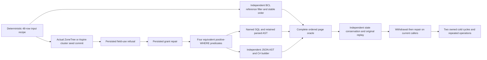

# Generated independent reference and predicate transformations

The [product specification](../../design/product-specification.md), QueryExecution REQ/AC-QUERY-001..006 and REQ/AC-SQLC-001/006 require behavioral differential evidence. The existing original 200-document/50-trial adapter operation and cross-adapter cursor operation remain mandatory. Their fixed status/threshold corpus does not itself establish generated null/missing/Unicode coverage or equivalent predicate transformations under both indexed and consented scan plans. This stage adds whole operations for that acceptance gap; it changes no product parser, evaluator, storage, authentication, limit, format or dependency.

| Criterion | Concrete operation and evidence boundary |
|---|---|
| REQ-SQLC-006 / AC-SQLC-006 generated scalar corpus | Two coprime-permutation seeds over48 independent IDs. Ten omitted scores, ten explicit JSON nulls, negative/zero/positive scores and both decimal extrema; composed/decomposed Unicode, emoji and Greek tags. fixture verifies corpus cardinalities and extrema. Input recipe and BCL reference are independent of KeyLoad query execution. |
| Equivalent predicates | With p=status equality, q=score>=1 and r=ordinal composed-tag equality: p AND(q OR r), (p AND q) OR(p AND r), (r OR q) AND p, and distributive form OR its repeated p AND q term. These preserve positive WHERE selection with nullable q; no Boolean negation or false general claim about two-valued null semantics. |
| SQL/JSON/C# and parsed paths | Actual selected ScriptDOM T-SQL named parameters with ORDER BY, OFFSET ROWS/FETCH NEXT. Independently authored JSON AST values and actual C# expression lowering. The parsed AST is retained after generated binary roundtrip and reused through policy changes/cold. This is a retained typed parsed request, not SQL PREPARE/wire portal qualification. C# has no Skip API: the existing canonical Offset is explicitly assigned after builder lowering. |
| Index/scan equivalence | Shape0/2 keep an AND-extractable status equality and must use literal index:by-status. Shape1/3 have OR roots and must use bounded-full-scan under explicit AllowFullScan. Every shape/input route matches the same independently filtered input rows; typed Explain additionally verifies complete literal path/partition/scan-budget plan. No cursor identity equivalence across logically different predicate trees is promised. |
| REQ/AC-QUERY-001..006 complete results and bounds | Page size3, both bucket directions with ordinal ID tie-break, offsets0/2. Every page has complete independent JSON/identity/revision/redaction/source metadata, stable continuation cut, exact path and opaque cursor presence/final termination. No result from one adapter supplies another adapter's expected rows. exact store cut is distinct from public opaque positive cut; public cuts are not compared across nodes or ordered against logical replication receipt positions. |
| Fresh authority and safe projection | A protected status field initially has Read but no Use; all four shapes/input routes fail before partial results. Persisted repair grants Use, withdrawal removes it, second repair restores it. Same warm SDK/official MCP callers observe both changes. Private title never appears in reader star output and has exact redacted-field metadata. Root full-image query still sees all original fields. frozen clock also checks original nonexpired cursor after policy repair rejects with CursorExpired; public new flow does not claim isolated old-cursor epoch proof. |
| No effects, replay and lifecycle | Every result/refusal independently checks entire actual canonical raw image, position and complete identity after primary assertions. seed/replay receipts include all five mutation fields and exact original outcome bytes. Public every response independently rereads all48 full original rows through one admin query and complete outbox; SDK/official MCP replay matches complete public four-field mutation receipts and full token. The fifth CompositionReferences field is JsonIgnore and has no public getter proof. Both real same-root reopens and both genuine Aspire-owned all-node cold attempts execute with joined disposal and retained failures. |

MetamorphicReferenceWholeFlowTests and MetamorphicPublicClusterTests each retain four source-declared seed/direction/offset cases. The approved readonly analyzer preflight retains exact input, analyzer/Roslyn DLL hashes and original findings; it does not bind types, compile, aggregate partial types or qualify runtime behavior.

Intentional dialect boundaries remain explicit: selected TSQL.ScriptDOM180, KeyLoad missing distinct from JSON null, ordinal Unicode/string comparison, bounded supported decimal arithmetic, canonical document metadata id, and explicit scan consent. The new query text uses no retired NULLS/FETCH FIRST/LIMIT/EXPLAIN grammar. typed Explain remains distinct. PostgreSQL-wire scalar-common cases, actual Npgsql session/portal protocol, existing SQL Boolean/null/distinct/offset/decimal suites, cancellation/admission and full SQL conformance are retained separate gates. This operation does not qualify PostgreSQL collation compatibility, all SQL semantics, every model operator, wire interoperability, measured performance, power loss or production readiness. Frontend and persisted migration are N/A.
