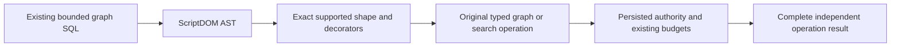

# graph AST acceptance repair

Canonical slice: QueryExecution. Linked GraphTraversal and Search use their unchanged direct-operation owners. Implements REQ-GRAPH-DOM-CONSUMER-001..004 and REQ-TSQL-001..004 through the existing operation cases; no new dialect, dependency, public API or storage format.

## Requirements and measurable acceptance

- REQ-GRAPH-AST-REPAIR-001 / AC-GRAPH-AST-REPAIR-001: ordinary supported nested graph-search calls must pass AST shape validation. Empty decorator collections are ordinary calls; nonempty unsupported decorations still refuse. The six original SqlGraphSearchParity operations retain every complete independent ranked/expansion result and direct-operation comparison.
- REQ-GRAPH-AST-REPAIR-002 / AC-GRAPH-AST-REPAIR-002: original wrong parameter/vector dimensions, denied label use, pre-cancellation and both result-composition caps reach their actual owning diagnostics. Preserve full atomic state, complete healthy continuation, original receipt and cancellation controls; UnsupportedCapability cannot substitute for a supported operation's Validation, PermissionDenied or BudgetExceeded.
- REQ-GRAPH-AST-REPAIR-003 / AC-GRAPH-AST-REPAIR-003: signed Int32 minimum and maximum literal/parameter values lower exactly before existing operation caps return BudgetExceeded. Fractions and nonrepresentable Int32 values remain Validation. One terminal semicolon remains accepted; a second remains Validation as specified by the original boundary case. Shared MainScalar parsing is outside this correction scope.
- REQ-GRAPH-AST-REPAIR-004 / AC-GRAPH-AST-REPAIR-004: the original vector attachment admission/scalar-state whole flows retain full literal ranks and independent state/refusal assertions; a parser shape failure must not conceal their intended authorization, attachment bounds or scalar-state refusals.

## Operation map

Parsing roles: ScriptDomGraphShape and ScriptDomGraphScalar, with a narrowly shared ScriptDomSyntax/ScriptDomTokenBounds internal consumer boundary. Existing scalar entry points preserve their original call signatures and structural diagnostics. Existing tests: SqlGraphSearchParityTests (6 failures), SqlGraphSearchRejectionTests (3), SqlGraphPathParameterBoundaryTests (2), AdapterVectorAttachmentWholeFlowTests (1), VectorAttachmentAdmissionWholeFlowTests (3), VectorAttachmentScalarStateWholeFlowTests (3). All original case names, arguments, whole results and healthy controls are preserved. Existing cluster consumers and their receipts/cold lifetimes remain unchanged and require Main's original execution evidence.

Frontend, protocol, migration, package adoption, benchmark changes: N/A. The owning repair follows [ADR-130](../../ADR/ADR-130-microsoft-scriptdom-tsql.md) and ScriptDOM AST contracts. Optional null return-type decoration and empty decorator collections remain absent decorations; nonempty collections remain unsupported. The code retains unsupported nonempty decorations, accepts digit-only numeric magnitude under unary negative within the exact signed Int32 bound, and rejects repeated trailing semicolons through the original token stream and budget/cancellation owner. The internal consumer boundary runs only after complete byte/token/comment/parenthesis quota accounting and before structural refusal. Default scalar parsing retains UnsupportedCapability for GO/extra-semicolon structure; Graph retains Validation for repeated trailing terminators. GO and second statements remain UnsupportedCapability. No duplicate tokenization, parse, text rewriting or broad exception remapping is used. No performance or durability claim.
