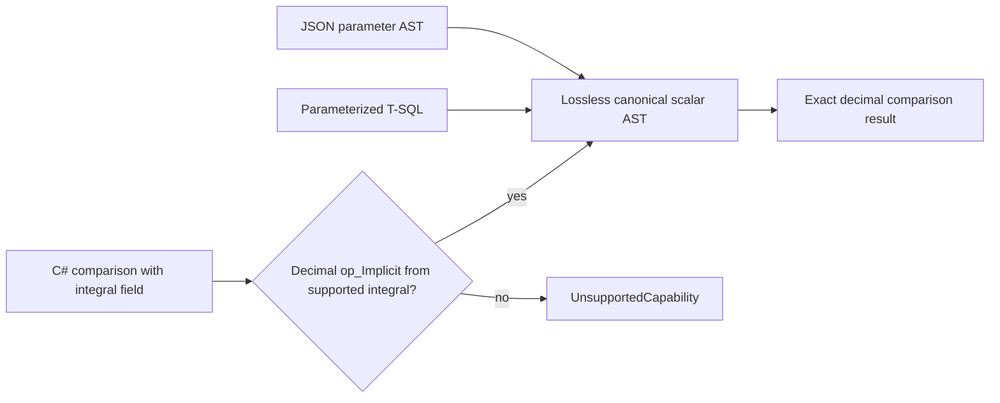

# Lossless integer and decimal adapter equivalence

Canonical slice: QueryExecution. Ordinary C# comparisons such as `row.IntNumber >= 1.5m` contain the actual System.Decimal.op_Implicit conversion method. The previous blanket method rejection made its own integral-to-decimal branch unreachable. Admit only the native Decimal-owned static op_Implicit with one exact supported integral input, Decimal return and Decimal target. No application conversion code is invoked; narrowing, floating conversion and nullable conversion admission are unchanged.

REQ-QUERY-INTEGER-DECIMAL-001: actual expression builders for all eight integral types and checked Int32 lower losslessly into the canonical scalar AST. Fractional and each original type-maximum boundary compare by exact decimal semantics. REQ-QUERY-INTEGER-DECIMAL-002: parameterized actual T-SQL, independently authored JSON parameter AST, C# literal AST and native serialized C# AST produce independently literal complete pages, exact order/cut/metadata/access path and no null/missing matches. REQ-QUERY-INTEGER-DECIMAL-003: exact persisted authority changes affect the same live QueryEngine; denial, repair, revocation and repair preserve all native bytes around reads. Full original seed receipts and same-ID replay survive two existing-only cold opens. AC-QUERY-INTEGER-DECIMAL-001: genuine whole Case seeds complete literal low/middle/upper/per-type-maximum/null/missing records and checks full receipt independently before all query waves. AC-QUERY-INTEGER-DECIMAL-002: actual user-defined conversion, float-to-decimal, decimal/integer narrowing, checked narrowing and formerly unsupported nullable lifted conversions remain exact UnsupportedCapability. The application operator invocation counter stays unchanged. All successful/refused query waves conserve original full image, cut and identity under joined failure ownership. AC-QUERY-INTEGER-DECIMAL-003: retain original C# property scalar data, SQL/AST version and source contract. No handwritten parser, implicit client evaluation, public endpoint or library is introduced.

UI N/A: query compilation and existing server operation. This packet adds native Unit coverage, not public cluster evidence. Actual framework reflection evidence proves expression metadata only. It does not prove repaired KeyLoad runtime success or performance.

