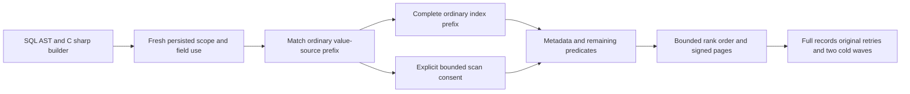

# Metadata-safe rule-based index matching

REQ-QUERY-002/003/005/006 and AC-QUERY-005/006; ADR-010, ADR-012, ADR-013, ADR-014 and ADR-020. This is a bounded optimizer correctness contributor, not complete optimizer acceptance.

## Producer and binding contract

`ResourceConfiguration.ValidateResourcePaths` admits concrete RFC6901 index paths, including `/@revision`. `Documents.IndexValues` reads canonical document JSON for every index component. In contrast, `PredicateEvaluator.FieldValue` resolves exactly `/@id` and `/@revision` to `DocumentRecord.Reference.Id` and decimal `DocumentRecord.Revision`. ScriptDomNames maps SQL `id` and `revision` into those reserved AST paths; the C# QueryFunctions markers use the same paths. The raw JSON property `@revision` remains caller data. An ordinary index over that property is not a metadata revision index.

Before the correction, index matching could seek raw body99 while a metadata revision1 row actually matched, yielding an empty or incomplete successful result. The shared `QueryCandidateReader.IndexPath` prefix now stops at either exact reserved metadata path. An earlier ordinary prefix remains eligible subject to the original whole-composite IncludeNull/IncludeMissing completeness guard; fields are not reordered. The existing id point path, residual predicate, store identity/cut, current row filtering, field-use binding, scan consent, candidate/result budgets and cancellation remain authoritative. No persisted index/resource/AST/cursor format or grammar changes.

| Requirement | Acceptance and complete operation contributors |
| --- | --- |
| REQ-QRO-001: candidate keys must use the same value source as predicate fields | AC-QRO-001: three real collection index shapes (revision-only, leading revision plus safe status fallback, trailing revision) and all four sparse flag pairs return independently authored rows equal to forced reference scans. |
| REQ-QRO-002: residual and top-prefix semantics survive safe matching | AC-QRO-002: metadata1/2, raw99 nonmatch and nested ordinary `nested.@revision` control preserve projected JSON, actual revisions, rank ordering, both TOP2 pages, cursor termination and bounded Explain accessPath/atomicPartition/scanBudget. |
| REQ-QRO-003: optimizer cannot bypass current authority or admission | AC-QRO-003: live persisted Use removal yields exact denied null results before candidates, repair on the same owner/key restores complete flows; implicit fallback without consent yields exact UnsupportedCapability. Before-cancel original caller tasks settle without effects and healthy operations follow. |
| REQ-QRO-004: canonical records and outcomes survive retry/recovery | AC-QRO-004: actual seed15 then CAS update3 produce literal full receipts; current full15 documents/raw shadows remain after every original seed/update replay. whole raw image/physical cut/owner and actual persisted outcome bytes remain unchanged; two joined same-root ZoneTree cold waves and two all-three Aspire cluster cold waves attempt independently. |

contributors: QueryRuleOptimizationWholeFlowTests.MetadataRevisionIndexPlansKeepResidualRowsAuthorityReplayAndTwoCold, four declared argument pairs. The actual TestDatabase applies commands through the canonical engine. Each complete ProcessDurable receipt is checked against an independently captured pre-operation canonical sequence and partition identity; every mutation retains the hidden CompositionReferences check and actual persisted outcome bytes. Real body revisions are a1/b2/c1/d1/e1 while raw shadows are99/1/2/missing/null. The second CAS batch is genuine database work, not a fixture-written authority counter.

Public contributors: QueryRuleOptimizationClusterTests.MetadataRevisionIndexPlansKeepPublicResultsFreshUseReplayAndTwoCold, four declared pairs. The actual Aspire-owned cluster app and persisted reader/key execute SDK Query, official MCP Query, unified SELECT through SDK and official MCP, C# builder/JSON AST through SDK and official MCP. Explain uses the admitted AST flag only. Every SDK and official MCP original command replay is followed by pure full documents/outbox conservation; the frozen baseline has18 real document changes. All five public CommitReceipt fields, including actual PersistedCopies, and all three CommitToken fields are observable; hidden CompositionReferences is JsonIgnored and belongs only to proof. Physical cuts are opaque across calls; continuations retain the captured cut only within their own sequence. Conservation is complete per whole observed wave and per replay, not per individual page.

The public Profile uses default fixed deadlines and serialized cluster fixtures; no duration increase. before-cancel is OCE/original token. SDK typed query and SQL SELECT are Cancelled/full fixed read-unavailable Problem with null/undefined values; official MCP is OCE/original token. This is pre-cancel proof, not held-I/O cancellation. No fabricated corruption endpoint, stored receipt, authority state, trusted role, provider, scale/performance claim or process/power-loss equivalence is added.

## Evidence boundaries

The planned eight argument operations are not a discovery census. Remaining route pruning, aggregates, bounded cost/fan-out Explain estimates, plan-cache signatures and unsafe-rewrite qualification retain their existing independent scope. Existing sparse-composite, reference and adapter suites remain mandatory; this batch does not replace them. No full SQL grammar, SQL wire protocol, production readiness, speed or durability claim follows.
