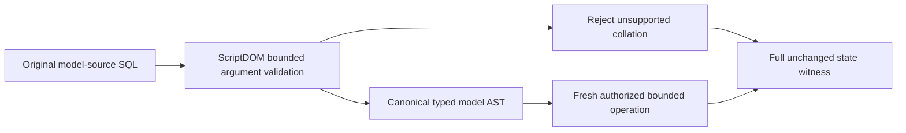

# Closed model-source argument binding

REQ-QUERY-FIELD-LINEAGE-001..003 binder acceptance and AC-TSQL-002/003/005 require whitelist/type constraints to survive names-to-model binding. Source-literal and verified named model-source arguments currently extract StringLiteral.Value or VariableReference.Name before constructing primitive ModelQuerySource names/generation. Unlike column/operand/projection paths, neither bind site checks inherited PrimaryExpression.Collation. The actual pinned180.140.0 parser preserves COLLATE on the six supported native argument shapes; upstream SlotVisitor only applies resource/slot rules and no downstream names validator receives these discarded annotations. This is a KeyLoad closed-lowering omission, not a ScriptDOM defect or demonstrated permission escalation.

Require an uncollated native scalar at the existing Identifier and Generation bind sites AFTER the original context observation. Refuse UnsupportedCapability with the existing fixed detail before catalog/read access. Keep missing/invalid parameter precedence for ordinary uncollated inputs, generation bounds, exact original values, fresh persisted authority, typed AST/serialization/version/identity and one native read cut. No text rewrite, comparer/collation implementation, parser fallback or new package.

The original Unit AcSqlView001EventAndQueueSourcesLowerToBoundedTypedAst method keeps every static native shape assertion and genuine seed/denial/repair/stale-generation/full literal pages/seed replay/two cold. Its repaired phase and both cold owners add six literal/named argument refusals with unchanged native diagnostics, whole captured native image/cut/identity and original seed replay even after primary failure; each same parameter pair then executes complete independent expected healthy event/queue pages and existing SQL/AST pages.

The original public InvalidSourcesAndModelCursorRejectBeforeScanning method retains its original errors/rows/timeout. Existing scenario retains the same seed Guid/payload and captures its entire original CommandRequest/CommitReceipt for SDK/official MCP replay, rather than discarding those objects. Additional original-owner SDK and official MCP refusal/healthy projected pages are independently literal. Each response observes primary then complete original event stream/both message inspections/outbox, full original receipt replay and conservation. Official clients settle/dispose before each of the two same-AppHost cold cuts; original SDK owner/token/endpoints remain. Public cuts remain opaque.

The original composed projection lineage classes continue to own protected nested/reference projection, forged source alias, predicate/reference Use revocation and two-cold proofs. Root/other owners'051 builder/062 pointer/045 capability surfaces are not changed.

